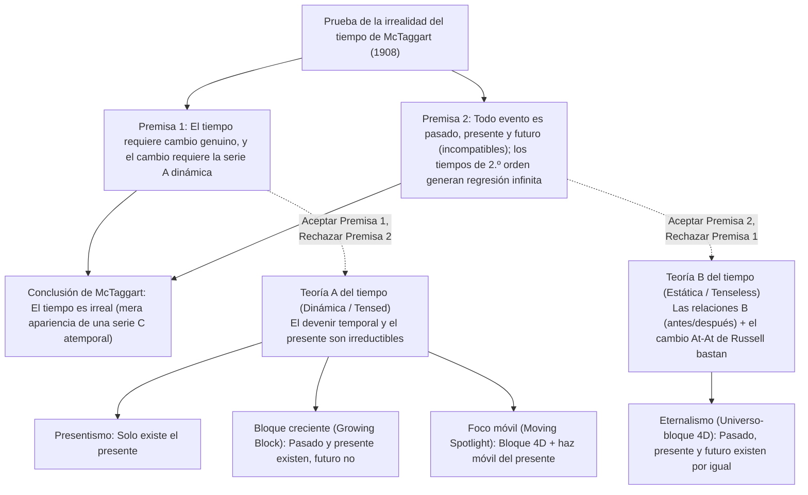
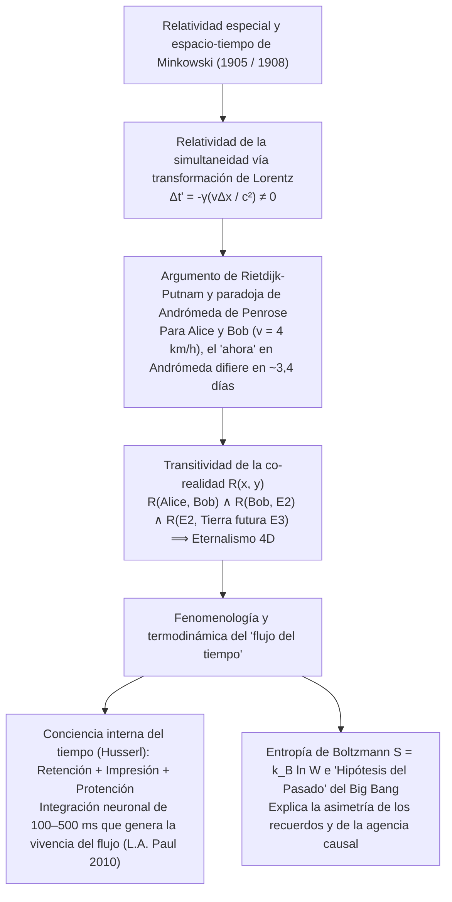

## 1. Introducción y «La irrealidad del tiempo» de J.M.E. McTaggart (1908)

Hacia el año 397 d. C., San Agustín escribió en sus *Confesiones* (Libro XI, 14): «¿Qué es, pues, el tiempo? Si nadie me lo pregunta, lo sé; pero si quiero explicárselo al que me lo pregunta, no lo sé». Según nuestra intuición cotidiana, el pasado (Sócrates, los dinosaurios) ya no existe y el futuro aún no existe; únicamente existe el «ahora» (el presente).

En 1908, el filósofo de Cambridge <strong>J.M.E. McTaggart</strong> publicó en *Mind* su célebre artículo *«The Unreality of Time»*, distinguiendo dos series temporales:
1. <strong>La serie A (dinámica / tensional):</strong> Ordena los eventos respecto al «ahora» como *futuros ($F(e)$)*, *presentes ($N(e)$)* y *pasados ($P(e)$)*. Su esencia es el cambio incesante de estas determinaciones.
2. <strong>La serie B (estática / atensional):</strong> Ordena los eventos mediante relaciones diádicas permanentes: *anterior a ($E(e_1, e_2)$)*, *simultáneo con* y *posterior a*.

La prueba deductiva en dos pasos de McTaggart sostiene que el tiempo es irreal:
* <strong>Premisa 1 (Sin serie A no hay cambio ni tiempo):</strong> El tiempo exige cambio. En una pura serie B (contra la teoría *At-At* de Bertrand Russell), las propiedades y fechas de los eventos permanecen eternamente fijas; lo único que cambia en un evento es su paso de futuro a presente y a pasado (serie A).
* <strong>Premisa 2 (Contradicción de la serie A y regresión infinita):</strong> Pasado $P(e)$, presente $N(e)$ y futuro $F(e)$ son mutuamente incompatibles, pero todo evento temporal debe poseer los tres:
  $$\forall e \, \Big( \neg\big(P(e) \land N(e)\big) \land \neg\big(N(e) \land F(e)\big) \Big) \quad \text{vs.} \quad \forall e \, \big( P(e) \land N(e) \land F(e) \big)$$
  Responder que «$e$ *fue* futuro, *es* presente y *será* pasado» introduce una <strong>serie A de segundo orden</strong> (matriz $3 \times 3$), cuya diagonal ($P(P(e)), N(N(e)), F(F(e))$) reproduce la misma contradicción, desatando una <strong>regresión infinita viciosa</strong> hacia tiempos de orden $3^n$.

---

## 2. Los cuatro modelos ontológicos del tiempo: Presentismo vs. Eternalismo

1. <strong>Presentismo (Arthur Prior, Ned Markosian):</strong> Solo existen los objetos y eventos presentes. Bloquea la regresión de McTaggart mediante operadores oracionales primitivos ($P, F$), pero choca contra la <strong>objeción del hacedor de verdad (Truthmaker Objection, Sider 2001)</strong> —¿qué entidad en el mero presente hace verdadero que «Existieron dinosaurios en el Cretácico»?— y el problema de las relaciones transtemporales.
2. <strong>Eternalismo / Universo-bloque 4D (Bertrand Russell, W.V.O. Quine, D.H. Mellor, Ted Sider):</strong> Pasado, presente y futuro existen en igualdad ontológica dentro de una variedad espacio-temporal cuatridimensional. «Ahora» es, al igual que «aquí», un puro <strong>indexical</strong> que señala la coordenada espacio-temporal del hablante.
3. <strong>Universo de bloque creciente (Growing Block, C.D. Broad 1923):</strong> El pasado y el presente existen, mientras que el futuro no existe; el «presente» es el borde de crecimiento del bloque. Sucumbe a la <strong>objeción epistémica del «pasado muerto» (Dead Past, Braddon-Mitchell 2004)</strong>: si Lincoln existe en la rebanada de 1863 creyendo vivir en el «ahora», ¿cómo sabemos que 2026 es el borde exterior del bloque y no parte del pasado muerto?
4. <strong>Teoría del foco móvil (Moving Spotlight, Ross Cameron 2015):</strong> Añade al bloque 4D un foco móvil de «presentidad absoluta», pero hereda el escepticismo epistémico y la paradoja de la velocidad del tiempo («un segundo por hipersegundo»).

| Criterio | Presentismo | Bloque creciente (Growing Block) | Foco móvil (Moving Spotlight) | Eternalismo (Universo-bloque 4D) |
| :--- | :--- | :--- | :--- | :--- |
| <strong>Campo metafísico</strong> | Teoría A (dinámica) | Teoría A (dinámica) | Teoría A (dinámica) | Teoría B (estática / atensional) |
| <strong>Estatus de pasado y futuro</strong> | Pasado <strong>no</strong>, Futuro <strong>no</strong> | Pasado <strong>sí</strong>, Futuro <strong>no</strong> | Pasado <strong>sí</strong>, Futuro <strong>sí</strong> | Pasado <strong>sí</strong>, Futuro <strong>sí</strong> |
| <strong>Naturaleza del «ahora»</strong> | La totalidad de la existencia | Borde ontológico de crecimiento | Propiedad monádica móvil | Indexical (como «aquí») |
| <strong>Hacedores de verdad del pasado</strong> | <strong>Grave problema</strong> | <strong>Resuelto</strong> (el pasado existe) | <strong>Resuelto</strong> (el pasado existe) | <strong>Resuelto</strong> (el bloque 4D existe) |
| <strong>Objeción epistémica</strong> | <strong>Inmune</strong> | <strong>Fatalmente vulnerable</strong> | <strong>Fatalmente vulnerable</strong> | <strong>Inmune</strong> (indexical en cada corte) |
| <strong>Relatividad especial</strong> | <strong>Incompatible</strong> sin éter | <strong>Incompatible</strong> sin foliación | <strong>Incompatible</strong> sin foliación | <strong>Directamente compatible</strong> (Minkowski) |

---

## 3. Relatividad especial, espacio-tiempo de Minkowski y la paradoja de Andrómeda

En la <strong>relatividad especial de Einstein (1905)</strong> y el <strong>espacio-tiempo cuatridimensional de Minkowski (1908)</strong>, el intervalo invariante es $ds^2 = -c^2 dt^2 + dx^2 + dy^2 + dz^2$. Por la <strong>transformación de Lorentz</strong>:

$$t' = \gamma \left( t - \frac{vx}{c^2} \right), \qquad \gamma = \frac{1}{\sqrt{1 - v^2/c^2}} \implies \Delta t' = \gamma \left( \Delta t - \frac{v \Delta x}{c^2} \right)$$

Dos eventos simultáneos en el marco $S$ ($\Delta t = 0$) separados por $\Delta x > 0$ <strong>no son simultáneos</strong> en $S'$ que se mueve a velocidad $v$ ($\Delta t' = -\gamma \frac{v \Delta x}{c^2} \neq 0$).

<strong>C.W. Rietdijk (1966)</strong> y <strong>Hilary Putnam (1967)</strong> demostraron que esto colapsa el presentismo en el eternalismo, ilustrado por la <strong>paradoja de Andrómeda de Roger Penrose (1989)</strong>: si Bob ($B$) camina a $v = 4\text{ km/h} \approx 1.11\text{ m/s}$ cruzándose con Alice ($A$) inmóvil en dirección a la galaxia de Andrómeda ($L = 2.5 \times 10^6\text{ años luz}$), sus hiperplanos de simultaneidad en Andrómeda difieren en:

$$\Delta t \approx \frac{v L}{c^2} = \left(\frac{1.11\text{ m/s}}{3.0 \times 10^8\text{ m/s}}\right) \times 2.5 \times 10^6\text{ años} \approx 3.38\text{ días}$$

Para Alice, el lanzamiento de una flota alienígena en Andrómeda aún no se ha decidido ($E_1$); ¡para Bob, la flota ya partió hace casi cuatro días ($E_2$)! Por la <strong>transitividad de la existencia</strong> $R(A, B) \land R(B, E_2) \land R(E_2, \text{Tierra futura } E_3)$, toda la variedad 4D de Minkowski coexiste atensionalmente.

---

## 4. ¿Por qué sentimos que el tiempo fluye? — Husserl, ciencia cognitiva y la flecha termodinámica

1. <strong>La fenomenología de Husserl y la neurociencia cognitiva:</strong> Para escuchar una melodía ($C \to E \to G$), cada «presente vivo» articula tres momentos intencionales: <strong>retención</strong> (conservación inmediata de la nota recién pasada), <strong>impresión originaria</strong> (nota actual) y <strong>protención</strong> (anticipación de la nota inminente). Como demostraron <strong>L.A. Paul (2010)</strong> y <strong>Craig Callender (2017)</strong>, cada estado cerebral $B(t_n)$ a lo largo de nuestra línea de universo 4D codifica simultáneamente (en una ventana de $100\text{–}500\text{ ms}$) huellas de memoria operativa de $t_{n-1}$ y modelos predictivos de $t_{n+1}$, generando necesariamente la fenomenología dinámica del paso del tiempo.
2. <strong>La mecánica estadística de Boltzmann y la «Hipótesis del Pasado» (Past Hypothesis):</strong> Aunque las leyes microfísicas son simétricas bajo inversión temporal ($t \to -t$), la <strong>flecha del tiempo</strong> macroscópica surge de la segunda ley de la termodinámica:
   $$S = k_B \ln W, \qquad \frac{dS}{dt} \geq 0$$
   Unida a la condición de contorno cosmológica de un Big Bang de entropía ultrabaja ($W_0 \ll W_{\max}$, la <strong>Past Hypothesis</strong> de David Albert, 2000), esta pendiente entrópica explica por qué los registros y recuerdos solo existen hacia el pasado y por qué nuestras decisiones solo ramifican el futuro.
