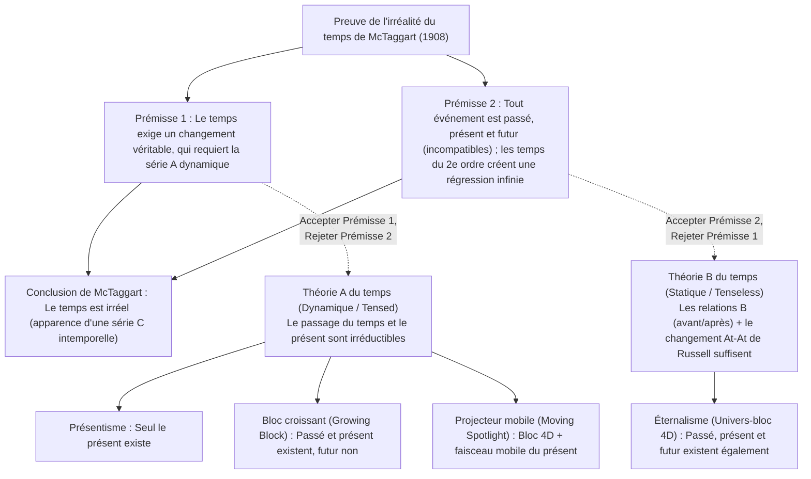
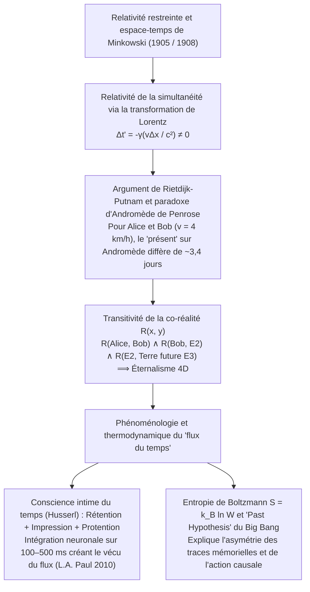

## 1. Introduction et « L'irréalité du temps » de J.M.E. McTaggart (1908)

Vers 397 apr. J.-C., saint Augustin écrivait dans ses *Confessions* (Livre XI, 14) : « Qu'est-ce donc que le temps ? Si personne ne me le demande, je le sais ; mais si je veux l'expliquer à qui me le demande, je ne le sais plus. » Selon notre intuition commune, le passé (Socrate, les dinosaures) n'existe plus et le futur n'existe pas encore ; seul existe le « maintenant » (le présent).

En 1908, le philosophe de Cambridge <strong>J.M.E. McTaggart</strong> publia dans *Mind* son article fondateur *« The Unreality of Time »*, distinguant deux séries temporelles :
1. <strong>La série A (dynamique / temporelle) :</strong> Ordonne les événements par rapport au « maintenant » comme *futurs ($F(e)$)*, *présents ($N(e)$)* et *passés ($P(e)$)*. Son essence est le changement incessant de ces déterminations.
2. <strong>La série B (statique / sans temps grammatical) :</strong> Ordonne les événements par des relations dyadiques permanentes : *antérieur à ($E(e_1, e_2)$)*, *simultané avec* et *postérieur à*.

La preuve en deux étapes de McTaggart démontre que le temps est irréel :
* <strong>Prémisse 1 (Pas de temps sans série A) :</strong> Le temps implique le changement. Or, dans une pure série B (contre la théorie *At-At* de Bertrand Russell), les propriétés et dates des événements restent éternellement fixes ; seul change leur passage du futur au présent puis au passé (série A).
* <strong>Prémisse 2 (Contradiction de la série A et régression à l'infini) :</strong> Passé $P(e)$, présent $N(e)$ et futur $F(e)$ sont mutuellement incompatibles, mais tout événement temporel doit posséder les trois :
  $$\forall e \, \Big( \neg\big(P(e) \land N(e)\big) \land \neg\big(N(e) \land F(e)\big) \Big) \quad \text{vs.} \quad \forall e \, \big( P(e) \land N(e) \land F(e) \big)$$
  Répondre que « $e$ *était* futur, *est* présent et *sera* passé » invoque une <strong>série A de second ordre</strong> (matrice $3 \times 3$), où la diagonale ($P(P(e)), N(N(e)), F(F(e))$) reproduit la même contradiction, déclenchant une <strong>régression vicieuse à l'infini</strong> vers des temps d'ordre $3^n$.

---

## 2. Les quatre modèles ontologiques du temps : Présentisme vs. Éternalisme

1. <strong>Présentisme (Arthur Prior, Ned Markosian) :</strong> Seuls les objets et événements présents existent. Il bloque la régression de McTaggart par des opérateurs temporels primitifs ($P, F$), mais se heurte à l'<strong>objection du vérificateur (Truthmaker Objection, Sider 2001)</strong> — qu'est-ce qui, dans le seul monde présent, rend vraie la proposition « Des dinosaures ont vécu au Crétacé » ? — et au problème des relations trans-temporelles.
2. <strong>Éternalisme / Univers-bloc 4D (Bertrand Russell, W.V.O. Quine, D.H. Mellor, Ted Sider) :</strong> Passé, présent et futur existent sur un pied d'égalité dans l'espace-temps quadridimensionnel. « Maintenant » est, tout comme « ici », un pur <strong>indexical</strong> désignant la coordonnée spatio-temporelle du locuteur.
3. <strong>Univers-bloc croissant (Growing Block, C.D. Broad 1923) :</strong> Le passé et le présent existent, mais non le futur ; le « présent » est le bord de croissance du bloc. Il succombe à l'<strong>objection épistémique du « passé mort » (Dead Past, Braddon-Mitchell 2004)</strong> : si Lincoln existe dans la tranche de 1863 en croyant vivre « maintenant », comment savons-nous que 2026 est au bord externe du bloc plutôt qu'enfoui dans le passé mort ?
4. <strong>Projecteur mobile (Moving Spotlight, Ross Cameron 2015) :</strong> Ajoute au bloc 4D un projecteur de « présentité absolue », mais hérite du scepticisme épistémique et du paradoxe de la vitesse du temps (« une seconde par hyper-seconde »).

| Critère | Présentisme | Bloc croissant (Growing Block) | Projecteur mobile | Éternalisme (Univers-bloc 4D) |
| :--- | :--- | :--- | :--- | :--- |
| <strong>Camp métaphysique</strong> | Théorie A (dynamique) | Théorie A (dynamique) | Théorie A (dynamique) | Théorie B (statique / sans temps) |
| <strong>Statut du passé et du futur</strong> | Passé <strong>non</strong>, Futur <strong>non</strong> | Passé <strong>oui</strong>, Futur <strong>non</strong> | Passé <strong>oui</strong>, Futur <strong>oui</strong> | Passé <strong>oui</strong>, Futur <strong>oui</strong> |
| <strong>Nature de « maintenant »</strong> | La totalité de l'existence | Bord ontologique de croissance | Propriété monadique mobile | Indexical (comme « ici ») |
| <strong>Vérificateurs du passé</strong> | <strong>Grave problème</strong> | <strong>Résolu</strong> (le passé existe) | <strong>Résolu</strong> (le passé existe) | <strong>Résolu</strong> (le bloc 4D existe) |
| <strong>Objection épistémique</strong> | <strong>Immunisé</strong> | <strong>Fatalement vulnérable</strong> | <strong>Fatalement vulnérable</strong> | <strong>Immunisé</strong> (indexical partout) |
| <strong>Relativité restreinte</strong> | <strong>Incompatible</strong> sans éther | <strong>Incompatible</strong> sans feuilletage | <strong>Incompatible</strong> sans feuilletage | <strong>Directement compatible</strong> (Minkowski) |

---

## 3. Relativité restreinte, espace-temps de Minkowski et le paradoxe d'Andromède

Dans la <strong>relativité restreinte d'Einstein (1905)</strong> et l'<strong>espace-temps quadridimensionnel de Minkowski (1908)</strong>, l'intervalle invariant est $ds^2 = -c^2 dt^2 + dx^2 + dy^2 + dz^2$. Par la <strong>transformation de Lorentz</strong> :

$$t' = \gamma \left( t - \frac{vx}{c^2} \right), \qquad \gamma = \frac{1}{\sqrt{1 - v^2/c^2}} \implies \Delta t' = \gamma \left( \Delta t - \frac{v \Delta x}{c^2} \right)$$

Deux événements simultanés dans le référentiel $S$ ($\Delta t = 0$) séparés par $\Delta x > 0$ ne sont <strong>pas simultanés</strong> dans $S'$ en mouvement à vitesse $v$ ($\Delta t' = -\gamma \frac{v \Delta x}{c^2} \neq 0$).

<strong>C.W. Rietdijk (1966)</strong> et <strong>Hilary Putnam (1967)</strong> en ont déduit l'effondrement du présentisme dans l'éternalisme, illustré par le <strong>paradoxe d'Andromède de Roger Penrose (1989)</strong> : si Bob ($B$) marche à $v = 4\text{ km/h} \approx 1.11\text{ m/s}$ en croisant Alice ($A$) immobile en direction de la galaxie d'Andromède ($L = 2.5 \times 10^6\text{ années-lumière}$), leurs hyperplans de simultanéité sur Andromède diffèrent de :

$$\Delta t \approx \frac{v L}{c^2} = \left(\frac{1.11\text{ m/s}}{3.0 \times 10^8\text{ m/s}}\right) \times 2.5 \times 10^6\text{ ans} \approx 3.38\text{ jours}$$

Pour Alice, le lancement d'une flotte extraterrestre sur Andromède est encore indécis ($E_1$) ; pour Bob, la flotte est déjà partie depuis près de quatre jours ($E_2$) ! Par la <strong>transitivité de l'existence</strong> $R(A, B) \land R(B, E_2) \land R(E_2, \text{Terre future } E_3)$, toute la variété 4D de Minkowski coexiste intemporellement.

---

## 4. Pourquoi sentons-nous le temps couler ? — Husserl, sciences cognitives et flèche thermodynamique

1. <strong>La phénoménologie de Husserl et les neurosciences cognitives :</strong> Pour percevoir une mélodie ($C \to E \to G$), chaque « présent vivant » unit trois visées : la <strong>rétention</strong> (maintien immédiat de la note qui vient de passer), l'<strong>impression originaire</strong> (note présente) et la <strong>protention</strong> (anticipation de la note imminente). Comme l'ont montré <strong>L.A. Paul (2010)</strong> et <strong>Craig Callender (2017)</strong>, chaque état cérébral $B(t_n)$ le long de notre ligne d'univers 4D encode simultanément (sur une fenêtre de $100\text{ à }500\text{ ms}$) les traces mémorielles de $t_{n-1}$ et les modèles prédictifs de $t_{n+1}$, engendrant l'expérience qualitative d'un flux continu.
2. <strong>La mécanique statistique de Boltzmann et l'« Hypothèse du Passé » (Past Hypothesis) :</strong> Alors que les lois microscopiques sont symétriques par renversement du temps ($t \to -t$), la <strong>flèche du temps</strong> macroscopique découle du second principe de la thermodynamique :
   $$S = k_B \ln W, \qquad \frac{dS}{dt} \geq 0$$
   Jointe à la condition aux limites cosmologique d'un Big Bang à très basse entropie ($W_0 \ll W_{\max}$, la <strong>Past Hypothesis</strong> de David Albert, 2000), cette croissance d'entropie explique pourquoi les souvenirs et traces ne se forment que vers le passé et pourquoi nos décisions n'infléchissent que le futur.
