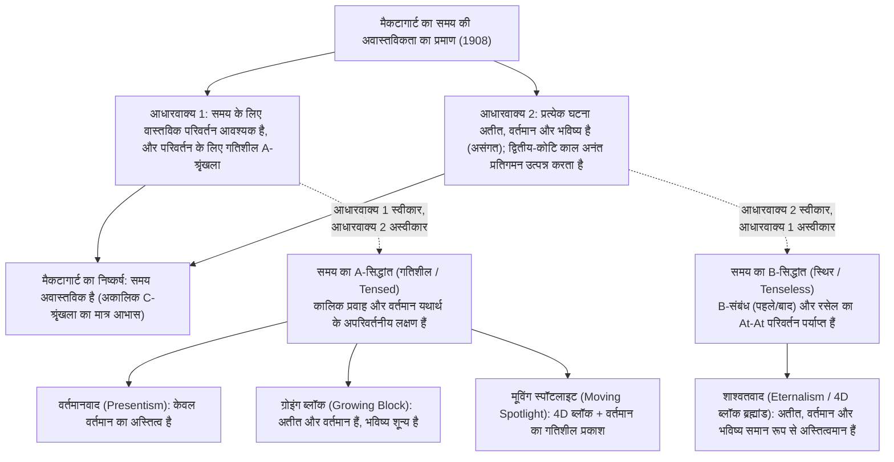
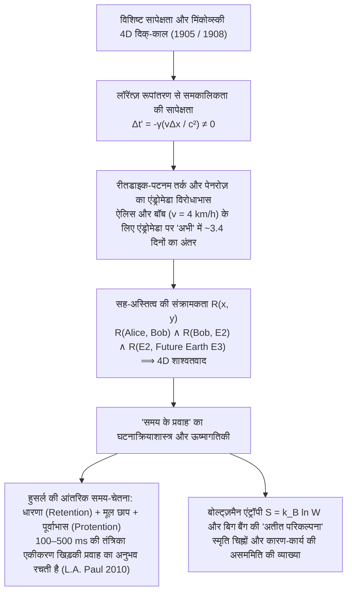

## 1. प्रस्तावना और जे.एम.ई. मैकटागार्ट का "द अनरियलिटी ऑफ टाइम" (1908)

लगभग 397 ईस्वी में, संत ऑगस्टीन ने अपनी पुस्तक *कन्फेशंस* (*Confessiones*, पुस्तक XI, 14) में प्रसिद्ध पहेली लिखी थी: "तो फिर समय क्या है? यदि कोई मुझसे नहीं पूछता, तो मैं जानता हूँ; किंतु यदि मैं पूछने वाले को समझाना चाहूँ, तो मैं नहीं जानता।" हमारे सामान्य अंतर्ज्ञान के अनुसार, अतीत (सुकरात, डायनासोर) अब अस्तित्व में नहीं है और भविष्य अभी अस्तित्व में नहीं आया है; केवल उस्तरे की धार जैसा तीक्ष्ण "अभी" (वर्तमान) ही वास्तविक है।

1908 में, कैम्ब्रिज के दार्शनिक <strong>जे.एम.ई. मैकटागार्ट (J.M.E. McTaggart)</strong> ने *Mind* पत्रिका में अपना युगांतरकारी शोधपत्र *"The Unreality of Time"* प्रकाशित किया, जिसमें समय में घटनाओं के क्रम को दो श्रृंखलाओं में विभाजित किया गया:
1. <strong>A-श्रृंखला (गतिशील / काल-सापेक्ष):</strong> घटनाओं को "अभी" के सापेक्ष *भविष्य ($F(e)$)*, *वर्तमान ($N(e)$)* और *अतीत ($P(e)$)* के रूप में क्रमबद्ध करती है। इसका सार इन निर्धारणों का निरंतर परिवर्तन है।
2. <strong>B-श्रृंखला (स्थिर / काल-निरपेक्ष):</strong> घटनाओं को स्थायी द्वि-आधारी संबंधों — *से पहले ($E(e_1, e_2)$)*, *के समकालिक*, और *के बाद* — द्वारा क्रमबद्ध करती है।

समय की अवास्तविकता के लिए मैकटागार्ट का दो-चरणीय निगमनात्मक प्रमाण इस प्रकार है:
* <strong>आधारवाक्य 1 (A-श्रृंखला के बिना कोई परिवर्तन या समय नहीं):</strong> समय के लिए परिवर्तन आवश्यक है। शुद्ध B-श्रृंखला में (बर्ट्रेंड रसेल के *At-At* परिवर्तन सिद्धांत के विरुद्ध), किसी घटना के गुण और तिथियाँ सदैव स्थिर रहती हैं; घटना में केवल यही बदल सकता है कि वह भविष्य से वर्तमान और फिर अतीत में खिसकती है (A-श्रृंखला)।
* <strong>आधारवाक्य 2 (A-श्रृंखला का अंतर्विरोध और दुष्ट अनंत प्रतिगमन):</strong> अतीत $P(e)$, वर्तमान $N(e)$ और भविष्य $F(e)$ परस्पर असंगत हैं, फिर भी समय के प्रवाह के कारण प्रत्येक घटना $e$ में तीनों गुण होने चाहिए:
  $$\forall e \, \Big( \neg\big(P(e) \land N(e)\big) \land \neg\big(N(e) \land F(e)\big) \Big) \quad \text{vs.} \quad \forall e \, \big( P(e) \land N(e) \land F(e) \big)$$
  यह उत्तर देना कि "$e$ भविष्य *था*, वर्तमान *है*, और अतीत *होगा*" एक <strong>द्वितीय-कोटि की A-श्रृंखला</strong> ($3 \times 3$ आव्यूह) को जन्म देता है, जिसके मुख्य विकर्ण ($P(P(e)), N(N(e)), F(F(e))$) पर वही विरोधाभास पुनः प्रकट होता है, जिससे $3^n$ कोटि की ओर <strong>दुष्ट अनंत प्रतिगमन (Vicious Infinite Regress)</strong> शुरू हो जाता है।

---

## 2. समय के चार सत्तामीमांसीय मॉडल: वर्तमानवाद बनाम शाश्वतवाद

1. <strong>वर्तमानवाद (Presentism — आर्थर प्रायर, नेड मार्कोसियन):</strong> केवल वर्तमान वस्तुएँ और घटनाएँ अस्तित्व में हैं। यह आदिम काल-संकारकों ($P, F$) द्वारा मैकटागार्ट के प्रतिगमन को रोकता है, किंतु <strong>सत्य-निर्माता आपत्ति (Truthmaker Objection, Sider 2001)</strong> — यदि अतीत का अस्तित्व ही नहीं है, तो "क्रिटेशियस युग में डायनासोर थे" को कौन-सा वर्तमान तथ्य सत्य बनाता है? — और अंतर-कालिक संबंधों की समस्या से घिर जाता है।
2. <strong>शाश्वतवाद / 4D ब्लॉक ब्रह्मांड (Eternalism — रसेल, क्वाइन, मेलर, टेड साइडर):</strong> अतीत, वर्तमान और भविष्य चार-आयामी दिक्-काल (spacetime) में समान सत्तामीमांसीय स्तर पर अस्तित्वमान हैं। "अभी" (Now) — ठीक स्थानिक शब्द "यहाँ" (Here) की तरह — एक शुद्ध <strong>सूचकांकिक पद (Indexical)</strong> है जो वक्ता के दिक्-काल निर्देशांक को इंगित करता है।
3. <strong>ग्रोइंग ब्लॉक ब्रह्मांड (Growing Block — सी.डी. ब्रॉड 1923):</strong> अतीत और वर्तमान अस्तित्व में हैं, किंतु भविष्य नहीं; "वर्तमान" ब्लॉक के विकास का सबसे बाहरी किनारा है। यह <strong>"मृत अतीत" (Dead Past) की ज्ञानमीमांसीय आपत्ति (Braddon-Mitchell 2004)</strong> के आगे विफल हो जाता है: यदि 1863 के स्लाइस में लिंकन मौजूद हैं और मानते हैं कि वे "अभी" में जी रहे हैं, तो हम कैसे जानते हैं कि 2026 ब्लॉक का बाहरी किनारा है, न कि मृत अतीत का एक हिस्सा?
4. <strong>मूविंग स्पॉटलाइट सिद्धांत (Moving Spotlight — रॉस कैमरून 2015):</strong> 4D ब्लॉक में "परम वर्तमानता" का गतिशील प्रकाश जोड़ता है, किंतु ज्ञानमीमांसीय संशयवाद और समय के प्रवाह की दर ("एक सेकंड प्रति हाइपर-सेकंड") के विरोधाभास से ग्रस्त रहता है।

| मानदंड | वर्तमानवाद (Presentism) | ग्रोइंग ब्लॉक (Growing Block) | मूविंग स्पॉटलाइट | शाश्वतवाद (4D ब्लॉक ब्रह्मांड) |
| :--- | :--- | :--- | :--- | :--- |
| <strong>तत्त्वमीमांसीय खेमा</strong> | A-सिद्धांत (गतिशील) | A-सिद्धांत (गतिशील) | A-सिद्धांत (गतिशील) | B-सिद्धांत (स्थिर / काल-निरपेक्ष) |
| <strong>अतीत व भविष्य की सत्ता</strong> | अतीत <strong>नहीं</strong>, भविष्य <strong>नहीं</strong> | अतीत <strong>हाँ</strong>, भविष्य <strong>नहीं</strong> | अतीत <strong>हाँ</strong>, भविष्य <strong>हाँ</strong> | अतीत <strong>हाँ</strong>, भविष्य <strong>हाँ</strong> |
| <strong>"अभी" की प्रकृति</strong> | संपूर्ण अस्तित्व | अस्तित्व के विकास का अग्रभाग | गतिशील एकल गुण | सूचकांकिक पद ("यहाँ" के समान) |
| <strong>अतीत के सत्य-निर्माता</strong> | <strong>गंभीर समस्या</strong> | <strong>सुलझा हुआ</strong> (अतीत ब्लॉक में है) | <strong>सुलझा हुआ</strong> (अतीत ब्लॉक में है) | <strong>सुलझा हुआ</strong> (4D ब्लॉक मौजूद है) |
| <strong>ज्ञानमीमांसीय आपत्ति</strong> | <strong>सुरक्षित</strong> | <strong>घातक रूप से असुरक्षित</strong> | <strong>घातक रूप से असुरक्षित</strong> | <strong>सुरक्षित</strong> (प्रत्येक स्लाइस पर सूचकांकिक) |
| <strong>विशिष्ट सापेक्षता</strong> | ईथर के बिना <strong>असंगत</strong> | वैश्विक स्तरण के बिना <strong>असंगत</strong> | वैश्विक स्तरण के बिना <strong>असंगत</strong> | <strong>पूर्णतः संगत</strong> (मिंकोव्स्की दिक्-काल) |

---

## 3. विशिष्ट सापेक्षता सिद्धांत, मिंकोव्स्की दिक्-काल और एंड्रोमेडा विरोधाभास

आइंस्टीन के <strong>विशिष्ट सापेक्षता सिद्धांत (1905)</strong> और हरमन मिंकोव्स्की के <strong>चार-आयामी दिक्-काल (1908)</strong> में अपरिवर्तनीय अंतराल $ds^2 = -c^2 dt^2 + dx^2 + dy^2 + dz^2$ है। <strong>लॉरेंत्ज़ रूपांतरण (Lorentz Transformation)</strong> के अनुसार:

$$t' = \gamma \left( t - \frac{vx}{c^2} \right), \qquad \gamma = \frac{1}{\sqrt{1 - v^2/c^2}} \implies \Delta t' = \gamma \left( \Delta t - \frac{v \Delta x}{c^2} \right)$$

तंत्र $S$ में $\Delta x > 0$ दूरी पर एक साथ घटित होने वाली दो घटनाएँ ($\Delta t = 0$), $v$ वेग से गतिमान तंत्र $S'$ में <strong>समकालिक नहीं होतीं</strong> ($\Delta t' = -\gamma \frac{v \Delta x}{c^2} \neq 0$)।

<strong>सी.डब्ल्यू. रीतडाइक (1966)</strong> और <strong>हिलरी पटनम (1967)</strong> ने सिद्ध किया कि इससे वर्तमानवाद ढहकर शाश्वतवाद में बदल जाता है, जिसे <strong>रोजर पेनरोज़ (1989)</strong> के <strong>एंड्रोमेडा विरोधाभास (Andromeda Paradox)</strong> द्वारा दर्शाया गया है: यदि बॉब ($B$) पृथ्वी पर स्थिर खड़ी ऐलिस ($A$) के पास से $v = 4\text{ km/h} \approx 1.11\text{ m/s}$ की सामान्य चाल से $L = 2.5 \times 10^6\text{ प्रकाश-वर्ष}$ दूर स्थित एंड्रोमेडा आकाशगंगा की ओर चलता है, तो एंड्रोमेडा पर उनके समकालिकता के समतल में इतना अंतर होगा:

$$\Delta t \approx \frac{v L}{c^2} = \left(\frac{1.11\text{ m/s}}{3.0 \times 10^8\text{ m/s}}\right) \times 2.5 \times 10^6\text{ वर्ष} \approx 3.38\text{ दिन}$$

ऐलिस के वर्तमान में एंड्रोमेडा के एलियन बेड़े ने अभी आक्रमण का निर्णय नहीं लिया है ($E_1$), जबकि बॉब के वर्तमान में बेड़ा लगभग चार दिन पहले ही रवाना हो चुका है ($E_2$)! <strong>अस्तित्व की संक्रामकता (Transitivity of Existence)</strong> $R(A, B) \land R(B, E_2) \land R(E_2, \text{भविष्य की पृथ्वी } E_3)$ के कारण संपूर्ण 4D मिंकोव्स्की दिक्-काल सह-अस्तित्व में है।

---

## 4. समय बहता हुआ क्यों प्रतीत होता है? — हुसर्ल, संज्ञानात्मक विज्ञान और ऊष्मागतिक तीर

1. <strong>एडमंड हुसर्ल का घटनाक्रियाशास्त्र और संज्ञानात्मक तंत्रिका विज्ञान:</strong> किसी संगीत धुन ($C \to E \to G$) को सुनने के लिए प्रत्येक "जीवंत वर्तमान" में तीन आयाम होते हैं: <strong>धारणा (Retention)</strong> (अभी-अभी बीते स्वर की पकड़), <strong>मूल छाप (Urimpression)</strong> (वर्तमान स्वर), और <strong>पूर्वाभास (Protention)</strong> (आगामी स्वर की अपेक्षा)। जैसा कि <strong>एल.ए. पॉल (2010)</strong> और <strong>क्रेग कैलेंडर (2017)</strong> ने दिखाया है, हमारी 4D विश्व-रेखा पर प्रत्येक मस्तिष्क अवस्था $B(t_n)$ लगभग $100\text{–}500\text{ ms}$ की एकीकरण खिड़की में $t_{n-1}$ के कार्यशील स्मृति चिह्नों और $t_{n+1}$ के भविष्यसूचक मॉडलों को एक साथ कूटबद्ध करती है, जिससे गतिशील प्रवाह का जीवंत अनुभव स्वतः उत्पन्न होता है।
2. <strong>बोल्ट्ज़मैन की सांख्यिकीय यांत्रिकी और "अतीत परिकल्पना" (Past Hypothesis):</strong> यद्यपि सूक्ष्म भौतिक नियम समय-उत्क्रमण ($t \to -t$) के प्रति सममित हैं, तथापि स्थूल <strong>समय का तीर (Arrow of Time)</strong> ऊष्मागतिकी के द्वितीय नियम से उत्पन्न होता है:
   $$S = k_B \ln W, \qquad \frac{dS}{dt} \geq 0$$
   13.8 अरब वर्ष पूर्व बिग बैंग की अति-निम्न एंट्रॉपी सीमा शर्त ($W_0 \ll W_{\max}$, डेविड अल्बर्ट की <strong>Past Hypothesis</strong>, 2000) के साथ मिलकर यह एंट्रॉपी प्रवणता स्पष्ट करती है कि स्मृति चिह्न केवल अतीत की दिशा में ही क्यों बनते हैं और हमारे निर्णय केवल भविष्य को ही क्यों प्रभावित करते हैं।
