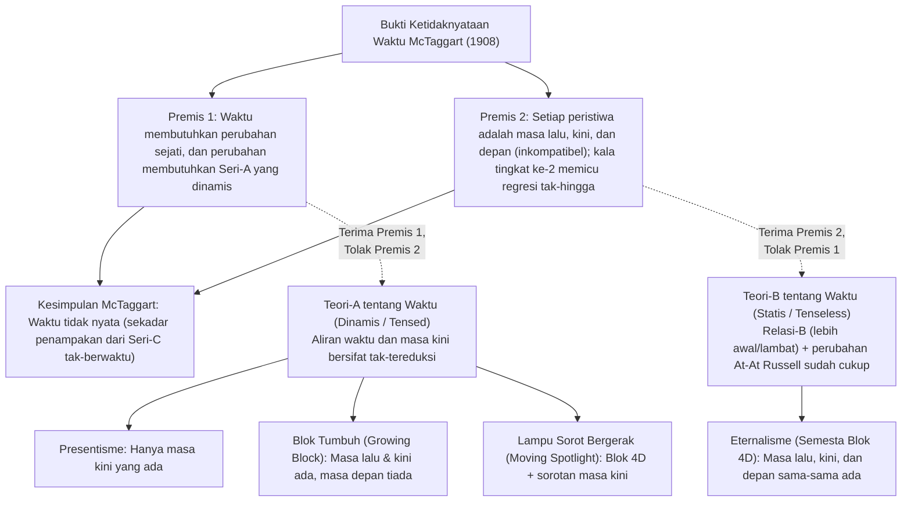
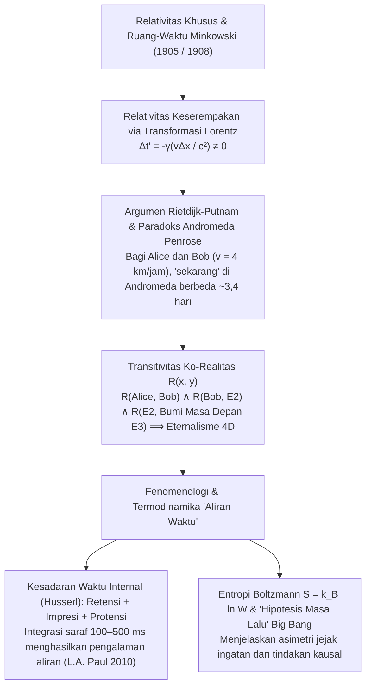

## 1. Pendahuluan dan "Ketidaknyataan Waktu" Karya J.M.E. McTaggart (1908)

Sekitar tahun 397 M, Santo Agustinus menulis dalam *Confessiones* (Buku XI, 14): "Apakah gerangan waktu itu? Jika tidak ada yang bertanya kepadaku, aku tahu; tetapi jika aku ingin menjelaskannya kepada orang yang bertanya, aku tidak tahu." Menurut intuisi sehari-hari kita, masa lalu (Sokrates, dinosaurus) sudah tidak ada lagi dan masa depan belum ada; satu-satunya yang sungguh-sungguh ada hanyalah "sekarang" (masa kini).

Pada tahun 1908, filsuf Cambridge <strong>J.M.E. McTaggart</strong> menerbitkan makalah terkenalnya *"The Unreality of Time"* di jurnal *Mind*, yang membedakan dua deret waktu:
1. <strong>Seri-A (dinamis / berkala-waktu):</strong> Mengurutkan peristiwa relatif terhadap "sekarang" sebagai *masa depan ($F(e)$)*, *masa kini ($N(e)$)*, dan *masa lalu ($P(e)$)*. Esensinya adalah perubahan terus-menerus dari determinasi ini.
2. <strong>Seri-B (statis / tak-berkala):</strong> Mengurutkan peristiwa melalui relasi diadik permanen: *lebih awal daripada ($E(e_1, e_2)$)*, *serempak dengan*, dan *lebih lambat daripada*.

Bukti deduktif dua langkah McTaggart menyimpulkan bahwa waktu itu tidak nyata:
* <strong>Premis 1 (Tanpa seri-A tidak ada perubahan maupun waktu):</strong> Waktu mensyaratkan perubahan. Dalam seri-B murni (melawan teori perubahan *At-At* Bertrand Russell), semua sifat dan tanggal peristiwa tetap abadi; satu-satunya yang berubah pada suatu peristiwa adalah pergerakannya dari masa depan ke masa kini lalu ke masa lalu (seri-A).
* <strong>Premis 2 (Kontradiksi seri-A dan regresi tak-hingga yang ganas):</strong> Masa lalu $P(e)$, masa kini $N(e)$, dan masa depan $F(e)$ saling tidak kompatibel, namun setiap peristiwa waktu harus memiliki ketiganya:
  $$\forall e \, \Big( \neg\big(P(e) \land N(e)\big) \land \neg\big(N(e) \land F(e)\big) \Big) \quad \text{vs.} \quad \forall e \, \big( P(e) \land N(e) \land F(e) \big)$$
  Menjawab bahwa "$e$ *dulunya* masa depan, *kini* masa kini, dan *kelak* masa lalu" memperkenalkan <strong>seri-A tingkat kedua</strong> (matriks $3 \times 3$), yang diagonal utamanya ($P(P(e)), N(N(e)), F(F(e))$) mengulangi kontradiksi yang sama, memicu <strong>regresi tak-hingga yang ganas (vicious infinite regress)</strong> menuju waktu tingkat $3^n$.

---

## 2. Empat Model Ontologis Waktu: Presentisme vs. Eternalisme

1. <strong>Presentisme (Arthur Prior, Ned Markosian):</strong> Hanya objek dan peristiwa masa kini yang ada. Ia memblokir regresi McTaggart lewat operator kalimat primitif ($P, F$), tetapi terbentur <strong>Keberatan Pembuat-Kebenaran (Truthmaker Objection, Sider 2001)</strong> — apa di dunia masa kini semata yang membuat kalimat "Dinosaurus hidup pada zaman Kapur" bernilai benar? — serta masalah relasi lintas-waktu.
2. <strong>Eternalisme / Semesta Blok 4D (Bertrand Russell, W.V.O. Quine, D.H. Mellor, Ted Sider):</strong> Masa lalu, masa kini, dan masa depan semuanya ada secara setara di dalam manifold ruang-waktu empat dimensi. "Sekarang" — persis seperti "di sini" — hanyalah <strong>indeksikal (indexical)</strong> yang menunjuk koordinat ruang-waktu si pembicara.
3. <strong>Semesta Blok Tumbuh (Growing Block, C.D. Broad 1923):</strong> Masa lalu dan masa kini ada, sedangkan masa depan tidak ada; "masa kini" adalah tepi pertumbuhan blok. Model ini runtuh oleh <strong>keberatan epistemik "Masa Lalu Mati" (Dead Past, Braddon-Mitchell 2004)</strong>: jika Lincoln ada di irisan tahun 1863 sambil meyakini dirinya hidup di "masa kini", bagaimana kita tahu bahwa tahun 2026 berada di tepi terluar blok dan bukan terkubur di masa lalu mati?
4. <strong>Teori Lampu Sorot Bergerak (Moving Spotlight, Ross Cameron 2015):</strong> Menambahkan sorotan "kemasakinian mutlak" yang bergerak di atas blok 4D, namun mewarisi skeptisisme epistemik serta paradoks laju aliran waktu ("satu detik per hiper-detik").

| Kriteria | Presentisme | Blok Tumbuh (Growing Block) | Lampu Sorot Bergerak | Eternalisme (Semesta Blok 4D) |
| :--- | :--- | :--- | :--- | :--- |
| <strong>Kubu Metafisika</strong> | Teori-A (dinamis) | Teori-A (dinamis) | Teori-A (dinamis) | Teori-B (statis / tak-berkala) |
| <strong>Status Masa Lalu & Depan</strong> | Lalu <strong>tidak</strong>, Depan <strong>tidak</strong> | Lalu <strong>ada</strong>, Depan <strong>tidak</strong> | Lalu <strong>ada</strong>, Depan <strong>ada</strong> | Lalu <strong>ada</strong>, Depan <strong>ada</strong> |
| <strong>Hakikat "Sekarang"</strong> | Keseluruhan eksistensi | Tepi pertumbuhan ontologis | Sifat monadik yang bergerak | Indeksikal (seperti "di sini") |
| <strong>Pembuat-Kebenaran Masa Lalu</strong> | <strong>Masalah Berat</strong> | <strong>Terpecahkan</strong> (masa lalu ada) | <strong>Terpecahkan</strong> (masa lalu ada) | <strong>Terpecahkan</strong> (blok 4D ada) |
| <strong>Keberatan Epistemik "Sekarang"</strong> | <strong>Kebal</strong> | <strong>Sangat Rentan</strong> (Dead Past) | <strong>Sangat Rentan</strong> | <strong>Kebal</strong> (indeksikal di tiap irisan) |
| <strong>Relativitas Khusus</strong> | <strong>Inkompatibel</strong> tanpa eter | <strong>Inkompatibel</strong> tanpa foliasi | <strong>Inkompatibel</strong> tanpa foliasi | <strong>Kompatibel Langsung</strong> (Minkowski) |

---

## 3. Relativitas Khusus, Ruang-Waktu Minkowski, dan Paradoks Andromeda

Dalam <strong>Relativitas Khusus Einstein (1905)</strong> dan <strong>ruang-waktu empat dimensi Minkowski (1908)</strong>, interval invariannya adalah $ds^2 = -c^2 dt^2 + dx^2 + dy^2 + dz^2$. Melalui <strong>Transformasi Lorentz</strong>:

$$t' = \gamma \left( t - \frac{vx}{c^2} \right), \qquad \gamma = \frac{1}{\sqrt{1 - v^2/c^2}} \implies \Delta t' = \gamma \left( \Delta t - \frac{v \Delta x}{c^2} \right)$$

Dua peristiwa yang serempak dalam kerangka $S$ ($\Delta t = 0$) pada jarak $\Delta x > 0$ <strong>tidak serempak</strong> dalam kerangka $S'$ yang bergerak dengan kecepatan $v$ ($\Delta t' = -\gamma \frac{v \Delta x}{c^2} \neq 0$).

<strong>C.W. Rietdijk (1966)</strong> dan <strong>Hilary Putnam (1967)</strong> membuktikan bahwa hal ini meruntuhkan presentisme menjadi eternalisme, sebagaimana diilustrasikan oleh <strong>Paradoks Andromeda Roger Penrose (1989)</strong>: jika Bob ($B$) berjalan kaki dengan kecepatan $v = 4\text{ km/jam} \approx 1.11\text{ m/s}$ melewati Alice ($A$) yang berdiri diam menuju Galaksi Andromeda ($L = 2.5 \times 10^6\text{ tahun cahaya}$), bidang hiper-keserempakan mereka di Andromeda berselisih sebesar:

$$\Delta t \approx \frac{v L}{c^2} = \left(\frac{1.11\text{ m/s}}{3.0 \times 10^8\text{ m/s}}\right) \times 2.5 \times 10^6\text{ tahun} \approx 3.38\text{ hari}$$

Bagi Alice, peluncuran armada alien di Andromeda belum diputuskan ($E_1$); bagi Bob, armada itu sudah meluncur hampir empat hari yang lalu ($E_2$)! Melalui <strong>transitivitas eksistensi</strong> $R(A, B) \land R(B, E_2) \land R(E_2, \text{Bumi masa depan } E_3)$, seluruh manifold 4D Minkowski ko-eksis secara tak-berkala.

---

## 4. Mengapa Waktu Terasa Mengalir? — Husserl, Ilmu Kognitif, dan Panah Termodinamika

1. <strong>Fenomenologi Edmund Husserl dan Neurosains Kognitif:</strong> Agar kita dapat mendengar sebuah melodi ($C \to E \to G$), setiap "masa kini yang hidup" menyatukan tiga momen intensional: <strong>retensi</strong> (penahanan langsung nada yang baru saja berlalu), <strong>impresi расal (Urimpression)</strong> (nada saat ini), dan <strong>protensi</strong> (antisipasi nada yang segera tiba). Sebagaimana ditunjukkan oleh <strong>L.A. Paul (2010)</strong> dan <strong>Craig Callender (2017)</strong>, setiap keadaan otak $B(t_n)$ di sepanjang garis-dunia 4D kita secara simultan mengodekan (dalam jendela integrasi $100\text{–}500\text{ ms}$) jejak memori kerja dari $t_{n-1}$ dan model prediktif dari $t_{n+1}$, sehingga secara niscaya melahirkan fenomenologi dinamis aliran waktu.
2. <strong>Mekanika Statistik Boltzmann dan "Hipotesis Masa Lalu" (Past Hypothesis):</strong> Meskipun hukum mikrofisika bersifat simetris terhadap pembalikan waktu ($t \to -t$), <strong>panah waktu</strong> makroskopik muncul dari Hukum Kedua Termodinamika:
   $$S = k_B \ln W, \qquad \frac{dS}{dt} \geq 0$$
   Digabungkan dengan syarat batas kosmologis Big Bang berentropi sangat rendah ($W_0 \ll W_{\max}$, <strong>Past Hypothesis</strong> David Albert, 2000), gradien entropi ini menjelaskan mengapa rekaman dan ingatan hanya terbentuk ke arah masa lalu dan mengapa keputusan kita hanya mencabangkan masa depan.
