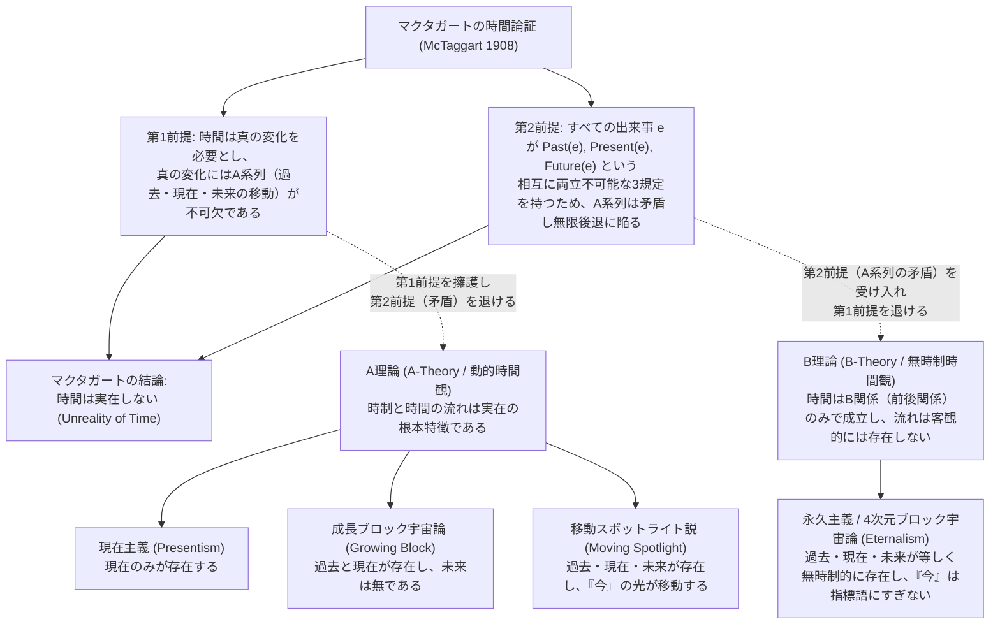
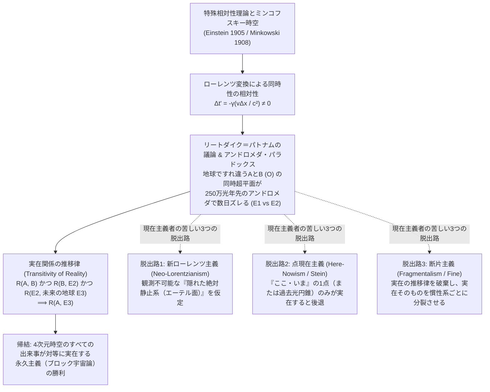
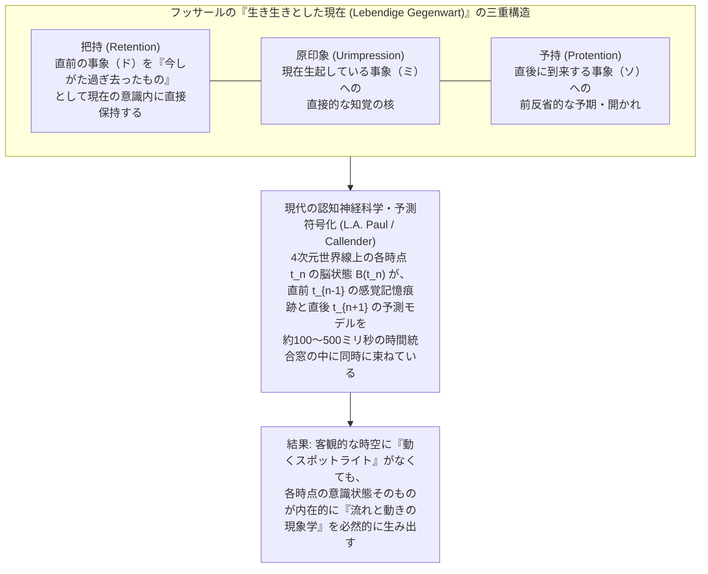

## 序論：アウグスティヌスの嘆きと「今」という謎

西暦397年頃、北アフリカのヒッポの司教であった聖アウグスティヌス（Saint Augustine of Hippo, 354–430）は、不朽の自伝的著作『告白』（*Confessiones*）第11巻第14章において、人類の知性史において最も有名かつ本質的な問いの一つを書き記した。

> 「いったい時間とは何であろうか。誰も私に尋ねないとき、私は知っている。しかし、尋ねる者に説明しようとすると、私は知らないのである（*Quid est ergo tempus? Si nemo ex me quaerat, scio; si quaerenti explicare velim, nescio*）。」

私たちが日常を生きるとき、時間ほど自明で親密なものはない。私たちは「今（現在）」という鮮烈な瞬間を生きており、つい先ほどまでの出来事は刻一刻と「過去」へと遠ざかり、まだ見ぬ「未来」が次々と「現在」へと流れ込んでくるのを肌で感じている。すでに過ぎ去った過去はもはや存在せず、まだ到来していない未来もまた存在しない。真に実在しているのは、過去と未来が交差するカミソリの刃のように鋭い「今（現在）」だけである——これが、私たちが前反省的に抱いているもっとも素朴で強固な直観である。

しかし、アウグスティヌスがすぐさま気づいたように、この素朴な直観を一歩踏み込んで論理的に分析しようとすると、たちまち深刻なアポリア（難問）が立ち現れる。もし過去が「もはや存在しない」のであり、未来が「いまだ存在しない」のだとすれば、そして「現在」が一切の時間的幅を持たない極限の点（幅を持てば、その前半は過去であり後半は未来へと分割されてしまう）にすぎないのだとすれば、いかにして時間は「長い」とか「短い」といった長さを持ちうるのだろうか？ 存在しない過去と存在しない未来のあいだに挟まれた、幅ゼロの「今」だけが実在するのだとすれば、そもそも時間そのものの存在基盤はどこにあるのか？

20世紀に入り、このアウグスティヌスの問いは、二つの巨大な知の地殻変動によってかつてないほど鋭利な姿へと鍛え上げられた。一つは、1908年にケンブリッジ大学の哲学者<strong>ジョン・マクタガート・エリス・マクタガート（J.M.E. McTaggart, 1866–1925）</strong>が学術誌『マインド（*Mind*）』に発表した記念碑的論文<strong>『時間の非実在性（The Unreality of Time）』</strong>であり、もう一つは、1905年の<strong>アルベルト・アインシュタイン（Albert Einstein）</strong>による特殊相対性理論と、1908年の<strong>ヘルマン・ミンコフスキー（Hermann Minkowski）</strong>による4次元時空（Minkowski spacetime）の定式化である。

形而上学（Metaphysics）における「A理論対B理論」「現在主義（Presentism）対永久主義（Eternalism）」の論争と、現代物理学が描き出す「相対論的ブロック宇宙（Block Universe）」および「熱力学的時間の矢（Thermodynamic Arrow of Time）」の交錯は、現代哲学において最もスリリングな最前線を形作っている。本稿では、マクタガートのパラドックスの論理構造から出発し、時間の4大存在論モデルの比較検討、特殊相対性理論における「同時性の相対性」とアンドロメダ・パラドックスによる現在主義への挑戦、さらには私たちがなぜこれほど強烈に「時間が流れている」と感じるのかという現象学・認知科学・統計力学の統合的解明までを、徹底的に掘り下げていく。

---

## 第1章：マクタガートの『時間の非実在性』——A系列とB系列、そして無限後退のパラドックス

現代の分析的時間哲学は、ほぼ例外なく1908年のJ.M.E.マクタガートの論文『時間の非実在性』を出発点としている。イギリス絶対観念論（British Idealism）の掉尾を飾る哲学者であったマクタガートは、この論文において、私たちが時間の中に出来事が並んでいると捉える仕方に<strong>「A系列（A-series）」</strong>と<strong>「B系列（B-series）」</strong>という二つの根本的に異なる系列があることを発見し、その区別を用いて「時間は実在しない」という驚くべき結論を導き出した。

### 1.1 A系列・B系列・C系列の厳密な定義

マクタガートによれば、時間における位置（positions in time）は、見かけ上、次の二つの様式によって秩序づけられている。

1. <strong>A系列（The A-series：時制的・動的系列）</strong>
   出来事を「遠い未来（distant future）」「近い未来（near future）」「現在（present）」「近い過去（near past）」「遠い過去（distant past）」という、<strong>「今」を基準とした単項的（monadic）かつ動的（dynamic）な時制規定（A-determinations）</strong>によって位置づける系列である。A系列の本質は、その位置が絶えず<strong>変化する</strong>ことにある。かつて未来であった出来事（たとえば「2026年の到来」）は、やがて現在となり、その後は過去となり、さらにはますます遠い過去へと押し流されていく。
2. <strong>B系列（The B-series：無時制的・静的系列）</strong>
   出来事を「〜より前（earlier than）」「〜と同時（simultaneous with）」「〜より後（later than）」という、<strong>二項的（dyadic）かつ恒久的（permanent）な無時制関係（B-relations）</strong>によって位置づける系列である。二つの出来事 $e_1$ と $e_2$ の間の前後関係 $E(e_1, e_2)$ は、いかなる時点においても決して変化しない。たとえば「1815年のワーテルローの戦い」が「2026年の今日」よりも前（earlier than）であるという事実は、紀元前1万年に見ても、西暦1億年に見ても、永遠に不変である。
3. <strong>C系列（The C-series：非時間的順序系列）</strong>
   マクタガートはさらに、時間的な方向や変化を伴わない純粋な構造的順序として<strong>C系列</strong>を導入する。アルファベットの $A, B, C, D$ や自然数の $1, 2, 3, 4$ のように、要素間に非対称的・推移的な順序はあるが、それ自体としては時間の流れを持たない系列である。マクタガートの分析によれば、非時間的なC系列にA系列（現在という特権的指標の移動）が付け加わることによって初めて、方向を持った時間的順序としてのB系列が生成される。

### 1.2 マクタガートの二段階論証：なぜ時間は矛盾するのか

マクタガートが『時間の非実在性』で展開した論証は、極めて明快な二つのステップ（前提1と前提2）から構成される演繹的証明である。

#### 第1ステップ（前提1）：時間は変化を不可欠とし、変化はA系列なしには成立しない

マクタガートはまず、「変化（change）なき時間はありえない」という基本原則を置く。もし宇宙の中で何一つ変化が生じないなら、そこには時間も存在しない。では、もし世界からA系列（過去・現在・未来）を完全に消去し、純粋なB系列（〜より前・〜より後）だけを残したとしたら、そこに「変化」は存在しうるだろうか？

マクタガートは「否」と答える。B系列の内部では、いかなる出来事も生起したり消滅したりしないし、その性質を変えることもない。たとえば「1714年のアン女王の死」という出来事 $e$ を考えてみよう。B系列において、アン女王の死は常に1714年という日付に固定されており、「原因はこれこれである」「苦痛を伴った」「ジョージ1世の即位より前である」といった性質やB関係は、永遠にそのままであり決して変化しない。アン女王の死に関して<strong>唯一変化しうるもの</strong>は、「かつては未来であったが、次に現在になり、そして過去になり、さらにますます遠い過去になっていく」という<strong>A系列上の規定（A-determinations）だけ</strong>なのである。

> [!IMPORTANT]
> <strong>ラッセルの「At-At理論」との対립</strong>
> マクタガートはここで、同僚であったバートランド・ラッセル（Bertrand Russell）が『数学の原理』（1903年）で提示した変化の定義——「火かき棒が時刻 $t_1$ において熱いという性質を持ち、時刻 $t_2$ において冷たいという性質を持つことこそが変化である」という無時制的な定義（いわゆる<strong>変化のAt-At理論</strong>）——を正面から批判している。マクタガートによれば、「時刻 $t_1$ で火かき棒が熱い」という事実も、「時刻 $t_2$ で火かき棒が冷たい」という事実も、それ自体は永遠に不変の恒久的真実であり、ちょうど空間的に「火かき棒の一端が熱く、他端が冷たい」ことが変化ではないのと同様に、A系列の移動がなければ真の「時間的変化」とは言えないのである。したがって、<strong>A系列なくして変化はなく、変化なくして時間は存在しない</strong>。

#### 第2ステップ（前提2）：A系列は内在的な論理的矛盾を孕んでおり、それを解消しようとすると悪性の無限後退に陥る

第1ステップで「時間が実在するならば、A系列が実在しなければならない」ことを示したマクタガートは、続く第2ステップで「しかしA系列は自己矛盾を含むため実在しえない」と論じる。

任意の出来事 $e$ に対して、「過去である」を $P(e)$、「現在である」を $N(e)$、「未来である」を $F(e)$ という単項述語で表そう。第一に、これら三つのA規定は<strong>相互に両立不可能（mutually incompatible）</strong>である。いかなる出来事も、過去でありながら同時に現在であることはできず、現在でありながら未来であることもできない。論理式で書けば次のようになる。

$$\forall e \, \Big( \neg\big(P(e) \land N(e)\big) \land \neg\big(N(e) \land F(e)\big) \land \neg\big(P(e) \land F(e)\big) \Big)$$

ところが第二に、A系列の本質（時間の流れ）からして、時間の中のすべての出来事 $e$ は（もし時間に始まりも終わりもなければ）<strong>これら三つの規定のすべてを持たなければならない</strong>。

$$\forall e \, \big( P(e) \land N(e) \land F(e) \big)$$

相互に両立不可能な三つの述語を、すべての出来事 $e$ が同時に満たすことは明白な論理的矛盾である！

もちろん、これに対して誰もが即座に思いつく反論がある。「マクタガートよ、出来事 $e$ は『同時に』過去・現在・未来であるのではない。『継起的に（successively）』そうであるのだ。すなわち、出来事 $e$ は<strong>かつて未来であり（was future）</strong>、<strong>いま現在であり（is present）</strong>、そして<strong>やがて過去になる（will be past）</strong>のだ。ここには何の矛盾もないではないか！」

マクタガートはこの反論を完全に予期しており、それこそが<strong>悪性の循環および無限後退（vicious circle and infinite regress）</strong>の罠であると指摘する。「かつて未来であった（was future）」とはどういう意味か？ それは「<strong>過去の時点において</strong>未来である（future in the past）」、すなわち二階の時制述語 $P(F(e))$ を意味する。同様に、時間の中の各出来事は、次のような9つの複合的A規定（二階のA系列）を持つことになる。

$$\begin{aligned}
&P(P(e)), \quad P(N(e)), \quad P(F(e)), \\
&N(P(e)), \quad N(N(e)), \quad N(F(e)), \\
&F(P(e)), \quad F(N(e)), \quad F(F(e))
\end{aligned}$$

たとえば、「水曜日の雨」という出来事 $e$ は、火曜日（過去）においては未来であったから $P(F(e))$ であり、水曜日（現在）においては現在であるから $N(N(e))$ であり、木曜日（未来）においては過去であるから $F(P(e))$ である。一見すると、これら $P(F(e)), N(N(e)), F(P(e))$ の間には矛盾がないように見える。

しかし、上記の9つの複合述語の<strong>対角線成分</strong>（あるいは任意の固定された外側の時制の行）に注目せよ。出来事 $e$ は、時間の経過とともに、「現在の現在 $N(N(e))$」「現在の過去 $N(P(e))$」「現在の未来 $N(F(e))$」のすべてを持たなければならず、同様に $P(P(e)), N(N(e)), F(F(e))$ の三つも相互に両立不可能であるにもかかわらず、すべての出来事 $e$ がそれらを持たなければならない！

この第2レベルの矛盾を解消するためには、「それは異なる第3レベルの時点においてである——すなわち、かつて $N(F(e))$ であった（$P(N(F(e)))$）し、いま $N(N(e))$ である（$N(N(N(e)))$）し、やがて $N(P(e))$ になる（$F(N(P(e)))$）のだ」と、三階のA系列へ逃げ込まなければならない。しかしその三階のA系列もまた全く同じ対角線上の矛盾を含んでおり、それを解消するには四階、五階……と無限に高次のA系列（メタ時間）を要請せざるをえない。いかなる第 $n$ 段階まで遡っても矛盾は決して解消されないため、この無限後退は<strong>悪性の無限後退（vicious infinite regress）</strong>である。

かくしてマクタガートは結論づける。
1. 時間が実在するならば、A系列が実在しなければならない（前提1）。
2. しかしA系列は解消不可能な論理的矛盾を含むため、実在しえない（前提2）。
3. ゆえに、<strong>時間は実在しない（Time is unreal）</strong>。私たちが時間的順序として経験しているものは、背後にある非時間的な実在（C系列）を有限な精神が誤って知覚した現象（appearance）にすぎない。

---

## 第2章：A理論とB理論の分岐、および時間の4大存在論モデル

マクタガート自身の結論である「時間は実在しない」という観念論的主張をそのまま受け入れた現代哲学者は少なかったものの、彼の二段階論証はその後100年以上にわたる時間哲学の地図を決定づけた。なぜなら、時間を実在として救い出そうとするあらゆる哲学者は、<strong>「マクタガートの第1前提と第2前提のどちらを拒絶するか」</strong>という二者択一を迫られたからである。

* <strong>A理論（A-Theory / Tensed Theory of Time / 動的時間観）</strong>：マクタガートの<strong>第1前提を受け入れ、第2前提を拒絶する</strong>陣営。「時間の流れ（temporal passage / becoming）」と過去・現在・未来の客観的区別こそが時間の本質であり、現在時制を無条件の基本概念として受け入れればマクタガートの無限後退は生じない、と主張する。
* <strong>B理論（B-Theory / Tenseless Theory of Time / 静的時間観）</strong>：マクタガートの<strong>第2前提を受け入れ、第1前提を拒絶する</strong>陣営。客観的なA系列（特権的な「今」の移動）は確かに矛盾もしくは余剰であるが、時間はラッセルのAt-At理論が示す通り、無時制的なB系列（〜より前・〜より後・〜と同時）だけで完全に成立しており、時間は実在する、と主張する。

さらに、この「時制と流れ（A対B）」の軸に、「過去・現在・未来のどの領域が実際に<strong>存在する（exist）</strong>のか」という<strong>存在論（Ontology）</strong>の軸を重ね合わせることで、現代形而上学における<strong>時間の4大存在論モデル</strong>が浮かび上がる。それぞれを厳密に検討しよう。

### 2.1 現在主義（Presentism）：「今」だけが存在する

<strong>現在主義（Presentism）</strong>は、アーサー・プライアー（Arthur Prior、時制論理 Tense Logic の創始者）、ネッド・マルコシアン（Ned Markosian）、ディーン・ジマーマン（Dean Zimmerman）、トレントン・メリックス（Trenton Merricks）らによって擁護されてきた、最も純粋なA理論のモデルである。

現在主義の中心テーゼは極めてシンプルかつ急進的である。
> <strong>「現在存在する対象・出来事のみが存在する（Only present objects and events exist）。」</strong>

私たちの最も制限のない存在量化子（unrestricted existential quantifier $\exists x$）の変域（domain）には、現在の対象しか含まれない。ソクラテスも、白亜紀のティラノサウルスも、1815年のナポレオンも、もはや一切存在しない。同様に、22世紀に火星で生まれる人類も、明日の朝食も、いまだ一切存在しない。形而上学における様相論（Modal Metaphysics）において、デイヴィッド・ルイス（David Lewis）の「様相実在論（Modal Realism：あらゆる可能世界が私たちの世界と同じくらい具体的に実在する）」に対して、ロバート・アダムズ（Robert Adams）やアルヴィン・プランティンガ（Alvin Plantinga）らの「現実主義（Actualism：現実世界のみが存在し、単なる可能世界は存在しない）」が対置されるのと同様に、現在主義は時間における「現実主義」なのである。

#### 現在主義がいかにマクタガートのパラドックスを回避するか
現在主義者（特にプライアー）によれば、マクタガートのパラドックスは、過去や未来の出来事をあたかも「どこかに存在していて、『過去である』や『未来である』という性質を帯びている対象」であるかのように空間化して扱ったことから生じる疑似問題である。現在主義にとって、基本となるのは実在する現在の事象だけであり、「かつて $p$ であった」や「やがて $q$ になるだろう」は、過去や未来の対象に属性を帰属させることではなく、現在の文に<strong>原始的な時制演算子（primitive tense operators）</strong> $P$（It was the case that...）や $F$（It will be the case that...）を作用させることにほかならない。したがって、二階の述語による対角線上の矛盾はそもそも発生しない。

#### 現在主義を襲う2つの致命的難問（反論）
しかし、現在主義はその直観的な魅力と引き換えに、現代形而上学において極めて深刻な二つの存在論的難問に直面する。

1. <strong>過去の真理に関する真理メイカー問題（The Truthmaker Objection to Past Truths）</strong>
   デイヴィッド・アームストロング（D.M. Armstrong）やサイモン・ケラー（Simon Keller）、テッド・サイダー（Ted Sider）らが鋭く突きつけた問題である。形而上学の基本原則である<strong>真理メイカー原理（Truthmaker Principle）</strong>によれば、ある命題 $\langle p \rangle$ が真であるならば、世界の中にその命題を真たらしめる何らかの実在（存在者・事態＝Truthmaker）が存在しなければならない（真であることは実在に根拠づけられる：*Truth supervenes on being*）。
   さて、「白亜紀に恐竜が存在した（Dinosaurs existed）」という命題は紛れもなく<strong>真</strong>であり、「白亜紀にユニコーンが存在した」という命題は<strong>偽</strong>である。ところが現在主義によれば、過去は一切存在しないのだから、恐竜もユニコーンも現在の宇宙のどこにも存在しない！ では、今この瞬間において、「恐竜が存在した」を真にし、「ユニコーンが存在した」を偽にする<strong>存在論的根拠（Truthmaker）</strong>はいったいどこにあるのか？
   * <em>現在の痕跡（化石）に訴える解決策の失敗</em>：「いま博物館に恐竜の骨の化石が存在するからだ」と答えることはできない。なぜなら、化石を一切残さずに消滅した過去の出来事（たとえば「紀元前400年の特定の日にソクラテスがくしゃみを2回した」という事実）もまた真か偽かの確定した真理値を持つし、そもそも「恐竜が存在した」という命題は、博物館の石ころについての命題ではなく、過去の生きた恐竜についての命題だからである。
   * <em>ルクレティウス主義（Lucretianism）の苦肉策</em>：ジョン・ビグロー（John Bigelow, 1996）は、古代ローマの詩人ルクレティウスに因んで、「現在の世界（宇宙全体）が、『かつて恐竜を含んでいた（having contained dinosaurs）』という現在の構造的性質を持っているのだ」と主張した。しかし、テッド・サイダーらが批判するように、このような「かつて〜であったという性質」は、現在の世界の物理的・内在的（intrinsic / categorical）な配置には一切還元されない不気味な「疑似性質（hypothetical / past-directed property）」であり、過去の存在を密輸入する「存在論的ごまかし（ontological cheating）」にすぎない。
   * <em>代用現在主義（Ersatz Presentism）</em>：トーマス・クリスプ（Thomas Crisp）やクレイグ・ボーン（Craig Bourne）らは、過去の各時点を「現在時制命題の極大無矛盾集合（maximally consistent sets of propositions）」という抽象的対象として構成し、そのうちの一つだけが具体的に実現しているとする代用主義を提唱したが、これもまた「抽象的な命題の集合が、どうして血と肉を持った生きた恐竜についての真理の根拠になりうるのか」という批判を免れない。

2. <strong>通時的関係の問題（The Problem of Cross-Time Relations）</strong>
   「私はソクラテスを尊敬している（$\text{Admires}(\text{Me}, \text{Socrates})$）」「1815年のナポレオンの敗北が、1821年の彼の死の間接的原因となった（$\text{Caused}(e_1, e_2)$）」「今日の雨は昨日の雨よりも激しい」といった命題を考えよう。論理的に、二項関係 $R(a, b)$ が成立するためには、関係項である $a$ と $b$ の<strong>双方が存在していなければならない</strong>（実在しない対象と関係を取り結ぶことはできない）。もし現在主義が言うように、ソクラテスや昨日の雨が文字通り「無（non-existent）」であるならば、いかにして現在の私がソクラテスと「尊敬する」という関係を持ち、昨日の出来事が今日の出来事と「因果関係」を持つことができるのだろうか？

### 2.2 永久主義／4次元ブロック宇宙論（Eternalism / The Block Universe）

現在主義の対極に位置し、現代の科学哲学者・分析形而上学者の大多数（W.V.O.クワイン、J.J.C.スマート、D.H.メラー、デイヴィッド・ルイス、テッド・サイダーら）から圧倒的な支持を集めているB理論のモデルが、<strong>永久主義（Eternalism）</strong>、別名<strong>4次元ブロック宇宙論（Four-Dimensional Block Universe）</strong>である。

永久主義の中心テーゼは次の通りである。
> <strong>「過去・現在・未来のすべての対象と出来事は、4次元時空多様体（spacetime manifold）のそれぞれの時間的・空間的座標において、まったく対等な存在論的資格で無時制的に存在する（Past, present, and future objects and events all exist tenselessly on an equal ontological footing）。」</strong>

永久主義の世界観においては、紀元前399年に毒杯を仰ぐソクラテスも、2026年にこの記事を読んでいるあなたも、西暦3000年に恒星間航行をする未来人も、4次元時空という巨大なブロックの中の異なる座標 $(x, y, z, t)$ に等しく実在している。ソクラテスが「今ここにいない」のは、彼が宇宙の存在リストから消滅したからではなく、単に「2026年という時間スライス（超平面）」の上に位置していないからにすぎない。

#### 「今（Now）」の指標語的分析（Indexical Analysis of "Now"）
永久主義は、空間と時間の見事な類比（Space-Time Analogy）によって「今」の特権性を解体する。
空間における<strong>「ここ（here）」</strong>という語を考えてみよう。東京にいる人は東京を指して「ここ」と呼び、パリにいる人はパリを指して「ここ」と呼ぶ。しかし、東京にいる人が「『ここ』である東京だけが実在し、パリという遠い場所は実在しない！」と主張したら、誰もがその空間的独我論（Spatial Solipsism）を笑うだろう。「ここ」とは客観的な物理的世界に刻まれた特別な光ではなく、<strong>発話者が発話している空間的位置を指し示す指標語（indexical / token-reflexive expression）</strong>にすぎない。

永久主義によれば、時間における<strong>「今（now / present）」</strong>もこれとまったく同じ<strong>時間的指標語（temporal indexical）</strong>である！
* 紀元前399年のアテネにおいて、ソクラテスが「いま私は毒人参を飲んでいる」と発話するとき、その発話トークン $u_1$ における「いま」は単に $u_1$ と同時である時刻 $t = \text{399 BCE}$ を指し示している。
* 2026年において、あなたが「いま私は記事を読んでいる」と考えるとき、その思考トークン $u_2$ における「いま」は単に $u_2$ と同時である時刻 $t = 2026$ を指し示している。

どちらの時点も、もう一方の時点に比べて形而上学的に特権的な「真の現在性（Presentness）」を持っているわけではない。すべての時点が、その時点に住む主体にとっては「今」なのである。

> [!NOTE]
> <strong>旧B理論（Old B-Theory）から新B理論（New B-Theory）への進化</strong>
> ラッセルやクワインら初期のB理論家（<strong>旧B理論</strong>）は、「今雨が降っている」のような時制文（A文）は、「2026年10月14日12時00分に雨が降っている」のような無時制の日付文（B文）へと<strong>意味論的に完全翻訳可能（reducible in meaning）</strong>であると主張した。しかし、ジョン・ペリー（John Perry）やデイヴィッド・カプラン（David Kaplan）の指標語研究、およびアーサー・プライアーの有名な『ありがたいことに、それは終わった（Thank Goodness That's Over!）』（1959年）の批判を受け、D.H.メラー（*Real Time*, 1981; *Real Time II*, 1998）やJ.J.C.スマートらは<strong>新B理論（New B-Theory）</strong>を確立した。
> 新B理論によれば、時制文（例：「会議が<strong>いま</strong>始まる！」）は、無時制の日付文（例：「会議が12時に始まる」）へと<strong>意味（character/cognitive significance）においては翻訳不可能</strong>である（時計が壊れて今が12時だと知らなければ、「今始まる」と信じない限り席を立って行動できないため）。しかし、その時制文を真たらしめる<strong>客観的な真理メイカー（Truthmaker）は、完全に無時制的なB事実（会議の開始時刻と発話トークンの生起時刻が同時であるという事実）のみ</strong>である！ これにより、B理論は「言語・思考における時制の不可欠性」を認めつつ、「実在における時制の不必要性」を完璧に両立させたのである。

また、永久主義のもとでは、現在主義を苦しめた「過去の真理メイカー問題」も「通時的関係の問題」も一瞬で氷解する。恐竜は4次元ブロックの白亜紀の領域に文字通り実在しているため、「恐竜が存在した」の真理メイカーは白亜紀の恐竜そのものであり、2026年の私と紀元前399年のソクラテスはともに4次元ブロック内に実在する二つの項として、時空を跨いだ関係を何の矛盾もなく取り結ぶことができる。

### 2.3 成長ブロック宇宙論（The Growing Block Theory）

「過去の出来事が完全に無であるとする現在主義は、過去の真理を説明できない。しかし、未来までがすでに確定して存在しているとする永久主義は、未来の開かれた可能性（Open Future）や私たちの自由意志の直観に反する！」——この双方の不満を同時に解決しようとして提唱された第三のモデルが、ケンブリッジの哲学者<strong>C.D.ブロード（C.D. Broad, *Scientific Thought*, 1923）</strong>やマイケル・トゥーリー（Michael Tooley, 1997）らによる<strong>成長ブロック宇宙論（Growing Block Universe / Theory）</strong>である。

成長ブロック宇宙論の中心テーゼは次の通りである。
> <strong>「過去と現在は実在するが、未来は一切存在しない（The past and the present exist, while the future does not exist at all）。」</strong>

宇宙は4次元時空のブロックであるが、永久主義のように未来の端まで完成したブロックではなく、<strong>「現在（Now）」という最先端の断面（cutting edge of reality）において、無から新たな実在のスライスが次々と付け加わり、結晶化していくことで絶えず成長し続けているブロック</strong>である。
* すでに生起した過去の出来事（恐竜やソクラテス）は、成長したブロックの内部に永遠に保存されて実在し続ける。したがって、過去の命題には確実な真理メイカーが存在する。
* 一方、未来の出来事はいまだブロックに付け加わっておらず、文字通り「無」である。アリストテレスが『命題論（*De Interpretatione*）』第9章で論じた「明日、海戦が起こるか否か」のような未来の偶発事（future contingents）は、いまだその真理メイカーが存在しないため、未来は文字通り開かれている。
* そして「今（現在）」とは、単なる主観的な指標語ではなく、<strong>実在のブロックと非実在の虚無（未来）とが接する存在論的な最前線（ontological boundary）</strong>として客観的に定義される。

#### 成長ブロック宇宙論を襲う致命的難問：「なぜ今が『今』だとわかるのか？」（Epistemic Objection / Dead Past Objection）
一見すると現在主義と永久主義の「いいとこ取り」に見える成長ブロック宇宙論であるが、2000年代に入り、クレイグ・ボーン（Craig Bourne, 2002）、デイヴィッド・ブラッドン＝ミッチェル（David Braddon-Mitchell, 2004）、トレントン・メリックス（Trenton Merricks, 2006）らによって、極めて破壊的な<strong>認識論的反論（The Epistemic "Now" Objection / Dead Past Objection）</strong>が突きつけられた。

思考実験を行ってみよう。成長ブロック宇宙論が正しいとし、真の宇宙の最先端（現在）が<strong>西暦3000年</strong>まで成長しているとしよう。このとき、ブロックの内部には、紀元前399年のソクラテスも、1863年にゲティスバーグ演説を行うエイブラハム・リンカーンも、そして2026年のあなたも、すべて実在のスライスとして完全に保存されて存在している。

さて、1863年のブロック断面の中に実在しているリンカーン大統領の脳状態と意識を考えてみよう。1863年のリンカーンは、まさにその演説の瞬間、「<strong>私はいま、宇宙の最先端である『現在』に生きて演説している！</strong>」と強く信じ、意識しているはずである。しかし、成長ブロック宇宙論の定義によれば、「現在」とはブロックの最新の端（西暦3000年）のことであるから、1863年のリンカーンが抱いている「いまは現在だ」という信念は、<strong>客観的には完全に偽（False）</strong>である！ 彼は自分が世界の最先端にいると錯覚しているが、実際にはとっくの昔に通り過ぎた<strong>「死んだ過去（dead past）」のブロックの奥深くに閉じ込められた存在</strong>なのである。

ここで恐怖の問いがあなた自身へと跳ね返る。<strong>「2026年にこの記事を読んでいるあなたは、自分がいまブロックの最先端（真の現在）にいるのか、それともすでに西暦5000年や1億年まで成長してしまったブロックの奥深く（死んだ過去）に埋もれているのか、どうやって区別できるのか？」</strong>
2026年のスライスにおけるあなたの脳の神経発火パターンも、主観的な知覚体験も、あなたが最先端にいようと過去の内部にいようと、1ミリも変わらない！ しかも、ブロックの体積（過去の全時点）に比べて、最先端の断面（ただ一つの瞬間）の測度はゼロに等しいから、確率論的に言えば、あなたが真の現在にいる確率はほぼゼロであり、<strong>成長ブロック宇宙論が正しければ、私たちはほぼ確実に「いまが現在であるかどうかすら知りえない」という極端な時間的懐疑論に陥ってしまう</strong>のである！（ピーター・フォレスト Peter Forrest 2004 はこれを避けるため、「意識はブロックの最先端の断面にしか宿らず、過去の断面にあるリンカーンや過去の私たちは意識を持たない哲学的ゾンビである」という『死んだ過去仮説 Dead Past Hypothesis』を提唱したが、これは「物理的・神経的に完全に同一の脳状態であるにもかかわらず、最先端にあるときだけ意識が宿り、1秒後には意識が消える」という心身問題上の極めて不条理な帰結を招く。）

### 2.4 移動スポットライト説（The Moving Spotlight Theory）

第四のモデルは、同じくC.D.ブロードが定式化し、近年ではロス・キャメロン（Ross Cameron, 2015）やブラッドフォード・スコウ（Bradford Skow）らによって精緻化されている<strong>移動スポットライト説（Moving Spotlight Theory）</strong>である。

移動スポットライト説は、<strong>永久主義の4次元ブロック存在論（過去・現在・未来のすべてが実在する）と、A理論の客観的な「現在性（Presentness）」を結合したハイブリッド・モデル</strong>である。暗い劇場のステージの上に、過去から未来に至るすべての出来事のブロックが最初から最後まで並んでいる。その上を、<strong>「絶対的な現在（Absolute Presentness）」という形而上学的なスポットライトの光</strong>が、過去から未来へと順番に照らしながら滑っていくのである。

しかし、このモデルもまた二つの深刻な難問を抱え込む。第一に、成長ブロック宇宙論とまったく同じ<strong>認識論的反論</strong>（スポットライトがすでに西暦3000年へと通り過ぎた後の暗闇の中で、2026年の私たちが「自分たちはスポットライトに照らされている！」と誤って信じている可能性を排除できない）に直面する。第二に、J.J.C.スマートやC.D.ブロード自身が指摘した<strong>「時間移動の速度問題（The Rate of Passage Problem）」</strong>である。スポットライトが時間軸に沿って移動するというなら、その移動は何に対して、どのくらいの速さで進むのか？ 「1秒あたり1秒（one second per second）」という答えは無意味なトートロジーであり、もしそれを測るための「超時間（hyper-time / 2階の時間 $T_2$）」を導入するならば、まさにマクタガートが警告した無限後退がそのままただちに現実化してしまうのである。

### 2.5 時間の4大存在論モデルの体系的比較

ここまでの4つの存在論モデルの構造的特徴と長所・短所を一覧表にまとめよう。

| 評価軸・特徴 | 現在主義 (Presentism) | 成長ブロック宇宙論 (Growing Block) | 移動スポットライト説 (Moving Spotlight) | 永久主義 / ブロック宇宙論 (Eternalism) |
| :--- | :--- | :--- | :--- | :--- |
| <strong>所属陣営</strong> | A理論（動的・時制的） | A理論（動的・時制的） | A理論（動的・時制的） | B理論（静的・無時制的） |
| <strong>過去の存在</strong> | <strong>存在しない</strong> | <strong>存在する</strong> | <strong>存在する</strong> | <strong>存在する</strong> |
| <strong>現在の存在</strong> | <strong>存在する</strong> | <strong>存在する</strong>（最先端の縁） | <strong>存在する</strong>（特権的光） | <strong>存在する</strong>（全時点と対等） |
| <strong>未来の存在</strong> | <strong>存在しない</strong> | <strong>存在しない</strong> | <strong>存在する</strong> | <strong>存在する</strong> |
| <strong>「今」の地位</strong> | 実在の全体そのもの | 成長するブロックの最先端断面 | 4次元ブロック上を動く絶対的性質 | 発話時点を指す単なる指標語（ここ＝今） |
| <strong>過去の真理メイカー</strong> | 深刻な難問（ルクレティウス主義等の苦肉策が必要） | 解決（過去の事象がブロック内に実在するため） | 解決（過去の事象が実在するため） | 解決（すべての時点の事象が実在するため） |
| <strong>認識論的「今」問題</strong> | 回避（存在するなら必ず現在であるため） | <strong>致命的難問</strong>（死んだ過去にいる可能性を排除不能） | <strong>致命的難問</strong>（光が去った暗闇にいる可能性を排除不能） | 回避（「今」は各時点の主体の指標語にすぎないため） |
| <strong>相対性理論との整合性</strong> | <strong>極めて困難</strong>（絶対的同時平面を要求） | <strong>極めて困難</strong>（宇宙大の成長断面を要求） | <strong>極めて困難</strong>（宇宙大のスポットライト断面を要求） | <strong>完全に整合</strong>（ミンコフスキー時空そのもの） |

---

## 第3章：特殊相対性理論とミンコフスキー時空——「同時性の相対性」とアンドロメダ・パラドックス

前章で見たように、純粋な形而上学の内部でさえ、現在主義や成長ブロック宇宙論などのA理論は深刻なアポリアを抱えていた。しかし、A理論（とりわけ現在主義）に対して歴史上もっとも決定的な打撃を与えたのは、哲学の内部からの批判ではなく、20世紀物理学の金字塔である<strong>アルベルト・アインシュタインの特殊相対性理論（Special Theory of Relativity, 1905）</strong>であった。

### 3.1 ミンコフスキー時空と不変世界間隔

アイザック・ニュートンが『プリンキピア』（1687年）で定式化した古典力学の世界観においては、宇宙全体を貫く単一の「絶対時間（absolute, true, and mathematical time）」が存在していた。ニュートン宇宙では、地球上の「今この瞬間」と、アンドロメダ銀河の「今この瞬間」は、観測者の運動状態とは無関係に一意かつ客観的に定まっており、宇宙全体の歴史は「絶対的な同時平面（3次元空間スライス）」を紙束のように積み重ねたものとして一意に分割（foliation）できた。

ところが1905年、アインシュタインは論文『運動する物体の電気力学について（*Zur Elektrodynamik bewegter Körper*）』において、（1）<strong>相対性原理</strong>（すべての慣性系において物理法則は同一の形式をとる）と、（2）<strong>光速度不変の原理</strong>（真空中の光の速さ $c \approx 3.0 \times 10^8\text{ m/s}$ は、光源や観測者の運動状態によらずすべての慣性系で一定である）という二つの公理から、ニュートンの絶対時間・絶対空間を根底から覆した。

その3年後の1908年（奇しくもマクタガートの『時間の非実在性』と全く同じ年！）、アインシュタインの旧師である数学者<strong>ヘルマン・ミンコフスキー（Hermann Minkowski）</strong>は、ケルンでの歴史的講演『空間と時間（*Raum und Zeit*）』の冒頭で、高らかにこう宣言した。

> 「諸君！ 私がこれから展開しようとする空間と時間に関する見解は、実験物理学の土壌から芽生えたものであり、そこにはその強靭さがある。その見解は根底的である。<strong>今や、空間それ自体、および時間それ自体は、単なる影へと消え去る運命にあり、両者のある種の結合のみが独立した実在を保つことになるであろう。</strong>」

ミンコフスキーが明らかにした通り、異なる慣性系間で不変な客観的実在（ローレンツ不変量）は、空間的距離 $\Delta r = \sqrt{\Delta x^2 + \Delta y^2 + \Delta z^2}$ でもなければ、時間的間隔 $\Delta t$ でもなく、それらを統合した4次元<strong>ミンコフスキー時空（Minkowski Spacetime）</strong>における<strong>世界間隔（spacetime interval）</strong> $ds^2$ である。

$$ds^2 = -c^2 dt^2 + dx^2 + dy^2 + dz^2 = \eta_{\mu\nu} dx^\mu dx^\nu$$

任意の出来事 $O$（原点）を基準にすると、4次元時空は<strong>光円錐（light cone）</strong>によって次の3つの不変領域に分割される。
1. <strong>時間的分離（Timelike separation: $ds^2 < 0$）</strong>：光速以下の信号で因果的に到達可能な領域。絶対的過去（past light cone, $dt < 0$）と絶対的未来（future light cone, $dt > 0$）に分かれ、この領域内の出来事の前後順序はすべての慣性系で一致する。
2. <strong>光的分離（Lightlike / Null separation: $ds^2 = 0$）</strong>：光速の信号が伝播する光円錐の表面。
3. <strong>空間的分離（Spacelike separation: $ds^2 > 0$、すなわち $|\Delta \mathbf{x}| > c |\Delta t|$）</strong>：光円錐の外側に広がる広大な領域（アインシュタインが「<strong>他所 Elsewhere</strong>」と呼んだ領域）。互いに光速をもってしても因果的影響を与え合うことができない領域であり、<strong>この領域にある出来事と原点 $O$ との時間的順序（過去か、現在か、未来か）は、観測者の慣性系によって完全に逆転する！</strong>

### 3.2 ローレンツ変換と「同時性の相対性」の数理的導出

なぜ空間的に離れた出来事の「同時性」が観測者の速度によって崩れるのか、<strong>ローレンツ変換（Lorentz Transformation）</strong>から厳密に確認しよう。
慣性系 $S$（座標 $(t, x, y, z)$）に対して、$x$ 軸の正の方向に一定速度 $v$ で運動する別の慣性系 $S'$（座標 $(t', x', y', z')$）を考える。両者の原点が $(t, x) = (0, 0)$ で一致するとき、ローレンツ変換は次の式で与えられる。

$$t' = \gamma \left( t - \frac{vx}{c^2} \right), \qquad x' = \gamma (x - vt), \qquad \gamma = \frac{1}{\sqrt{1 - v^2/c^2}}$$

ここで、慣性系 $S$ において<strong>完全に同時（$\Delta t = t_2 - t_1 = 0$）</strong>に生起し、かつ空間的に距離 $\Delta x = x_2 - x_1 \neq 0$ だけ離れた二つの出来事 $e_1 = (t_1, x_1)$ と $e_2 = (t_1, x_2)$ を考えよう。これら二つの出来事の、運動系 $S'$ における時間差 $\Delta t' = t'_2 - t'_1$ を計算すると、$\Delta t = 0$ であるから直ちに次の結果が得られる。

$$\Delta t' = \gamma \left( \Delta t - \frac{v \Delta x}{c^2} \right) = -\gamma \frac{v \Delta x}{c^2} \neq 0$$

このわずか一行の数式が持つ形而上学的破壊力は計り知れない。
慣性系 $S$ において「いま同時に起こっている（$\Delta t = 0$）」二つの出来事 $e_1, e_2$ は、速度 $v > 0$ で動く慣性系 $S'$ から見れば、<strong>決して同時ではない（$\Delta t' \neq 0$）</strong>のである！ $\Delta x > 0$ であれば、$S'$ 系では $\Delta t' < 0$（すなわち $e_2$ の方が $e_1$ よりも<strong>過去</strong>に起こった）となり、逆向き（$v < 0$）に動く慣性系 $S''$ から見れば $\Delta t'' > 0$（すなわち $e_2$ の方が $e_1$ よりも<strong>未来</strong>に起こる）となる。

したがって、特殊相対性理論において<strong>「宇宙全体における絶対的な現在（絶対的同時超平面）」などというものは物理的に存在しない</strong>。「どの出来事が『今』と同時であるか」は、選ぶ慣性系（超平面の傾き）に完全に依存するのである。

### 3.3 リートダイク＝パトナムの議論とペンローズの「アンドロメダ・パラドックス」

1960年代後半、物理学者のC.W.リートダイク（C.W. Rietdijk, 1966）と、20世紀を代表する哲学者<strong>ヒラリー・パトナム（Hilary Putnam, 1967, *"Time and Physical Geometry"*）</strong>は、この同時性の相対性を用いて、現在主義（および開かれた未来の理論）を論破する強力な幾何学的論証——<strong>リートダイク＝パトナムの議論（The Rietdijk-Putnam Argument）</strong>——を独立に発表した。さらに後年、数理物理学者<strong>ロジャー・ペンローズ（Roger Penrose）</strong>は名著『皇帝の新しい心（*The Emperor's New Mind*）』（1989年）において、この議論を劇的な思考実験として定式化した。それが有名な<strong>「アンドロメダ・パラドックス（The Andromeda Paradox）」</strong>である。

#### アンドロメダ・パラドックスの定量計算
前の式の $\Delta t' = -\gamma \frac{v \Delta x}{c^2}$ を見ると、日常的な速度 $v$（たとえば人間の歩く速さ）では、分母に光速の2乗 $c^2$ があるため、時間差 $\Delta t'$ は無視できるほど小さいように思えるかもしれない。しかし、分子には<strong>空間的距離 $\Delta x$</strong> が掛かっている！ もし距離 $\Delta x$ が宇宙論的なスケールで巨大であれば、どれほど微小な速度 $v$ であっても、同時超平面の傾きは<strong>数日〜数年という途方もない時間差</strong>を生み出す。

ペンローズの思考実験を計算してみよう。
地球上の同じ歩道で、二人の人間 $A$（地球に対して静止している人）と $B$（地球に対して時速 $4\text{ km/h} \approx 1.11\text{ m/s}$ というごく普通の歩行速度で、アンドロメダ銀河 M31 の方向へ向かって歩いている人）が、まさに今、肩を並べてすれ違ったとしよう。二人がすれ違う時空点（ここ・いま）を原点 $O$ とする。
地球からアンドロメダ銀河までの距離は $L = \Delta x \approx 250\text{万光年} = 2.5 \times 10^6\text{ light-years}$ である。歩行速度では $\gamma \approx 1$ であるから、静止している $A$ の「現在の同時超平面（$t = 0$）」と、歩いている $B$ の「現在の同時超平面（$t' = 0$）」がアンドロメダ銀河の位置で切り取る時刻のズレ $\Delta t$ は、次のように計算される。

$$\Delta t \approx \frac{v L}{c^2} = \left(\frac{v}{c}\right) \times \left(\frac{L}{c}\right) = \left(\frac{1.11\text{ m/s}}{3.0 \times 10^8\text{ m/s}}\right) \times 2.5 \times 10^6\text{ years} \approx 9.25 \times 10^{-3}\text{ years} \approx 3.38\text{ days（約3.4日〜5日）}$$

なんと、地球上でただ時速4キロで歩いているか立ち止まっているかという違いだけで、アンドロメダ銀河における「今この瞬間」は<strong>数日間もズレる</strong>のである！
ペンローズはこれを次のように描写する。いまアンドロメダ銀河の異星人文明が、地球を侵略するために宇宙艦隊を出撃させるべきかどうかを議論しているとしよう。
* 立ち止まっている $A$ にとっての「現在（$t=0$ の同時面）」にあるアンドロメダ銀河（出来事 $E_1$）では、異星人の議会はまだ出撃するかどうか迷っており、決定は下されていない。
* ところが、まさに同じ時空点 $O$ で $A$ のすぐ横を歩いてすれ違った $B$ にとっての「現在（$t'=0$ の同時面）」にあるアンドロメダ銀河（出来事 $E_2$、すなわち $E_1$ の約4日後）では、<strong>すでに数日前に出撃命令が下され、宇宙艦隊は地球へ向けて発進してしまっている！</strong>

#### パトナムによる現在主義崩壊の形式的証明
パトナムは、この状況を次の3つの前提からなる演繹として定式化した。いま、対象（出来事）$x$ にとって対象（出来事）$y$ が「共に実在する（co-existent / real for $x$）」という二項関係を $R(x, y)$ と書こう。

1. <strong>前提1（同一慣性系内の同時的実在）</strong>：観測者 $x$ の慣性系において $x$ と同時であるすべての出来事 $y$ は、$x$ にとって実在する（$S_x(x, y) \implies R(x, y)$）。（もし現在主義者がこれすら拒否すれば、「今この瞬間に太陽や月や隣の部屋が存在する」ことすら否定する独我論に陥る。）
2. <strong>前提2（相対性原理による特権系の不在）</strong>：特殊相対性理論により、すべての慣性系は物理的にも形而上学的にも完全に対等であり、特定の慣性系（例：$A$ の静止系）だけが特権的な「真の現在」を持つことはない。
3. <strong>前提3（実在関係の推移律 Transitivity of Existence）</strong>：「実在する」という関係 $R$ は、反射的・対称的・<strong>推移的（transitive）</strong>な同値関係である。すなわち、<strong>もし $x$ にとって $y$ が実在し、かつ $y$ にとって $z$ が実在するならば、$x$ にとって $z$ もまた実在しなければならない</strong>（$R(x, y) \land R(y, z) \implies R(x, z)$）。なぜなら、「実在する（存在する）」とは無条件の存在論的地位であり、「$B$ にとっては艦隊の発進が実在するが、同じ場所にいる $A$ にとっては実在しない」などという相対化は、「存在」の概念を破壊するからである。

この3つの前提を認めると、何が起きるか？
地球上の同じ時空点 $O$ で出会った $A$ と $B$ は、空間的にも時間的にも一致しているため、互いに完全に実在している：$R(A, B)$。
次に、歩いてすれ違った $B$ の現在超平面上には、アンドロメダの4日後の出来事 $E_2$ が同時として実在している：$R(B, E_2)$。
すると、推移律（前提3）により、$A$ にとっても4日後の未来の出来事 $E_2$ が<strong>いま既に実在している</strong>ことになる：$R(A, E_2)$！
さらに、アンドロメダ銀河の出来事 $E_2$ の位置にいて、今度は地球方向へ向かって歩いている第3の観測者 $C$ を考えれば、$C$ の現在超平面は地球上の<strong>未来の出来事 $E_3$（たとえば数日後の地球の出来事）</strong>を切り取る：$R(E_2, E_3)$。
再度推移律を適用すれば、$R(A, E_2) \land R(E_2, E_3) \implies R(A, E_3)$ となり、<strong>現在の地球にいる $A$ にとって、自分自身の未来の出来事 $E_3$（さらには連鎖を繰り返せば、4次元ミンコフスキー時空の過去・現在・未来のすべての出来事！）が等しく実在している</strong>ことが数学的に導かれる。こうして、「現在だけが存在する」という現在主義は、特殊相対性理論と結合した瞬間に、<strong>4次元ブロック宇宙論（永久主義）へと完全に崩壊（collapse）する</strong>のである！

### 3.4 現在主義に残された3つの苦しい脱出路とその代償

リートダイク＝パトナムの議論に対し、それでもなお現在主義（あるいはA理論）を守ろうとする哲学者たちは、パトナムの3つの前提のいずれかを拒絶する次の3つの脱出路を模索してきた。しかし、そのいずれもが極めて高い理論的代償を要求する。

1. <strong>新ローレンツ主義的現在主義（Neo-Lorentzian Presentism：前提2の拒絶）</strong>
   ウィリアム・レーン・クレイグ（William Lane Craig）やディーン・ジマーマン（Dean Zimmerman）、あるいは量子力学のボーム力学（Bohmian Mechanics）における非局所的量子ポテンシャルを根拠とするティム・モードリン（Tim Maudlin）らが示唆する路線である。彼らはアインシュタイン＝ミンコフスキーの時空解釈を退け、ヘンドリック・ローレンツ（Hendrik Lorentz）の初期の理論に立ち返って、<strong>「宇宙には物理的観測によっては決して検出できないが、形而上学的に特権化されたただ一つの『絶対静止系（絶対的同時超平面）』が隠れて存在する」</strong>と主張する。しかし、相対性原理（ローレンツ共変性）が素粒子物理学から宇宙論に至るまでこれほど完璧に検証されている中で、経験的に全く検証不可能な「形而上学的エーテル」をアドホックに復活させることは、現代物理学の精神に対する重大な後退であると言わざるをえない。
2. <strong>点現在主義／光円錐現在主義（Point Presentism / Cone Presentism：前提1の拒絶）</strong>
   科学哲学者ハワード・スタイン（Howard Stein, 1968, 1991）がパトナムへの反論として提示した知見に基づく路線である。ミンコフスキー時空の幾何学的構造（ローレンツ群の作用）のもとで不変に定義できるのは、空間全体に広がる超平面ではなく、時空点 $O$ そのもの（「<strong>ここ・いま Here-Now</strong>」）、あるいは $O$ の過去光円錐（Past Light Cone）の表面・内部だけである。したがって、空間的に離れた場所の「現在」という概念そのものを放棄し、「いま実在するのは『ここ・いま』という一点（または過去光円錐）だけである」と後退すれば、相対性理論との矛盾は避けられる。しかし、その代償は<strong>「いまこの瞬間に、私の目の前の壁の向こう側や、太陽や、隣の部屋にいる家族が存在している」という常識的な共有世界そのものの放棄（時空的独我論）</strong>である！
3. <strong>相対的実在論／断片主義（Relativized Existence / Fragmentalism：前提3の拒絶）</strong>
   キット・ファイン（Kit Fine, 2005, *"Tense and Reality"*）らが提唱する極めてラディカルな形而上学である。ファインは「実在が単一の整合的な全体（one big harmonious world）をなしている」という前提（および推移律）を破棄し、実在そのものが無数の両立不可能な「断片（fragments）」（各慣性系・各時点ごとの視点）へと分裂していると主張する。しかし、これは「そもそも無条件に何が存在するのか」を問う存在論（Ontology）の土台そのものを解体する試みにほかならない。

結論として、現代物理学の時空構造を正面から受け入れ、かつ独我論や隠れたエーテル仮説を退けるならば、<strong>永久主義（4次元ブロック宇宙論）こそが最も自然で整合的な時間の存在論である</strong>という結論は揺るぎないものとなる。

---

## 第4章：なぜ時間は「流れる」ように感じられるのか？——現象学・認知科学・熱力学による統合的解明

ここで、私たちは最後の、そして最も切実な哲学的問いに直面する。
もし物理学と形而上学が教える通り、私たちが住む宇宙が過去・現在・未来のすべてを無時制的に包含する<strong>4次元ブロック宇宙（B理論・永久主義）</strong>であり、そこには客観的に移動するスポットライトも、成長するブロックの断面も存在しないのだとすれば——<strong>なぜ私たちの主観的経験（意識）においては、これほどまでに圧倒的で抗いがたいリアリティをもって「時間が絶えず流れている（temporal passage / the whoosh of time）」と感じられるのだろうか？</strong> また、なぜ私たちは過去を記憶し後悔することはできるのに、未来を記憶することはできず、未来に向かってのみ行為を選択できるのだろうか？

もし永久主義者がこの「経験と物理記述のギャップ」を説明できなければ、私たちの生の感覚は宙に浮いてしまう。現代の時間哲学は、<strong>（1）フッサール現象学と認知神経科学による「みかけの現在」の解明</strong>、および<strong>（2）ボルツマン統計力学と熱力学第2法則による「時間の矢」の解明</strong>という二つの柱によって、この謎に驚くべき回答を与えている。

### 4.1 フッサールの内的時間意識の現象学と「みかけの現在（Specious Present）」

そもそも、私たちが「時間の流れ」や「変化」を直接知覚するとはどういうことだろうか？
19世紀末の心理学者ウィリアム・ジェイムズ（William James, *The Principles of Psychology*, 1890）は、私たちが直接経験する「現在」は、数学的な幅ゼロの点（ナイフの刃）ではなく、数秒間の厚みを持った「鞍の背（saddle-back）」のような時間的広がり——<strong>「みかけの現在（Specious Present）」</strong>——であることを指摘した。

この構造を哲学史上もっとも精密に分析したのが、現象学の創始者<strong>エトムント・フッサール（Edmund Husserl, 1859–1938）</strong>が『内的時間意識の現象学（*Zur Phänomenologie des inneren Zeitbewusstseins*）』（1893–1917年講義）で行った「メロディの知覚」の分析である。
私たちがたとえば「ド（$C$）→ ミ（$E$）→ ソ（$G$）」というメロディを聴くときを考えよう。
* もし私たちの意識が、その瞬間の音だけを知覚する幅ゼロの点であったなら、「ミ」が鳴っているときには「ド」はすでに消え去っており、「ソ」が鳴っているときには「ド」も「ミ」も消え去っている。すると私たちは、いつまで経っても「単独の音の連続」しか聴くことができず、<strong>「メロディ（音の継起・流れ）」を聴くことは決してできない</strong>はずである。
* かといって、「ソ」が鳴っているときに、過去の「ド」や「ミ」がいまと同じ鮮明さで同時に頭の中で鳴り響いているわけでもない（もしそうなら、メロディではなく「ド・ミ・ソの和音（ノイズ）」になってしまう！）。

フッサールは、このアポリアを解くために、私たちの「生き生きとした現在（*lebendige Gegenwart*）」の意識が、単なる点ではなく、次の<strong>三重の志向的構造（Tripartite Intentional Structure）</strong>を常に同時に内包していることを明らかにした。

1. <strong>原印象（Primal Impression / *Urimpression*）</strong>：まさに「いま」鳴り響いている現在の音位相（たとえば「ミ」）へと直接向けられた意識の核。
2. <strong>把持（Retention / *Retention*：第一次記憶）</strong>：たった今しがた鳴り終わったばかりの直前の音（「ド」）を、「いま鳴っている音」としてではなく、<strong>「たった今過ぎ去りつつある音（just-past）」という時間的奥行きを伴ったまま、現在の意識野の中に直接繋ぎ止めておく</strong>働き。（これは、昨日食べた夕食を思い出すような能動的な「想起・再生 *Wiedererinnerung*」とは根本的に異なる、受動的・前反省的な保持である。）
3. <strong>予持（Protention / *Protention*）</strong>：これからまさに到来しようとしている次の音（「ソ」）へとあらかじめ開かれ、予期している先行的な志向性。

### 4.2 認知科学と「時間の流れ」の認知的メカニズム（L.A.ポールとクレイグ・カレンダー）

フッサールのこの卓越した現象学的記述を、現代の認知神経科学および4次元ブロック宇宙論（B理論）の枠組みへと接続したのが、哲学者<strong>L.A.ポール（Laurie Paul, 2010, *"Temporal Experience"*）</strong>や<strong>クレイグ・カレンダー（Craig Callender, *What Makes Time Special?*, 2017）</strong>、サイモン・プロッサー（Simon Prosser）らの研究である。

映画館のスクリーンやアニメーションの<strong>仮現運動（apparent motion / beta movement）</strong>を思い浮かべてみよう。映画のフィルム自体は、1秒間に24枚の完全に静止したフレーム（静止画）が並んでいるだけである（これは4次元ブロック宇宙における空間的スライスの並びに相当する）。ところが、私たちの脳の視覚野（特にMT/V5野）には約 $100 \sim 500\text{ ms}$（ミリ秒）の<strong>時間統合窓（temporal integration window）</strong>が存在し、わずかに位置の異なる前後のフレームの情報を単一の知覚表象へと統合して処理するため、私たちは「静止画の切り替え」ではなく、<strong>滑らかで連続的な「動きそのもの（流動）」を直接知覚する</strong>。

L.A.ポールが論じる通り、4次元ブロック宇宙の中の私たちの世界線（worldline）に沿った各時刻 $t_1, t_2, t_3, \dots$ には、それぞれの時点の脳状態 $B(t_1), B(t_2), B(t_3), \dots$ が無時制的に存在している。そして、任意の単一の時点 $t_n$ における脳状態 $B(t_n)$ の内部には、
* 時刻 $t_n$ の感覚入力（原印象）、
* 数百ミリ秒前の時刻 $t_{n-1}$ の感覚入力が減衰しながら残した作業記憶・感覚記憶の神経痕跡（把持）、
* ベイズ脳の予測符号化（predictive coding）によって生成された直後の時刻 $t_{n+1}$ の予測モデル（予持）
の三つが<strong>一つの統合された神経表象として同時にエンコードされている</strong>！

だからこそ、時点 $t_n$ に存在する主体は、単に静止したスナップショットを経験するのではなく、「直前の状態から現在の状態へと変化し、次の状態へと向かっている」という<strong>動的な経過（passage）のクオリア</strong>をその時点の内部で必然的に経験するのである。時間の流れを感じるために、4次元時空の外側で形而上学的なスポットライトが実際に移動する必要はまったくない。<strong>4次元ブロック宇宙の内部に、把持と予持を備えた神経システム（脳）が埋め込まれていること自体が、「時間が流れている」という鮮烈な現象学的体験を過不足なく生み出している</strong>のである。

### 4.3 熱力学第2法則と「過去仮説（Past Hypothesis）」——なぜ過去と未来は非対称なのか

最後に残された問いは、「なぜ時間には<strong>向き（方向性＝Arrow of Time）</strong>があるのか？」という問題である。
4次元ブロック宇宙の基礎をなすミクロ物理学の基本方程式——ニュートンの運動方程式 $F = m \frac{d^2 x}{dt^2}$、マクスウェルの電磁気学方程式、アインシュタインの一般相対性理論の場の方程式 $G_{\mu\nu} = \frac{8\pi G}{c^4} T_{\mu\nu}$、そして量子力学のシュレーディンガー方程式 $i\hbar \frac{\partial}{\partial t}|\psi(t)\rangle = \hat{H}|\psi(t)\rangle$——はすべて（素粒子の弱い相互作用における微小なCP対称性の破れを除けば）、<strong>時間反転対称性（Time-Reversal Invariance: $t \to -t$）</strong>を持っている。ミクロの物理法則だけを眺めれば、過去から未来へ向かう方向と、未来から過去へ向かう方向の間には何の区別もない。

それにもかかわらず、マクロな世界において、コーヒーに垂らしたミルクは自然に混ざり合うが、混ざったカフェオレからミルクとコーヒーが分離することは決してない。ガラスのコップは床に落ちて割れるが、割れた破片が床から飛び上がって元のコップに戻ることはない。そして私たちは<strong>過去の出来事の記録や記憶（写真、化石、脳内のシナプス痕跡）だけを持ち、未来の記憶を持たず、過去を変えることはできないが未来の出来事には因果的に介入できる</strong>。この圧倒的な過去と未来の非対称性はどこから来るのか？

19世紀後半、オーストリアの物理学者<strong>ルートヴィッヒ・ボルツマン（Ludwig Boltzmann, 1844–1906）</strong>は、熱力学第2法則（孤立系のエントロピー $S$ は時間とともに増大する）を気体分子の統計力学によって基礎づけ、その墓碑にも刻まれた不朽の公式を導いた。

$$S = k_B \ln W, \qquad \frac{dS}{dt} \geq 0$$

ここで $k_B$ はボルツマン定数、$W$ はマクロな状態に対応するミクロな分子配置の相空間体積（状態数）である。低エントロピー状態（状態数 $W$ が極めて小さい特殊な秩序状態）にある系は、圧倒的多数を占める高エントロピー状態（状態数 $W$ が巨大な無秩序状態）へと確率論的にほぼ確実に遷移する。

しかし、ボルツマンの同僚であったヨハン・ロシュミット（Johann Loschmidt）が直ちに指摘したように（<strong>ロシュミットの可逆性パラドックス</strong>）、ミクロの力学法則が時間対称であるならば、ある時刻 $t_0$ で低エントロピー状態にある系は、<strong>未来（$t > t_0$）に向かってエントロピーが増大するのと全く同じ確率で、過去（$t < t_0$）に向かってもエントロピーが増大していなければならない</strong>はずである！ もしそうなら、昨日の宇宙のエントロピーも今日より高かったことになり、過去の記憶や記録の信頼性はすべて崩壊してしまう（いわゆる「ボルツマン脳 Boltzmann Brain」のパラドックス）。

このパラドックスを解決するために、現代の物理学者・科学哲学者——リチャード・ファインマン、ロジャー・ペンローズ、そして科学哲学者<strong>デイヴィッド・アルバート（David Albert, *Time and Chance*, 2000）</strong>やバリー・ローワー（Barry Loewer）、ヒュー・プライス（Huw Price）ら——が到達した結論が、宇宙論的境界条件としての<strong>「過去仮説（The Past Hypothesis）」</strong>である。

> <strong>過去仮説（Past Hypothesis）</strong>：私たちの4次元時空多様体の一方の時間的境界（約138億年前のビッグバン初期宇宙）は、可能な全相空間の中で<strong>異常なほど極端に低いエントロピー状態（$S_0 \ll S_{\max}$、とりわけ重力場におけるワイル曲率テンソルがほぼゼロである極めて一様な状態）</strong>として始まった。

4次元ブロック宇宙の片方の端（ビッグバン側）にこの極端な低エントロピーの境界条件が置かれているため、時空ブロックを貫くほぼすべての熱力学的軌跡において、<strong>「ビッグバンに近い側＝低エントロピー側（私たちが『過去』と呼ぶ方向）」から「ビッグバンから遠い側＝高エントロピー側（私たちが『未来』と呼ぶ方向）」へと向かう急峻なエントロピー勾配（$\nabla S$）</strong>が生まれるのである。

理論物理学者<strong>カルロ・ロヴェッリ（Carlo Rovelli, *The Order of Time*, 2017）</strong>やデイヴィッド・アルバートが鮮やかに解明した通り、なぜ私たちが「過去はすでに確定しており（記憶でき）、未来は開かれている（選択・決定できる）」と経験するのかという理由も、この熱力学的勾配から完全に説明される。
* <strong>なぜ過去だけを記憶・記録できるのか（痕跡の非対称性）</strong>：砂浜に残された「足跡」や、カメラのフィルム、私たちの脳の海馬に刻まれた「記憶」といった<strong>記録（record / trace）</strong>とは、局所的に秩序だった低エントロピーの相関構造である。熱力学的に、このような安定した記録が形成されるためには、周囲の環境へ熱を散逸させ、全体のエントロピーを増大させる非可逆過程が不可欠である。そして、現在の状態の中に「局所的な秩序だった相関（たとえば砂浜の窪み）」があるとき、過去仮説（初期宇宙が低エントロピーであったという境界条件）を前提にして初めて、「その窪みは風が偶然作ったのではなく、少し前に人間が歩いたことによって生じたのだ」という<strong>過去への推論（記憶・記録）</strong>が統計的に成立する。未来側には低エントロピー境界条件が存在しないため、「未来の足跡」や「未来の記憶」は物理的に形成されえないのである。
* <strong>なぜ未来にだけ働きかけることができるのか（行為と因果の非対称性）</strong>：私たちが「いまコーヒーを飲むか紅茶を飲むか」を熟慮し決定するプロセス（脳内の情報処理と運動出力）は、自由エネルギーを消費してエントロピーを増大させるマクロな熱力学的過程である。現在における微小な神経活動の差は、初期の低エントロピー境界条件（過去）を固定したままでは、エントロピーが増大する方向（未来）に対してのみマクロな分岐（コーヒーカップに手が伸びるか、紅茶のカップに手が伸びるか）を引き起こすことができる。だからこそ、熱力学の矢に沿って生きる行為主体（Agent）にとって、過去は「すでに固定された変えられない事実」として立ち現れ、未来は「自らの現在の選択によってどちらにも分岐しうる開かれた地平」として立ち現れるのである。

---

## 結論：「今」とは何か——宇宙の無時制的構造と、私たちの生の交差点

聖アウグスティヌスが1600年前に『告白』で発した「時間とは何か」という問い、そして「『今』だけが存在するのか」という本稿の主題に対して、私たちは今や、形而上学・相対論的物理学・現象学・熱力学を架橋した統合的な視座から答えることができる。

第一に、<strong>宇宙の基本的な存在論（Ontology）</strong>において、私たちが生きる世界は「幅ゼロの現在だけが存在し、過去と未来は虚無である」ような現在主義的世界ではない。マクタガートのパラドックスが暴き出したA系列の論理的困難、過去の真理メイカー問題、そして何よりアインシュタインの特殊相対性理論とリートダイク＝パトナムの議論（アンドロメダ・パラドックス）が示す「同時性の相対性」は、宇宙全体を一刀両断にする絶対的な「今（現在超平面）」が存在しないことを決定的に証明している。紀元前399年のソクラテスも、1687年のニュートンも、2026年の私たちも、そして遠い未来の出来事も、4次元時空多様体（ブロック宇宙）のそれぞれの座標において等しく実在している。この意味において、「今（Now）」とは、空間における「ここ（Here）」とまったく同じように、<strong>4次元時空内の特定の場所から発話・思考する主体が、自らの存在する時点を指し示す指標語（Indexical）</strong>である。

しかし第二に、そのことは「私たちの生きる『今』や『時間の流れ』が単なる無意味な錯覚にすぎない」ということを意味しない。
4次元時空の一方の端に刻まれた「過去仮説（ビッグバンの低エントロピー境界条件）」が生み出す壮大な熱力学の勾配の中で、私たち生命体・意識主体は、直前の過去の痕跡を「把持（Retention）」として脳内に保持し、現在の「原印象」を受け止めながら、いまだマクロな記録の定まっていない高エントロピー側（未来）を「予持（Protention）」として予測し、自らの選択によって未来の分岐を切り拓きながら生きている。

ア인シュタインは1955年3月、生涯の親友であったミケーレ・ベッソ（Michele Besso）の訃報に接し、自身もまた死を迎えるわずか数週間前に、ベッソの遺族に宛てた手紙の中でこう記した。

> 「いまや彼は、私よりも少しだけ先にこの奇妙な世界から旅立ちました。しかし、それは何事も意味しません。私たちのように物理学を信じる人間にとっては、<strong>過去・現在・未来のあいだの区別は、どれほど頑固であっても一つのイリュージョン（錯覚）にすぎない</strong>ことを知っているからです。」

物理的宇宙の全体を見渡す「永遠の相のもと（*sub specie aeternitatis*）」においては、あらゆる瞬間が消え去ることなく4次元時空の織物の中に永遠に実在している——それは、過ぎ去った愛すべき人々や出来事が決して「絶対的な無」へと消滅したのではないという、静かで深い形而上学的慰めを私たちに与えてくれる。そして同時に、その時空の織物の内部を生きる有限で熱力学的な身体を持つ私たちにとって、「ここ・いま」という一点こそが、記憶を束ね、他者と出会い、未来へと行為を投げかける唯一無二の生の現場なのである。
