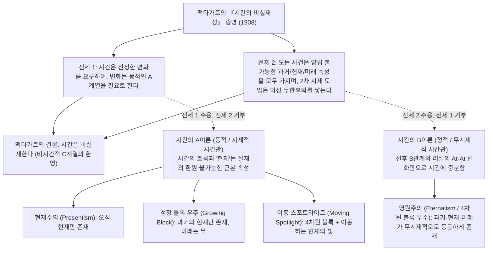
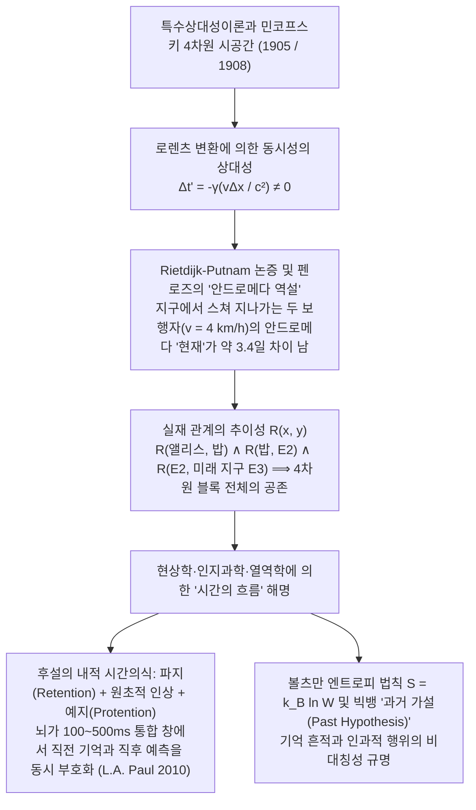

## 1. 서론 및 맥타가트의 『시간의 비실재성』(1908)

서기 397년경 아우구스티누스는 『고백록』 제11권에서 “시간이란 도대체 무엇인가? 아무도 묻지 않으면 나는 알지만, 묻는 자에게 설명하려 하면 알지 못한다”라고 탄식했다. 우리의 일상적 직관에 따르면 과거(소크라테스, 공룡)는 더 이상 존재하지 않고 미래는 아직 존재하지 않으며, 오직 면도날처럼 얇은 ‘지금(현재)’만이 실재한다.

1908년 케임브리지 철학자 <strong>존 맥타가트(J.M.E. McTaggart)</strong>는 논문 「시간의 비실재성(The Unreality of Time)」에서 시간 속 사건들의 배열을 두 가지 계열로 구분했다:
1. <strong>A계열(The A-series, 시제적·동적 계열)</strong>: ‘현재’를 기준으로 사건을 ‘먼 미래’, ‘가까운 미래’, ‘현재($N(e)$)’, ‘가까운 과거’, ‘먼 과거($P(e)$)’로 규정한다. A계열의 본질은 그 규정이 끊임없이 변화한다는 점이다.
2. <strong>B계열(The B-series, 무시제적·정적 계열)</strong>: 사건들을 ‘~보다 이전($E(e_1, e_2)$)’, ‘~와 동시’, ‘~보다 이후’라는 영구적인 이항 관계로 배열한다.

맥타가트는 두 단계 논증을 통해 “시간은 실재하지 않는다”고 증명한다:
* <strong>전제 1 (A계열 없이는 변화와 시간도 없다)</strong>: 시간은 변화를 필수 조건으로 하는데, 순수한 B계열(러셀의 At-At 변화 이론 비판)에서는 사건의 시점과 성질이 영원히 고정되어 있으며, 오직 미래에서 현재를 거쳐 과거로 이동하는 A계열 규정만이 변화할 수 있다.
* <strong>전제 2 (A계열의 내적 모순과 악성 무한후퇴)</strong>: 과거 $P(e)$, 현재 $N(e)$, 미래 $F(e)$는 상호 양립 불가능하지만, 시간의 흐름 속에서 모든 사건 $e$는 세 규정을 모두 가져야 한다:
  $$\forall e \, \Big( \neg\big(P(e) \land N(e)\big) \land \neg\big(N(e) \land F(e)\big) \Big) \quad \text{vs.} \quad \forall e \, \big( P(e) \land N(e) \land F(e) \big)$$
  만약 “$e$는 미래<strong>였고</strong>, 현재<strong>이며</strong>, 과거가 <strong>될 것이다</strong>”라고 답한다면, 이는 2차 A계열($3 \times 3$ 복합 시제 행렬)을 끌어들인 것이며, 그 대각선 및 행 성분($P(P(e)), N(N(e)), F(F(e))$ 등)에서 동일한 모순이 재발하여 $3^n$차 시제로의 <strong>악성 무한후퇴(Vicious Infinite Regress)</strong>에 빠진다.

---

## 2. 시간의 4대 존재론 모델: 현재주의 vs. 영원주의

1. <strong>현재주의(Presentism, 프라이어 Arthur Prior, 마코시안 Ned Markosian)</strong>: 오직 현재의 대상과 사건만 존재한다. 문장 시제 연산자 $P, F$를 기본 개념으로 삼아 맥타가트의 후퇴를 차단하지만, <strong>‘진리제보자 반론(Truthmaker Objection, Sider 2001)’</strong>(과거가 전혀 존재하지 않는다면 무엇이 “백악기에 공룡이 살았다”를 참으로 만드는가?)과 <strong>시간 간 인과관계 문제</strong>에 직면한다.
2. <strong>영원주의 / 4차원 블록 우주(Eternalism, 러셀, 콰인, 멜러 D.H. Mellor, 시더 Ted Sider)</strong>: 과거, 현재, 미래의 모든 사건이 4차원 시공간 다양체 안에 무시제적으로 동등하게 존재한다. ‘지금(Now)’은 공간적 ‘여기(Here)’와 똑같은 <strong>지표사(Indexical)</strong>로서 발화자 자신의 시공간 좌표를 가리킬 뿐이다.
3. <strong>성장 블록 우주론(Growing Block, 브로드 C.D. Broad 1923)</strong>: 과거와 현재는 존재하고 미래는 존재하지 않으며, ‘현재’는 블록이 자라나는 최전선 단면이다. 그러나 <strong>‘죽은 과거(Dead Past)’ 인식론적 반론(Braddon-Mitchell 2004)</strong>에 무너진다: 블록 내부의 1863년 단면에 존재하는 링컨도 자신이 ‘현재’에 살고 있다고 믿는데, 우리가 2026년이 우주의 최전선인지 아니면 이미 3000년에 추월당한 과거 단면인지 어떻게 알 수 있는가?
4. <strong>이동 스포트라이트 이론(Moving Spotlight, Cameron 2015)</strong>: 4차원 블록 위를 ‘절대적 현재성’의 불빛이 이동한다고 보나, 역시 인식론적 회의주의와 “초시간당 이동 속도”의 역설에 부딪힌다.

| 비교 차원 | 현재주의 (Presentism) | 성장 블록 우주 (Growing Block) | 이동 스포트라이트 (Moving Spotlight) | 영원주의 / 블록 우주 (Eternalism) |
| :--- | :--- | :--- | :--- | :--- |
| <strong>형이상학적 진영</strong> | A이론 (동적·시제적) | A이론 (동적·시제적) | A이론 (동적·시제적) | B이론 (정적·무시제적) |
| <strong>과거와 미래의 존재</strong> | 과거 <strong>비존재</strong>, 미래 <strong>비존재</strong> | 과거 <strong>존재</strong>, 미래 <strong>비존재</strong> | 과거 <strong>존재</strong>, 미래 <strong>존재</strong> | 과거 <strong>존재</strong>, 미래 <strong>존재</strong> |
| <strong>‘지금(Now)’의 본질</strong> | 실재 전체 그 자체 | 존재가 생성되는 최전선 경계 | 이동하는 단항적 절대 속성 | ‘여기(Here)’와 같은 지표사 |
| <strong>과거 진리의 진리제보자</strong> | <strong>심각한 난점</strong> (루크레티우스 속성 등) | <strong>해결됨</strong> (과거 실체가 블록 내 존재) | <strong>해결됨</strong> (과거 실체가 블록 내 존재) | <strong>해결됨</strong> (4차원 블록 내 존재) |
| <strong>‘죽은 과거’ 인식론적 반론</strong> | <strong>면역</strong> (존재하면 곧 현재) | <strong>치명적 취약</strong> (최전선 여부 판별 불가) | <strong>치명적 취약</strong> (조명 여부 판별 불가) | <strong>면역</strong> (모든 시점이 자신에게 ‘지금’) |
| <strong>특수상대성이론과의 양립성</strong> | <strong>충돌</strong> (숨겨진 절대 기준계 필요) | <strong>충돌</strong> (절대적 동시성 단면 필요) | <strong>충돌</strong> (절대적 동시성 단면 필요) | <strong>완벽히 양립</strong> (민코프스키 시공간) |

---

## 3. 아인슈타인의 특수상대성이론, 민코프스키 시공간, 그리고 안드로메다 역설

현대 물리학의 <strong>특수상대성이론(1905)</strong>과 <strong>민코프스키 4차원 시공간(1908)</strong>에서 관성계 간 불변량은 시공간 간격 $ds^2 = -c^2 dt^2 + dx^2 + dy^2 + dz^2$이다. <strong>로렌츠 변환(Lorentz Transformation)</strong>에 의해:

$$t' = \gamma \left( t - \frac{vx}{c^2} \right), \qquad \gamma = \frac{1}{\sqrt{1 - v^2/c^2}} \implies \Delta t' = \gamma \left( \Delta t - \frac{v \Delta x}{c^2} \right)$$

기준계 $S$에서 거리 $\Delta x > 0$만큼 떨어진 두 사건이 동시에($\Delta t = 0$) 일어나더라도, 속도 $v$로 움직이는 기준계 $S'$에서는 $\Delta t' = -\gamma \frac{v \Delta x}{c^2} \neq 0$이 되어 <strong>동시성의 상대성(Relativity of Simultaneity)</strong>이 성립한다.

<strong>리트다이크(C.W. Rietdijk, 1966)</strong>와 <strong>힐러리 퍼트넘(Hilary Putnam, 1967)</strong>의 논증, 그리고 <strong>로저 펜로즈(Roger Penrose, 1989)</strong>의 <strong>‘안드로메다 역설(Andromeda Paradox)’</strong>은 이를 극명하게 보여준다. 지구에서 정지한 앨리스($A$) 옆을 밥($B$)이 시속 $v = 4\text{ km/h} \approx 1.11\text{ m/s}$의 걸음걸이로 $L = 2.5 \times 10^6\text{ 광년}$ 떨어진 안드로메다 은하(M31)를 향해 걸어갈 때, 두 사람이 스치는 동일한 시공간 점 $O$에서 두 사람의 ‘안드로메다의 현재’는 다음과 같이 차이 난다:

$$\Delta t \approx \frac{v L}{c^2} = \left(\frac{1.11\text{ m/s}}{3.0 \times 10^8\text{ m/s}}\right) \times 2.5 \times 10^6\text{ 년} \approx 3.38\text{ 일 (약 3.4~5일!)}$$

앨리스의 현재 초평면에서는 안드로메다 외계 함대의 지구 침공 여부가 아직 결정되지 않았지만(사건 $E_1$), 밥의 현재 초평면에서는 이미 4일 전에 함대가 출격했다(사건 $E_2$)! 실재 관계 $R(x,y)$의 <strong>추이성(Transitivity)</strong> $R(A, B) \land R(B, E_2) \land R(E_2, \text{미래 지구 } E_3) \implies R(A, E_3)$에 의해, 4차원 민코프스키 시공간의 모든 과거·미래 사건은 이미 공존한다.

---

## 4. 왜 시간은 흐르는 것처럼 느껴지는가? — 현상학, 인지과학, 열역학적 시간의 화살

1. <strong>후설(Edmund Husserl)의 내적 시간의식 현상학과 인지신경과학</strong>: 후설은 우리가 멜로디($C \to E \to G$)를 들을 때 의식의 ‘살아있는 현재’가 <strong>파지(Retention, 방금 지나간 음의 일차적 보유)</strong>, <strong>원초적 인상(Urimpression, 현재 울리는 음)</strong>, <strong>예지(Protention, 곧 도래할 음에 대한 예기)</strong>의 삼중 지향적 구조를 갖는다고 밝혔다. 현대 철학자 <strong>L.A. Paul(2010)</strong>과 <strong>Craig Callender(2017)</strong>는 4차원 세계선 위의 각 뇌 상태 $B(t_n)$가 $100\sim 500\text{ ms}$의 시간 통합 창 안에서 $t_{n-1}$의 작업기억 흔적과 $t_{n+1}$의 예측 부호화 모델을 동시에 포함하기 때문에, 무시제적 4차원 블록 내부의 각 시점에서 생생한 ‘흐름’의 현상학이 필연적으로 생성됨을 입증했다.
2. <strong>볼츠만 통계역학과 ‘과거 가설(Past Hypothesis)’</strong>: 미시 물리 법칙은 시간 반전($t \to -t$)에 대칭적이지만, 거시적 <strong>시간의 화살(Arrow of Time)</strong>은 열역학 제2법칙과 볼츠만 엔트로피 공식에서 비롯된다:
   $$S = k_B \ln W, \qquad \frac{dS}{dt} \geq 0$$
   데이비드 앨버트(David Albert, 2000)가 정식화한 우주론적 경계조건인 <strong>‘과거 가설’</strong>(138억 년 전 빅뱅 초기 우주가 극저엔트로피 상태 $W_0 \ll W_{\max}$였다는 조건) 덕분에, 거시적 기억과 흔적은 오직 저엔트로피 경계(과거) 쪽으로만 형성되며, 우리의 행위적 선택은 엔트로피가 증가하는 미래 쪽으로만 분기한다.
