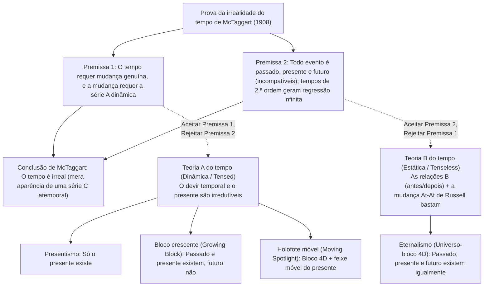
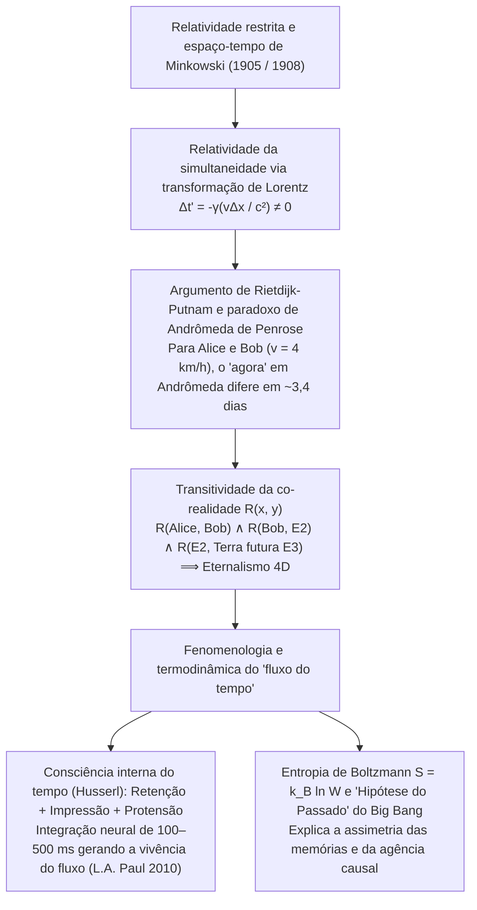

## 1. Introdução e "A Irrealidade do Tempo" de J.M.E. McTaggart (1908)

Por volta de 397 d.C., Santo Agostinho escreveu em suas *Confissões* (Livro XI, 14): "O que é, pois, o tempo? Se ninguém me pergunta, eu sei; mas se quero explicar a quem me pergunta, já não sei." Segundo nossa intuição cotidiana, o passado (Sócrates, os dinossauros) não existe mais e o futuro ainda não existe; somente o "agora" (o presente) é real.

Em 1908, o filósofo de Cambridge <strong>J.M.E. McTaggart</strong> publicou na *Mind* seu artigo seminal *"The Unreality of Time"*, distinguindo duas séries temporais:
1. <strong>A série A (dinâmica / tensional):</strong> Ordena os eventos em relação ao "agora" como *futuros ($F(e)$)*, *presentes ($N(e)$)* e *passados ($P(e)$)*. Sua essência é a mudança contínua dessas determinações.
2. <strong>A série B (estática / atensional):</strong> Ordena os eventos por relações diádicas permanentes: *anterior a ($E(e_1, e_2)$)*, *simultâneo com* e *posterior a*.

A prova dedutiva em duas etapas de McTaggart sustenta que o tempo é irreal:
* <strong>Premissa 1 (Sem série A não há mudança nem tempo):</strong> O tempo exige mudança. Em uma pura série B (contra a teoria *At-At* de Bertrand Russell), as propriedades e datas dos eventos permanecem eternamente fixas; a única coisa que muda em um evento é sua passagem de futuro a presente e a passado (série A).
* <strong>Premissa 2 (Contradição da série A e regressão infinita):</strong> Passado $P(e)$, presente $N(e)$ e futuro $F(e)$ são mutuamente incompatíveis, mas todo evento temporal deve possuir os três:
  $$\forall e \, \Big( \neg\big(P(e) \land N(e)\big) \land \neg\big(N(e) \land F(e)\big) \Big) \quad \text{vs.} \quad \forall e \, \big( P(e) \land N(e) \land F(e) \big)$$
  Responder que "$e$ *foi* futuro, *é* presente e *será* passado" introduz uma <strong>série A de segunda ordem</strong> (matriz $3 \times 3$), cuja diagonal ($P(P(e)), N(N(e)), F(F(e))$) reproduz a mesma contradição, desencadeando uma <strong>regressão infinita viciosa</strong> rumo a tempos de ordem $3^n$.

---

## 2. Os quatro modelos ontológicos do tempo: Presentismo vs. Eternalismo

1. <strong>Presentismo (Arthur Prior, Ned Markosian):</strong> Apenas objetos e eventos presentes existem. Bloqueia a regressão de McTaggart por meio de operadores de tempo verbal primitivos ($P, F$), mas esbarra na <strong>objeção do fazedor de verdade (Truthmaker Objection, Sider 2001)</strong> — o que no mero presente torna verdadeiro que "Dinossauros existiram no Cretáceo"? — e no problema das relações transtemporais.
2. <strong>Eternalismo / Universo-bloco 4D (Bertrand Russell, W.V.O. Quine, D.H. Mellor, Ted Sider):</strong> Passado, presente e futuro existem em igualdade ontológica dentro de uma variedade espaço-temporal quadridimensional. "Agora" é, tal como "aqui", um puro <strong>indexical</strong> que aponta a coordenada espaço-temporal do falante.
3. <strong>Universo em bloco crescente (Growing Block, C.D. Broad 1923):</strong> O passado e o presente existem, enquanto o futuro não existe; o "presente" é a borda de crescimento do bloco. Sucumbe à <strong>objeção epistêmica do "passado morto" (Dead Past, Braddon-Mitchell 2004)</strong>: se Lincoln existe na fatia de 1863 acreditando viver no "agora", como sabemos que 2026 é a borda externa do bloco e não parte do passado morto?
4. <strong>Teoria do holofote móvel (Moving Spotlight, Ross Cameron 2015):</strong> Acrescenta ao bloco 4D um holofote móvel de "presentidade absoluta", mas herda o ceticismo epistêmico e o paradoxo da velocidade do tempo ("um segundo por hiper-segundo").

| Critério | Presentismo | Bloco crescente (Growing Block) | Holofote móvel (Moving Spotlight) | Eternalismo (Universo-bloco 4D) |
| :--- | :--- | :--- | :--- | :--- |
| <strong>Campo metafísico</strong> | Teoria A (dinâmica) | Teoria A (dinâmica) | Teoria A (dinâmica) | Teoria B (estática / atensional) |
| <strong>Status de passado e futuro</strong> | Passado <strong>não</strong>, Futuro <strong>não</strong> | Passado <strong>sim</strong>, Futuro <strong>não</strong> | Passado <strong>sim</strong>, Futuro <strong>sim</strong> | Passado <strong>sim</strong>, Futuro <strong>sim</strong> |
| <strong>Natureza do "agora"</strong> | A totalidade da existência | Borda ontológica de crescimento | Propriedade monádica móvel | Indexical (como "aqui") |
| <strong>Fazedores de verdade do passado</strong> | <strong>Grave problema</strong> | <strong>Resolvido</strong> (o passado existe) | <strong>Resolvido</strong> (o passado existe) | <strong>Resolvido</strong> (o bloco 4D existe) |
| <strong>Objeção epistêmica</strong> | <strong>Imune</strong> | <strong>Fatalmente vulnerável</strong> | <strong>Fatalmente vulnerável</strong> | <strong>Imune</strong> (indexical em cada corte) |
| <strong>Relatividade restrita</strong> | <strong>Incompatível</strong> sem éter | <strong>Incompatível</strong> sem folheação | <strong>Incompatível</strong> sem folheação | <strong>Diretamente compatível</strong> (Minkowski) |

---

## 3. Relatividade restrita, espaço-tempo de Minkowski e o paradoxo de Andrômeda

Na <strong>relatividade restrita de Einstein (1905)</strong> e no <strong>espaço-tempo quadridimensional de Minkowski (1908)</strong>, o intervalo invariante é $ds^2 = -c^2 dt^2 + dx^2 + dy^2 + dz^2$. Pela <strong>transformação de Lorentz</strong>:

$$t' = \gamma \left( t - \frac{vx}{c^2} \right), \qquad \gamma = \frac{1}{\sqrt{1 - v^2/c^2}} \implies \Delta t' = \gamma \left( \Delta t - \frac{v \Delta x}{c^2} \right)$$

Dois eventos simultâneos no referencial $S$ ($\Delta t = 0$) separados por $\Delta x > 0$ <strong>não são simultâneos</strong> em $S'$ movendo-se com velocidade $v$ ($\Delta t' = -\gamma \frac{v \Delta x}{c^2} \neq 0$).

<strong>C.W. Rietdijk (1966)</strong> e <strong>Hilary Putnam (1967)</strong> provaram que isso colapsa o presentismo no eternalismo, ilustrado pelo <strong>paradoxo de Andrômeda de Roger Penrose (1989)</strong>: se Bob ($B$) caminha a $v = 4\text{ km/h} \approx 1.11\text{ m/s}$ cruzando com Alice ($A$) parada em direção à galáxia de Andrômeda ($L = 2.5 \times 10^6\text{ anos-luz}$), seus hiperplanos de simultaneidade em Andrômeda diferem em:

$$\Delta t \approx \frac{v L}{c^2} = \left(\frac{1.11\text{ m/s}}{3.0 \times 10^8\text{ m/s}}\right) \times 2.5 \times 10^6\text{ anos} \approx 3.38\text{ dias}$$

Para Alice, o lançamento de uma frota alienígena em Andrômeda ainda não foi decidido ($E_1$); para Bob, a frota já partiu há quase quatro dias ($E_2$)! Pela <strong>transitividade da existência</strong> $R(A, B) \land R(B, E_2) \land R(E_2, \text{Terra futura } E_3)$, toda a variedade 4D de Minkowski coexiste atensionalmente.

---

## 4. Por que sentimos que o tempo flui? — Husserl, ciência cognitiva e a seta termodinâmica

1. <strong>A fenomenologia de Husserl e a neurociência cognitiva:</strong> Para ouvirmos uma melodia ($C \to E \to G$), cada "presente vivo" articula três momentos intencionais: <strong>retenção</strong> (conservação imediata da nota recém-passada), <strong>impressão originária</strong> (nota atual) e <strong>protensão</strong> (antecipação da nota iminente). Como mostraram <strong>L.A. Paul (2010)</strong> e <strong>Craig Callender (2017)</strong>, cada estado cerebral $B(t_n)$ ao longo de nossa linha de universo 4D codifica simultaneamente (em uma janela de $100\text{–}500\text{ ms}$) traços de memória operacional de $t_{n-1}$ e modelos preditivos de $t_{n+1}$, gerando necessariamente a fenomenologia dinâmica da passagem do tempo.
2. <strong>A mecânica estatística de Boltzmann e a "Hipótese do Passado" (Past Hypothesis):</strong> Embora as leis microfísicas sejam simétricas sob inversão temporal ($t \to -t$), a <strong>seta do tempo</strong> macroscópica emerge da segunda lei da termodinâmica:
   $$S = k_B \ln W, \qquad \frac{dS}{dt} \geq 0$$
   Aliada à condição de contorno cosmológica de um Big Bang de entropia ultrabaixa ($W_0 \ll W_{\max}$, a <strong>Past Hypothesis</strong> de David Albert, 2000), essa inclinação entrópica explica por que registros e memórias só se formam em direção ao passado e por que nossas decisões só ramificam o futuro.
