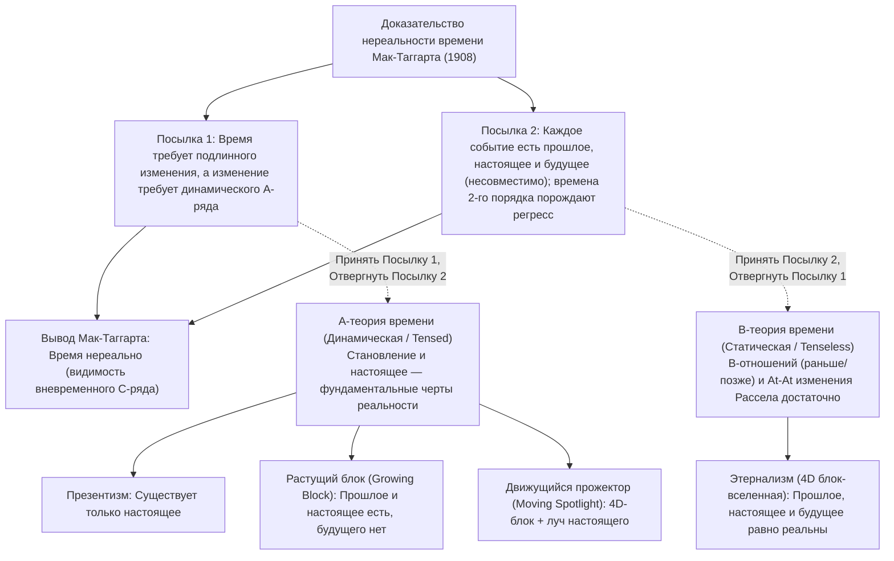
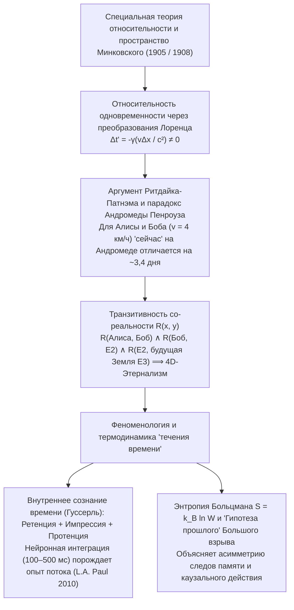

## 1. Введение и «Нереальность времени» Дж. М. Э. Мак-Таггарта (1908)

Около 397 года н. э. Блаженный Августин записал в «Исповеди» (Книга XI, 14) знаменитый вопрос: «Что же такое время? Если никто меня об этом не спрашивает, я знаю, что такое время; если бы я захотел объяснить спрашивающему — нет, не знаю». Согласно нашей повседневной интуиции, прошлого (Сократа, динозавров) уже нет, а будущего еще нет — подлинно существует лишь острое, как лезвие бритвы, «сейчас» (настоящее).

В 1908 году кембриджский философ <strong>Дж. М. Э. Мак-Таггарт (J.M.E. McTaggart)</strong> опубликовал в журнале *Mind* эпохальную статью *«The Unreality of Time»*, выделив два способа упорядочения событий во времени:
1. <strong>А-ряд (динамический / видо-временной):</strong> Упорядочивает события относительно «сейчас» как *будущие ($F(e)$)*, *настоящие ($N(e)$)* и *прошлые ($P(e)$)*. Его сущность — непрерывное изменение этих определений.
2. <strong>В-ряд (статический / безвременной):</strong> Упорядочивает события посредством неизменных двухместных отношений: *раньше чем ($E(e_1, e_2)$)*, *одновременно с* и *позже чем*.

Двухшаговое доказательство нереальности времени Мак-Таггарта гласит:
* <strong>Посылка 1 (Без А-ряда нет изменения и времени):</strong> Время требует изменения. В чистом В-ряде (против *At-At* теории изменения Бертрана Рассела) все свойства и даты событий навечно фиксированы; меняться может лишь положение события в А-ряде (переход из будущего в настоящее и прошлое).
* <strong>Посылка 2 (Противоречивость А-ряда и дурной бесконечный регресс):</strong> Прошлое $P(e)$, настоящее $N(e)$ и будущее $F(e)$ взаимно несовместимы, но каждое временное событие должно обладать всеми тремя:
  $$\forall e \, \Big( \neg\big(P(e) \land N(e)\big) \land \neg\big(N(e) \land F(e)\big) \Big) \quad \text{vs.} \quad \forall e \, \big( P(e) \land N(e) \land F(e) \big)$$
  Возражение «$e$ *было* будущим, *есть* настоящее и *будет* прошлым» вводит <strong>А-ряд второго порядка</strong> (матрицу $3 \times 3$), на главной диагонали которой ($P(P(e)), N(N(e)), F(F(e))$) воспроизводится то же противоречие, запуская <strong>порочный бесконечный регресс</strong> к временам порядка $3^n$.

---

## 2. Четыре онтологические модели времени: Презентизм против Этернализма

1. <strong>Презентизм (Артур Прайор, Нед Маркосян):</strong> Существуют только настоящие объекты и события. Он блокирует регресс Мак-Таггарта с помощью примитивных операторов времени ($P, F$), но сталкивается с <strong>проблемой истинностного обеспечения (Truthmaker Objection, Sider 2001)</strong> — что в чисто настоящем мире делает истинным суждение «В меловом периоде жили динозавры»? — и проблемой межвременных отношений.
2. <strong>Этернализм / 4D блок-вселенная (Бертран Рассел, У. В. О. Куайн, Д. Х. Меллор, Тед Сайдер):</strong> Прошлое, настоящее и будущее равноправно существуют в четырехмерном пространственно-временном многообразии. «Сейчас» — подобно слову «здесь» — это чистый <strong>индексикал (Indexical)</strong>, указывающий координату говорящего в блоке.
3. <strong>Растущая блок-вселенная (Growing Block, Ч. Д. Броуд 1923):</strong> Прошлое и настоящее существуют, будущего нет; «настоящее» — это растущий край блока. Модель рушится под ударом <strong>эпистемического возражения «мертвого прошлого» (Dead Past, Braddon-Mitchell 2004)</strong>: если Линкольн существует в срезе 1863 года и убежден, что живет «сейчас», откуда мы знаем, что 2026 год находится на внешнем краю блока, а не в глубине мертвого прошлого?
4. <strong>Теория движущегося прожектора (Moving Spotlight, Росс Кэмерон 2015):</strong> Добавляет к 4D-блоку движущийся луч «абсолютного настоящего», но наследует эпистемический скептицизм и парадокс скорости течения времени («одна секунда в гипер-секунду»).

| Критерий | Презентизм | Растущий блок (Growing Block) | Движущийся прожектор | Этернализм (4D блок-вселенная) |
| :--- | :--- | :--- | :--- | :--- |
| <strong>Метафизический лагерь</strong> | А-теория (динамическая) | А-теория (динамическая) | А-теория (динамическая) | В-теория (статическая) |
| <strong>Статус прошлого и будущего</strong> | Прош. <strong>нет</strong>, Буд. <strong>нет</strong> | Прош. <strong>есть</strong>, Буд. <strong>нет</strong> | Прош. <strong>есть</strong>, Буд. <strong>есть</strong> | Прош. <strong>есть</strong>, Буд. <strong>есть</strong> |
| <strong>Природа «сейчас»</strong> | Вся полнота бытия | Передний край роста бытия | Движущееся монадическое свойство | Индексикал (как «здесь») |
| <strong>Истинностные основания прошлого</strong> | <strong>Острая проблема</strong> | <strong>Решено</strong> (прошлое есть в блоке) | <strong>Решено</strong> (прошлое есть в блоке) | <strong>Решено</strong> (весь 4D-блок есть) |
| <strong>Эпистемическое возражение</strong> | <strong>Неуязвим</strong> | <strong>Фатально уязвим</strong> (Dead Past) | <strong>Фатально уязвим</strong> | <strong>Неуязвим</strong> (индексикал везде) |
| <strong>Специальная теория относительности</strong> | <strong>Несовместим</strong> без эфира | <strong>Несовместим</strong> без слоения | <strong>Несовместим</strong> без слоения | <strong>Прямо совместим</strong> (Минковский) |

---

## 3. Специальная теория относительности, пространство-время Минковского и парадокс Андромеды

В <strong>специальной теории относительности Эйнштейна (1905)</strong> и <strong>четырехмерном пространстве-времени Минковского (1908)</strong> инвариантом является интервал $ds^2 = -c^2 dt^2 + dx^2 + dy^2 + dz^2$. Согласно <strong>преобразованиям Лоренца</strong>:

$$t' = \gamma \left( t - \frac{vx}{c^2} \right), \qquad \gamma = \frac{1}{\sqrt{1 - v^2/c^2}} \implies \Delta t' = \gamma \left( \Delta t - \frac{v \Delta x}{c^2} \right)$$

Два события, одновременные в системе $S$ ($\Delta t = 0$) на расстоянии $\Delta x > 0$, <strong>не одновременны</strong> в системе $S'$, движущейся со скоростью $v$ ($\Delta t' = -\gamma \frac{v \Delta x}{c^2} \neq 0$).

<strong>К. В. Ритдайк (1966)</strong> и <strong>Хилари Патнэм (1967)</strong> доказали, что это ведет к краху презентизма в пользу этернализма, что наглядно демонстрирует <strong>парадокс Андромеды Роджера Пенроуза (1989)</strong>: если Боб ($B$) идет со скоростью шага $v = 4\text{ км/ч} \approx 1.11\text{ м/с}$ мимо стоящей Алисы ($A$) по направлению к галактике Андромеды ($L = 2.5 \times 10^6\text{ световых лет}$), их гиперплоскости одновременности на Андромеде расходятся на:

$$\Delta t \approx \frac{v L}{c^2} = \left(\frac{1.11\text{ м/с}}{3.0 \times 10^8\text{ м/с}}\right) \times 2.5 \times 10^6\text{ лет} \approx 3.38\text{ суток}$$

Для Алисы вторжение инопланетного флота с Андромеды еще не решено ($E_1$), а для Боба флот уже вылетел почти четыре дня назад ($E_2$)! В силу <strong>транзитивности существования</strong> $R(A, B) \land R(B, E_2) \land R(E_2, \text{будущая Земля } E_3)$ все четырехмерное многообразие Минковского сосуществует вневременно.

---

## 4. Почему кажется, что время течет? — Гуссерль, когнитивная наука и термодинамическая стрела

1. <strong>Феноменология Эдмунда Гуссерля и когнитивная нейронаука:</strong> Чтобы воспринимать мелодию ($C \to E \to G$), каждое «живое настоящее» объединяет три интенциональных момента: <strong>ретенцию</strong> (удержание только что отзвучавшей ноты), <strong>первичную импрессию</strong> (звучащая нота) и <strong>протенцию</strong> (предвосхищение следующей ноты). Как показали <strong>Л. А. Пол (2010)</strong> и <strong>Крейг Каллендер (2017)</strong>, каждое состояние мозга $B(t_n)$ вдоль нашей 4D мировой линии в окне интеграции $100\text{–}500\text{ мс}$ одновременно кодирует затухающие следы рабочей памяти о $t_{n-1}$ и предиктивные модели $t_{n+1}$, необходимо порождая феноменологию динамического потока.
2. <strong>Статистическая механика Больцмана и «Гипотеза прошлого» (Past Hypothesis):</strong> Хотя микрозаконы физики симметричны относительно обращения времени ($t \to -t$), макроскопическая <strong>стрела времени</strong> возникает из второго начала термодинамики:
   $$S = k_B \ln W, \qquad \frac{dS}{dt} \geq 0$$
   В сочетании с космологическим граничным условием сверхнизкоэнтропийного Большого взрыва ($W_0 \ll W_{\max}$, <strong>Past Hypothesis</strong> Дэвида Альберта, 2000) этот градиент энтропии объясняет, почему следы памяти формируются только о прошлом, а наши решения разветвляют только будущее.
