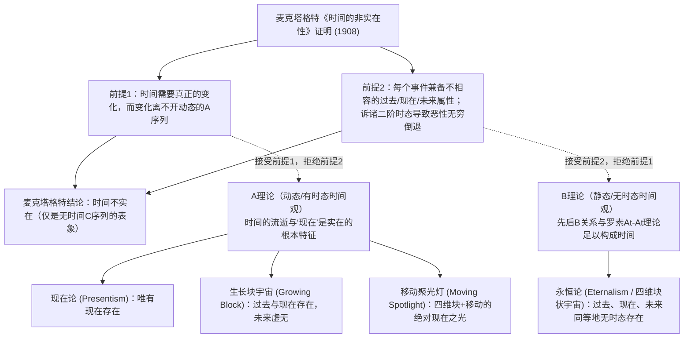
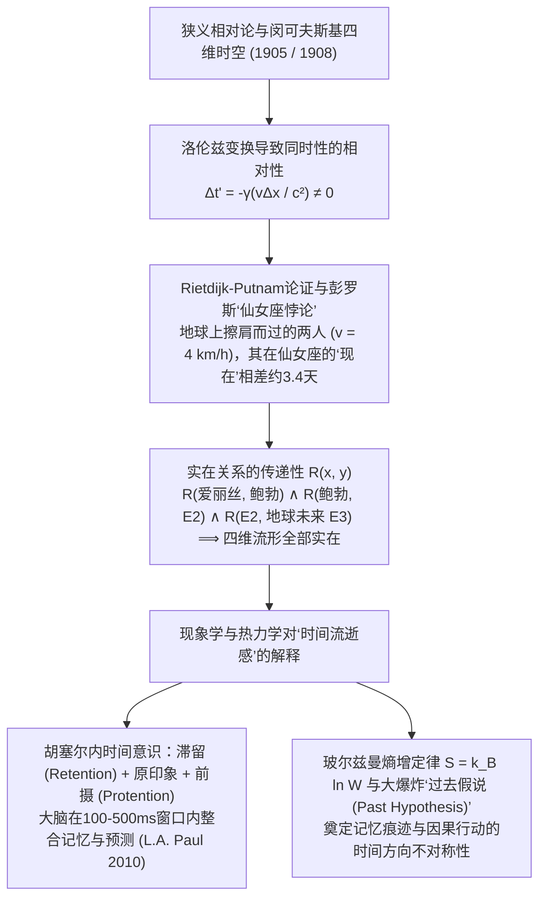

## 1. 引言与麦克塔格特的《时间的非实在性》（1908）

公元397年左右，圣奥古斯丁在《忏悔录》第十一卷中写下了著名的感叹：“时间究竟是什么？没有人问我，我知道；但若我要向提问者解释，我却一头雾水。”在日常直觉中，过去的苏格拉底与恐龙已不复存在，未来的事件尚未发生，唯有锋利如刀刃的“现在（Now）”真实存在。

1908年，剑桥哲学家<strong>约翰·麦克塔格特（J.M.E. McTaggart）</strong>在《心灵（*Mind*）》杂志发表了里程碑式的论文《时间的非实在性》（*The Unreality of Time*），将时间中的位置划分为两个序列：
1. <strong>A序列（The A-series，时态/动态序列）</strong>：以“现在”为基准，将事件规定为“遥远未来”“切近未来”“现在（Present, $N(e)$）”“切近过去”“遥远过去（Past, $P(e)$）”。A序列的本质在于其规定性不断变化。
2. <strong>B序列（The B-series，无时态/静态序列）</strong>：通过二元关系“早于（Earlier than, $E(e_1, e_2)$）”“同时”“晚于（Later than）”定位事件。B关系是永恒不变的。

麦克塔格特通过两步演绎证明“时间不实在”：
* <strong>前提1（无A序列则无变化与时间）</strong>：时间预设变化，而在纯粹的B序列中（反驳罗素的At-At变化理论），事件的时间坐标与性质永恒固定；事件唯一能变化的是从未来变为现在再变为过去的A属性。
* <strong>前提2（A序列的内在矛盾与恶性无穷倒退）</strong>：过去 $P(e)$、现在 $N(e)$ 与未来 $F(e)$ 彼此逻辑不相容，但时间流逝要求每个事件 $e$ 兼备三者：
  $$\forall e \, \Big( \neg\big(P(e) \land N(e)\big) \land \neg\big(N(e) \land F(e)\big) \Big) \quad \text{vs.} \quad \forall e \, \big( P(e) \land N(e) \land F(e) \big)$$
  若辩称“$e$ <strong>曾是</strong>未来、<strong>正是</strong>现在、<strong>将是</strong>过去”，则是引入二阶A序列，产生 $3 \times 3$ 复合时态矩阵，其中主对角线（或同行）项如 $P(P(e)), N(N(e)), F(F(e))$ 依然矛盾，从而触发向 $3^n$ 阶时态的<strong>恶性无穷倒退（Vicious Infinite Regress）</strong>。

---

## 2. 时间的四大本体论模型：现在论 vs. 永恒论

围绕A理论与B理论的对立，当代分析形而上学形成了四大时间本体论模型：

1. <strong>现在论（Presentism，普赖尔 Arthur Prior、马科西安 Ned Markosian）</strong>：唯有当下的客体与事件存在。它通过句法时态算子 $P, F$ 阻断麦克塔格特倒退，但面临两大致命难题：一是<strong>“使真者难题（Truthmaker Objection，Sider 2001）”</strong>——如果过去根本不存在，是什么客观事实使“白垩纪存在霸王龙”为真？二是<strong>跨时间关系难题</strong>——不存在的过去如何与现在发生因果关系？
2. <strong>永恒论 / 四维块状宇宙（Eternalism，罗素、蒯因、梅勒 D.H. Mellor、西德 Ted Sider）</strong>：过去、现在和未来在四维流形中同等存在。“现在（Now）”就像空间词汇“这里（Here）”一样，纯粹是一个<strong>指示词（Indexical）</strong>，仅指代发话者或思考者自身所在的时空坐标。
3. <strong>生长块宇宙论（Growing Block，布罗德 C.D. Broad 1923）</strong>：过去与现在存在，未来不存在，“现在”是四维宇宙块不断生长的最前沿切片。但它无法逃脱<strong>“死去的过去（Dead Past）”认识论反驳（Braddon-Mitchell 2004）</strong>：如果1863年的林肯依然存在于过去的块中并主观确信自己正处于“现在”，我们又如何知道2026年处于宇宙最前沿，而不是深埋在早已被3000年超越的“死去过去”之中？
4. <strong>移动聚光灯理论（Moving Spotlight，Cameron 2015）</strong>：承认四维块存在，但附加一束沿时间移动的“绝对现在”之光。它同样深陷认识论怀疑论与“时间流逝速率（一秒每超秒）”的无穷倒退。

| 比较维度 | 现在论 (Presentism) | 生长块宇宙 (Growing Block) | 移动聚光灯 (Moving Spotlight) | 永恒论 / 块状宇宙 (Eternalism) |
| :--- | :--- | :--- | :--- | :--- |
| <strong>所属阵营</strong> | A理论（动态时态） | A理论（动态时态） | A理论（动态时态） | B理论（静态无时态） |
| <strong>过去与未来的存在性</strong> | 过去<strong>不存在</strong>，未来<strong>不存在</strong> | 过去<strong>存在</strong>，未来<strong>不存在</strong> | 过去<strong>存在</strong>，未来<strong>存在</strong> | 过去<strong>存在</strong>，未来<strong>存在</strong> |
| <strong>“现在”的本质</strong> | 存在本身的全部总和 | 存在生长的最前沿边界 | 移动的一元绝对属性 | 类似“这里”的指示词 (Indexical) |
| <strong>过去命题的使真者</strong> | <strong>严重困难</strong>（需诉诸卢克莱修属性） | <strong>已解决</strong>（过去实体存在） | <strong>已解决</strong>（过去实体存在） | <strong>已解决</strong>（四维块内实体存在） |
| <strong>“死去过去”认识论怀疑</strong> | <strong>免疫</strong>（存在即现在） | <strong>致命脆弱</strong>（无法确知是否在前沿） | <strong>致命脆弱</strong>（无法确知是否被照亮） | <strong>免疫</strong>（每个切片对自己皆是现在） |
| <strong>与狭义相对论兼容性</strong> | <strong>冲突</strong>（需隐秘绝对参考系） | <strong>冲突</strong>（需绝对全局同时面） | <strong>冲突</strong>（需绝对全局同时面） | <strong>完美兼容</strong>（闵可夫斯基时空原生） |

---

## 3. 狭义相对论、闵可夫斯基时空与仙女座悖论（Rietdijk-Putnam论证）

对现在论最致命的打击来自现代物理学。根据爱因斯坦1905年<strong>狭义相对论</strong>与闵可夫斯基（Hermann Minkowski, 1908）的四维时空几何，惯性系之间不变的是四维时空线元 $ds^2 = -c^2 dt^2 + dx^2 + dy^2 + dz^2$。由<strong>洛伦兹变换（Lorentz Transformation）</strong>：

$$t' = \gamma \left( t - \frac{vx}{c^2} \right), \qquad \gamma = \frac{1}{\sqrt{1 - v^2/c^2}} \implies \Delta t' = \gamma \left( \Delta t - \frac{v \Delta x}{c^2} \right)$$

当参考系 $S$ 中空间相距 $\Delta x > 0$ 的两个类空事件同时发生（$\Delta t = 0$）时，在以速度 $v$ 运动的参考系 $S'$ 中，它们的时间差为 $\Delta t' = -\gamma \frac{v \Delta x}{c^2} \neq 0$。这就是<strong>同时性的相对性（Relativity of Simultaneity）</strong>。

1966–1967年，<strong>里特戴克（C.W. Rietdijk）</strong>与<strong>希拉里·普特南（Hilary Putnam）</strong>独立证明了狭义相对论蕴含四维永恒论；1989年<strong>罗杰·彭罗斯（Roger Penrose）</strong>将其形象化为著名的<strong>“仙女座悖论（Andromeda Paradox）”</strong>：
设地球上的爱丽丝（$A$）静止站立，鲍勃（$B$）以日常步行速度 $v = 4\text{ km/h} \approx 1.11\text{ m/s}$ 朝距离地球 $L = 2.5 \times 10^6\text{ 光年}$ 的仙女座星系（M31）走过她身边。在两人擦肩而过的同一时空点 $O$，两人的“同时超平面”在仙女座星系上的时间差高达：

$$\Delta t \approx \frac{v L}{c^2} = \left(\frac{1.11\text{ m/s}}{3.0 \times 10^8\text{ m/s}}\right) \times 2.5 \times 10^6\text{ 年} \approx 3.38\text{ 天（约 3.4 至 5 天！）}$$

对爱丽丝而言，仙女座外星舰队是否入侵地球尚未决定（事件 $E_1$）；而对擦肩而过的鲍勃而言，外星舰队早在4天前就已起航（事件 $E_2$）！若“共处同一现在即实在”且<strong>实在性具有传递性</strong> $R(x,y) \land R(y,z) \implies R(x,z)$，则通过传递链 $R(A, B) \land R(B, E_2) \land R(E_2, \text{未来地球 } E_3)$，四维闵可夫斯基流形中的一切过去与未来事件皆已客观存在。

---

## 4. 为什么我们感觉时间在流动？——胡塞尔现象学、认知科学与热力学时间之箭

既然四维块状宇宙是无时态的，为什么我们的意识体验却充满动态的“流逝感”？
1. <strong>胡塞尔（Edmund Husserl）的内时间意识现象学与认知科学</strong>：胡塞尔指出，我们对一段旋律（$C \to E \to G$）的知觉并非无厚度的数学点，而是由<strong>滞留（Retention，刚消逝之音的即时保持）</strong>、<strong>原印象（Urimpression，当下之音）</strong>与<strong>前摄（Protention，对即将到来之音的预期）</strong>构成的三重意向结构。当代形而上学家 <strong>L.A. Paul（2010）</strong>与 <strong>Craig Callender（2017）</strong>结合认知神经科学证明：四维世界线上的每个大脑状态 $B(t_n)$ 都在 $100\sim 500\text{ ms}$ 的时间整合窗口内同时编码了 $t_{n-1}$ 的衰减工作记忆痕迹与 $t_{n+1}$ 的预测编码模型，从而在每个静态切片内部自动生成了“从过去流向未来”的鲜活现象学体验。
2. <strong>玻尔兹曼统计力学与“过去假说（Past Hypothesis）”</strong>：微观物理定律对时间反演（$t \to -t$）是对称的，宏观的<strong>时间之箭（Arrow of Time）</strong>源于热力学第二定律与玻尔兹曼熵公式：
   $$S = k_B \ln W, \qquad \frac{dS}{dt} \geq 0$$
   结合大卫·阿尔伯特（David Albert, 2000）提出的宇宙学边界条件<strong>“过去假说”</strong>——宇宙在138亿年前的大爆炸起点处于极低熵状态（$W_0 \ll W_{\max}$）——沿着这一陡峭的熵增梯度，局部宏观记忆痕迹（如脚印、照片、大脑突触印迹）只能向低熵的过去方向形成，而我们的神经决策扰动只能向高熵的未来方向发散。正如爱因斯坦在1955年绝笔信中所言：“过去、现在和未来的区别只是一种顽固的幻觉”；但作为嵌入四维熵梯度中的具身主体，“此时此地”正是记忆照亮行动的永恒坐标。
