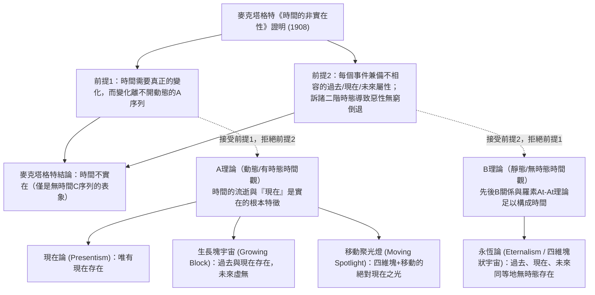
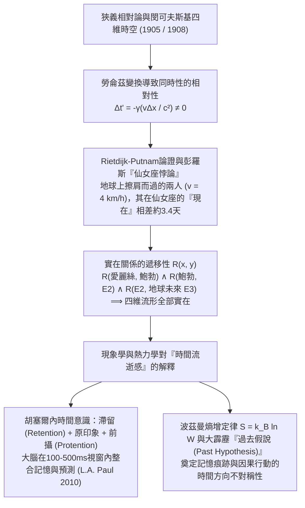

## 1. 引言與麥克塔格特的《時間的非實在性》（1908）

西元397年左右，聖奧古斯丁在《懺悔錄》第十一卷中寫下了著名的感嘆：「時間究竟是什麼？沒有人問我，我知道；但若我要向提問者解釋，我卻一頭霧水。」在日常直覺中，過去的蘇格拉底與恐龍已不復存在，未來的事件尚未發生，唯有鋒利如刀刃的「現在（Now）」真實存在。

1908年，劍橋哲學家<strong>約翰·麥克塔格特（J.M.E. McTaggart）</strong>在《心靈（*Mind*）》雜誌發表了里程碑式的論文《時間的非實在性》（*The Unreality of Time*），將時間中的位置劃分為兩個序列：
1. <strong>A序列（The A-series，時態/動態序列）</strong>：以「現在」為基準，將事件規定為「遙遠未來」「切近未來」「現在（Present, $N(e)$）」「切近過去」「遙遠過去（Past, $P(e)$）」。A序列的本質在於其規定性不斷變化。
2. <strong>B序列（The B-series，無時態/靜態序列）</strong>：透過二元關係「早於（Earlier than, $E(e_1, e_2)$）」「同時」「晚於（Later than）」定位事件。B關係是永恆不變的。

麥克塔格特透過兩步演繹證明「時間不實在」：
* <strong>前提1（無A序列則無變化與時間）</strong>：時間預設變化，而在純粹的B序列中（反駁羅素的At-At變化理論），事件的時間座標與性質永恆固定；事件唯一能變化的是從未來變為現在再變為過去的A屬性。
* <strong>前提2（A序列的內在矛盾與惡性無窮倒退）</strong>：過去 $P(e)$、現在 $N(e)$ 與未來 $F(e)$ 彼此邏輯不相容，但時間流逝要求每個事件 $e$ 兼備三者：
  $$\forall e \, \Big( \neg\big(P(e) \land N(e)\big) \land \neg\big(N(e) \land F(e)\big) \Big) \quad \text{vs.} \quad \forall e \, \big( P(e) \land N(e) \land F(e) \big)$$
  若辯稱「$e$ <strong>曾是</strong>未來、<strong>正是</strong>現在、<strong>將是</strong>過去」，則是引入二階A序列，產生 $3 \times 3$ 複合時態矩陣，其中主對角線（或同行）項如 $P(P(e)), N(N(e)), F(F(e))$ 依然矛盾，從而觸發向 $3^n$ 階時態的<strong>惡性無窮倒退（Vicious Infinite Regress）</strong>。

---

## 2. 時間的四大本體論模型：現在論 vs. 永恆論

圍繞A理論與B理論的對立，當代分析形上學形成了四大時間本體論模型：

1. <strong>現在論（Presentism，普賴爾 Arthur Prior、馬科西安 Ned Markosian）</strong>：唯有當下的客體與事件存在。它透過句法時態算子 $P, F$ 阻斷麥克塔格特倒退，但面臨兩大致命難題：一是<strong>「使真者難題（Truthmaker Objection，Sider 2001）」</strong>——如果過去根本不存在，是什麼客觀事實使「白堊紀存在暴龍」為真？二是<strong>跨時間關係難題</strong>——不存在的過去如何與現在發生因果關係？
2. <strong>永恆論 / 四維塊狀宇宙（Eternalism，羅素、蒯因、梅勒 D.H. Mellor、西德 Ted Sider）</strong>：過去、現在和未來在四維流形中同等存在。「現在（Now）」就像空間詞彙「這裡（Here）」一樣，純粹是一個<strong>指示詞（Indexical）</strong>，僅指代發話者或思考者自身所在的時空座標。
3. <strong>生長塊宇宙論（Growing Block，布羅德 C.D. Broad 1923）</strong>：過去與現在存在，未來不存在，「現在」是四維宇宙塊不斷生長的最前沿切片。但它無法逃脫<strong>「死去的過去（Dead Past）」認識論反駁（Braddon-Mitchell 2004）</strong>：如果1863年的林肯依然存在於過去的塊中並主觀確信自己正處於「現在」，我們又如何知道2026年處於宇宙最前沿，而不是深埋在早已被3000年超越的「死去過去」之中？
4. <strong>移動聚光燈理論（Moving Spotlight，Cameron 2015）</strong>：承認四維塊存在，但附加一束沿時間移動的「絕對現在」之光。它同樣深陷認識論懷疑論與「時間流逝速率（一秒每超秒）」的無窮倒退。

| 比較維度 | 現在論 (Presentism) | 生長塊宇宙 (Growing Block) | 移動聚光燈 (Moving Spotlight) | 永恆論 / 塊狀宇宙 (Eternalism) |
| :--- | :--- | :--- | :--- | :--- |
| <strong>所屬陣營</strong> | A理論（動態時態） | A理論（動態時態） | A理論（動態時態） | B理論（靜態無時態） |
| <strong>過去與未來的存在性</strong> | 過去<strong>不存在</strong>，未來<strong>不存在</strong> | 過去<strong>存在</strong>，未來<strong>不存在</strong> | 過去<strong>存在</strong>，未來<strong>存在</strong> | 過去<strong>存在</strong>，未來<strong>存在</strong> |
| <strong>「現在」的本質</strong> | 存在本身的全部總和 | 存在生長的最前沿邊界 | 移動的一元絕對屬性 | 類似「這裡」的指示詞 (Indexical) |
| <strong>過去命題的使真者</strong> | <strong>嚴重困難</strong>（需訴諸盧克萊修屬性） | <strong>已解決</strong>（過去實體存在） | <strong>已解決</strong>（過去實體存在） | <strong>已解決</strong>（四維塊內實體存在） |
| <strong>「死去過去」認識論懷疑</strong> | <strong>免疫</strong>（存在即現在） | <strong>致命脆弱</strong>（無法確知是否在前沿） | <strong>致命脆弱</strong>（無法確知是否被照亮） | <strong>免疫</strong>（每個切片對自己皆是現在） |
| <strong>與狹義相對論相容性</strong> | <strong>衝突</strong>（需隱秘絕對參考系） | <strong>衝突</strong>（需絕對全局同時面） | <strong>衝突</strong>（需絕對全局同時面） | <strong>完美相容</strong>（閔可夫斯基時空原生） |

---

## 3. 狹義相對論、閔可夫斯基時空與仙女座悖論（Rietdijk-Putnam論證）

對現在論最致命的打擊來自現代物理學。根據愛因斯坦1905年<strong>狹義相對論</strong>與閔可夫斯基（Hermann Minkowski, 1908）的四維時空幾何，慣性系之間不變的是四維時空線元 $ds^2 = -c^2 dt^2 + dx^2 + dy^2 + dz^2$。由<strong>勞侖茲變換（Lorentz Transformation）</strong>：

$$t' = \gamma \left( t - \frac{vx}{c^2} \right), \qquad \gamma = \frac{1}{\sqrt{1 - v^2/c^2}} \implies \Delta t' = \gamma \left( \Delta t - \frac{v \Delta x}{c^2} \right)$$

當參考系 $S$ 中空間相距 $\Delta x > 0$ 的兩個類空事件同時發生（$\Delta t = 0$）時，在以速度 $v$ 運動的參考系 $S'$ 中，它們的時間差為 $\Delta t' = -\gamma \frac{v \Delta x}{c^2} \neq 0$。這就是<strong>同時性的相對性（Relativity of Simultaneity）</strong>。

1966–1967年，<strong>里特戴克（C.W. Rietdijk）</strong>與<strong>希拉蕊·普特南（Hilary Putnam）</strong>獨立證明了狹義相對論蘊含四維永恆論；1989年<strong>羅傑·彭羅斯（Roger Penrose）</strong>將其形象化為著名的<strong>「仙女座悖論（Andromeda Paradox）」</strong>：
設地球上的愛麗絲（$A$）靜止站立，鮑勃（$B$）以日常步行速度 $v = 4\text{ km/h} \approx 1.11\text{ m/s}$ 朝距離地球 $L = 2.5 \times 10^6\text{ 光年}$ 的仙女座星系（M31）走過她身邊。在兩人擦肩而過的同一時空點 $O$，兩人的「同時超平面」在仙女座星系上的時間差高達：

$$\Delta t \approx \frac{v L}{c^2} = \left(\frac{1.11\text{ m/s}}{3.0 \times 10^8\text{ m/s}}\right) \times 2.5 \times 10^6\text{ 年} \approx 3.38\text{ 天（約 3.4 至 5 天！）}$$

對愛麗絲而言，仙女座外星艦隊是否入侵地球尚未決定（事件 $E_1$）；而對擦肩而過的鮑勃而言，外星艦隊早在4天前就已啟航（事件 $E_2$）！若「共處同一現在即實在」且<strong>實在性具有遞移性</strong> $R(x,y) \land R(y,z) \implies R(x,z)$，則透過遞移鏈 $R(A, B) \land R(B, E_2) \land R(E_2, \text{未來地球 } E_3)$，四維閔可夫斯基流形中的一切過去與未來事件皆已客觀存在。

---

## 4. 為什麼我們感覺時間在流動？——胡塞爾現象學、認知科學與熱力學時間之箭

既然四維塊狀宇宙是無時態的，為什麼我們的意識體驗卻充滿動態的「流逝感」？
1. <strong>胡塞爾（Edmund Husserl）的內時間意識現象學與認知科學</strong>：胡塞爾指出，我們對一段旋律（$C \to E \to G$）的知覺並非無厚度的數學點，而是由<strong>滯留（Retention，剛消逝之音的即時保持）</strong>、<strong>原印象（Urimpression，當下之音）</strong>與<strong>前攝（Protention，對即將到來之音的預期）</strong>構成的三重意向結構。當代形上學家 <strong>L.A. Paul（2010）</strong>與 <strong>Craig Callender（2017）</strong>結合認知神經科學證明：四維世界線上的每個大腦狀態 $B(t_n)$ 都在 $100\sim 500\text{ ms}$ 的時間整合視窗內同時編碼了 $t_{n-1}$ 的衰減工作記憶痕跡與 $t_{n+1}$ 的預測編碼模型，從而在每個靜態切片內部自動生成了「從過去流向未來」的鮮活現象學體驗。
2. <strong>波茲曼統計力學與「過去假說（Past Hypothesis）」</strong>：微觀物理定律對時間反演（$t \to -t$）是對稱的，宏觀的<strong>時間之箭（Arrow of Time）</strong>源於熱力學第二定律與波茲曼熵公式：
   $$S = k_B \ln W, \qquad \frac{dS}{dt} \geq 0$$
   結合大衛·阿爾伯特（David Albert, 2000）提出的宇宙學邊界條件<strong>「過去假說」</strong>——宇宙在138億年前的大霹靂起點處於極低熵狀態（$W_0 \ll W_{\max}$）——沿著這一陡峭的熵增梯度，局部宏觀記憶痕跡（如腳印、照片、大腦突觸印迹）只能向低熵的過去方向形成，而我們的神經決策擾動只能向高熵的未來方向發散。正如愛因斯坦在1955年絕筆信中所言：「過去、現在和未來的區別只是一種頑固的幻覺」；但作為嵌入四維熵梯度中的具身主體，「此時此地」正是記憶照亮行動的永恆座標。
