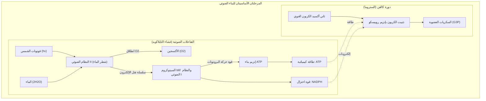
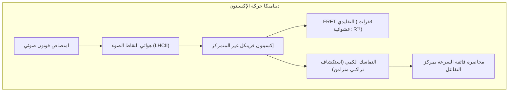
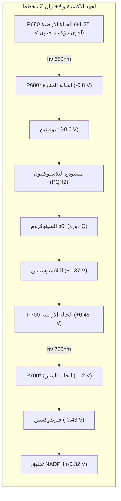
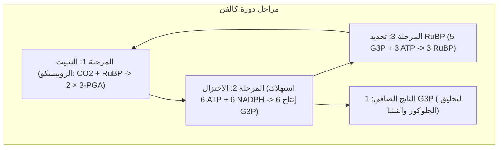

## مقدمة: المحرك الديناميكي الحراري الأعظم للغلاف الحيوي

يتنفس كوكب الأرض وتنبض محيطاته وغاباته بالحياة بفضل عملية جزيئية كيميائية خارقة واحدة: **البناء الضوئي (Photosynthesis)**.

تمتص النباتات والطحالب والبكتيريا الزرقاء الإشعاع الشمسي لتثبت سنوياً أكثر من **100 مليار طن من الكربون غير العضوي ($\text{CO}_2$)** في هيئة كتلة حيوية، وتطلق بالتزامن أكثر من 100 مليار طن من الأكسجين النقي ($\text{O}_2$). ويقارب الناتج الاستقلابي الإجمالي لهذا المحرك **100 تيروات ($100\text{ TW}$)**.

بينما تصل كفاءة الألواح الشمسية الصناعية إلى نحو 20%، يعمل انتقال طاقة الإثارة في هوائيات اليخضور بكفاءة كمية تقارب **100% (Near-100% Quantum Yield)** في درجات الحرارة والضغط العاديين.

---

## 1. البنية فوق الجزيئية لأغشية الثايلاكويد

تعتمد الكفاءة الهائلة على **الفصل المكاني الصارم** للمعقدات البروتينية:
- **النظام الضوئي الثاني (PSII)**: محصور في أغشية الغرانا المتراصة بكثافة؛
- **النظام الضوئي الأول (PSI)**: متمركز في صفائح الستروما غير المتراصة لتفادي تسرب الطاقة من PSII؛
- **معقد السيتوكروم $b_6f$**: موزع بانتظام لربط تدفق الإلكترونات؛
- **إنزيم بناء ATP ($F_oF_1$)**: محصور في الستروما لضخامة رأسه الحفاز $F_1$ الذي لا يتسع في فراغات الغرانا الضيقة.

---

## 2. علم الأحياء الكمي: التماسك ونقل الإكسيتونات

أثبت التحليل الطيفي الإلكتروني ثنائي الأبعاد أن الطاقة لا تقفز كجسيمات كلاسيكية عشوائية، بل تتحرك كـ **موجات تراكب كمي متماسكة (Quantum Coherence)** تستكشف مسارات متعددة في آن واحد، لتبلغ مركز التفاعل في أقل من 50 بيكوثانية بأدنى قدر من التشتت الحراري.

---

## 3. التفاعلات الضوئية: مخطط Z وشطر جزيئات الماء

- **كاتيون $\text{P680}^{+\bullet}$ الراديكالي**: بجهد أكسدة يبلغ **$+1.25\text{ V}$**، يمثل المؤكسد الحيوي الوحيد القادر على انتزاع إلكترونات الماء المستقرة.
- **معقد توليد الأكسجين (OEC)**: يضم عنقود **$\text{Mn}_4\text{CaO}_5$** على شكل كرسي مشوه. ووفق ساعة حالات S لكوك ($S_0 \rightarrow S_4$)، يختزن 4 مكافئات أكسدة ليشطر جزيئي ماء معاً، محرراً **جزيء أكسجين واحد $\text{O}_2$ و4 بروتونات**:

$$2\text{H}_2\text{O} \longrightarrow \text{O}_2 + 4\text{H}^+ + 4e^-$$

---

## 4. القوة المحركة للبروتونات ومحرك ATP الدوار

يولد ضخ البروتونات فرقاً تركيزياً هائلاً في درجة الحموضة ($\Delta\text{pH} \approx 2.5 \sim 3.0$)، مؤسساً قوة محركة للبروتونات تقارب $\Delta p \approx 200\text{ mV}$.

وعند تدفق البروتونات عبر **إنزيم بناء ATP ($F_oF_1$)**:
- تدور حلقة $c$ الدوارة في معقد $F_o$ باتجاه واحد؛
- يُحدث المحور $\gamma$ تغيرات فراغية دورية (مفتوح، مرتخٍ، مشدود) في الرأس الحفاز $\alpha_3\beta_3$، مخلقاً 3 جزيئات ATP لكل دورة كاملة بكفاءة ميكانيكية تفوق 90%.

---

## 5. دورة كالفن ومعضلة إنزيم روبيسكو

يخلط إنزيم **RuBisCO** الذي نشأ في حقب ما قبل الأكسجين بين $\text{CO}_2$ و $\text{O}_2$. ويؤدي هذا التفاعل العكسي إلى **التنفس الضوئي (Photorespiration)** مهدراً حتى 40% من الطاقة.
- **نباتات C4 (الذرة، قصب السكر)**: **فصل مكاني**. تثبت الكربون في خلايا النسيج المتوسط وتضخه بتركيز مرتفع حول الروبيسكو في خلايا غمد الحزمة الوعائية.
- **نباتات CAM (الصبار، الأناناس)**: **فصل زمني**. تفتح ثغورها ليلاً لتخزين حمض الماليك وتغلقها نهاراً لمنع تبخر الماء.

---

## الخلاصة

في كل ورقة نباتية، تتشابك ميكانيكا الكم، والتحفيز الكيميائي الانتقالي، ومحركات النانو الميكانيكية لنسج شريان الحياة الأبدي على كوكب الأرض.
