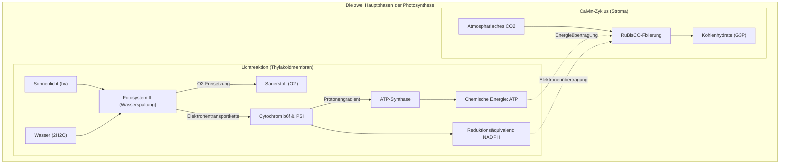
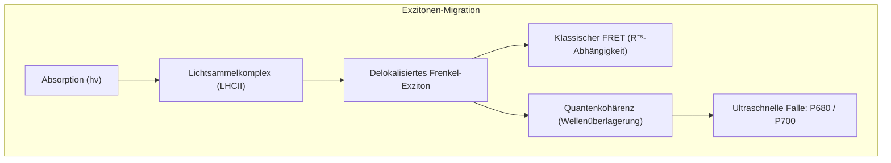
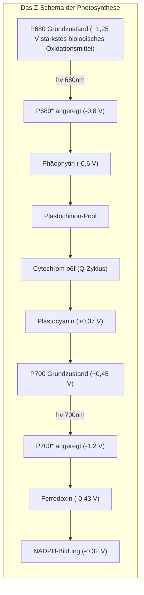
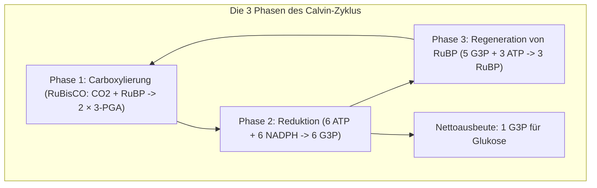

## Einleitung: Das größte thermodynamische Kraftwerk der Biosphäre

Das Leben auf der Erde wird durch einen einzigen molekularen Prozess angetrieben: **die Photosynthese**. 

Jedes Jahr fangen Pflanzen, Algen und Cyanobakterien solare Energie auf, um über **100 Milliarden Tonnen anorganisches $\text{CO}_2$** in Biomasse zu binden und zeitgleich 100 Milliarden Tonnen reinen Sauerstoff ($\text{O}_2$) freizusetzen. Die biologische Gesamtleistung beträgt rund **100 Terawatt ($100\text{ TW}$)** – ein Vielfaches des menschlichen Primärenergiebedarfs.

Während Silizium-Solarzellen unter Laborbedingungen 20% Wirkungsgrad erreichen, arbeitet der Exzitonentransfer in Lichtsammelantennen mit einer **Quantenausbeute von nahezu 100%** – und das bei Raumtemperatur und neutralem pH-Wert.

---

## 1. Supramolekulare Struktur der Thylakoidmembran

Die enorme Effizienz der Photosynthese beruht auf der **räumlichen Trennung** der Proteinkomplexe in der Thylakoidmembran:
- **Fotosystem II (PSII)**: Nahezu ausschließlich in den dicht gestapelten **Granamembranen** lokalisiert.
- **Fotosystem I (PSI)**: In den ungestapelten **Stromalamellen** positioniert, um unkontrollierte Energieabflüsse (Spillover) von PSII zu verhindern.
- **Cytochrom-$b_6f$-Komplex**: Gleichmäßig verteilt zur Vermittlung des Elektronentransports.
- **$F_oF_1$-ATP-Synthase**: Auf Stromalamellen beschränkt, da der voluminöse $F_1$-Kopf sterisch nicht in die Grana-Spalten passt.

---

## 2. Quantenbiologie: Exzitonentransfer und Quantenkohärenz

Mittels zweidimensionaler elektronischer Spektroskopie wurde nachgewiesen, dass angeregte Zustände nicht als klassische Partikel von Chlorophyll zu Chlorophyll springen, sondern als **quantenkohärente Exzitonenwellen** agieren. Das Exziton erkundet simultan mehrere Pfade und wird durch Gitterschwingungen des Proteins (ENAQT) verlustfrei in weniger als $50\text{ ps}$ zum Reaktionszentrum geleitet.

---

## 3. Die Lichtreaktion: Z-Schema und Wasserspaltung

- **P680-Radikalkation**: Mit einem Redoxpotenzial von **$+1,25\text{ V}$** entreißt es Wassermolekülen die Elektronen.
- **Sauerstoffentwickelnder Komplex (OEC)**: Enthält den **$\text{Mn}_4\text{CaO}_5$-Cluster** in verzerrter Sesselkonformation. Nach Kok's S-Zustandsuhr ($S_0 \rightarrow S_4$) sammelt der Komplex 4 Oxidationsäquivalente an, um zwei Wassermoleküle synchron ohne toxische Radikale zu spalten:

$$2\text{H}_2\text{O} \longrightarrow \text{O}_2 + 4\text{H}^+ + 4e^-$$

---

## 4. Protonenmotorische Kraft und die rotierende ATP-Synthase

Durch Protonenakkumulation sinkt der pH-Wert im Lumen auf $\approx 5,5$, während das Stroma basisch bleibt ($\text{pH} \approx 8,0$). Die protonenmotorische Kraft beträgt:

$$\Delta p = \Delta\Psi - \frac{2,303 R T}{F} \Delta\text{pH} \approx 200\text{ mV}$$

Beim Rückstrom durch die **$F_oF_1$-ATP-Synthase** dreht sich der $c$-Ring des $F_o$-Motors im Uhrzeigersinn. Die exzentrische $\gamma$-Achse treibt strukturelle Konformationsänderungen (Open, Loose, Tight) der $\alpha_3\beta_3$-Untereinheiten an und erzeugt 3 ATP pro $360^\circ$-Drehung mit über 90% Energieausbeute.

---

## 5. Calvin-Benson-Zyklus und das RuBisCO-Dilemma

### Die Sauerstoff-Fehlreaktion von RuBisCO
**RuBisCO** entwickelte sich vor über 3 Milliarden Jahren in einer anoxischen Ur-Atmosphäre. In unserer heutigen Atmosphäre fixiert RuBisCO bei jedem vierten Reaktionszyklus fälschlicherweise $\text{O}_2$ statt $\text{CO}_2$. Die anschließende **Photorespiration** verschlingt erhebliche ATP-Mengen und setzt bis zu 40% des gebundenen Kohlenstoffs wieder frei!

### Anpassung der C4- und CAM-Pflanzen
- **C4-Pflanzen (Mais, Zuckerrohr)**: **Räumliche Trennung**. Die primäre Fixierung erfolgt in Mesophyllzellen über PEP-Carboxylase; das $\text{CO}_2$ wird in Bündelscheidenzellen um RuBisCO hochkonzentriert, was Photorespiration eliminiert.
- **CAM-Pflanzen (Kakteen, Ananas)**: **Zeitliche Trennung**. Spaltöffnungen öffnen sich nur nachts zur Speicherung von Äpfelsäure; tagsüber bleibt die Pflanze geschlossen gegen Austrocknung.

---

## Fazit

Jedes grüne Blatt ist ein lebendes Quanten-Kraftwerk. Die Photosynthese verbindet atomare Koordinationschemie, Quantenoptik und Nanomechanik zu der fundamentalen Lebensgrundlage unseres Planeten.
