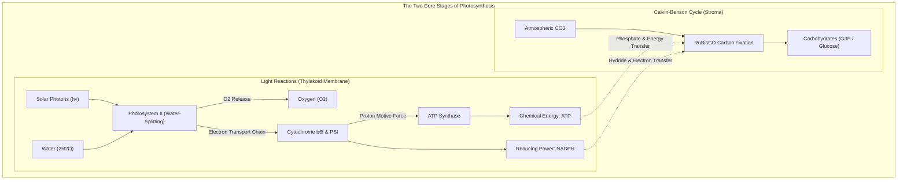
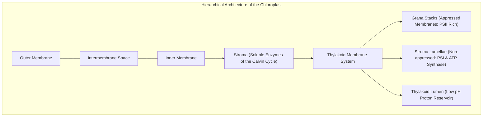
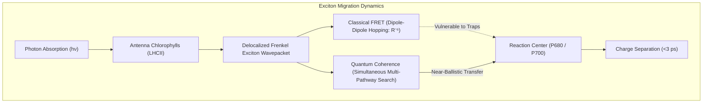
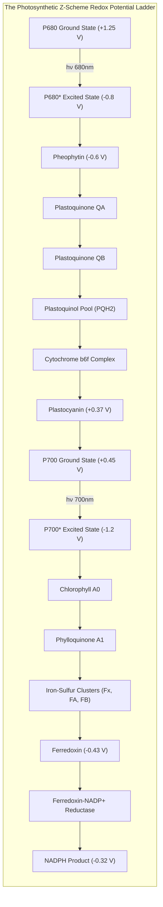
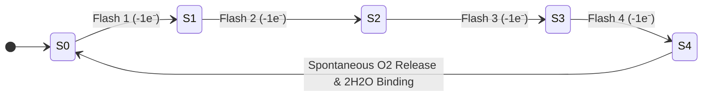
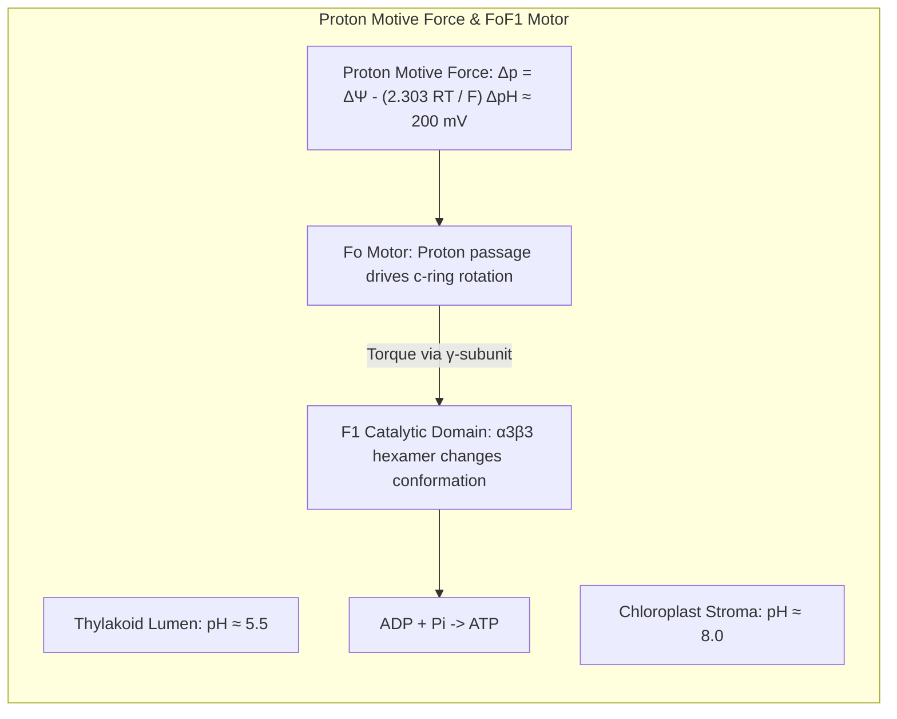
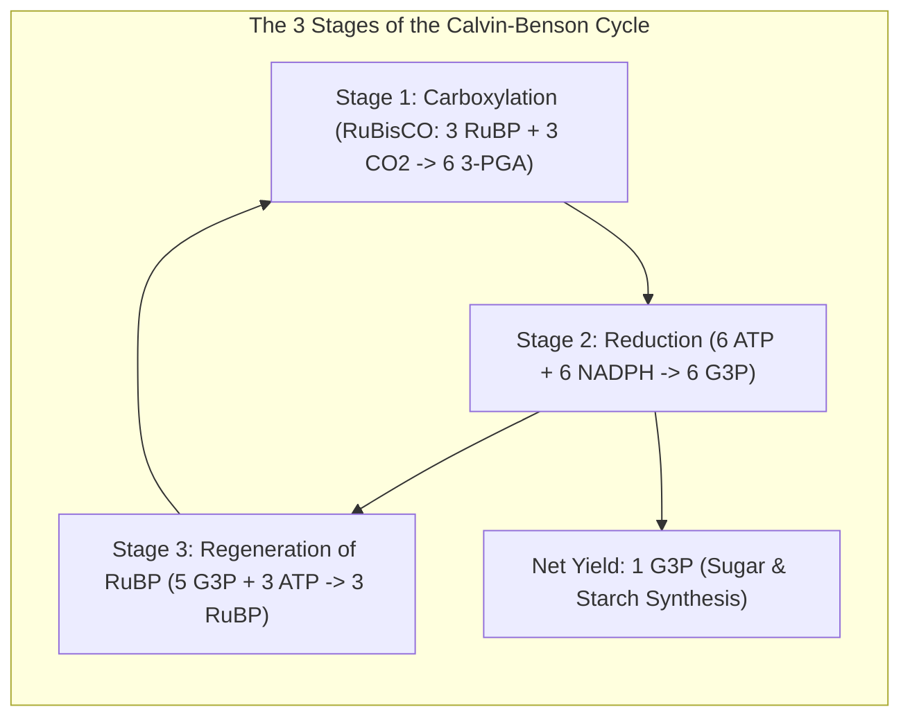
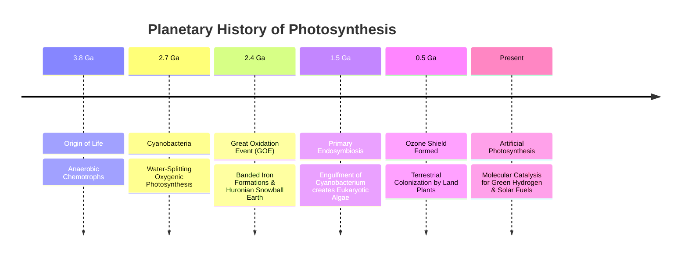

## Introduction: The Biosphere's Prime Thermodynamic Engine

Floating in the vacuum of space, planet Earth thrives under a luminous shield of blue oceans and green foliage. This global biosphere is sustained almost entirely by a **single nanoscale biochemical process: Photosynthesis**.

Each year, the Sun pours approximately $3.8 \times 10^{24}\text{ J}$ of radiant energy onto Earth. Plants, eukaryotic algae, and cyanobacteria capture a fraction of this flux to fix over **100 billion metric tons of inorganic carbon ($\text{CO}_2$)** into biomass, concurrently releasing over **100 billion tons of molecular oxygen ($\text{O}_2$)**. The aggregate biological output of this molecular engine approaches **100 terawatts ($100\text{ TW}$)**—hundreds of times greater than the total annual energy consumption of human industrial civilization.



Humanity's most advanced photovoltaic devices achieve electrical efficiencies around 20%, but rely on crystalline semiconductors and struggle to split water under ambient conditions without rare-earth catalysts (platinum, iridium).

In stark contrast, photosynthetic organisms assemble abundant Earth minerals (manganese, calcium, iron, magnesium) inside protein matrices to split water into protons and oxygen at **neutral pH, room temperature, and 1 atmosphere of pressure**. Even more astonishingly, the primary excitation energy transfer from light-harvesting antenna pigments to reaction centers operates with an efficiency approaching **near-100% quantum yield**.

---

## 1. Supramolecular Architecture of the Chloroplast

The formidable bioenergetic efficiency of photosynthesis relies on the **spatial segregation of multi-subunit protein complexes** across the lipid bilayer of the **thylakoid membrane**.



### 1.1 Lateral Heterogeneity in Thylakoids
The thylakoid network encloses a continuous, single internal aqueous compartment: the **lumen**. Within the membrane, four major protein supercomplexes are laterally segregated:
- **Photosystem II (PSII)**: Concentrated almost exclusively in the **appressed grana stacks**.
- **Photosystem I (PSI)**: Localized in the **non-appressed stroma lamellae** and the margins of grana stacks, preventing excitation spillover from PSII.
- **Cytochrome $b_6f$ Complex**: Evenly distributed across both appressed and non-appressed membranes, acting as the redox bridge.
- **$F_oF_1$-ATP Synthase**: Confined to stroma lamellae due to the bulky catalytic $F_1$ head ($10\text{ nm}$ diameter) protruding into the stroma, which cannot fit into the narrow ($3 \sim 4\text{ nm}$) grana partitions.

### 1.2 Chlorophyll Spectroscopy and Molecular Orbitals
Photosynthetic light harvesting is driven by **chlorophyll $a$ and $b$**.
- A substituted **tetrapyrrole (porphyrin) ring** with a central coordinating $\text{Mg}^{2+}$ ion.
- An extensive, planar **delocalized $\pi$-electron system** responsible for optical transitions.
- A hydrophobic **phytol ester tail** ($C_{20}H_{39}$) anchoring the pigment within the lipid bilayer.

The electronic absorption displays two major peaks: the **Soret band** in the blue ($\approx 430\text{ nm}$) and the **Q band** in the red ($\approx 660 \sim 680\text{ nm}$). Higher-energy blue excitations undergo ultrafast internal conversion ($<100\text{ fs}$), dropping non-radiatively to the lowest singlet excited state ($S_1$).

---

## 2. Quantum Biology: Exciton Energy Transfer

How does an excitation absorbed by peripheral antenna pigments reach the reaction center within tens of picoseconds without decaying as fluorescence or heat?



### 2.1 Förster Resonance Energy Transfer (FRET)
Classically, energy migration between weak-coupling pigments is modeled by **Förster Resonance Energy Transfer (FRET)**:

$$E_{\text{FRET}} = \frac{R_0^6}{R_0^6 + R^6}$$

where $R$ is the inter-fluorophore distance and $R_0$ is the characteristic Förster radius ($2 \sim 6\text{ nm}$). While valid for well-separated chromophores, FRET treats migration as an incoherent, classical random walk.

### 2.2 Quantum Coherence and Environmental Assistance
In dense antenna complexes (e.g., LHCII and the FMO complex), chlorophyll-chlorophyll distances are $<1\text{ nm}$, creating electronic coupling matrix elements $J$ ($50 \sim 100\text{ cm}^{-1}$) comparable to vibrational coupling.

Under these conditions, excitations form **delocalized Frenkel excitons**:

$$\Psi_{\text{exciton}}(t) = \sum_{k} c_k(t) | \phi_k \rangle$$

Two-dimensional electronic spectroscopy reveals that excitons retain **quantum coherence** for hundreds of femtoseconds at physiological temperatures. The exciton wavepacket explores multiple energy transfer pathways simultaneously. Furthermore, molecular vibrations of the protein scaffold do not destroy coherence; instead, **Environment-Assisted Quantum Transport (ENAQT)** tunes vibrational phonon modes to bridge energy gaps, funneling the excitation toward the reaction center trap with $>95\%$ quantum efficiency.

---

## 3. The Light Reactions: The Z-Scheme Redox Cascade



### 3.1 P680: Nature's Most Powerful Biological Oxidant
At the core of PSII sits the **P680 special pair**. Upon excitation to $\text{P680}^*$, ultrafast electron transfer to pheophytin creates the radical pair $\text{P680}^{+\bullet}\text{Pheo}^{-\bullet}$ in $3\text{ ps}$.
The resulting cation **$\text{P680}^{+\bullet}$** possesses a redox potential of **$+1.25\text{ V} \sim +1.28\text{ V}$**—the strongest oxidizing agent in biological systems, capable of wresting electrons from water ($E_0' = +0.815\text{ V}$).

### 3.2 The $\text{Mn}_4\text{CaO}_5$ Cluster and Kok's S-State Clock
Water oxidation is a four-electron reaction:

$$2\text{H}_2\text{O} \longrightarrow \text{O}_2 + 4\text{H}^+ + 4e^- \quad (\Delta G^\circ = +477\text{ kJ/mol})$$

To avoid high-energy reactive oxygen intermediates, the **Oxygen-Evolving Complex (OEC)** stores oxidative equivalents sequentially. The OEC is a distorted cubane cluster containing **4 manganese ions and 1 calcium ion bridged by 5 oxo ligands ($\text{Mn}_4\text{CaO}_5$)**.



As demonstrated by Bessel Kok (1970), the cluster transitions through five oxidation states ($S_0 \rightarrow S_4$):
- Each photon flash removes one electron via redox-active tyrosine $\text{Tyr}_Z$.
- Upon reaching the transient $S_4$ state, an $\text{O}-\text{O}$ covalent bond is formed between two substrate water molecules, releasing **one molecule of $\text{O}_2$** and regenerating $S_0$.

---

## 4. The Chemiosmotic Mechanism and Rotary ATP Synthase



Mitchell's **proton motive force (PMF)** across the thylakoid membrane is defined by:

$$\Delta p = \Delta\Psi - \frac{2.303 R T}{F} \Delta\text{pH}$$

In thylakoids, counter-ion fluxes ($\text{Mg}^{2+}, \text{Cl}^-$) minimize the membrane potential $\Delta\Psi$, so $\Delta p$ ($\approx 180 \sim 220\text{ mV}$) is dominated by the steep **$\Delta\text{pH} \approx 2.5 \sim 3.0$** (a 1,000-fold proton concentration gradient).

Protons escape back to the stroma through the **$F_oF_1$-ATP Synthase**:
- Protons enter the $a$-subunit half-channel, protonating essential glutamate residues on the rotor **$c$-ring**, driving unidirectional rotation.
- Rotation of the asymmetric central **$\gamma$-stalk** within the stationary $\alpha_3\beta_3$ head forces cyclic conformational changes (**Open, Loose, Tight**), synthesizing 3 molecules of ATP per $360^\circ$ rotation with mechanical energy efficiency exceeding $90\%$.

---

## 5. The Calvin-Benson-Bassham (CBB) Cycle

In the stroma, chemical energy ($\text{ATP}$) and reducing equivalents ($\text{NADPH}$) fuel the enzymatic reduction of $\text{CO}_2$ into triose phosphates.



The net stoichiometry for exporting one molecule of glyceraldehyde-3-phosphate (G3P) is:

$$3\text{CO}_2 + 9\text{ATP} + 6\text{NADPH} + 6\text{H}^+ \longrightarrow \text{G3P} + 9\text{ADP} + 8\text{P}_i + 6\text{NADP}^+ + 3\text{H}_2\text{O}$$

---

## 6. The RuBisCO Paradox: Photorespiration and C4/CAM Innovations

**RuBisCO** (Ribulose-1,5-bisphosphate carboxylase/oxygenase) is the most abundant protein on Earth, comprising up to $50\%$ of soluble leaf protein. However, RuBisCO suffers from an evolutionary flaw: **oxygenation cross-reactivity**.

```mermaid
graph TD
    RuBP["Substrate: RuBP"]
    RuBP -->|Carboxylation (+ CO2)| Good["2 × 3-PGA (Calvin Cycle Assimilation)"]
    RuBP -->|Oxygenation (+ O2)| Bad["1 × 3-PGA + 1 × 2-Phosphoglycolate"]
    Bad --> Photoresp["Photorespiration (Consumes ATP/NADPH, Loses 25% Carbon)"]
```

Because RuBisCO evolved $>3$ billion years ago in an anoxic atmosphere, it cannot strictly discriminate $\text{CO}_2$ from $\text{O}_2$. In modern air ($21\%\ \text{O}_2$ vs $0.04\%\ \text{CO}_2$), roughly **1 in 4 catalytic events fixes oxygen instead of carbon**, producing toxic **2-phosphoglycolate**. Salvaging this byproduct via **photorespiration** across three organelles squanders over $25\% \sim 40\%$ of photosynthetic energy.

### Evolutionary Countermeasures: C4 and CAM Adaptations
To overcome RuBisCO’s oxygenase liability, advanced plant clades developed biological carbon-concentrating mechanisms (CCMs):
- **C4 Plants (Maize, Sugarcane)**: **Spatial separation**. $\text{CO}_2$ is initially fixed by PEP carboxylase (which has zero oxygenase activity) into 4-carbon organic acids in mesophyll cells, then shuttled to bundle-sheath cells where $\text{CO}_2$ is concentrated $10\times$ around RuBisCO, abolishing photorespiration.
- **CAM Plants (Pineapples, Cacti)**: **Temporal separation**. Stomata open exclusively at night to capture $\text{CO}_2$ as malate; during the day, stomata stay sealed to conserve water while malate is decarboxylated inside cells.

---

## 7. Planetary Impact and Artificial Photosynthesis



Oxygenic photosynthesis triggered the **Great Oxidation Event (GOE)** 2.4 billion years ago, precipitating the world's banded iron formations, generating the stratospheric ozone layer, and paving the way for aerobic respiration and multicellular life.

Today, understanding the atomic geometry of the $\text{Mn}_4\text{CaO}_5$ cluster and rotary ATP synthesis inspires **artificial photosynthesis**—engineering molecular water-splitting photoelectrodes and electrochemical $\text{CO}_2$ reduction cells to produce zero-carbon solar fuels.

---

## Conclusion

Every leaf on Earth is a living quantum bio-nanotechnology facility. By coupling femtosecond exciton coherence, single-photon multi-electron water oxidation, and nanomechanical rotary synthesis, photosynthesis remains the most sublime molecular symphony in the universe.
