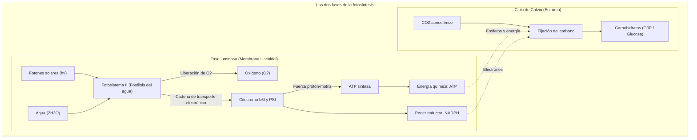
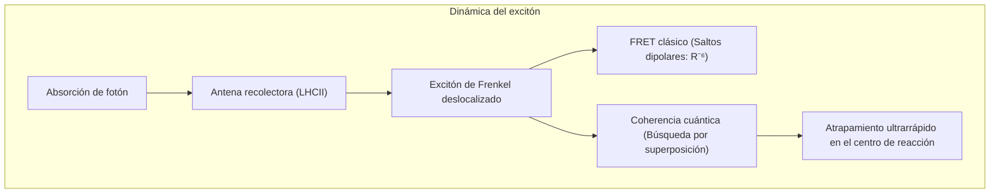
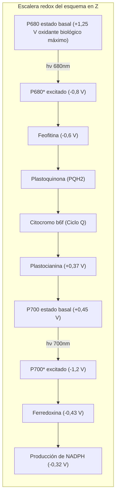
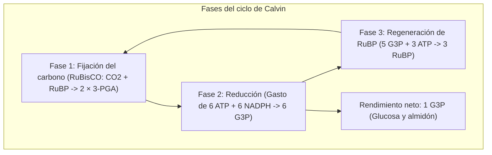

## Introducción: El motor termodinámico de la biosfera

La biosfera terrestre se sustenta sobre un único proceso molecular maestro: **la fotosíntesis**.

Cada año, las plantas, algas y cianobacterias capturan la radiación solar para fijar más de **100.000 millones de toneladas de dióxido de carbono ($\text{CO}_2$)** en biomasa, liberando una masa equivalente de oxígeno molecular ($\text{O}_2$). Su potencia metabólica total ronda los **100 teravatios ($100\text{ TW}$)**.

Mientras los paneles solares artificiales rondan el 20% de rendimiento, el transporte de energía de excitación en las antenas de clorofila alcanza un **rendimiento cuántico cercano al 100%**.

---

## 1. Arquitectura supramolecular del cloroplasto

La extrema eficiencia fotosintética depende de la **segregación espacial** de los complejos en la membrana tilacoidal:
- **Fotosistema II (PSII)**: Restringido a las membranas apiladas densas (grana).
- **Fotosistema I (PSI)**: Ubicado en las laminillas del estroma no apiladas, evitando pérdidas de energía por proximidad (spillover).
- **Citocromo $b_6f$**: Distribuido uniformemente actuando como puente redox móvil.
- **$F_oF_1$-ATP sintasa**: Confinada a las zonas expuestas al estroma, dado que su cabeza catalítica globular $F_1$ no cabe en las estrechas particiones de los grana.

---

## 2. Biología cuántica: Coherencia y transferencia de excitones

La espectroscopía bidimensional ha revelado que la excitación viaja como un **paquete de ondas cuántico coherente**, sondeando simultáneamente múltiples rutas de transferencia. Asistido por vibraciones de la matriz proteica (ENAQT), el excitón llega al centro de reacción en menos de $50\text{ ps}$ con mínimas pérdidas disipativas.

---

## 3. Reacciones luminosas: Esquema en Z y fotólisis del agua

- **P680**: Con un potencial redox de **$+1,25\text{ V}$**, es la única especie bioquímica capaz de arrancar electrones del agua.
- **Complejo de evolución de oxígeno (OEC)**: Alberga el **clúster $\text{Mn}_4\text{CaO}_5$**. Mediante el reloj de estados S de Kok ($S_0 \rightarrow S_4$), almacena cuatro equivalentes de oxidación antes de escindir dos moléculas de agua en **una molécula de $\text{O}_2$ y 4 protones**:

$$2\text{H}_2\text{O} \longrightarrow \text{O}_2 + 4\text{H}^+ + 4e^-$$

---

## 4. Fuerza protón-motriz y nanomotor ATP sintasa

El gradiente transmembranal genera una fuerza protón-motriz ($\Delta p \approx 200\text{ mV}$), sostenida por un $\Delta\text{pH} \approx 2,5 \sim 3,0$.

Al regresar los protones hacia el estroma a través de la **$F_oF_1$-ATP sintasa**:
- El anillo $c$ de $F_o$ rota mecánicamente;
- El eje central $\gamma$ rota de forma excéntrica induciendo cambios conformacionales cíclicos (Abierto, Laxo, Apretado) en los dominios catalíticos $\alpha_3\beta_3$, generando 3 moléculas de ATP por revolución con un rendimiento mecánico del 90%.

---

## 5. El ciclo de Calvin y la paradoja de la RuBisCO

La **RuBisCO**, originada en una atmósfera primordial carente de oxígeno, confunde con frecuencia el $\text{CO}_2$ con el $\text{O}_2$. La fotorrespiración resultante disipa hasta un 40% de la energía fijada.
- **Plantas C4 (Maíz, caña de azúcar)**: **Separación espacial**. Concentran activamente el $\text{CO}_2$ alrededor de la RuBisCO en las células de la vaina vascular.
- **Plantas CAM (Cactus, piña)**: **Separación temporal**. Abren sus estomas de noche para acumular malato y mantienen los estomas cerrados de día para ahorrar agua.

---

## Conclusión

En cada hoja verde, la mecánica cuántica, la química inorgánica de transición y los motores rotatorios macromoleculares confluyen para tejer la trama energética de nuestro planeta.
