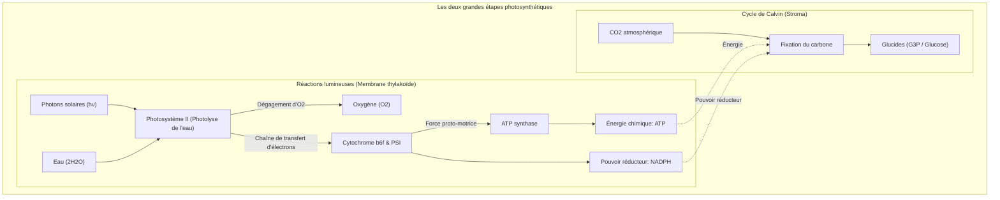
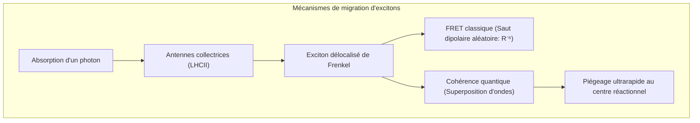
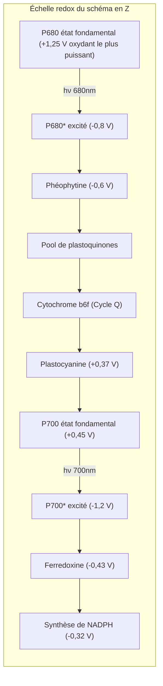
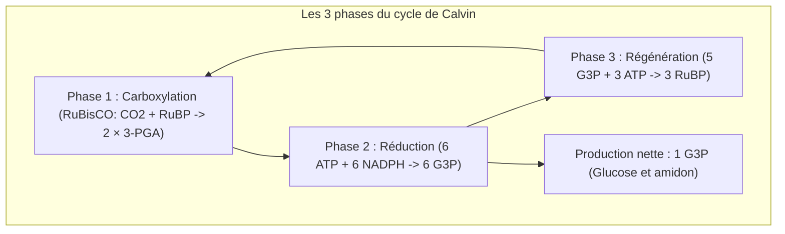

## Introduction : Le moteur thermodynamique de la biosphère

Toute la chaîne trophique terrestre repose sur un prodige biochimique : **la photosynthèse**.

Chaque année, les végétaux, algues et cyanobactéries convertissent le flux solaire pour fixer plus de **100 milliards de tonnes de dioxyde de carbone ($\text{CO}_2$)** en biomasse, libérant une quantité équivalente d'oxygène pur ($\text{O}_2$). La puissance biologique globale atteint **100 térawatts ($100\text{ TW}$)**.

Tandis que nos cellules photovoltaïques peinent à dépasser 20% d'efficacité électrique, le transfert d'énergie d'excitation au sein des antennes collectrices atteint un **rendement quantique proche de 100%**.

---

## 1. Architecture supramoléculaire des thylakoïdes

L'efficacité du système repose sur la **ségrégation spatiale latérale** des complexes protéiques :
- **Photosystème II (PSII)** : Confiné dans les zones accolées denses (grana) ;
- **Photosystème I (PSI)** : Exclusif aux membranes non accolées (lamelles du stroma) pour éviter le siphonage d'énergie de PSII ;
- **Cytochrome $b_6f$** : Distribué uniformément pour le transit redox ;
- **$F_oF_1$-ATP synthase** : Strictement cantonné au stroma en raison de l'encombrement stérique de sa tête catalytique $F_1$.

---

## 2. Biologie quantique : Cohérence et transfert d'exciton

La spectroscopie électronique 2D a prouvé que les excitons se déplacent sous forme **d'ondes de superposition quantique cohérentes**. L'exciton explore simultanément de multiples chemins à travers le réseau de chlorophylles, guidé par les phonons thermiques des protéines (ENAQT) pour atteindre le piège en moins de $50\text{ ps}$.

---

## 3. Réactions claires : Schéma en Z et photolyse de l'eau

- **Cation radicalaire $\text{P680}^{+\bullet}$** : Son potentiel de **$+1,25\text{ V}$** en fait la seule molécule vivante capable d'arracher les électrons de l'eau.
- **Horloge de Kok et cluster $\text{Mn}_4\text{CaO}_5$** : Le complexe d'oxydation de l'eau accumule 4 équivalents d'oxydation ($S_0 \rightarrow S_4$) avant de catalyser l'oxydation de 2 molécules d'eau, produisant **1 molécule d'$\text{O}_2$ et 4 protons** :

$$2\text{H}_2\text{O} \longrightarrow \text{O}_2 + 4\text{H}^+ + 4e^-$$

---

## 4. Force proton-motrice et nanocarrousel ATP synthase

L'accumulation de protons génère un différentiel de $\text{pH}$ ($\Delta\text{pH} \approx 2,5 \sim 3,0$), établissant une force proto-motrice :

$$\Delta p = \Delta\Psi - \frac{2,303 R T}{F} \Delta\text{pH} \approx 200\text{ mV}$$

Le passage des protons à travers le rotor $c$ de $F_o$ entraîne la rotation de l'axe central $\gamma$. Dans la tête $\alpha_3\beta_3$, les sites catalytiques alternent entre trois états (Ouvert, Lâche, Serré), synthétisant 3 ATP par tour complet avec un rendement énergétique de 90%.

---

## 5. Cycle de Calvin et l'impasse de la RuBisCO

Apparue à une époque anoxique, la **RuBisCO** confond régulièrement $\text{CO}_2$ et $\text{O}_2$. La réaction d'oxygénation génère un composé toxique éliminé par la **photorespiration**, gaspillant de 25% à 40% de l'énergie photosynthétique !
- **Plantes C4 (Maïs)** : **Séparation spatiale**. Le $\text{CO}_2$ est piégé dans le mésophylle et reconcentré dans la gaine périvasculaire.
- **Plantes CAM (Cactus)** : **Séparation temporelle**. Les stomates ne s'ouvrent que la nuit pour capter le $\text{CO}_2$ sous forme de malate.

---

## Conclusion

Dans chaque chloroplaste, la mécanique quantique, l'oxydoréduction et la nanorotation mécanique s'harmonisent pour soutenir l'édifice de la vie sur Terre.
