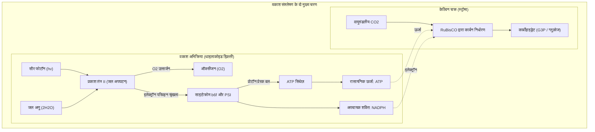
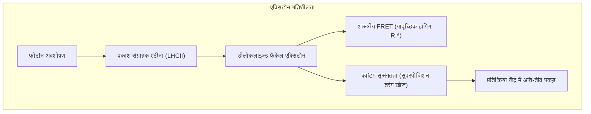
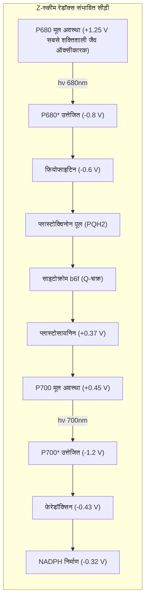
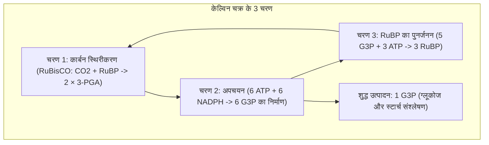

## प्रस्तावना: जीवमंडल का सबसे विशाल थर्मोडायनामिक इंजन

पृथ्वी पर जीवन का अस्तित्व एक अद्वितीय आणविक प्रक्रिया पर निर्भर करता है: **प्रकाश संश्लेषण (Photosynthesis)**।

प्रतिवर्ष पौधे, शैवाल और सायनोबैक्टीरिया सूर्य की ऊर्जा का उपयोग करके **100 अरब टन से अधिक अकार्बनिक कार्बन ($\text{CO}_2$)** को जैविक शर्करा में स्थिर करते हैं और इतनी ही मात्रा में शुद्ध ऑक्सीजन ($\text{O}_2$) वातावरण में छोड़ते हैं। इस प्रक्रिया का वैश्विक जैविक ऊर्जा उत्पादन लगभग **100 टेरावाट ($100\text{ TW}$)** है।

मानव निर्मित सोलर सेल जहां 20% दक्षता पर काम करते हैं, वहीं क्लोरोफिल एंटीना में प्रकाश ऊर्जा का स्थानांतरण **लगभग 100% क्वांटम दक्षता (Quantum Yield)** के साथ सामान्य तापमान और दबाव पर होता है।

---

## 1. थाइलाकोइड झिल्ली की आणविक वास्तुकला

प्रकाश संश्लेषण की उच्च दक्षता झिल्ली पर प्रोटीन परिसरों के **स्थानिक पृथक्करण** पर टिकी है:
- **प्रकाश तंत्र II (PSII)**: घने ग्रैना (Grana) स्टैक में केंद्रित;
- **प्रकाश तंत्र I (PSI)**: गैर-संकुचित स्ट्रोमा लैमेली में स्थित ताकि ऊर्जा का रिसाव न हो;
- **साइटोक्रोम $b_6f$ कॉम्प्लेक्स**: इलेक्ट्रॉन प्रवाह के लिए समान रूप से वितरित;
- **$F_oF_1$-ATP सिंथेज़**: केवल स्ट्रोमा लैमेली में मौजूद, क्योंकि इसका विशाल $F_1$ सिर ग्रैना की संकीर्ण दरारों में समा नहीं सकता।

---

## 2. क्वांटम जीवविज्ञान: एक्सिटोन ट्रांसफर और क्वांटम सुसंगतता

2D इलेक्ट्रॉनिक स्पेक्ट्रोस्कोपी से सिद्ध हुआ है कि एक्सिटोन कणों के रूप में नहीं, बल्कि **क्वांटम सुसंगत तरंगों (Quantum Coherence)** के रूप में एक साथ कई मार्गों की खोज करते हैं और 50 पिकोसेकंड से भी कम समय में न्यूनतम ऊर्जा हानि के साथ प्रतिक्रिया केंद्र तक पहुंचते हैं।

---

## 3. प्रकाश अभिक्रिया: Z-स्कीम और जल का अपघटन

- **P680 रेडिकल धनायन**: इसका रेडॉक्स विभव **$+1.25\text{ V}$** है, जो पानी जैसे स्थिर अणु से इलेक्ट्रॉन खींचने वाला एकमात्र जैविक घटक है।
- **ऑक्सीजन विकसित करने वाला कॉम्प्लेक्स (OEC)**: इसमें **$\text{Mn}_4\text{CaO}_5$ क्लस्टर** होता है। कोक की S-अवस्था घड़ी ($S_0 \rightarrow S_4$) के अनुसार यह 4 ऑक्सीकरण समतुल्य एकत्र करता है और एक साथ 2 जल अणुओं को तोड़कर **1 अणु $\text{O}_2$ और 4 प्रोटॉन** मुक्त करता है:

$$2\text{H}_2\text{O} \longrightarrow \text{O}_2 + 4\text{H}^+ + 4e^-$$

---

## 4. प्रोटॉन प्रेरक बल और घूर्णनशील ATP सिंथेज़

प्रोटॉन के संचय से लुमेन और स्ट्रोमा के बीच $\Delta\text{pH} \approx 2.5 \sim 3.0$ का अंतर पैदा होता है, जिससे $\Delta p \approx 200\text{ mV}$ का प्रोटॉन प्रेरक बल बनता है।

जब प्रोटॉन **$F_oF_1$-ATP सिंथेज़** से होकर गुजरते हैं:
- $F_o$ मोटर की $c$-रिंग एक दिशा में घूमती है;
- सनकी केंद्रीय शाफ्ट $\gamma$ उत्प्रेरक सिर $\alpha_3\beta_3$ में चक्रीय विरूपण (ओपन, लूज, टाइट) उत्पन्न करता है, जिससे 90% से अधिक यांत्रिक दक्षता के साथ प्रति चक्कर 3 ATP अणु बनते हैं।

---

## 5. केल्विन चक्र और RuBisCO की सीमाएं

प्राचीन अनॉक्सी युग में विकसित **RuBisCO** अक्सर $\text{CO}_2$ के स्थान पर $\text{O}_2$ को बांध लेता है, जिससे **प्रकाश श्वसन (Photorespiration)** होता है और 40% तक ऊर्जा व्यर्थ हो जाती है।
- **C4 पौधे (मक्का, गन्ना)**: **स्थानिक पृथक्करण** द्वारा बंडल शीथ कोशिकाओं में $\text{CO}_2$ को सांद्रित करके प्रकाश श्वसन को समाप्त करते हैं।
- **CAM पौधे (कैक्टस, अनानास)**: **कालिक पृथक्करण** द्वारा रात में रंध्र खोलकर मैलेट जमा करते हैं और दिन में रंध्र बंद रखकर पानी बचाते हैं।

---

## निष्कर्ष

हर हरी पत्ती के भीतर क्वांटम यांत्रिकी, अकार्बनिक उत्प्रेरण और नैनोमोटर्स का यह अद्भुत संगम पृथ्वी पर जीवन का सबसे दिव्य संगीत रचता है।
