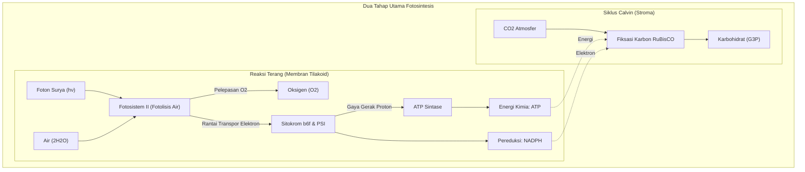
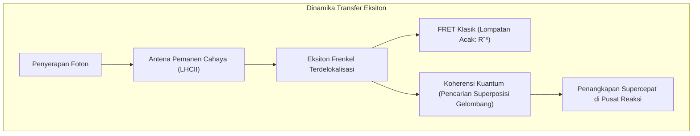
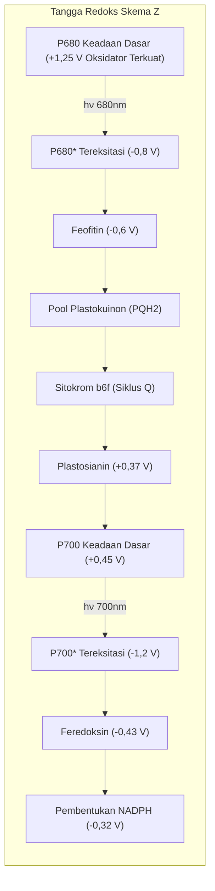
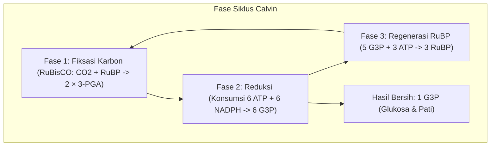

## Pendahuluan: Pembangkit Termodinamika Utama Biosfer Bumi

Seluruh jaring-jaring kehidupan di Bumi bergantung pada satu mahakarya molekuler: **Fotosintesis**.

Setiap tahun, tanaman, alga, dan sianobakteri mengikat lebih dari **100 miliar ton karbon anorganik ($\text{CO}_2$)** menjadi biomassa, sembari melepaskan lebih dari 100 miliar ton oksigen murni ($\text{O}_2$) ke atmosfer. Daya konversi biologisnya mencapai **sekitar 100 terawatt ($100\text{ TW}$)**.

Panel surya buatan manusia mencapai efisiensi sekitar 20%, namun transfer energi eksitasi pada antena klorofil bekerja dengan **rendemen kuantum mendekati 100%** pada suhu kamar dan pH netral.

---

## 1. Arsitektur Supramolekuler Tilakoid

Efisiensi fotosintesis berakar pada **pemisahan spasial lateral** kompleks protein:
- **Fotosistem II (PSII)**: Terkonsentrasi pada membran bertumpuk padat (grana);
- **Fotosistem I (PSI)**: Berada pada lamela stroma tak bertumpuk guna mencegah kebocoran energi dari PSII;
- **Kompleks Sitokrom $b_6f$**: Tersebar merata menjembatani transpor elektron;
- **$F_oF_1$-ATP Sintase**: Dibatasi hanya pada lamela stroma karena kepala katalitik $F_1$ yang besar tidak muat di celah sempit grana.

---

## 2. Biologi Kuantum: Koherensi dan Transfer Eksiton

Spektroskopi elektronik dua dimensi membuktikan bahwa eksiton berpindah sebagai **gelombang superposisi kuantum yang koheren**. Dibantu vibrasi fonon protein matriks (ENAQT), eksiton menyusuri berbagai jalur secara simultan menuju pusat reaksi dalam waktu kurang dari $50\text{ ps}$.

---

## 3. Reaksi Terang: Skema Z dan Fotolisis Air

- **P680**: Dengan potensial redoks **$+1,25\text{ V}$**, molekul ini merupakan oksidator biologis terkuat yang mampu merenggut elektron dari air.
- **Kompleks Pengevolusi Oksigen (OEC)**: Mengandung **kluster $\text{Mn}_4\text{CaO}_5$**. Berdasarkan jam siklus S Kok ($S_0 \rightarrow S_4$), kluster ini mengumpulkan 4 ekuivalen oksidasi sebelum memecah dua molekul air menjadi **1 molekul $\text{O}_2$ dan 4 proton**:

$$2\text{H}_2\text{O} \longrightarrow \text{O}_2 + 4\text{H}^+ + 4e^-$$

---

## 4. Gaya Gerak Proton dan Nanomotor ATP Sintase

Akumulasi proton di lumen menghasilkan gaya gerak proton ($\Delta p \approx 200\text{ mV}$), didorong oleh $\Delta\text{pH} \approx 2,5 \sim 3,0$.

Saat proton mengalir kembali melalui **$F_oF_1$-ATP Sintase**:
- Cincin $c$ pada rotor $F_o$ berputar searah;
- Poros eksentrik $\gamma$ menginduksi perubahan konformasi katalitik $\alpha_3\beta_3$, menghasilkan 3 molekul ATP per putaran dengan efisiensi mekanis di atas 90%.

---

## 5. Siklus Calvin dan Keterbatasan RuBisCO

Enzim **RuBisCO** berevolusi pada era anoksik purba sehingga kerap keliru mengikat $\text{O}_2$. **Fotorespirasi** yang terjadi membuang hingga 40% energi fotosintesis.
- **Tanaman C4 (Jagung, tebu)**: **Pemisahan spasial**. Memekatkan $\text{CO}_2$ di sel seludang pembuluh untuk meniadakan fotorespirasi.
- **Tanaman CAM (Kaktus, nanas)**: **Pemisahan temporal**. Stomata hanya membuka pada malam hari guna menghemat air.

---

## Kesimpulan

Setiap helai daun hijau adalah instalasi bionanoteknologi kuantum yang menyatukan fisika partikel, fotokimia, dan biologi menjadi penopang kehidupan bumi.
