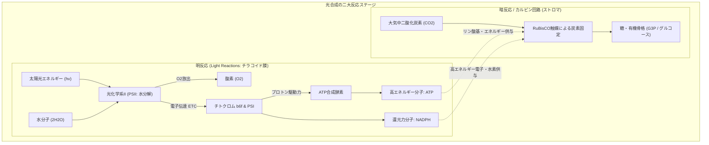
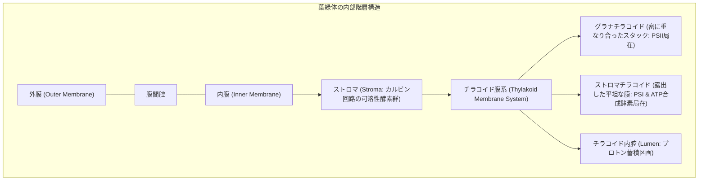
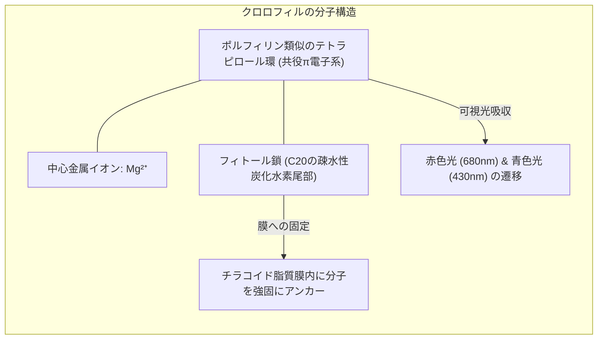
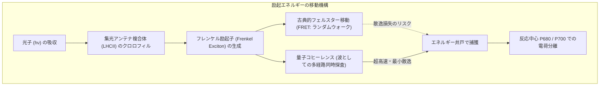
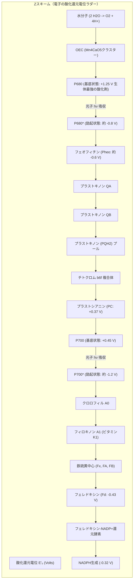
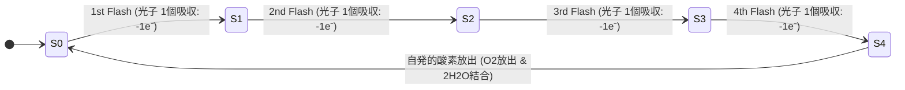
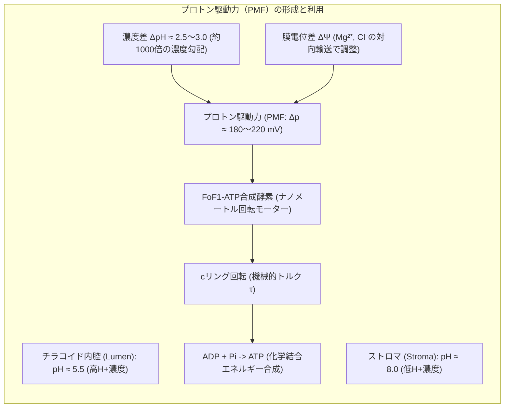
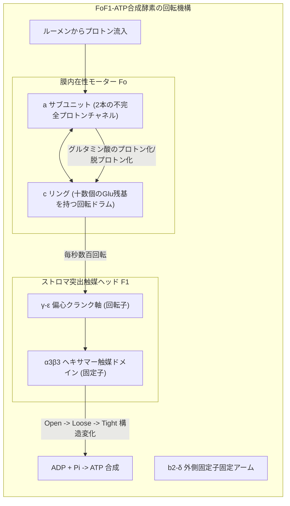
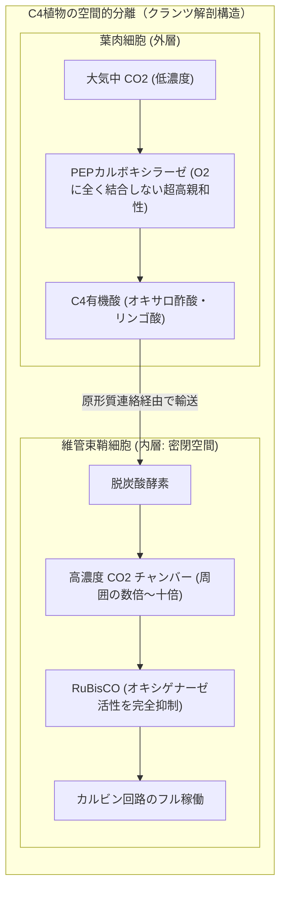
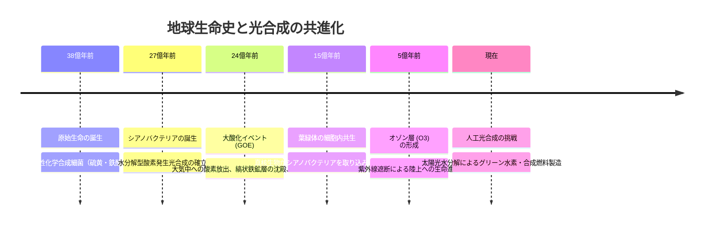

## はじめに：太陽光と水から生命を織り成す「地球最大の化学工場」

宇宙空間に浮かぶ惑星地球。その表面を青い海洋と緑の植生が覆い、無数の生命が呼吸し活動できるのは、太陽から降り注ぐ光エネルギーを化学結合エネルギーへと変換し続ける、ある**単一の分子プロセス**が存在するからに他ならない。それが**「光合成（Photosynthesis）」**である。

太陽が地球に届けるエネルギーは年間約 $3.8 \times 10^{24}\text{ J}$ に達する。地表の植物、藻類、そしてシアノバクテリア（藍藻）は、そのごく一部を捕獲し、年間**約1,000億トン以上の無機炭素（二酸化炭素：$\text{CO}_2$）をグルコースなどの有機物へと固定**し、同時に**約1,000億トン以上の純粋な酸素（$\text{O}_2$）**を大気中へ放出し続けている。地球上の生物学的エネルギー循環の規模は、人類全体の年間エネルギー消費量（約 $6 \times 10^{20}\text{ J}$）の数百倍、連続出力にして**約100テラワット（$100\text{ TW}$）**に及ぶ。



現代の人間が誇る最先端の人工シリコン太陽電池は、光電変換効率こそ20%前後に達するものの、製造には莫大な高純度鉱物と高温プロセスを要し、水から水素と酸素を常温常圧で分解する触媒系はいまだ貴金属（白金やイリジウム）に頼らざるを得ない。

一方、植物の葉緑体（Chloroplast）は、ありふれた土壌のミネラル（マンガン、カルシウム、鉄、マグネシウム）をタンパク質のポケットに精緻に配置し、**常温・常圧・中性付近の水溶液中**で、水分子を軽々と4電子分解してみせる。しかも、光受容アンテナが光子を吸収してから反応中心へエネルギーを伝達する**量子収率（Quantum Yield）は「ほぼ100%」**という、物理限界の超高効率を達成している。

なぜ、熱揺らぎの激しい生体分子の環境下で、このような完璧な量子物理的・化学的制御が可能なのか？ 
本稿では、葉緑体のナノメートル構造から、光子捕獲の量子コヒーレンス、水分子を粉砕するマンガンクラスターの幾何学、プロトン回転モーターATP合成酵素、カルビン回路の代謝ネットワーク、RuBisCOの宿命、そして地球大気史を不可逆的に変えた大酸化イベントまで、光合成の全貌を徹底的に解明していく。

---

## 1. 葉緑体とチラコイド膜の超分子アーキテクチャ

光合成の驚異的な反応効率は、反応に関与するタンパク質複合体が、**脂質二重層（Lipid Bilayer）という二次元の膜空間に極めて厳密な配向と位置関係で配置されていること**によって実現されている。



### 1.1 チラコイド膜の空間的分離（Spatial Segregation）
葉緑体の内部を満たす水溶性基質を**ストロマ（Stroma）**と呼び、その中にコインを積み重ねたような扁平な袋状の膜構造が広がっている。この膜を**チラコイド膜（Thylakoid Membrane）**、重なり合った部分を**グラナ（Grana）**、グラナ間を連絡する平坦な非重畳膜を**ストロマチラコイド（Stroma Lamellae）**と呼ぶ。

チラコイド膜の厚さはわずか約4ナノメートルであり、内部に**内腔（ルーメン：Lumen）**という孤立した水相区画を囲い込んでいる。

特筆すべきは、光合成の主要なタンパク質複合体が膜上でランダムに混ざり合っているのではなく、**厳密に空間分離**されている点である。

| 複合体名称 | 主な局在部位 | 空間分離の物理的・生物学的意義 |
| :--- | :--- | :--- |
| **光化学系II（PSII）** | グラナの密集部（重畳膜） | 励起エネルギーが直接PSIに逃げる（スピルオーバー）のを防ぎ、エネルギー分配を最適化 |
| **光化学系I（PSI）** | ストロマチラコイド（非重畳部） | 巨大なストロマ側突出部がグラナの狭い隙間に入り込めないため外周部に配置 |
| **チトクロム $b_6f$ 複合体** | グラナとストロマの両方に均等分布 | PSIIとPSIの間を移動するプラストキノン（脂溶性）とプラストシアニン（水溶性）の中継点 |
| **ATP合成酵素（$F_oF_1$）** | ストロマチラコイドおよびグラナ辺縁部 | 巨大な親水性ヘッド（$F_1$）がストロマ側へ突き出すため、立体障害によりグラナ積層部には侵入不能 |

この精緻なドメイン分離によって、光エネルギーの分配バランス、電子伝達の衝突回避、そしてルーメンからストロマへの効率的なプロトン勾配形成が物理的に担保されている。

### 1.2 クロロフィルの分子構造と光吸収スペクトル
光合成の主役となる色素分子は**クロロフィル（葉緑素：Chlorophyll）**である。高等植物では主にクロロフィル $a$ とクロロフィル $b$ が存在する。



クロロフィルの中心にはマグネシウムイオン（$\text{Mg}^{2+}$）が配位結合しており、周囲のポルフィリン環に広がる**高度に非局在化した $\pi$ 電子共役系**によって、可視光線の光子を極めて高い確率で捕捉する。
- **ソレー帯（Soret band）**：青色光（約 $430\text{ nm} \sim 450\text{ nm}$）の吸収。高い励起状態（$S_2$）へ遷移する。
- **Q帯（Q band）**：赤色光（約 $660\text{ nm} \sim 680\text{ nm}$）の吸収。第一励起一重項状態（$S_1$）へ遷移する。

青色光によって高い励起状態（$S_2$）に励起された電子は、ピコ秒（$10^{-12}\text{ s}$）以下の超高速で内部転換（Internal Conversion）を起こし、熱を放出して第一励起状態（$S_1$）へと緩和する。したがって、青色光を吸っても赤色光を吸っても、光化学反応に実際に利用されるのは $S_1$ のエネルギー（約 $1.8\text{ eV}$）である。緑色の波長（約 $500\text{ nm} \sim 550\text{ nm}$）はあまり吸収されずに反射・透過されるため、私たちの目に植物の葉は鮮やかな緑色に見える。

---

## 2. 量子生物学のフロンティア：励起エネルギー移動と量子コヒーレンス

クロロフィルが光子を吸収して励起状態になった後、そのエネルギーはどのようにして反応中心（Reaction Center）へと届けられるのか？ ここには、生物学の教科書を書き換えた**「量子生物学（Quantum Biology）」**の最もスリリングな物理現象が潜んでいる。



### 2.1 古典的フェルスター共鳴エネルギー移動（FRET）
1個の反応中心タンパク質には、数百個の「アンテナクロロフィル」やカロテノイドが結合した集光複合体（LHCII）が付随している。アンテナ色素が光を捉えると、電子そのものが移動するのではなく、**励起エネルギーのみが色素分子間をバケツリレーのように移動**する。

古典的電磁気学・生化学において、このエネルギー移動は**フェルスター共鳴エネルギー移動（FRET：Förster Resonance Energy Transfer）**として説明されてきた。
供与体（Donor）分子の蛍光双極子と、受容体（Acceptor）分子の吸収双極子が、近距離場のクーロン相互作用によって共鳴する。その移動効率 $E_{\text{FRET}}$ は、分子間距離 $R$ の**6乗に反比例**する。

$$E_{\text{FRET}} = \frac{R_0^6}{R_0^6 + R^6}$$

ここで $R_0$ はフェルスター距離（移動効率が50%になる距離、通常 $2 \sim 6\text{ nm}$）である。
しかし、アンテナ色素から反応中心まで分子が数十個連なっている場合、古典的なホッピング（ブラウン運動的なランダムウォーク）モデルだけを仮定すると、エネルギーがあちこちに迷い込み、熱や蛍光として散逸してしまう確率が高くなり、**観測される「ほぼ100%（>95%）という驚異的な量子効率」を数学的に説明することが極めて困難**であった。

### 2.2 量子コヒーレンス（Quantum Coherence）の発見
2007年、ローレンス・バークレー国立研究所のグレゴリー・エンゲル（Gregory Engel）らは、緑色硫黄細菌のFMO（Fenna-Matthews-Olson）アンテナタンパク質を用いた2次元電子分光法（2D Electronic Spectroscopy）実験において、**励起エネルギーが量子力学的重ね合わせ（Quantum Superposition）とコヒーレンスを保ったまま移動している決定的な証拠（量子ビート信号）**を観測した。

アンテナ複合体内部では、クロロフィル分子同士が約1ナノメートルという極限の至近距離で密集しており、分子間の電子軌道の重なり合い（電子結合定数 $J$）が、周囲の水分子やタンパク質の熱揺らぎのエネルギーと同等以上の強さを持つ。

この強結合極限において、励起エネルギーは単一の分子に局在した「粒子」として振る舞うのではなく、複数のクロロフィル分子にまたがって非局在化した**「励起子（Exciton：波）」**として振る舞う。

$$\Psi_{\text{exciton}}(t) = \sum_{k} c_k(t) | \phi_k \rangle$$

励起子の波は、アンテナネットワーク内の**「すべての可能な移動経路を同時に重ね合わせ状態で探査（Quantum Search）」**し、最も抵抗が少なく最も速やかに反応中心へ到達できる最適経路を選択的に通過する。
生体という「温かく、湿っていて、ノイズに満ちた（warm, wet, and noisy）」環境下において、熱振動が量子コヒーレンスを一瞬で破壊（デコヒーレンス）するのではなく、むしろタンパク質のフォノン（格子振動）が励起子のエネルギー準位差を橋渡しする**環境支援型量子移動（ENAQT：Environment-Assisted Quantum Transport）**として機能していることが近年の理論物理学によって証明されている。

---

## 3. 明反応の全貌：Zスキームの酸化還元カスケード

反応中心に励起エネルギーが到達すると、いよいよ物理学的な「光子吸収」から、化学的な**「電子移動反応（電荷分離）」**へと舞台が移行する。
この明反応のエネルギーダイナミクスを視覚化したのが、アルファベットの「Z」の文字を横倒しにした形状を持つ**「Zスキーム（Z-scheme）」**である。



### 3.1 光化学系II（PSII）と生体内最強の酸化剤「P680」
PSIIの反応中心には、**P680**と呼ばれる特殊なクロロフィル$a$のペア（スペシャルペア）が存在する。
P680が光子を吸収して励起状態 $\text{P680}^*$ に達すると、わずか数ピコ秒で電子を隣接する**フェオフィチン（Pheophytin：中心の $\text{Mg}^{2+}$ が水素2個に置換されたクロロフィル誘導体）**へと放出する（電荷分離：$\text{P680}^+ \text{Pheo}^-$）。

電子を奪われた直後の **$\text{P680}^+$（ラジカルカチオン）** は、酸化還元電位が**$+1.25\text{ V} \sim +1.28\text{ V}$**という、生体内で知られるあらゆる分子の中で最も強力な酸化力を持つ「酸化剤の怪物」となる。
熱力学的に極めて安定で酸化されにくい水分子（$\text{H}_2\text{O}$ の標準酸化還元電位 $E_0' = +0.815\text{ V}$ at $\text{pH } 7.0$）から電子を強制的に引き抜くことができるのは、全地球上でこの $\text{P680}^+$ だけである。

### 3.2 酸素発生複合体（OEC）とコックのS状態サイクル
水分子の分解は、化学的に極めて困難なハードルを内包している。
- 1光子の吸収によって引き抜ける電子は**1個**である。
- しかし、2分子の水（$2\text{H}_2\text{O}$）を分解して安定な酸素分子（$\text{O}_2$）を生成するためには、**4個の電子と4個のプロトンを同時に引き抜かなければならない**。

$$2\text{H}_2\text{O} \longrightarrow \text{O}_2 + 4\text{H}^+ + 4e^- \quad (\Delta G^\circ = +477\text{ kJ/mol})$$

もし1電子ずつ分解して不安定な中間体（ヒドロキシルラジカル $\cdot\text{OH}$ や過酸化水素 $\text{H}_2\text{O}_2$）をそのまま放出すれば、強烈な活性酸素種（ROS）によって細胞が自己破壊されてしまう。
この難問を解決するためにPSIIのルーメン側に備わっているのが、**酸素発生複合体（OEC：Oxygen-Evolving Complex）**である。



1970年、ベッセル・コック（Bessel Kok）は、暗順応させた葉緑体に極短パルス光を連続照射したとき、**酸素の発生量が「4回の閃光周期（4-flash oscillation）」で周期的にピークを迎える**ことを発見した。これが有名な**コックのS状態サイクル（Kok's S-state Clock）**である。

OECの心臓部には、日本の神谷信夫や沈建仁らによる大型放射光施設（SPring-8）での超高分解能X線結晶構造解析（2011年）によって全貌が解明された**「$\text{Mn}_4\text{CaO}_5$ クラスター」**が鎮座している。
4個のマンガン原子と1個のカルシウム原子が、5個の酸素原子を介して架橋された**「歪んだ椅子型（Distorted Chair）」**の三次元カゴ状錯体である。

マンガン（$\text{Mn}$）は、$\text{Mn}^{2+}$ から $\text{Mn}^{5+}$ まで複数の酸化数を柔軟に取り得る遷移金属である。
1. **$S_0$ 状態**：最も還元された状態（$\text{Mn}_4$ の形式酸化数：$\text{Mn}^{III}_3\text{Mn}^{IV}$）。
2. **$S_1 \rightarrow S_2 \rightarrow S_3$**：光子が1個当たるごとに、チロシン残基（$\text{Tyr}_Z$）を介してP680へ電子が1個ずつ渡り、マンガンクラスターが1価ずつ高酸化状態へと充電されていく。
3. **$S_4$ 状態**：4個目の光子を吸収した瞬間、極限まで酸化された不安定な過渡状態 $S_4$ に到達する。
4. **一瞬の化学反応**：クラスターに配位していた2つの水分子から瞬時に電子4個がクラスターへ一気に引き戻され、結合していた酸素原子同士が強固な二重結合を形成して**1分子の酸素（$\text{O}_2$）ガスが放出**され、システムは即座に基底状態 $S_0$ へとリセットされる。

放出された4個のプロトン（$\text{H}^+$）はチラコイド内腔（ルーメン）へと放出され、ルーメン内の酸性化（プロトン蓄積）に直接貢献する。

### 3.3 プラストキノン、チトクロム $b_6f$、そしてQサイクル
PSIIの反応中心から飛び出した電子は、フェオフィチン、固定プラストキノン $Q_A$ を経て、可動型プラストキノン $Q_B$ へと渡される。
$Q_B$ は電子2個とストロマからのプロトン2個を受け取ると、膜に溶け込んだ**プラストキノール（$\text{PQH}_2$）**となり、膜内を拡散して**チトクロム $b_6f$ 複合体**へと移動する。

チトクロム $b_6f$ 複合体では、ピーター・ミッチェルが提唱した**「Qサイクル（Q-cycle）」**が稼働する。
$\text{PQH}_2$ が酸化される際、電子の1個は高電位経路（リスケ鉄硫黄タンパク質 $\rightarrow$ チトクロム $f \rightarrow$ プラストシアニン）を通ってPSIへ送られるが、もう1個の電子は低電位経路（チトクロム $b_L \rightarrow b_H$）を通ってストロマ側の別のPQ分子を還元するために使われる。
この巧妙な分岐機構により、**電子1個がPSIへ流れるごとに、ストロマからルーメンへ実質2個のプロトン（$\text{H}^+$）が能動輸送**される。

---

## 4. プロトン駆動力（PMF）とATP合成酵素の分子回転力学

電子伝達系が稼働した結果、チラコイド膜を挟んで劇的なイオン濃度勾配が発生する。
1. PSIIによる水分解で生じた $\text{H}^+$ がルーメンに蓄積する。
2. チトクロム $b_6f$ のQサイクルによってストロマからルーメンへ $\text{H}^+$ が汲み上げられる。
3. PSIの末端（FNR）で $\text{NADPH}$ が合成される際、ストロマ側の $\text{H}^+$ が消費される。



### 4.1 プロトン駆動力（PMF）の熱力学
ピーター・ミッチェル（Peter Mitchell）の化学浸透説（1961年）に従い、チラコイド膜を介したプロトン駆動力（Proton Motive Force：$\Delta p$）は、電気化学ポテンシャル差として以下のように定義される。

$$\Delta p = \Delta\Psi - \frac{2.303 R T}{F} \Delta\text{pH}$$

ここで：
- $\Delta\Psi$ は膜電位差（ルーメンの内側からストロマの外側を引いた電位）。
- $R$ は気体定数、$T$ は絶対温度、$F$ はファラデー定数である。
- 常温（$25^\circ\text{C}$）において、係数 $\frac{2.303 R T}{F} \approx 59.1\text{ mV}$ である。

光照射下における葉緑体のチラコイド膜では、マグネシウムイオン（$\text{Mg}^{2+}$）や塩素イオン（$\text{Cl}^-$）の対向輸送によって膜電位 $\Delta\Psi$ は比較的小さく抑えられ（数十mV）、起電力の大半は**約 $2.5 \sim 3.0$ に達する強大な $\Delta\text{pH}$（内腔が $\text{pH } 5.5$、ストロマが $\text{pH } 8.0$、すなわち約1,000倍のプロトン濃度差）**によって賄われる。
総合的なプロトン駆動力 $\Delta p$ は**約 $180\text{ mV} \sim 220\text{ mV}$**に達し、これが強烈な自由エネルギー差となってプロトンを外側（ストロマ）へ押し出そうとする。

### 4.2 $F_oF_1$-ATP合成酵素の驚異的回転機構
このプロトンの急流を受け止めて高エネルギー物質 $\text{ATP}$ を合成するのが、生体ナノマシンの極致である**$F_oF_1$-ATP合成酵素（ATP Synthase）**である。



- **$F_o$ モーター（膜貫通部）**：
  固定子である $a$ サブユニットには、ルーメン側に通じる半チャネルと、ストロマ側に通じる半チャネルの2本が存在し、途中で途切れている。回転子である $c$ サブユニットリング（葉緑体では通常14個の $c$ サブユニットからなるリング）の各モノマーには、カルボキシル基（グルタミン酸残基）が存在する。
  ルーメン側の高いプロトン濃度によりグルタミン酸がプロトン化されて電荷が中和されると、疎水的な脂質膜内へと回転侵入できるようになる。1周回ってストロマ側の半チャネルに達すると、低プロトン濃度環境下でプロトンがストロマへ脱離する。この一方向のプロトン移動が**$c$ リングの強力な一方向連続回転トルク**を生み出す。
- **$F_1$ ヘッド（触媒部）**：
  $c$ リングには、非対称に曲がった棒状の $\gamma$ サブユニット（中心軸）が直結している。$\gamma$ 軸が固定された $\alpha_3\beta_3$ 複合体の中で偏心回転すると、3個の $\beta$ サブユニットの立体配座が強制的に変化する（ポール・ボイヤーの回転触媒説：1997年ノーベル化学賞）。
  1. **Open（開放型）**：生成された $\text{ATP}$ を放出し、新たな $\text{ADP}$ と無機リン酸 $\text{P}_i$ を結合可能にする。
  2. **Loose（結合型）**：$\text{ADP}$ と $\text{P}_i$ を緩やかに捕捉して逃がさない。
  3. **Tight（密着型）**：強力に圧縮して遷移状態を安定化させ、自発的に脱水縮合させて $\text{ATP}$ を合成する。

中心軸が1回転（$360^\circ$）するごとに、3分子の $\text{ATP}$ が正確無比に合成される。エネルギー変換効率は90%を超え、人類がこれまでに製作したあらゆる人工モーターを凌駕する超高精度分子タービンである。

---

## 5. 暗反応（カルビン・ベンソン回路）：無機炭素を有機骨格へ

明反応によって太陽エネルギーは、可搬性の高い化学エネルギー通貨である**$\text{ATP}$**と、強力な還元剤である**$\text{NADPH}$**の形に変換された。
この2つの駆動力をストロマで消費して、大気中の二酸化炭素（$\text{CO}_2$）を有機物の基本骨格である糖（トリオースリン酸）へと同化固定する代謝経路が**「カルビン・ベンソン・バッシャム回路（Calvin-Benson-Bassham Cycle）」**である。

```mermaid
flowchart TD
    subgraph CalvinCycle["カルビン・ベンソン回路の3大ステージ"]
        direction TB
        CO2["3 × CO2 (大気中から供給)"]
        RuBP["3 × RuBP (リブロース-1,5-ビスリン酸: 5炭糖)"]
        
        subgraph Stage1["第1ステージ：炭素固定 (Carboxylation)"]
            RuBP & CO2 -->|酵素 RuBisCO| Unstable["不安定な6炭糖中間体"]
            Unstable --> PGA["6 × 3-PGA (3-ホスホグリセリン酸)"]
        end
        
        subgraph Stage2["第2ステージ：還元 (Reduction)"]
            PGA -->|6 ATP 消費 (リン酸化)| BPGA["6 × 1,3-BPGA"]
            BPGA -->|6 NADPH 消費 (還元)| G3P_Pool["6 × G3P (グリセルアルデヒド-3-リン酸)"]
        end
        
        subgraph Stage3["第3ステージ：RuBP受容体の再生 (Regeneration)"]
            G3P_Pool --> Output["1 × G3P (正味の生産物: ブドウ糖・デンプン・スクロース合成へ)"]
            G3P_Pool -->|5 × G3P (15個の炭素)| ComplexSugar["複雑な糖リン酸再編成 (アルドラーゼ・トランスケトラーゼ)"]
            ComplexSugar -->|3 ATP 消費| RuBP
        end
    end
```

### 5.1 回路の全体化学収支
カルビン回路が一巡して、正味**1分子のグリセルアルデヒド-3-リン酸（G3P：3炭糖）**を回路外へ排出するためには、3分子の $\text{CO}_2$ を固定する必要がある。

$$3\text{CO}_2 + 9\text{ATP} + 6\text{NADPH} + 6\text{H}^+ \longrightarrow \text{G3P} + 9\text{ADP} + 8\text{P}_i + 6\text{NADP}^+ + 3\text{H}_2\text{O}$$

排出されたG3Pは、細胞質でスクロース（ショ糖）に変換されて植物全身へ送られ、あるいは葉緑体内にとどまってデンプン粒として貯蔵される。私たちが口にする米、小麦、トウモロコシ、そしてすべての植物性有機物の炭素骨格は、例外なくこの回路の回転から生み出されたものである。

---

## 6. 地球上最大の酵素RuBisCOの宿命とC4・CAM植物の進化

カルビン回路の第1段階、すなわち大気中の $\text{CO}_2$ を5炭糖のリブロース-1,5-ビスリン酸（RuBP）に結合させる反応を触媒する酵素が**RuBisCO（ルビスコ：リブロース-1,5-ビスリン酸カルボキシラーゼ/オキシゲナーゼ）**である。
RuBisCOは、地球上の全植物タンパク質の約30%〜50%を占め、**「地球上に最も大量に存在するタンパク質（総重量約数億トン）」**として知られる。

しかし、この生命の存亡を握る最重要酵素は、進化の歴史が残した**「致命的な触媒的欠陥」**を抱えている。

```mermaid
graph TD
    subgraph RuBisCOCrossroads["RuBisCOの二面性と光呼吸のロス"]
        RuBP["基質: RuBP (リブロース-1,5-ビスリン酸)"]
        
        RuBP -->|カルボキシラーゼ活性 (+ CO2)| Good["有益な炭素固定: 2分子の 3-PGA"]
        Good --> NormalCycle["カルビン回路正常回転 -> 糖合成"]
        
        RuBP -->|オキシゲナーゼ活性 (+ O2: 誤反応)| Bad["有毒な副産物: 1分子 3-PGA + 1分子 2-ホスホグリコール酸"]
        Bad --> Photorespiration["光呼吸 (ペルオキシソーム・ミトコンドリアでの解毒回収系)"]
        Photorespiration --> Lost["莫大なATPと還元力を浪費し、固定した炭素の25%を再放出"]
    end
```

### 6.1 オキシゲナーゼ活性と光呼吸（Photorespiration）の浪費
RuBisCOが進化した約30億年前の原始地球には、大気中に $\text{CO}_2$ が充満しており、酸素（$\text{O}_2$）はほとんど存在しなかった。そのため、RuBisCOの活性中心は、**分子の大きさと電子雲の形状が似ている $\text{CO}_2$ と $\text{O}_2$ を厳密に見分ける必要がなかった**のである。

しかし現代の大気は、酸素が約21%、二酸化炭素がわずか約0.04%（420 ppm）という、圧倒的な酸素過剰環境である。
この環境下では、RuBisCOは**約3回〜4回に1回の頻度で誤って $\text{O}_2$ と結合（オキシゲナーゼ活性）**してしまう。

$$\text{RuBP} + \text{O}_2 \xrightarrow{\text{RuBisCO}} 3\text{-PGA (3炭素)} + \text{2-ホスホグリコール酸 (2炭素)}$$

副産物として生じる2-ホスホグリコール酸は植物にとって有毒であり、これをカルビン回路の中間体へ解毒・リサイクルするために、葉緑体、ペルオキシソーム、ミトコンドリアの3つのオルガネラを跨ぐ複雑な代謝経路**「光呼吸（Photorespiration）」**を回さなければならない。
光呼吸の過程で、**せっかく光合成で固定した炭素の約25%が再び $\text{CO}_2$ として大気へ無駄に放出され、莫大な $\text{ATP}$ と $\text{NADPH}$ が失われる**。特に高温・乾燥下では、植物が水分の蒸散を防ぐために気孔を閉じるため、葉肉内の $\text{CO}_2/\text{O}_2$ 比が急低下し、光呼吸によるエネルギー損失は40%〜50%にまで達する。

### 6.2 進化の回答：C4植物とCAM植物の濃縮ポンプ
植物は進化の過程で、RuBisCOの活性中心そのものを大改造することはできなかった（カルボキシラーゼ活性と基質親和性のトレードオフの限界）。その代わり、**「RuBisCOの周囲に物理的・時間的に $\text{CO}_2$ を超高濃度で送り込む圧縮ポンプ」**を進化させた。



| 光合成タイプ | 代表的植物 | 炭素固定の分離機構 | 初発固定酵素 | メリットと適応環境 |
| :--- | :--- | :--- | :--- | :--- |
| **C3植物** | イネ、コムギ、ダイズ、樹木 | なし（葉肉細胞内で直接RuBisCOが作用） | RuBisCO | 温和・湿潤気候で高効率、低温に強い |
| **C4植物** | トウモロコシ、サトウキビ、ススキ | **空間的分離**（葉肉細胞で捕捉 $\rightarrow$ 維管束鞘細胞で濃縮） | PEPカルボキシラーゼ | 高温・強光・乾燥下で光呼吸ゼロ、水利用効率が極めて高い |
| **CAM植物** | サボテン、パイナップル、多肉植物 | **時間的分離**（夜間に気孔開口・リンゴ酸貯蔵 $\rightarrow$ 昼間に密閉下で濃縮） | PEPカルボキシラーゼ | 砂漠・極度の乾燥環境、驚異的な節水能力 |

---

## 7. 地球生命圏の共進化：大酸化イベントから人工光合成へ

光合成は、単なる植物の生理現象にとどまらない。地球という惑星の地質、大気、そして生命の進化史そのものを不可逆的に創り変えた、惑星規模の原動力である。



### 7.1 大酸化イベント（Great Oxidation Event: GOE）
約24億年前、水分解型のPSIIを獲得したシアノバクテリアが海洋で大繁殖した。それまで海洋中に無尽蔵に溶け込んでいた還元型の二価鉄イオン（$\text{Fe}^{2+}$）は、シアノバクテリアが排出した酸素によって酸化され、三価の酸化鉄（$\text{Fe}_2\text{O}_3$）となって海底へ沈殿した。これが、現代の人類文明が製鉄に用いている世界中の巨大な**「縞状鉄鉱層（Banded Iron Formations）」**の起源である。

海洋の鉄が沈殿し尽くすと、酸素は大気中へと溢れ出し始めた。当時の大気中に充満していた強力な温室効果ガスであるメタン（$\text{CH}_4$）が酸素と反応して二酸化炭素へと酸化され、温室効果の激減によって地球全体が数億年にわたり氷河に覆われる**「ヒューロニアン氷河期（全球凍結：スノーボールアース）」**を引き起こした。当時の嫌気性生物にとっては史上最悪の「酸素大量絶滅事件」であったが、この過酷な試練を乗り越えた生物たちが好気呼吸を獲得し、ミトコンドリアや葉緑体の細胞内共生を経て、多細胞生物、そして人類へと至る爆発的な進化の扉が開かれたのである。

### 7.2 人工光合成（Artificial Photosynthesis）への挑戦
21世紀の現代、気候変動とエネルギー危機の克服に向けて、科学者たちが総力を挙げて取り組んでいるのが**「人工光合成」**である。
- **半導体光触媒**：東京大学の堂免一成らによる窒化タンタルや酸化物半導体ナノ粒子を用いた常温水分解。
- **金属錯体分子触媒**：PSIIの $\text{Mn}_4\text{CaO}_5$ クラスターを模倣した多核マンガンやルテニウム・コバルト錯体による高効率水酸化。
- **二酸化炭素の直接還元**：太陽光と水から得た電子を用い、$\text{CO}_2$ をギ酸、一酸化炭素、あるいはメタノールなどの高付加価値化学品へと直接変換する技術。

数十億年をかけて植物が洗練させてきた光合成の分子機構を完全に理解し、それを工学的に再現することは、人類が化石燃料の呪縛から脱却し、太陽エネルギーと大気中の分子だけで循環型社会を構築するための究極のフロンティアなのである。

---

## 結論：1枚の緑の葉に宿る宇宙の調和

私たちが道端で見かける、何の変哲もない植物の葉。
その内部では、1秒間に数兆回の頻度で光子が吸い込まれ、量子コヒーレンスによって迷いなく反応中心へと誘導され、生体内最強の酸化電位によって水分子が引き裂かれ、ナノメートルサイズの回転モーターが高速で唸りを上げながらATPを紡ぎ出し、大気中の希薄な二酸化炭素が生命の血肉へと固定されている。

1. **量子物理の極致**：熱揺らぎのノイズを逆に味方につけた環境支援型エネルギー移動と量子コヒーレンス。
2. **無機触媒と有機機能の融合**：歪んだ椅子型 $\text{Mn}_4\text{CaO}_5$ クラスターが実現する、安全で完全な4電子水分解サイクル。
3. **惑星生態系の基盤**：酸素を供給し、大気組成を保ち、全食物連鎖のエネルギーを供給し続ける太陽生命ネットワーク。

光合成は、物理学、化学、そして生物学の基本法則が最も完璧な形で交差する、この宇宙で最も壮麗な分子の交響曲なのである。
