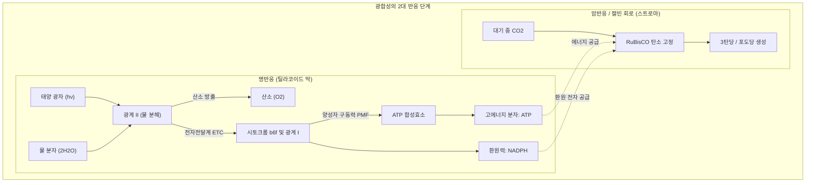
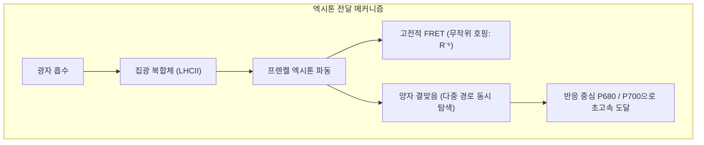
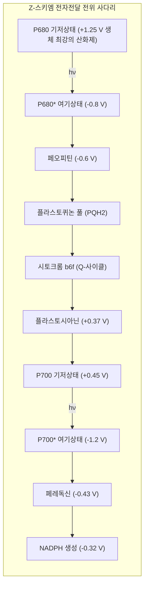
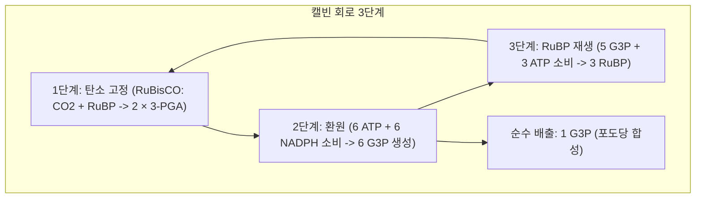

## 서론: 지구 생명권을 지탱하는 거대한 화학 엔진

푸른 바다와 녹색 대지로 덮인 지구. 이 행성의 모든 생명 활동을 지탱하는 근원적 원동력은 바로 **광합성(Photosynthesis)**이라는 단 하나의 분자 기구입니다.

지구상의 식물과 조류, 남세균은 매년 **1,000억 톤 이상의 이산화탄소($\text{CO}_2$)**를 고정하여 유기물을 합성하고, 동량의 순수한 산소($\text{O}_2$)를 대기로 방출합니다. 이 생물학적 에너지 변환 규모는 **약 100 테라와트($100\text{ TW}$)**에 달합니다.

인공 태양전지는 귀금속 촉매를 써도 상온에서 물을 분해하기 어렵지만, 식물의 엽록체는 흔한 미네랄(망간, 칼슘, 철, 마그네슘)만으로 상온·상압에서 물을 4전자 분해하며, 빛 에너지를 반응 중심으로 전달하는 **양자 수율(Quantum Yield)은 100%에 근접**합니다.

---

## 1. 엽록체와 틸라코이드 막의 초분자 구조

틸라코이드 막은 반응 단백질 복합체들을 공간적으로 엄격히 분리합니다:
- **광계 II (PSII)**: 밀집된 그라나(Grana) 적층부에 국재;
- **광계 I (PSI)**: 외부에 노출된 스트로마 틸라코이드에 배치;
- **시토크롬 $b_6f$ 복합체**: 전 막에 균일 분포하여 전자 전달 중계;
- **$F_oF_1$-ATP 합성효소**: 거대한 $F_1$ 헤드 때문에 비적층부에만 존재.

---

## 2. 양자생물학: 엑시톤 에너지 전달과 양자 결맞음

엽록소 분자 사이의 거리가 $1\text{ nm}$ 미만으로 밀집되어 있어, 흡수된 에너지는 개별 입자가 아닌 비국재화된 파동(Exciton)으로 거동합니다. 엑시톤은 **양자 결맞음(Quantum Coherence)**을 유지하며 모든 경로를 동시에 탐색하여 최소 손실로 수십 피코초 만에 반응 중심에 도달합니다.

---

## 3. 명반응의 Z-스키엠과 물 분해

- **P680 라디칼 양이온**: $+1.25\text{ V}$의 산화전위를 가져 물 분자($+0.815\text{ V}$)를 산화시킬 수 있는 유일한 생체 분자입니다.
- **$\text{Mn}_4\text{CaO}_5$ 클러스터와 코크의 S-상태 시계**: 4개의 망간 원자가 왜곡된 의자형 구조를 이루며 광자 1개마다 산화수를 1씩 축적($S_0 \rightarrow S_4$), $S_4$ 상태에서 물 2분자를 단숨에 분해하여 **$\text{O}_2$ 1분자와 4개의 양성자**를 방출합니다:

$$2\text{H}_2\text{O} \longrightarrow \text{O}_2 + 4\text{H}^+ + 4e^-$$

---

## 4. 양성자 구동력과 ATP 합성효소 회전 모터

틸라코이드 내부 루멘($\text{pH } 5.5$)과 외부 스트로마($\text{pH } 8.0$)의 농도 차이로 인해 **$\Delta p \approx 200\text{ mV}$의 양성자 구동력(PMF)**이 형성됩니다.

양성자가 **$F_oF_1$-ATP 합성효소**를 통과할 때:
- $c$-링 회전 모터가 구동되어 $\gamma$ 중심축을 회전시킵니다;
- $\alpha_3\beta_3$ 헤드가 Open $\rightarrow$ Loose $\rightarrow$ Tight 구조 변화를 일으키며 1회전당 3분자의 ATP를 90% 이상의 경이적인 기계적 효율로 합성합니다.

---

## 5. 캘빈 회로와 RuBisCO의 광호흡 역설

지구상에 가장 풍부한 효소인 **RuBisCO**는 산소($\text{O}_2$)를 잘못 결합시키는 산화효소 활성을 지니고 있어, 고정된 탄소의 25~40%를 **광호흡(Photorespiration)**으로 낭비합니다.
- **C4 식물(옥수수, 사탕수수)**: 엽육세포에서 PEP 카르복실화효소로 탄소를 먼저 잡고 유관속초세포에 고농도 $\text{CO}_2$를 공급하는 **공간적 분리**로 광호흡을 근절했습니다.
- **CAM 식물(선인장, 파인애플)**: 밤에 기공을 열어 말산으로 저장하고 낮에 밀폐 상태에서 광합성하는 **시간적 분리**를 진화시켰습니다.

---

## 6. 지구 대산화 사건과 인공 광합성

24억 년 전 남세균의 광합성으로 대기 중 산소가 급증한 **대산화 사건(GOE)**은 전 지구적 빙하기를 불렀으나, 호흡 생물의 출현과 오존층 형성을 이끌어 다세포 생물 탄생의 기틀을 마련했습니다.

---

## 결론

녹색 잎사귀 하나 속에서 양자 결맞음, 물 분해 촉매, 나노 회전 모터가 완벽한 하모니를 이루며 생명의 호흡을 이어가고 있습니다.
