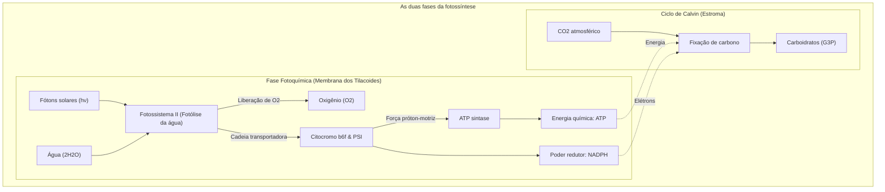
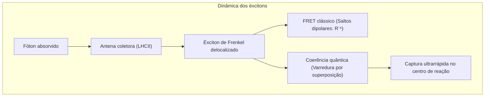
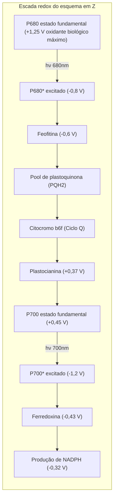
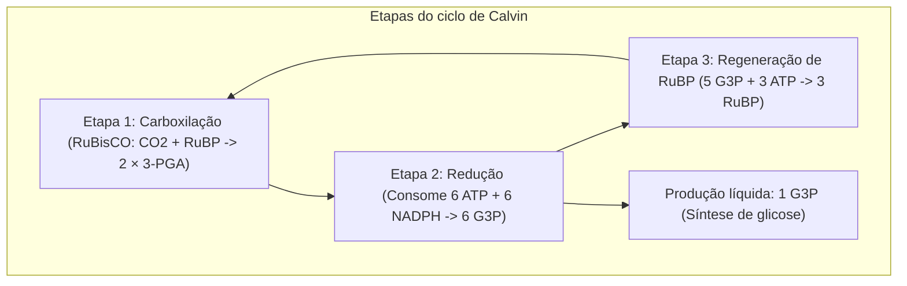

## Introdução: O motor termodinâmico mestre da biosfera

A biosfera terrestre depende inteiramente de uma singular usina molecular: **a fotossíntese**.

A cada ano, vegetais, algas e cianobactérias absorvem a radiação solar para fixar mais de **100 bilhões de toneladas de dióxido de carbono ($\text{CO}_2$)** em biomassa, liberando simultaneamente mais de 100 bilhões de toneladas de oxigênio molecular ($\text{O}_2$). A potência biológica combinada atinge **100 terawatts ($100\text{ TW}$)**.

Enquanto células solares sintéticas atingem cerca de 20% de eficiência fotovoltaica, a transferência de excitação nas antenas coletoras atinge um **rendimento quântico próximo de 100%**, à temperatura ambiente e pH neutro.

---

## 1. Arquitetura supramolecular dos tilacoides

A altíssima eficiência fotossintética advém da **segregação espacial lateral** dos complexos proteicos:
- **Fotossistema II (PSII)**: Restrito às membranas empilhadas densas (grana);
- **Fotossistema I (PSI)**: Localizado nas lamelas estromáticas não empilhadas, evitando perda descontrolada de energia para o PSI;
- **Citocromo $b_6f$**: Distribuído igualmente para mediar o fluxo de elétrons;
- **$F_oF_1$-ATP sintase**: Restrita às lamelas expostas ao estroma, pois sua grande cabeça globular $F_1$ não cabe nas partições dos grana.

---

## 2. Biologia quântica: Coerência e transporte de éxcitons

A espectroscopia bidimensional demonstrou que o éxciton se propaga como um **pacote de ondas em superposição quântica coerente**, explorando simultaneamente múltiplos caminhos. Sintonizado pelos fônons vibracionais da proteína (ENAQT), o éxciton alcança o centro de reação em menos de $50\text{ ps}$.

---

## 3. Fase fotoquímica: Esquema em Z e fotólise da água

- **P680**: Com potencial redox de **$+1,25\text{ V}$**, é o agente oxidante biológico mais poderoso da Terra.
- **Complexo de evolução de oxigênio (OEC)**: Abriga o **cluster $\text{Mn}_4\text{CaO}_5$**. Pelo relógio de estados S de Kok ($S_0 \rightarrow S_4$), acumula quatro equivalentes oxidativos antes de quebrar duas moléculas de água em **1 molécula de $\text{O}_2$ e 4 prótons**:

$$2\text{H}_2\text{O} \longrightarrow \text{O}_2 + 4\text{H}^+ + 4e^-$$

---

## 4. Força próton-motriz e o nanomotor ATP sintase

O acúmulo de prótons no lúmen tilacoidal gera uma força próton-motriz ($\Delta p \approx 200\text{ mV}$), sustentada por $\Delta\text{pH} \approx 2,5 \sim 3,0$.

Ao fluírem de volta pela **$F_oF_1$-ATP sintase**:
- O anel $c$ do rotor $F_o$ gira unidirecionalmente;
- O eixo central $\gamma$ induz mudanças conformacionais sequenciais (Aberto, Frouxo, Justo) na cabeça $\alpha_3\beta_3$, gerando 3 ATP por rotação com rendimento superior a 90%.

---

## 5. Ciclo de Calvin e o paradoxo da RuBisCO

A **RuBisCO**, surgida em eras anóxicas, frequentemente confunde $\text{CO}_2$ com $\text{O}_2$. A **fotorrespiração** resultante dissipa até 40% da energia fixada.
- **Plantas C4 (Milho, cana-de-açúcar)**: **Separação espacial**. Concentram ativamente o $\text{CO}_2$ ao redor da RuBisCO nas células da bainha perivascular.
- **Plantas CAM (Cactos, abacaxi)**: **Separação temporal**. Abrem estômatos apenas à noite para estocar malato, poupando água.

---

## Conclusão

Em cada folha viva, a física quântica, a catálise inorgânica e nanomotores rotatórios convergem na sinfonia que sustenta toda a vida na Terra.
