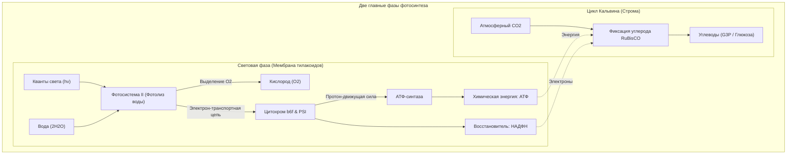
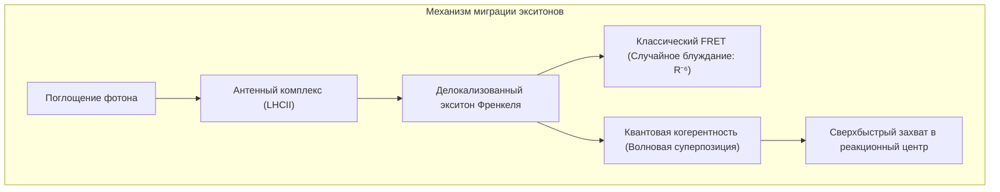
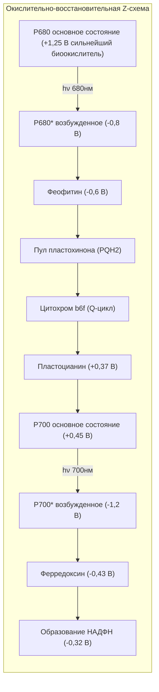
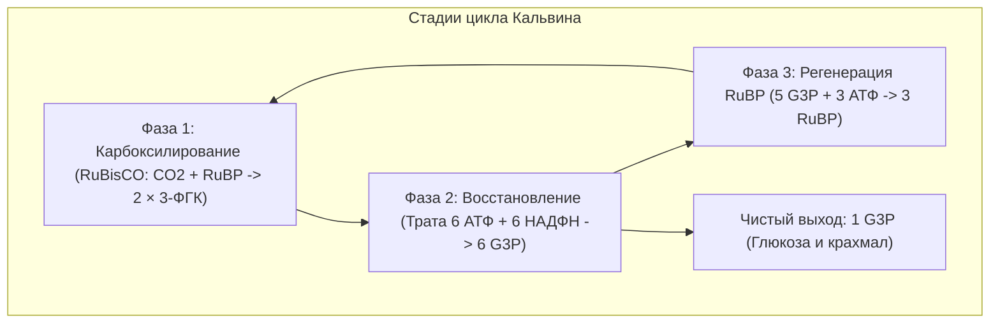

## Введение: Главный термодинамический двигатель биосферы

Вся жизнь на планете Земля существует благодаря единственному молекулярному явлению — **фотосинтезу**.

Ежегодно растительность, водоросли и цианобактерии преобразуют энергию солнечного излучения, связывая свыше **100 миллиардов тонн углекислого газа ($\text{CO}_2$)** в биомассу и выделяя эквивалентное количество кислорода ($\text{O}_2$). Биологическая мощность этого процесса составляет около **100 тераватт ($100\text{ ТВт}$)**.

В то время как кремниевые солнечные элементы с трудом достигают 20% эффективности, перенос энергии возбуждения в светособирающих антеннах работает с **квантовым выходом, близким к 100%**.

---

## 1. Супрамолекулярная структура тилакоидов

Высокая эффективность обеспечивается **пространственной сегрегацией** белковых комплексов:
- **Фотосистема II (ФС II)**: Локализована в плотно сложенных гранах;
- **Фотосистема I (ФС I)**: Находится на неспаренных мембранах стромальных ламелл;
- **Цитохромный комплекс $b_6f$**: Распределен равномерно;
- **$F_oF_1$-АТФ-синтаза**: Сосредоточена исключительно на стромальных мембранах, поскольку крупная головка $F_1$ не помещается в узкие щели гран.

---

## 2. Квантовая биология: Когерентный перенос экситонов

Двумерная электронная спектроскопия доказала: экситоны движутся как **квантово-когерентные волновые пакеты**, одновременно сканируя все доступные пути передачи. При поддержке фононов белковой матрицы (ENAQT) экситон достигает ловушки менее чем за $50\text{ пс}$ с пренебрежимо малыми потерями.

---

## 3. Световая фаза: Z-схема и расщепление воды

- **Радикал-катион $\text{P680}^{+\bullet}$** обладает потенциалом **$+1,25\text{ В}$** — это единственный биологический агент, способный отрывать электроны от молекул воды.
- **Водоокисляющий комплекс (OEC)**: Содержит кластер **$\text{Mn}_4\text{CaO}_5$**. Согласно S-циклу Кока ($S_0 \rightarrow S_4$), комплекс накапливает 4 окислительных эквивалента, синхронно расщепляя 2 молекулы воды на **1 молекулу $\text{O}_2$ и 4 протона**:

$$2\text{H}_2\text{O} \longrightarrow \text{O}_2 + 4\text{H}^+ + 4e^-$$

---

## 4. Протон-движущая сила и наномотор АТФ-синтазы

Накопление протонов в просвете тилакоида создает электрохимический градиент ($\Delta p \approx 200\text{ мВ}$), обусловленный $\Delta\text{pH} \approx 2,5 \sim 3,0$.

При обратном токе через **$F_oF_1$-АТФ-синтазу**:
- Кольцо $c$ ротора $F_o$ совершает однонаправленное вращение;
- Эксцентричный вал $\gamma$ циклически меняет конформацию каталитических центров $\alpha_3\beta_3$, синтезируя 3 молекулы АТФ за один полный оборот с механическим КПД свыше 90%.

---

## 5. Цикл Кальвина и парадокс RuBisCO

Фермент **RuBisCO**, возникший в бескислородную эпоху, связывает не только $\text{CO}_2$, но и $\text{O}_2$. Побочное **фотодыхание** растрачивает до 40% энергии.
- **C4-растения (Кукуруза)**: **Пространственное разделение**. Углерод улавливается в мезофилле и нагнетается к RuBisCO в обкладке проводящего пучка.
- **CAM-растения (Кактусы)**: **Временное разделение**. Устьица открываются ночью для запасания малата, предотвращая потерю влаги днем.

---

## Заключение

Каждый зеленый лист — это квантово-механический шедевр природы, связывающий свет звезд в ткань земной жизни.
