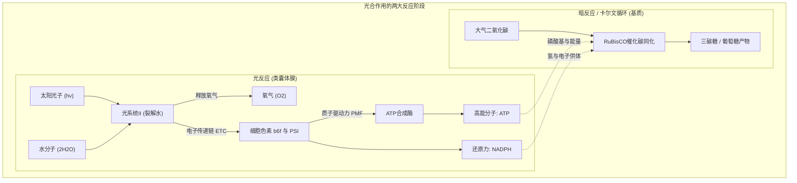
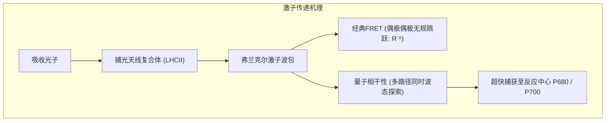
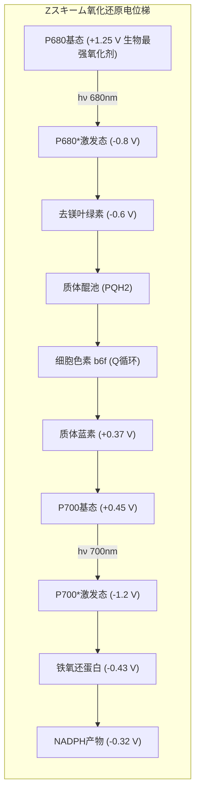
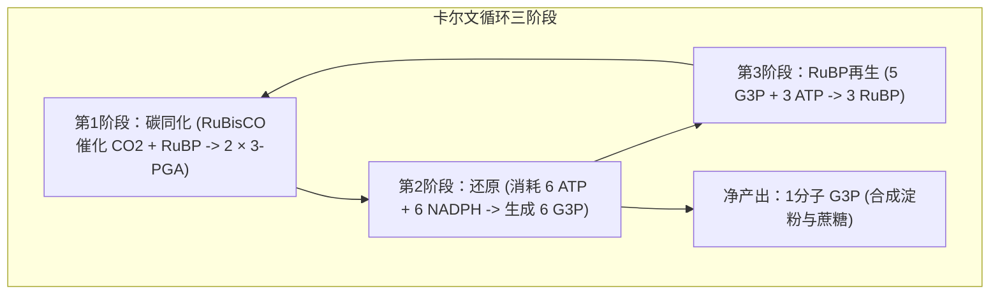

## 引言：地球上最宏大的分子化学引擎

地球表面生机勃勃的植被与海洋生态，全部维系于一个核心生物化学奇迹——**光合作用（Photosynthesis）**。

全球植物、藻类和蓝细菌每年吸收太阳辐射能，将超过**1000亿吨无机二氧化碳（$\text{CO}_2$）**固定为糖类有机物，同时释放出等量的纯净氧气（$\text{O}_2$）。其年生物能量转换功率高达**约100太瓦（$100\text{ TW}$）**，数十倍于全人类工业文明的总能耗。

人工光伏电池虽然光电效率可达20%，但常温水分解仍极度依赖贵金属催化剂。而植物叶绿体仅依靠地壳丰度极高的元素（锰、钙、铁、镁），在常温常压中性水溶液中就能裂解水，且光能捕获向反应中心的传递实现了**接近100%的量子产率**。

---

## 1. 叶绿体与类囊体膜的超分子结构

光合作用的高效性基于类囊体膜上的**超分子蛋白质复合体空间分离**：
- **光系统II（PSII）**：富集于密集的基粒类囊体叠层区（Appressed region）；
- **光系统I（PSI）**：分布于暴露的基质类囊体非叠层区（Stroma lamellae）；
- **细胞色素 $b_6f$ 复合体**：均匀分布于叠层与非叠层区，充当氧化还原中继桥；
- **$F_oF_1$-ATP合成酶**：局限于非叠层区，因其巨大的 $F_1$ 催化头部（直径约 $10\text{ nm}$）无法塞入狭窄的基粒叠层间隙。

---

## 2. 量子生物学：激子能量传递与量子相干性

2007年二维电子光谱实验证实：叶绿素分子密集排列（间距 $<1\text{ nm}$）使得电子轨道强耦合，激子以**量子力学叠加态（Quantum Coherence）**在天线复合体中同时探索多条退激路径，并在分子热振动辅助下（ENAQT），以波的方式在数十皮秒内近乎零损耗地汇入反应中心。

---

## 3. 光反应全貌：Z字型电子传递链与水裂解

- **P680阳离子自由基**拥有高达 **$+1.25\text{ V}$** 的超强氧化还原电位，是地球生物界唯一能撕裂水分子（$+0.815\text{ V}$）的分子。
- **放氧复合体（OEC）与Kok的S状态时钟**：OEC包含核心 **$\text{Mn}_4\text{CaO}_5$ 歪斜椅型簇**。每吸收一个光子升一级氧化态（$S_0 \rightarrow S_1 \rightarrow S_2 \rightarrow S_3 \rightarrow S_4$），积蓄4个氧化当量后，一瞬间协同夺取两分子水中的4个电子，释放出 **1分子 $\text{O}_2$ 和 4个质子**：

$$2\text{H}_2\text{O} \longrightarrow \text{O}_2 + 4\text{H}^+ + 4e^-$$

---

## 4. 质子驱动力与ATP合成酶旋转马达

电子传递伴随质子跨膜泵入，使类囊体腔内呈酸性（$\text{pH} \approx 5.5$），基质呈碱性（$\text{pH} \approx 8.0$）。产生的质子驱动力为：

$$\Delta p = \Delta\Psi - \frac{2.303 R T}{F} \Delta\text{pH} \approx 200\text{ mV}$$

质子经由 **$F_oF_1$-ATP合成酶** 回流：
- 质子穿过 $a$ 亚基半通道使 $c$ 环谷氨酸质子化，驱动 $c$ 环单向旋转；
- 轴向 $\gamma$ 亚基偏心旋转强迫 $\alpha_3\beta_3$ 催化头部发生 Open $\rightarrow$ Loose $\rightarrow$ Tight 构象转变，每转一圈稳定合成 3 分子 ATP，机械效率超过 90%。

---

## 5. 卡尔文循环与RuBisCO的光呼吸宿命

### RuBisCO的催化缺陷与光呼吸
地球上最丰富的酶 **RuBisCO** 进化于30亿年前的无氧高碳环境，无法严格区分 $\text{CO}_2$ 与 $\text{O}_2$。在现今富氧大气中，RuBisCO每4次反应就有1次发生加氧副反应，生成有害的2-磷酸乙醇酸，迫使植物启动跨三个细胞器的**光呼吸（Photorespiration）**，白白损耗25%~40%的光合能量！

### C4与CAM植物的进化反制
- **C4植物（玉米、甘蔗）**：**空间分离**。叶肉细胞利用PEP羧化酶固定 $\text{CO}_2$，并在维管束鞘细胞中释放高浓度 $\text{CO}_2$，彻底抑制光呼吸。
- **CAM植物（仙人掌、凤梨）**：**时间分离**。夜间气孔张开固定碳为苹果酸，白天关闭气孔保水并在强光下脱羧供卡尔文循环使用。

---

## 6. 地球生物圈与大氧化事件

24亿年前，蓝细菌释放的氧气与海洋二价铁反应沉淀出全球铁矿，随后氧气涌入大气引发**大氧化事件（GOE）**与全球冻结。残存生物演化出有氧呼吸，催生出臭氧层与真核多细胞生命的爆发。

---

## 结论

一叶落而知天下秋。每一片绿叶内部，量子相干性与多金属催化在此交织成宇宙最壮丽的能量转换交响乐。
