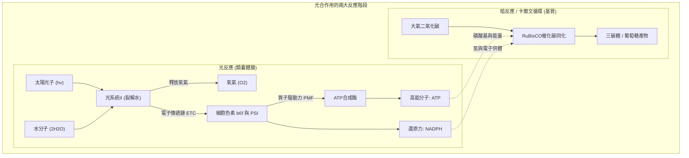
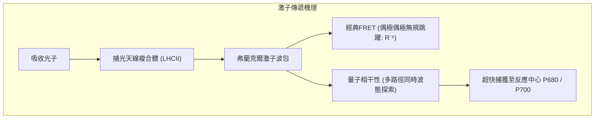
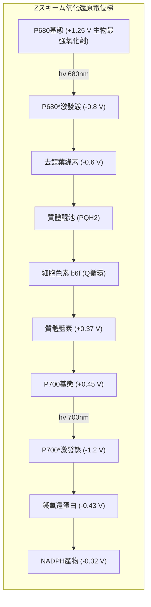
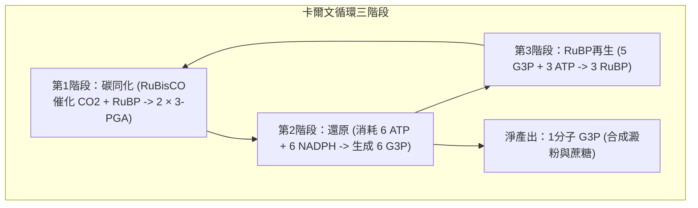

## 引言：地球上最宏大的分子化學引擎

地球表面生機勃勃的植被與海洋生態，全部維繫於一個核心生物化學奇蹟——**光合作用（Photosynthesis）**。

全球植物、藻類和藍細菌每年吸收太陽輻射能，將超過**1000億噸無機二氧化碳（$\text{CO}_2$）**固定為糖類有機物，同時釋放出等量的純淨氧氣（$\text{O}_2$）。其年生物能量轉換功率高達**約100太瓦（$100\text{ TW}$）**，數十倍於全人類工業文明的總能耗。

人工光伏電池雖然光電效率可達20%，但常溫水分解仍極度依賴貴金屬催化劑。而植物葉綠體僅依靠地殼豐度極高的元素（錳、鈣、鐵、鎂），在常溫常壓中性水溶液中就能裂解水，且光能捕獲向反應中心的傳遞實現了**接近100%的量子產率**。

---

## 1. 葉綠體與類囊體膜的超分子結構

光合作用的高效性基於類囊體膜上的**超分子蛋白質複合體空間分離**：
- **光系統II（PSII）**：富集於密集的基粒類囊體疊層區（Appressed region）；
- **光系統I（PSI）**：分布於暴露的基質類囊體非疊層區（Stroma lamellae）；
- **細胞色素 $b_6f$ 複合體**：均勻分布於疊層與非疊層區，充當氧化還原中繼橋；
- **$F_oF_1$-ATP合成酶**：局限於非疊層區，因其巨大的 $F_1$ 催化頭部（直徑約 $10\text{ nm}$）無法塞入狹窄的基粒疊層間隙。

---

## 2. 量子生物學：激子能量傳遞與量子相干性

2007年二維電子光譜實驗證實：葉綠素分子密集排列（間距 $<1\text{ nm}$）使得電子軌道強耦合，激子以**量子力學疊加態（Quantum Coherence）**在天線複合體中同時探索多條退激路徑，並在分子熱振動輔助下（ENAQT），以波的方式在數十皮秒內近乎零損耗地匯入反應中心。

---

## 3. 光反應全貌：Z字型電子傳遞鏈與水裂解

- **P680陽離子自由基**擁有高達 **$+1.25\text{ V}$** 的超強氧化還原電位，是地球生物界唯一能撕裂水分子（$+0.815\text{ V}$）的分子。
- **放氧複合體（OEC）與Kok的S狀態時鐘**：OEC包含核心 **$\text{Mn}_4\text{CaO}_5$ 歪斜椅型簇**。每吸收一個光子升一級氧化態（$S_0 \rightarrow S_1 \rightarrow S_2 \rightarrow S_3 \rightarrow S_4$），積蓄4個氧化當量後，一瞬間協同奪取兩分子水中的4個電子，釋放出 **1分子 $\text{O}_2$ 和 4個質子**：

$$2\text{H}_2\text{O} \longrightarrow \text{O}_2 + 4\text{H}^+ + 4e^-$$

---

## 4. 質子驅動力與ATP合成酶旋轉馬達

電子傳遞伴隨質子跨膜泵入，使類囊體腔內呈酸性（$\text{pH} \approx 5.5$），基質呈鹼性（$\text{pH} \approx 8.0$）。產生的質子驅動力為：

$$\Delta p = \Delta\Psi - \frac{2.303 R T}{F} \Delta\text{pH} \approx 200\text{ mV}$$

質子經由 **$F_oF_1$-ATP合成酶** 回流：
- 質子穿過 $a$ 亞基半通道使 $c$ 環穀氨酸質子化，驅動 $c$ 環單向旋轉；
- 軸向 $\gamma$ 亞基偏心旋轉強迫 $\alpha_3\beta_3$ 催化頭部發生 Open $\rightarrow$ Loose $\rightarrow$ Tight 構象轉變，每轉一圈穩定合成 3 分子 ATP，機械效率超過 90%。

---

## 5. 卡爾文循環與RuBisCO的光呼吸宿命

### RuBisCO的催化缺陷與光呼吸
地球上最豐富的酶 **RuBisCO** 進化於30億年前的無氧高碳環境，無法嚴格區分 $\text{CO}_2$ 與 $\text{O}_2$。在現今富氧大氣中，RuBisCO每4次反應就有1次發生加氧副反應，生成有害的2-磷酸乙醇酸，迫使植物啟動跨三個細胞器的**光呼吸（Photorespiration）**，白白損耗25%~40%的光合能量！

### C4與CAM植物的進化反制
- **C4植物（玉米、甘蔗）**：**空間分離**。葉肉細胞利用PEP羧化酶固定 $\text{CO}_2$，並在維管束鞘細胞中釋放高濃度 $\text{CO}_2$，徹底抑制光呼吸。
- **CAM植物（仙人掌、鳳梨）**：**時間分離**。夜間氣孔張開固定碳為蘋果酸，白天關閉氣孔保水並在強光下脫羧供卡爾文循環使用。

---

## 6. 地球生物圈與大氧化事件

24億年前，藍細菌釋放的氧氣與海洋二價鐵反應沉澱出全球鐵礦，隨後氧氣湧入大氣引發**大氧化事件（GOE）**與全球凍結。殘存生物演化出有氧呼吸，催生出臭氧層與真核多細胞生命的爆發。

---

## 結論

一葉落而知天下秋。每一片綠葉內部，量子相干性與多金屬催化在此交織成宇宙最壯麗的能量轉換交響樂。
