Pointing an inert, dark blue or pitch-black panel toward the daytime sky generates continuous, clean electrical power with zero moving parts, zero chemical combustion, zero acoustic emissions, and zero direct greenhouse gas emissions. The photovoltaic (PV) solar cell represents one of humanity's most elegant triumphs of solid-state quantum physics and semiconductor manufacturing.

Yet beneath this tranquil surface lies a dizzying interplay of quantum mechanics, non-equilibrium statistical mechanics, electrodynamics, and precision power electronics. While conventional thermal power plants (coal, gas, nuclear) rely on the classical thermodynamics of the Carnot cycle—burning fuel to produce high-pressure steam that drives a mechanical turbine and an electromagnetic generator—solar cells accomplish a direct quantum leap: <strong>transforming the discrete energy of solar photons directly into the potential energy of free conduction electrons</strong>.

This comprehensive treatise examines the entire scientific and engineering architecture of photovoltaic technology: from the quantum band structure of crystalline silicon and carrier statistics, to the electrostatics of the p-n junction and charge separation kinetics, the mathematical derivation of the Shockley-Queisser limit, the nanostructured evolution of modern industrial architectures (PERC, TOPCon, HJT), the non-linear physics of partial shading and thermal degradation, to the multi-kHz algorithmic control of maximum power point tracking (MPPT) inverters.

---

## 1. Direct Quantum Conversion: Bypassing the Carnot Cycle

To understand the revolutionary character of photovoltaics, one must contrast it with heat-engine-based electrical generation.

### 1.1 The Thermodynamic Constraint of Heat Engines

In any thermal power cycle (Rankine, Brayton, or internal combustion), energy transformation is governed by the Second Law of Thermodynamics. The maximum theoretical efficiency is capped by the <strong>Carnot Efficiency</strong>:

$$\eta_{Carnot} = 1 - \frac{T_C}{T_H}$$

where $T_H$ is the absolute temperature of the high-temperature heat reservoir (e.g., combustion gases or nuclear reactor coolant) and $T_C$ is the ambient heat sink temperature.

Even with ultra-supercritical steam cycles operating at $T_H \approx 873\,\mathrm{K}$ ($600^\circ\mathrm{C}$) and cooling water at $T_C \approx 298\,\mathrm{K}$ ($25^\circ\mathrm{C}$), the Carnot ceiling is roughly $66\%$, with real-world turbine-generator sets reaching practical efficiencies between $35\%$ and $45\%$. Furthermore, this pathway incurs substantial frictional wear, parasitic pumping loads, thermal radiation losses, and constant mechanical degradation.

### 1.2 The Photovoltaic Quantum Mechanism

Photovoltaic energy conversion is fundamentally not a heat engine operating between two macroscopic temperature reservoirs. It is a <strong>quantum optoelectronic process</strong>. 

An individual quantum of electromagnetic radiation (a photon) carries energy:

$$E = h\nu = \frac{hc}{\lambda}$$

where $h \approx 6.626 \times 10^{-34}\,\mathrm{J\cdot s}$ is Planck's constant, $c \approx 2.998 \times 10^8\,\mathrm{m/s}$ is the speed of light, and $\lambda$ is the photon's free-space wavelength.

When a photon possessing energy equal to or greater than the semiconductor's electronic bandgap ($h\nu \ge E_g$) is absorbed by a valence electron, that electron is instantaneously promoted across the forbidden energy gap into the conduction band. The resulting electron-hole pair is separated by a built-in electrostatic field before recombination can occur, producing a net electrical potential difference and driving an external current.

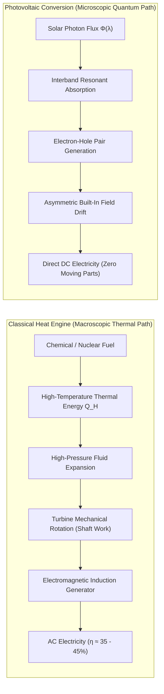

---

## 2. Solid-State Physics and Band Theory of Semiconductors

The physical engine of every solar cell is the semiconductor crystal—most commonly crystalline silicon ($\mathrm{Si}$).

### 2.1 Crystal Structure and the Origin of Energy Bands

Crystalline silicon is a Group 14 element with four valence electrons in its outer $3s^2 3p^2$ subshells. In a crystal, silicon atoms organize into the <strong>diamond cubic lattice</strong>—a face-centered cubic (FCC) Bravais lattice with a two-atom basis, where each silicon atom is tetrahedrally bonded to four nearest neighbors via highly directional, localized $sp^3$ hybrid covalent bonds.

According to quantum mechanics, when $N$ identical atoms are brought together from infinite separation into a periodic crystalline lattice with spatial periodicity $\mathbf{R}$, the discrete atomic energy levels split due to Pauli's Exclusion Principle into continuous bands of allowed energy states separated by forbidden energy gaps (bandgaps).

The wavefunctions of electrons in this periodic potential $V(\mathbf{r} + \mathbf{R}) = V(\mathbf{r})$ satisfy <strong>Bloch's Theorem</strong>:

$$\psi_{n, \mathbf{k}}(\mathbf{r}) = e^{j \mathbf{k} \cdot \mathbf{r}} u_{n, \mathbf{k}}(\mathbf{r})$$

where $\mathbf{k}$ is the electron crystal wavevector within the first Brillouin zone and $u_{n, \mathbf{k}}(\mathbf{r})$ has the periodicity of the crystal lattice.

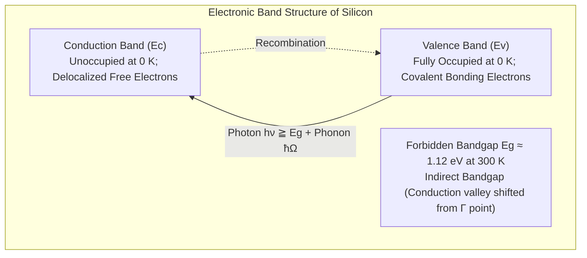

1. <strong>Valence Band ($E_v$)</strong>:
   The highest occupied energy band at absolute zero ($T = 0\,\mathrm{K}$), corresponding to the bonding molecular orbitals that hold the silicon atoms together. Because every quantum state in this band is completely filled, electrons cannot accelerate in response to an external electric field without violating Pauli's principle. Hence, an entirely filled valence band cannot conduct electric current.
2. <strong>Conduction Band ($E_c$)</strong>:
   The lowest unoccupied band situated above the valence band, corresponding to antibonding states. Any electron promoted into this band occupies an almost entirely empty continuum of available states and can move freely throughout the crystal as a mobile negative charge carrier.
3. <strong>The Bandgap ($E_g = E_c - E_v$)</strong>:
   The forbidden energy threshold separating $E_v$ and $E_c$. At room temperature ($300\,\mathrm{K}$), crystalline silicon has an indirect bandgap of <strong>$E_g \approx 1.12\,\mathrm{eV}$</strong>. Because silicon is an <strong>indirect bandgap semiconductor</strong> (the conduction band minimum does not align at the same crystal momentum $\mathbf{k}$ as the valence band maximum at the $\Gamma$ point), optical absorption requires the simultaneous absorption or emission of a lattice vibration quantum (a <strong>phonon</strong>, $\hbar \Omega$) to conserve crystal momentum:
   $$E_{photon} = E_g \pm \hbar\Omega, \quad \hbar\mathbf{k}_{photon} \approx \mathbf{0} = \hbar\mathbf{k}_{electron} \pm \hbar\mathbf{q}_{phonon}$$
   Consequently, silicon's absorption coefficient $\alpha(\lambda)$ near the band edge is relatively low compared to direct bandgap materials like $\mathrm{GaAs}$ or organometallic halide perovskites, necessitating a thicker active layer ($\sim 150\,\mu\mathrm{m}$) to capture most incident sunlight.

### 2.2 Doping: n-Type and p-Type Semiconductors

An intrinsic (undoped) silicon crystal at room temperature is an electrical insulator for practical purposes. The intrinsic carrier concentration $n_i$ is governed by the Fermi-Dirac distribution:

$$n_i = \sqrt{N_c N_v} \exp\left( -\frac{E_g}{2 k_B T} \right) \approx 1.5 \times 10^{10}\,\mathrm{cm^{-3}} \quad (\text{at } 300\,\mathrm{K})$$

Given that silicon contains roughly $5 \times 10^{22}\,\mathrm{atoms/cm^3}$, fewer than one in a trillion atoms is ionized. To create functional electronic devices, we introduce controlled impurities via <strong>doping</strong>.

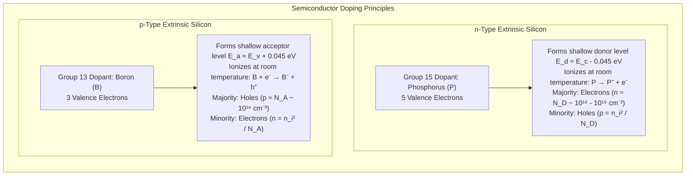

- <strong>n-type Doping (Phosphorus, $\mathrm{P}$)</strong>:
  Replacing a tetravalent silicon atom with a pentavalent phosphorus atom introduces four electrons into the covalent bonds, leaving a fifth electron loosely bound to the phosphorus nucleus by a hydrogenic Coulomb potential. At room temperature ($k_B T \approx 26\,\mathrm{meV}$), this fifth electron is easily ionized into the conduction band, leaving behind a fixed positive ion ($\mathrm{P^+}$). In an n-type semiconductor, <strong>electrons are majority carriers</strong> ($n \approx N_D$), and <strong>holes are minority carriers</strong> ($p \approx n_i^2 / N_D$).
- <strong>p-type Doping (Boron, $\mathrm{B}$)</strong>:
  Replacing a silicon atom with a trivalent boron atom leaves one covalent bond vacant of an electron. A neighboring valence electron can hop into this empty state with minimal thermal energy, ionizing the boron into a fixed negative ion ($\mathrm{B^-}$) and creating a mobile deficiency in the valence band known as a <strong>hole ($h^+$)</strong>. In a p-type semiconductor, <strong>holes are majority carriers</strong> ($p \approx N_A$), and <strong>electrons are minority carriers</strong> ($n \approx n_i^2 / N_A$).

---

## 3. The p-n Junction and Photovoltaic Charge Separation

A simple uniform bar of silicon exposed to light will not produce external electricity. When light generates an electron-hole pair, the two oppositely charged particles attract one another and recombine within microseconds unless an asymmetric spatial force pulls them apart.

That internal force is provided by the <strong>p-n junction</strong>.

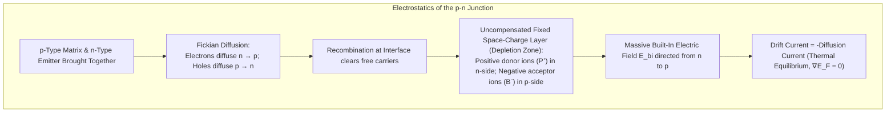

### 3.1 Space-Charge Region and Built-In Potential

When a p-type region and an n-type region meet, enormous carrier concentration gradients drive intense diffusion:
- Mobile electrons diffuse from the n-side into the p-side.
- Mobile holes diffuse from the p-side into the n-side.

Near the metallurgical interface, diffusing carriers recombine and disappear. This leaves behind a region depleted of all mobile charges: the <strong>Depletion Region (Space-Charge Region)</strong>. 

Within this depletion zone, the unshielded ionized dopant cores remain locked into the lattice:
- Fixed positive charges ($\mathrm{P^+}$) on the n-side.
- Fixed negative charges ($\mathrm{B^-}$) on the p-side.

This spatial charge separation generates an intense <strong>built-in electric field ($\mathbf{E}_{bi}$)</strong> pointing from the n-side toward the p-side. Integrating Poisson's Equation:

$$\nabla^2 \phi = -\frac{\rho(x)}{\epsilon_0 \epsilon_r} = -\frac{q}{\epsilon_s} [p(x) - n(x) + N_D^+(x) - N_A^-(x)]$$

yields the <strong>Built-In Potential ($V_{bi}$)</strong> across the junction:

$$V_{bi} = \frac{k_B T}{q} \ln\left( \frac{N_A N_D}{n_i^2} \right)$$

In silicon solar cells, $V_{bi}$ is typically <strong>$0.7\,\mathrm{V}$ to $0.9\,\mathrm{V}$</strong>. This electric field exerts a drift force on mobile charges that directly opposes the diffusion tendency. In thermodynamic equilibrium with no light and no external bias, the drift current precisely cancels the diffusion current for both electrons and holes, resulting in zero net current and a constant, spatially flat Fermi level ($E_F$).

### 3.2 Photogeneration and Separation Dynamics

When sunlight illuminates the cell, photons with $h\nu \ge E_g$ penetrate into the semiconductor according to the Beer-Lambert Law:

$$\Phi(x, \lambda) = \Phi_0(\lambda) e^{-\alpha(\lambda) x}$$

where $\Phi_0(\lambda)$ is the incident photon flux at wavelength $\lambda$, $x$ is the depth from the front surface, and $\alpha(\lambda)$ is the wavelength-dependent optical absorption coefficient.

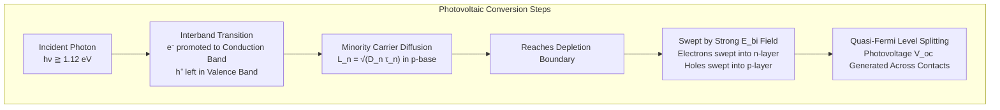

The generation rate of electron-hole pairs $G(x)$ at depth $x$ across the solar spectrum is:

$$G(x) = \int_0^{\lambda_{max}} \alpha(\lambda) \Phi_0(\lambda) [1 - R(\lambda)] e^{-\alpha(\lambda) x} d\lambda$$

Once generated, the dynamics of these excess non-equilibrium carriers are dictated by whether they reside inside or outside the depletion zone:
1. <strong>Generation inside the Depletion Zone</strong>:
   The electron-hole pair is instantly caught by the built-in electric field $\mathbf{E}_{bi}$ ($\sim 10^4 - 10^5\,\mathrm{V/cm}$). The electrostatic Coulomb force $\mathbf{F} = q\mathbf{E}$ violently sweeps the electron into the n-region and the hole into the p-region at terminal saturation drift velocities ($v_{sat} \approx 10^7\,\mathrm{cm/s}$) in mere picoseconds, preventing any recombination.
2. <strong>Generation in the Quasi-Neutral Base (p-Type Bulk)</strong>:
   The majority of photons, particularly in the weakly absorbed red and near-infrared spectrum ($700 - 1100\,\mathrm{nm}$), penetrate deep into the bulk p-type base. Here, the electric field is virtually zero. The photogenerated minority electrons must diffuse via random thermal motion toward the edge of the depletion zone.
   
   The probability that a minority electron reaches the depletion edge before recombining is governed by its <strong>Minority Carrier Diffusion Length ($L_n$)</strong>:
   $$L_n = \sqrt{D_n \tau_n}$$
   where $D_n = \frac{k_B T}{q}\mu_n$ is the electron diffusion coefficient and $\tau_n$ is the minority carrier recombination lifetime. In modern electronic-grade monocrystalline wafers, $\tau_n$ exceeds $1 - 3\,\mathrm{milliseconds}$, resulting in diffusion lengths $L_n > 500\,\mu\mathrm{m}$—far exceeding the typical wafer thickness of $130 - 150\,\mu\mathrm{m}$. Virtually every generated electron reaches the depletion zone and is successfully collected.
3. <strong>Establishment of the Photovoltage</strong>:
   The steady accumulation of separated electrons in the n-layer and holes in the p-layer disrupts thermal equilibrium. The single equilibrium Fermi level splits into two distinct <strong>Quasi-Fermi Levels</strong>: $E_{Fn}$ for electrons and $E_{Fp}$ for holes. The splitting of these quasi-Fermi levels directly defines the externally measurable <strong>Open-Circuit Photovoltage ($V_{oc}$)</strong>:
   $$q V_{oc} = E_{Fn} - E_{Fp}$$
   Connecting an external electrical load allows these accumulated electrons to flow through the circuit toward the p-layer, driving mechanical work, lighting lamps, or charging batteries before returning to recombine peacefully at the rear contact.

---

## 4. Equivalent Circuit Model and Current-Voltage (I-V) Mathematics

The operational performance of a solar cell under arbitrary illumination and load conditions is modeled with extreme precision through equivalent circuit analysis.

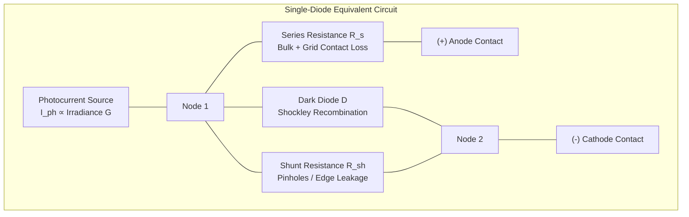

### 4.1 The Single-Diode Transcendental Equation

Applying Kirchhoff's Current Law to the single-diode equivalent circuit yields the fundamental governing equation of photovoltaic output:

$$I = I_{ph} - I_0 \left[ \exp\left( \frac{q(V + I R_s)}{n k_B T} \right) - 1 \right] - \frac{V + I R_s}{R_{sh}}$$

where:
- $I$: Net current delivered to the external load ($\mathrm{A}$).
- $V$: Voltage across the external terminals ($\mathrm{V}$).
- $I_{ph}$: Light-generated photocurrent ($\mathrm{A}$), directly proportional to incident solar irradiance $G$ ($\mathrm{W/m^2}$).
- $I_0$: Reverse dark saturation current ($\mathrm{A}$), a measure of thermal carrier generation and recombination across the junction.
- $q$: Elementary charge ($1.602 \times 10^{-19}\,\mathrm{C}$).
- $k_B$: Boltzmann constant ($1.381 \times 10^{-23}\,\mathrm{J/K}$).
- $T$: Absolute cell temperature ($\mathrm{K}$). The thermal voltage is defined as $V_t = k_B T / q \approx 25.85\,\mathrm{mV}$ at $25^\circ\mathrm{C}$.
- $n$: Diode ideality factor (dimensionless, typically $1.0 \le n \le 1.5$ in commercial silicon).
- $R_s$: Parasitic series resistance ($\Omega$). Includes bulk silicon resistivity, front metallization finger resistance, solder ribbons, and metal-semiconductor contact resistance.
- $R_{sh}$: Parasitic shunt resistance ($\Omega$). Represents alternate leakage paths crossing the p-n junction along crystal grain boundaries, edge defects, or pinholes.

### 4.2 Key Performance Figures of Merit

The capability of any solar cell is fully captured by four critical parameters extracted from its I-V curve:

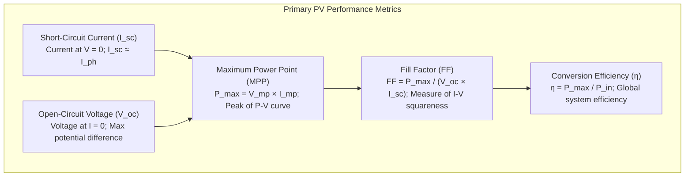

1. <strong>Short-Circuit Current ($I_{sc}$)</strong>:
   The current flowing through the cell when the terminal voltage is shorted to zero ($V = 0$). Assuming low series resistance ($R_s \to 0$) and high shunt resistance ($R_{sh} \to \infty$):
   $$I_{sc} \approx I_{ph} = q \int G(x) dx$$
   $I_{sc}$ scales linearly with solar irradiance.
2. <strong>Open-Circuit Voltage ($V_{oc}$)</strong>:
   The maximum voltage available from the cell when external current is zero ($I = 0$). Setting $I = 0$ in the governing equation yields:
   $$V_{oc} = \frac{n k_B T}{q} \ln\left( \frac{I_{ph}}{I_0} + 1 \right) \approx \frac{n k_B T}{q} \ln\left( \frac{I_{sc}}{I_0} \right)$$
   $V_{oc}$ depends logarithmically on illumination intensity and increases dramatically as the dark saturation current $I_0$ is reduced through surface passivation.
3. <strong>Fill Factor ($FF$)</strong>:
   The ratio of the maximum extractable electrical power $P_{max}$ to the theoretical product of $V_{oc}$ and $I_{sc}$:
   $$FF = \frac{P_{max}}{V_{oc} I_{sc}} = \frac{V_{mp} I_{mp}}{V_{oc} I_{sc}}$$
   The Fill Factor characterizes the "squareness" of the I-V curve. Ideal junctions with negligible series resistance ($R_s \approx 0$) and infinite shunt resistance ($R_{sh} \to \infty$) exhibit $FF \approx 0.82 - 0.86$. High series resistance squashes the curve vertically, while low shunt resistance tilts the horizontal slope, drastically reducing $FF$.
4. <strong>Power Conversion Efficiency ($\eta$)</strong>:
   The percentage of incident radiant energy converted into maximum electrical power under Standard Test Conditions (STC: Irradiance $P_{in} = 1000\,\mathrm{W/m^2}$, AM1.5G spectrum, cell temperature $T = 25^\circ\mathrm{C}$):
   $$\eta = \frac{P_{max}}{P_{in} \cdot A_{cell}} = \frac{V_{oc} I_{sc} FF}{P_{in} \cdot A_{cell}}$$

---

## 5. The Thermodynamic Limit: The Shockley-Queisser Limit

Why cannot a single-junction solar cell achieve 80% or 100% efficiency? The ultimate theoretical ceiling for photovoltaic energy conversion was calculated in 1961 by William Shockley and Hans-Joachim Queisser using the principle of <strong>detailed balance</strong>.

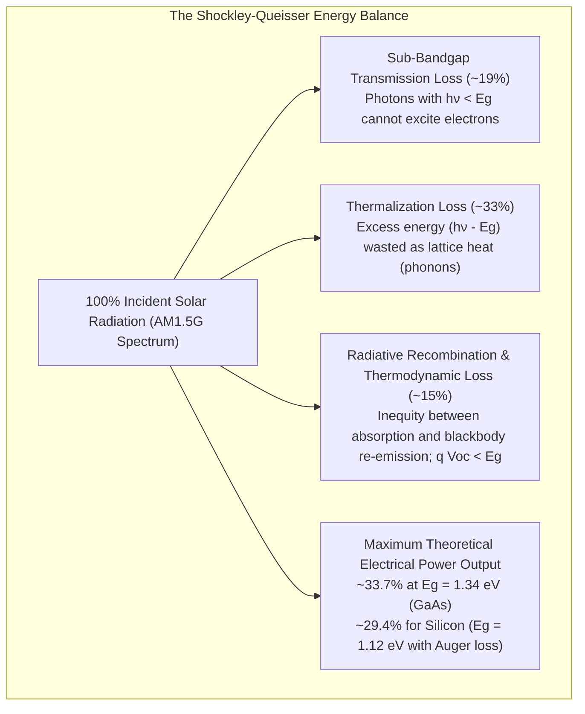

### 5.1 The Four Fundamental Physical Losses

In their foundational detailed balance formulation, Shockley and Queisser considered a solar cell at temperature $T_c = 300\,\mathrm{K}$ exposed to a non-concentrated blackbody emitter (the Sun at $T_s = 5778\,\mathrm{K}$) subtending a solid angle $\Omega_s \approx 6.8 \times 10^{-5}\,\mathrm{steradians}$.

1. <strong>Sub-Bandgap Transmission Loss ($h\nu < E_g$)</strong>:
   Photons whose energy falls below the bandgap cannot bridge the quantum barrier. They pass through the crystal without interacting. In silicon ($E_g = 1.12\,\mathrm{eV}$), all infrared wavelengths beyond $\lambda = 1107\,\mathrm{nm}$ are lost, accounting for roughly <strong>$19\%$</strong> of all incident solar energy.
2. <strong>Thermalization Loss ($h\nu > E_g$)</strong>:
   When a high-energy photon (such as ultraviolet or blue light, $h\nu \approx 2.5 - 3.5\,\mathrm{eV}$) is absorbed, it promotes an electron deep into the conduction band. Within femtoseconds to picoseconds, this "hot carrier" scatters off lattice phonons, releasing its excess kinetic energy $(h\nu - E_g)$ as thermal waste heat until it relaxes to the conduction band edge $E_c$. This single mechanism discards approximately <strong>$33\%$</strong> of the solar spectrum.
3. <strong>Thermodynamic Voltage Penalty ($q V_{oc} < E_g$)</strong>:
   Because a solar cell is at non-zero temperature ($300\,\mathrm{K}$), it must obey Kirchhoff's Law of Thermal Radiation: any body that absorbs radiation must also re-emit blackbody radiation. The radiative recombination rate balances absorption at open circuit, imposing an entropy generation penalty that dictates that $q V_{oc}$ is always strictly smaller than $E_g$ by approximately $0.3 - 0.4\,\mathrm{eV}$.
4. <strong>Radiative and Non-Radiative Recombination</strong>:
   Even in the absence of material defects, band-to-band radiative recombination and multiparticle Auger recombination set fundamental upper bounds on carrier lifetimes.

### 5.2 The Theoretical Ceiling

Synthesizing these trade-offs as a function of semiconductor bandgap $E_g$:
- A small bandgap absorbs almost all photons, but suffers from low $V_{oc}$ and crippling thermalization losses.
- A large bandgap yields high $V_{oc}$ with minimal thermalization, but fails to absorb most of the solar photon flux.

The global optimum sits at <strong>$E_g \approx 1.34\,\mathrm{eV}$</strong>, yielding the classic <strong>Shockley-Queisser Limit of $33.7\%$</strong> under unconcentrated sunlight. For crystalline silicon ($E_g \approx 1.12\,\mathrm{eV}$), accounting for intrinsic Auger recombination losses, the ultimate practical single-junction limit is <strong>$29.4\%$</strong>.

---

## 6. Industrial Silicon Solar Cell Architectures: From BSF to TOPCon and HJT

In the laboratory, single-junction monocrystalline silicon cells have surpassed <strong>$26.8\%$</strong> efficiency—approaching within $2.6$ percentage points of the absolute physical ceiling. This astounding achievement represents decades of nanoscale interface engineering.

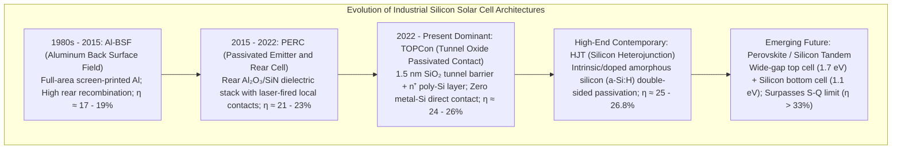

### 6.1 Light Trapping: Texturing and Anti-Reflective Coatings

Polished bare silicon reflects over $35\%$ of incoming sunlight due to its high refractive index ($n_{Si} \approx 3.9$). To capture photons efficiently:
1. <strong>Random Inverted Pyramids</strong>:
   Wafers are wet-chemically etched in potassium hydroxide ($\mathrm{KOH}$) and isopropyl alcohol ($\mathrm{IPA}$). Because alkaline solutions etch the (100) crystal plane hundreds of times faster than the close-packed (111) plane, the wafer naturally self-assembles into millions of microscopic four-sided pyramids ($2 - 8\,\mu\mathrm{m}$ tall). Incoming light bounces off the inclined facets multiple times, dropping primary reflection below $10\%$.
2. <strong>Dielectric Anti-Reflective Coating (ARC)</strong>:
   A thin layer of silicon nitride ($\mathrm{SiN_x}$) is deposited via Plasma-Enhanced Chemical Vapor Deposition (PECVD). By choosing refractive index $n_{ARC} \approx \sqrt{n_{Si} n_{air}} \approx 2.05$ and thickness $d = \lambda_0 / (4 n_{ARC}) \approx 75\,\mathrm{nm}$, destructive optical interference cancels reflections at $\lambda \approx 600\,\mathrm{nm}$, reducing total module reflectance to under <strong>$1.5\%$</strong> and imparting the deep blue/black color.

### 6.2 Advanced Passivation Technologies

Traditional full-area metal contacts create severe surface defect states (dangling bonds) that act as deadly recombination centers:

1. <strong>PERC (Passivated Emitter and Rear Cell)</strong>:
   PERC replaced full-area rear aluminum alloy with a dual dielectric passivation stack: an ultra-thin film of aluminum oxide ($\mathrm{Al_2O_3}$) capped with protective $\mathrm{SiN_x}$. The fixed negative charges in $\mathrm{Al_2O_3}$ provide field-effect passivation (repelling electrons), while atomic hydrogen passivates interfacial dangling bonds. Localized laser pulses ablate tiny micro-openings through the dielectric to allow electrical contact, lifting commercial module efficiencies beyond $22\%$.
2. <strong>TOPCon (Tunnel Oxide Passivated Contact)</strong>:
   TOPCon completely eliminates direct metal-to-silicon contact on the rear side. It features an ultra-pure, chemically grown <strong>tunnel oxide layer ($\mathrm{SiO_2}$)</strong> of extraordinary thinness: just <strong>$1.2 - 1.5\,\mathrm{nm}$ (approximately 5 to 6 atomic layers)</strong>. This is capped by a heavily doped n-type polycrystalline silicon layer.
   
   Quantum mechanics dictates that majority electrons easily tunnel through this ultrathin barrier via quantum tunneling with almost zero electrical resistance, whereas minority carrier holes are completely blocked by the large valence band offset. Surface recombination velocity drops to near zero ($S < 3\,\mathrm{cm/s}$), pushing open-circuit voltages beyond $735\,\mathrm{mV}$.
3. <strong>HJT (Silicon Heterojunction)</strong>:
   HJT sandwiches an n-type crystalline silicon wafer between ultra-clean bilayers of intrinsic and doped hydrogenated amorphous silicon ($i\text{-}\mathrm{a\text{-}Si:H}$ and $p^+/n^+\,\mathrm{a\text{-}Si:H}$). Because amorphous silicon has a wider bandgap ($E_g \approx 1.7\,\mathrm{eV}$), it creates huge band offsets that reflect minority carriers away from surfaces. HJT boasts the lowest temperature coefficient and achieves open-circuit voltages exceeding <strong>$750\,\mathrm{mV}$</strong>.

---

## 7. Environmental Non-Linearities: Temperature, Shading, and Hot-Spots

Solar cells do not operate in a vacuum; they function on baking rooftops, freezing tundras, and humid deserts.

### 7.1 The Temperature Paradox

A common public misconception assumes that solar panels generate more electricity when it is hotter outside. The exact opposite is true: <strong>as photovoltaic cell temperature rises, power output drops significantly</strong>.

The temperature coefficient of maximum power ($\gamma = \frac{1}{P_{mp}}\frac{dP_{mp}}{dT}$) for commercial silicon panels is typically <strong>$-0.30\% \text{ to } -0.38\% / ^\circ\mathrm{C}$</strong>. On a scorching summer day when ambient air is $35^\circ\mathrm{C}$, rooftop panels can reach operational temperatures of $70^\circ\mathrm{C}$ ($+45^\circ\mathrm{C}$ above STC $25^\circ\mathrm{C}$), losing $15\%$ to $17\%$ of their rated peak capacity!

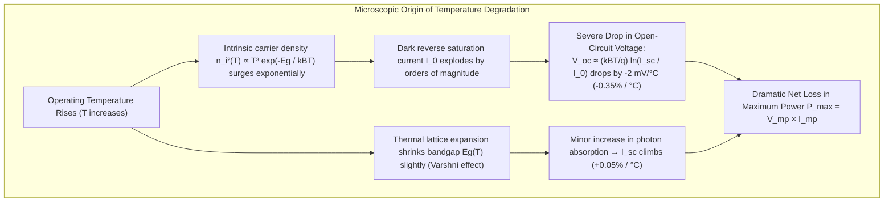

The underlying solid-state cause is the explosive increase in dark saturation current:

$$I_0 \propto n_i^2 \propto T^3 \exp\left( -\frac{E_g}{k_B T} \right)$$

As temperature climbs, thermal energy excites copious intrinsic carriers, destroying the electrostatic contrast across the p-n junction. Because $V_{oc} \propto \ln(I_{sc} / I_0)$, the exponential surge in the denominator drives $V_{oc}$ downward at approximately <strong>$-2.0\,\mathrm{mV} / ^\circ\mathrm{C}$ per cell</strong>. The tiny gain in $I_{sc}$ ($+0.05\% / ^\circ\mathrm{C}$ due to marginal bandgap shrinkage) is overwhelmingly eclipsed by the voltage collapse.

### 7.2 Partial Shading and Hot-Spot Catastrophe

Because individual cells produce modest voltage ($\sim 0.6\,\mathrm{V}$), commercial modules connect 60 to 72 cells in series strings. In a series circuit, Kirchhoff's Current Law dictates that <strong>every cell must carry the exact same current</strong>.

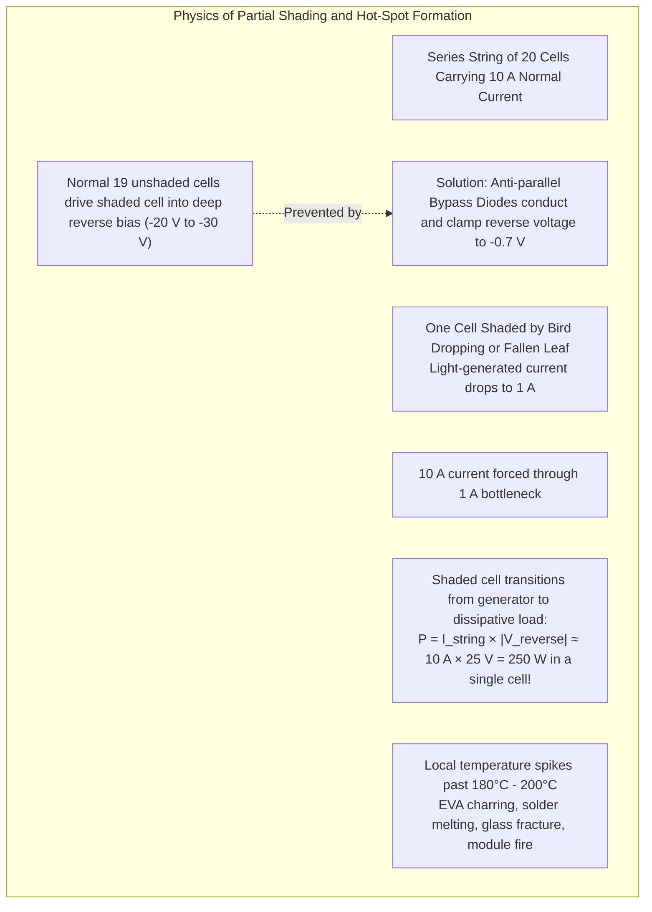

If a single cell is partially shaded by a leaf or chimney:
1. The unshaded cells continue producing full photocurrent ($10\,\mathrm{A}$).
2. The shaded cell can only generate $1\,\mathrm{A}$.
3. The remaining cells in the series string act like a high-voltage battery charger, forcing the $10\,\mathrm{A}$ current through the shaded cell.
4. The shaded cell is driven into <strong>extreme reverse bias</strong> ($-15\,\mathrm{V}$ to $-30\,\mathrm{V}$).
5. Instead of generating power, the shaded cell dissipates all the power generated by the rest of the string:
   $$P_{dissipated} = I_{string} \times |V_{reverse}| \approx 10\,\mathrm{A} \times 25\,\mathrm{V} = 250\,\mathrm{W}$$
6. Dissipating 250 watts across a wafer with an area of $0.02\,\mathrm{m^2}$ produces an enormous localized thermal flux. Within seconds, temperatures spike past <strong>$180^\circ\mathrm{C} - 220^\circ\mathrm{C}$</strong>, melting solder joints, browning and vaporizing the encapsulant polymer, shattering the tempered glass cover, and presenting an active structural fire risk.

To prevent this catastrophe, manufacturers divide the series string into three subgroups protected by <strong>anti-parallel Bypass Diodes</strong> (Schottky diodes) located in the rear junction box. When a cell enters reverse bias, the bypass diode becomes forward-biased and conducts, shunting the entire $10\,\mathrm{A}$ string current harmlessly around the shaded subgroup, clamping the reverse voltage to under $0.7\,\mathrm{V}$.

---

## 8. Power Electronics and System Integration: Inverters and MPPT

The raw electricity exiting a photovoltaic array is uncontrolled, variable-voltage direct current (DC). To feed domestic loads and synchronize with the public utility grid, it must pass through a <strong>Power Conditioning Subsystem (Inverter)</strong>.

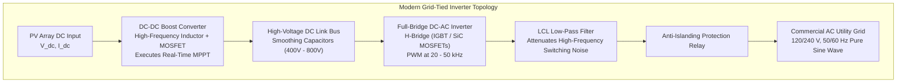

### 8.1 Maximum Power Point Tracking (MPPT) Algorithms

Because the I-V characteristic curve varies continuously with solar irradiance and ambient temperature, there exists at every instant a unique operating point where power output is maximized: the <strong>Maximum Power Point (MPP)</strong>.

An inverter's digital signal processor (DSP) continuously executes high-speed <strong>MPPT algorithms</strong> to modulate the effective load impedance seen by the solar array:
1. <strong>Perturb and Observe (P&O)</strong>:
   The controller introduces a small perturbation $\Delta V$ to the operational array voltage and measures the resulting change in power $\Delta P$.
   - If $\Delta P > 0$ (power increased), the controller continues perturbing voltage in the same direction.
   - If $\Delta P < 0$ (power decreased), the perturbation step is reversed.
   P&O is simple and effective, though it oscillates slightly around the true peak in steady state.
2. <strong>Incremental Conductance (IncCond)</strong>:
   Exploiting the mathematical derivative of power with respect to voltage:
   $$\frac{dP}{dV} = \frac{d(VI)}{dV} = I + V \frac{dI}{dV}$$
   At the exact MPP, $\frac{dP}{dV} = 0$, which yields:
   $$\frac{dI}{dV} = -\frac{I}{V}$$
   The algorithm compares the instantaneous conductance ($I/V$) with the incremental conductance ($dI/dV$):
   - $\frac{dI}{dV} = -\frac{I}{V} \implies$ Operating exactly at MPP.
   - $\frac{dI}{dV} > -\frac{I}{V} \implies$ Operating to the left of MPP ($\frac{dP}{dV} > 0$, voltage must increase).
   - $\frac{dI}{dV} < -\frac{I}{V} \implies$ Operating to the right of MPP ($\frac{dP}{dV} < 0$, voltage must decrease).
   Incremental conductance tracks dynamic irradiance fluctuations (such as fast-moving clouds) with zero steady-state hunting oscillation.

### 8.2 Grid Synchronization and Anti-Islanding Protection

Modern inverters synthesize utility-grade AC electricity using sinusoidal Pulse-Width Modulation (SPWM) switching at $20 - 50\,\mathrm{kHz}$, maintaining Total Harmonic Distortion (THD) below $3\%$.

A critical safety mandate is <strong>Anti-Islanding Protection</strong> (governed by IEEE 1547 and UL 1741). If the utility power grid suffers a blackout or is disconnected for maintenance, a grid-tied solar system must not continue energizing the local power lines in isolation ("islanding"). Islanding poses a fatal electrocution hazard to utility repair crews and can damage consumer appliances through uncontrolled voltage and frequency drift. 

Inverters incorporate both:
- <strong>Passive Detection</strong>: Monitoring voltage magnitude, frequency, and phase angle for sudden anomalous shifts.
- <strong>Active Frequency Drift</strong>: Injecting small, continuous perturbation signals into the current waveform. If the strong stabilizing grid is present, the frequency remains clamped. If the grid disconnects, the perturbation positive-feedback destabilizes the frequency, triggering an automatic safety shutdown within $100\,\mathrm{milliseconds}$.

---

## 9. Long-Term Reliability and Degradation Physics

Solar panels are expected to endure decades of brutal outdoor exposure. Commercial warranties guarantee <strong>$80\% \text{ to } 85\%$ of original power output after 25 to 30 years</strong>, equating to a degradation rate of under <strong>$0.5\% / \text{year}$</strong>.

Understanding and preventing microscopic degradation mechanisms is the foundation of bankable solar installations:

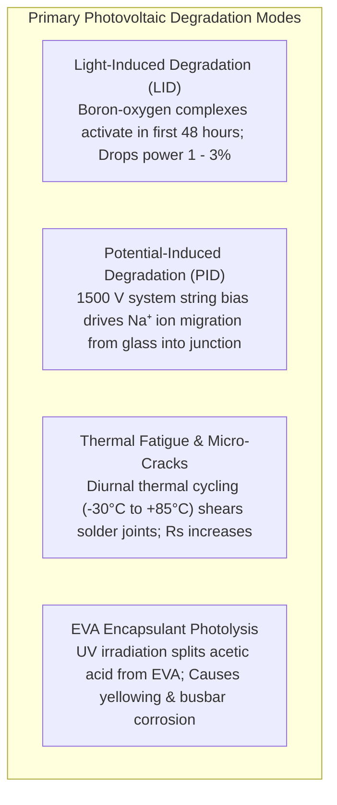

1. <strong>Light-Induced Degradation (LID)</strong>:
   Historically seen in p-type Czochralski wafers, LID manifests within the first 48 hours of initial sunlight exposure. Trace interstitial oxygen ($\mathrm{O}_i$) dissolved during crucible melting binds with substitutional boron dopants ($\mathrm{B}_s$) under excess carrier injection, forming metastable $\mathrm{B}_s\text{-}\mathrm{O}_{2i}$ defect complexes that capture electrons and permanently suppress diffusion length. The industry solved this by switching to <strong>gallium ($\mathrm{Ga}$) doping</strong> or transitioning entirely to <strong>n-type silicon</strong> (TOPCon/HJT), where phosphorus does not react with oxygen.
2. <strong>Potential-Induced Degradation (PID)</strong>:
   In modern utility-scale mega-solar installations, panels are wired into long strings operating at system voltages up to <strong>$1,500\,\mathrm{V}$</strong>. When strings operate with a high negative potential relative to ground, a massive electrostatic field is established between the grounded aluminum frame and the internal solar cells.
   
   This field pulls mobile sodium ions ($\mathrm{Na^+}$) out of the soda-lime cover glass, driving them through the EVA encapsulant and forcing them into the microscopic crystal defects and antireflective coating of the front cell surface. The sodium accumulation shunts the p-n junction, causing catastrophically severe power drops of <strong>$30\% \text{ to } 80\%$</strong> within months. PID is neutralized by using sodium-free glass, anti-PID polyolefin elastomer (POE) encapsulants, and positive-grounding or night-time reverse bias regeneration.
3. <strong>Thermal Cycling and Mechanical Fatigue</strong>:
   Because silicon has a low coefficient of thermal expansion ($\alpha_{Si} \approx 2.6 \times 10^{-6}/\mathrm{K}$) while the copper interconnect ribbons expand significantly faster ($\alpha_{Cu} \approx 16.5 \times 10^{-6}/\mathrm{K}$), diurnal temperature swings (from $-30^\circ\mathrm{C}$ night frosts to $+85^\circ\mathrm{C}$ afternoon heat) subject the microscopic solder joints to cyclical shear stress. Over thousands of cycles, microcracks propagate across the solder intermetallics, elevating series resistance $R_s$ and reducing Fill Factor.

---

## 10. Conclusion: The Quantum Architecture of a Clean Energy Future

The modern photovoltaic solar cell is far more than a simple slab of silicon; it is a monument to modern applied quantum electrodynamics.

- <strong>Direct Quantum Translation</strong>: Light is not degraded into low-grade heat; instead, individual photons promote electrons directly across quantum energy bands, outmaneuvering the Carnot cycle.
- <strong>The Magic of the p-n Junction</strong>: Built-in space-charge electrostatics untangle electron-hole pairs before recombination can occur, producing sustained, non-equilibrium electromotive force.
- <strong>Approaching the Physical Limit</strong>: Through nanoscopic surface texturing, light-trapping, and quantum-tunneling passivated contacts (TOPCon, HJT), industrial manufacturing routinely reaches over $90\%$ of the thermodynamic Shockley-Queisser limit.
- <strong>Harmonized Systems</strong>: Precision power electronics, algorithmic maximum power point tracking, and multi-layered safety mechanisms smoothly integrate these micro-scale quantum phenomena into multi-gigawatt planetary electrical grids.

By unlocking the direct conversion of starlight into electricity, solid-state physics has furnished human civilization with an abundant, resilient, and inexhaustible energy foundation that will power our planet for centuries to come.
