空から降り注ぐ太陽光線に黒っぽい板を向けておくだけで、音も立てず、燃料も消費せず、二酸化炭素も排出せずに電力が湧き出し続ける――。太陽電池（Photovoltaic Cell / Solar Cell）は、現代社会における最もクリーンで普及した再生可能エネルギー技術です。

しかし、その静寂な佇まいの内側では、アインシュタインがノーベル物理学賞を受賞した量子論の金字塔である「光電効果」、固体の量子力学的バンド理論、超高純度半導体中のナノスケール電荷輸送現象、そして精密なパワーエレクトロニクス制御がミリ秒単位で連動しています。

従来の火力発電や原子力発電は、熱エネルギーで水蒸気を作り、タービンを回して電磁誘導で電気を得るという「熱力学（カルノーサイクル）と機械工学」の仲介を不可欠としていました。これに対し、太陽電池は<strong>「光子の量子エネルギーを、半導体中の電子のポテンシャルエネルギーへと直接変換する」</strong>という、熱機関の制約を根底から飛び越えた量子デバイスです。

本稿では、半導体のバンド構造とキャリア統計、p-n接合における内蔵電場と電荷分離の微視的メカニズム、等価回路モデルとI-V特性方程式、ショックレー・クワイサー限界（理論的変換効率の壁）、PERCやTOPConなどの最新セル構造、温度・部分影・ホットスポットの非線形物理、MPPT（最大電力点追従）とインバータ制御、さらには劣化機構（LID/PID）に至るまで、太陽電池の物理と工学の全貌を徹底的に掘り下げます。

---

## 1. 光電直接変換の夜明け：熱機関を越える量子力学的跳躍

熱機関を用いる発電システムでは、カルノーの定理により、熱源温度 $T_H$ と環境温度 $T_L$ によって理論最大熱効率 $\eta_{Carnot} = 1 - T_L/T_H$ が厳格に制限されます。また、ボイラー、タービン、発電機という巨大な可動部品群の摩擦損失や熱放射損失が伴います。

これに対し、太陽起電力効果（Photovoltaic Effect）は、物質に光を照射した際に直接起電力（電圧）と電流が発生する現象です。

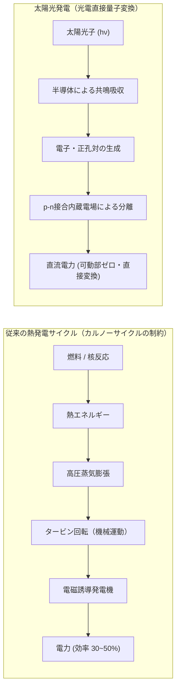

### 1.1 歴史的発展と物理学的転換点

1. <strong>エドモン・ベクレルの発見（1839年）</strong>:
   フランスの物理学者アレクサンドル・エドモン・ベクレルが、電解液中に浸した金属電極に光を照射すると微小な電流が流れる光起電力効果を世界で初めて観測しました。
2. <strong>アインシュタインの光量子仮説（1905年）</strong>:
   アルベルト・アインシュタインは、光が連続的な波であると同時に、エネルギー $E = h\nu$（$h$ はプランク定数、$\nu$ は振動数）を持つ粒子（光子 / Photon）として振る舞うと提唱しました。この光量子論こそが、光子が半導体中の電子にエネルギーを一対一で受け渡す光電変換の微視的基礎を築きました。
3. <strong>ベル研究所によるシリコン太陽電池の発明（1954年）</strong>:
   ダリル・チャピン、カルビン・フラー、ジェラルド・ピアソンらが、高純度シリコンのp-n接合を用いた近代的な単結晶シリコン太陽電池を開発しました。初期の変換効率は約6%でしたが、宇宙探査機（ヴァンガード1号など）の電源として実証され、半導体微細加工技術の進歩とともに地上用エネルギーの主役に登り詰めました。

---

## 2. 半導体物理学とバンド理論：電子が動ける舞台の創出

太陽電池の動作を理解するためには、量子力学に基づく<strong>エネルギーバンド理論（Band Theory）</strong>と、半導体のキャリア統計を押さえる必要があります。

### 2.1 結晶シリコンの共有結合とエネルギーバンド

単結晶シリコン（$\mathrm{Si}$）は、周期表の第14族に属し、最外殻に4個の価電子（Valence Electrons）を持ちます。シリコン結晶中では、各原子が隣接する4個のシリコン原子と価電子を1個ずつ出し合い、強固な $sp^3$ 混成軌道による<strong>共有結合（Covalent Bond）</strong>を形成してダイヤモンド構造の結晶格子を構成しています。

孤立した単一原子では電子のエネルギー準位は離散的ですが、アボガドロ数オーダー（$\sim 10^{22}\,\mathrm{atoms/cm^3}$）の原子が極めて近接して結晶を形成すると、パウリの排他律により電子軌道が相互作用して無数の微細な準位へと分裂し、連続的な「エネルギーバンド」を形成します。

```mermaid
flowchart TD
    subgraph BandDiagram ["半導体のエネルギーバンド構造"]
        CB["伝導帯 (Conduction Band: Ec)<br/>電子が自由に動き回れる空の準位"]
        Gap["バンドギャップ Eg ≈ 1.12 eV (禁制帯)<br/>電子の存在が許されないエネルギー障壁"]
        VB["価電子帯 (Valence Band: Ev)<br/>電子が共有結合に束縛されて満たされた準位"]
        
        VB -->|光子吸収: hν ≧ Eg| CB
        CB -.->|再結合 (熱・発光損失)| VB
    end
```

- <strong>価電子帯（Valence Band, $E_v$）</strong>:
  絶対零度（$T = 0\,\mathrm{K}$）において、共有結合に関与する電子によって完全に満たされた最高エネルギーバンドです。電子が隙間なく詰まっているため、外部から電場を印加しても電子は移動できず、電流は流れません。
- <strong>伝導帯（Conduction Band, $E_c$）</strong>:
  価電子帯の上方に位置する空のエネルギーバンドです。ここに励起された電子は、結晶内を自由に移動できる伝導電子（自由電子）として電流を担います。
- <strong>バンドギャップ（Bandgap / 禁制帯幅, $E_g$）</strong>:
  価電子帯の頂上 $E_v$ と伝導帯の底 $E_c$ の間のエネルギー差（$E_g = E_c - E_v$）です。電子はこの隙間に安定して存在することはできません。室温（$300\,\mathrm{K}$）における結晶シリコンのバンドギャップは <strong>約 $1.12\,\mathrm{eV}$</strong> です。

### 2.2 ドーピング：n型半導体とp型半導体

純粋な真性シリコン（Intrinsic Silicon）では、熱励起によって自発的に伝導帯に上がる電子の数（真性キャリア密度 $n_i$）は室温でわずか約 $1.5 \times 10^{10}\,\mathrm{cm^{-3}}$ に過ぎず、極めて高い電気抵抗を示します。実用的な太陽電池を作るためには、微量の不純物を意図的に導入する<strong>ドーピング（Doping）</strong>によって電気的性質を制御します。

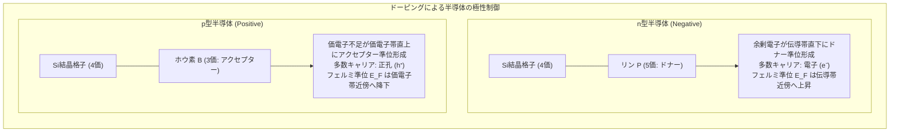

1. <strong>n型半導体（Negative-type）</strong>:
   4価のシリコン結晶中に、第15族の元素である<strong>リン（$\mathrm{P}$）</strong>やヒ素（$\mathrm{As}$）をドープします。リン原子は4個の価電子でシリコンと共有結合を形成しますが、余った5番目の電子は原子核に弱く束縛されているだけです。室温の熱エネルギー（$k_B T \approx 26\,\mathrm{meV}$）で容易に電離し、伝導帯へと飛び出します。リンのような不純物を<strong>ドナー（Donor）</strong>と呼び、n型半導体中では<strong>電子が多数キャリア（Majority Carrier）</strong>、正孔が少数キャリア（Minority Carrier）となります。
2. <strong>p型半導体（Positive-type）</strong>:
   シリコン結晶中に、第13族の元素である<strong>ホウ素（$\mathrm{B}$）</strong>やガリウム（$\mathrm{Ga}$）をドープします。ホウ素原子は価電子が3個しかないため、周囲のシリコンとの共有結合の1つに電子の欠損（空席）が生じます。この空席には隣接する価電子が容易に飛び移り、結果として正の電荷を持った粒子のように振る舞う<strong>正孔（ホール / Hole）</strong>が生成されます。ホウ素のような不純物を<strong>アクセプター（Acceptor）</strong>と呼び、p型半導体中では<strong>正孔が多数キャリア</strong>、電子が少数キャリアとなります。

---

## 3. p-n接合と光起電力効果：キャリア分離のミクロ力学

単なる半導体バルクに光を当てて電子を励起しても、電気が外に取り出せるわけではありません。励起された電子と正孔は、フェムト秒からマイクロ秒の短時間で再び出会い、熱や光を放出して元の基底状態へと戻る<strong>再結合（Recombination）</strong>を起こして消滅してしまうからです。

電子と正孔を消滅する前に空間的に引き離し、外部回路へと送り出すための強力な内蔵ポンプこそが<strong>p-n接合（p-n Junction）</strong>です。


### 3.1 空乏層（Depletion Region）と内蔵電位（Built-in Potential）

p型半導体とn型半導体を原子レベルで接合すると、濃度の異なるキャリアが界面を越えて自発的に拡散を始めます。
- n型側の高密度な電子はp型側へと拡散する。
- p型側の高密度な正孔はn型側へと拡散する。

界面付近で両者が衝突すると再結合して消滅します。その結果、界面近傍には可動キャリアが一切存在しない領域――<strong>空乏層（Depletion Layer / 空間電荷領域）</strong>が形成されます。

空乏層の内部では、キャリアが去った後に結晶格子に固定された不純物イオンが剥き出しになります。
- n型側には、電子を手放してプラスに帯電した固定ドナーイオン（$\mathrm{P^+}$）。
- p型側には、正孔を受け取ってマイナスに帯電した固定アクセプターイオン（$\mathrm{B^-}$）。

この空間電荷対（Space Charge）により、<strong>n型領域からp型領域へと向かう強力な内蔵電場（Built-in Electric Field, $\mathbf{E}_{bi}$）</strong>が発生します。
この電場は、さらなる電子の拡散を押し戻すドリフト力として作用し、最終的に「拡散電流」と「電場によるドリフト電流」が完全に釣り合って熱平衡状態に達します。このとき界面に生じる電位差が<strong>内蔵電位（Built-in Potential $V_{bi}$）</strong>です。

$$V_{bi} = \frac{k_B T}{q} \ln\left( \frac{N_A N_D}{n_i^2} \right)$$

ここで $k_B$ はボルツマン定数、$T$ は絶対温度、$q$ は素電荷、$N_A$ はアクセプター濃度、$N_D$ はドナー濃度、$n_i$ は真性キャリア密度です。シリコンのp-n接合における $V_{bi}$ は通常 <strong>$0.7\sim 0.9\,\mathrm{V}$</strong> 程度になります。

### 3.2 光照射によるキャリア生成と空間分離

太陽光が太陽電池に入射すると、エネルギー $E = h\nu$ を持つ光子がシリコン結晶内部へと侵入します。

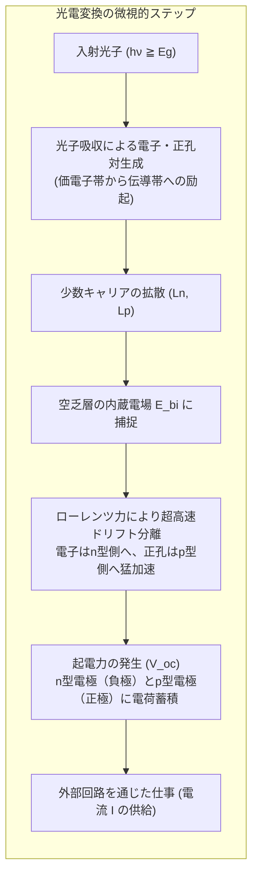

1. <strong>光生成（Photogeneration）</strong>:
   光子のエネルギーが入射半導体のバンドギャップ以上である場合（$h\nu \ge E_g \approx 1.12\,\mathrm{eV}$、波長 $\lambda \le 1107\,\mathrm{nm}$）、光子は価電子帯の電子によって吸収されます。電子は禁制帯を飛び越えて伝導帯へと励起され、価電子帯には正孔が1つ残されます。これにより、<strong>電子・正孔対（Electron-Hole Pair, EHP）</strong>が生成されます。
2. <strong>拡散と寿命（Diffusion & Lifetime）</strong>:
   空乏層の外部（中性領域）で生まれた少数キャリア（p型中の電子、n型中の正孔）は、濃度勾配に従ってランダムウォーク（熱拡散）しながら空乏層に向かって移動します。キャリアが再結合して消滅するまでに移動できる平均距離を<strong>拡散長（Diffusion Length, $L$）</strong>と呼びます。
   $$L_n = \sqrt{D_n \tau_n}, \quad L_p = \sqrt{D_p \tau_p}$$
   ここで $D$ は拡散係数、$\tau$ はキャリア再結合寿命（Carrier Lifetime）です。高品質な結晶シリコンウェハでは、キャリア寿命が数百マイクロ秒から数ミリ秒に達し、拡散長はウェハの厚み（約 $150\,\mu\mathrm{m}$）に匹敵するため、生成されたキャリアの大部分が無事に空乏層へと到達できます。
3. <strong>電場によるキャリア分離（Charge Separation）</strong>:
   電子・正孔対が空乏層に到達する（あるいは空乏層内部で直接光生成される）と、そこ隙間なく張り巡らされた内蔵電場 $\mathbf{E}_{bi}$ から猛烈な静電力（クーロン力 $\mathbf{F} = q\mathbf{E}$）を受けます。
   - 負の電荷を持つ<strong>電子（$e^-$）は、電場に逆らってn型領域側へと一瞬で掃き出される</strong>。
   - 正の電荷を持つ<strong>正孔（$h^+$）は、電場に沿ってp型領域側へと一瞬で掃き出される</strong>。
4. <strong>起電力の発生と仕事の取り出し</strong>:
   分離された電子はn型層に、正孔はp型層に溜まります。これにより、n型領域が負極（マイナス端子）、p型領域が正極（プラス端子）として充電され、両端の電極間に<strong>光起電力（Photovoltage）</strong>が生じます。
   外部回路に負荷（電球やバッテリー）を接続すると、過剰な電子は外部導線を通ってp型領域へと流れ出し、負荷に対して電気的な仕事を行います。こうして、光エネルギーが一切の可動部なしに直流電力へと変換されるのです。

---

## 4. 太陽電池の等価回路と電流-電圧（I-V）特性の数理

太陽電池の工学的挙動は、半導体物理と回路理論を結ぶ<strong>等価回路モデル（Equivalent Circuit Model）</strong>によって厳密に記述されます。

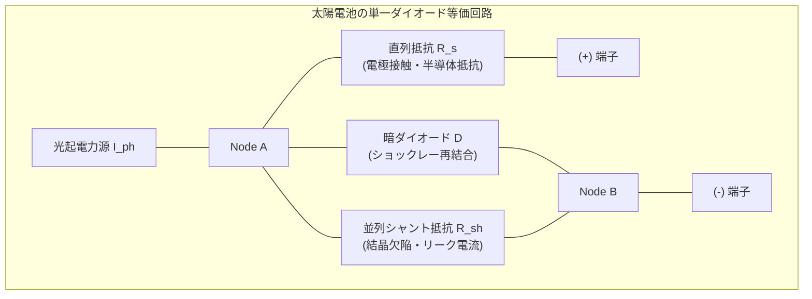

### 4.1 単一ダイオードモデルの基本方程式

太陽電池の等価回路は、理想的な定電流源（光生成電流 $I_{ph}$）、理想ダイオード、直列抵抗 $R_s$、並列シャント抵抗 $R_{sh}$ の合成回路として表現されます。
キルヒホッフの電流則より、外部端子に出力される電流 $I$ と端子電圧 $V$ の関係式は以下の<strong>非線形超越方程式</strong>となります。

$$I = I_{ph} - I_0 \left[ \exp\left( \frac{q(V + I R_s)}{n k_B T} \right) - 1 \right] - \frac{V + I R_s}{R_{sh}}$$

ここで各パラメータの物理的意味は以下の通りです。
- $I_{ph}$（光生成電流 / Photogenerated Current）: 入射太陽光の光子フラックスに正比例する電流。
- $I_0$（逆方向飽和電流 / Reverse Saturation Current）: 熱励起による少数キャリアの拡散・再結合に起因する暗電流（微小値、$10^{-12}\sim 10^{-9}\,\mathrm{A}$）。
- $q$: 素電荷（約 $1.602 \times 10^{-19}\,\mathrm{C}$）。
- $k_B$: ボルツマン定数（約 $1.381 \times 10^{-23}\,\mathrm{J/K}$）。
- $T$: セル絶対温度（$\mathrm{K}$）。
- $n$: ダイオード理想係数（Ideality Factor, 通常 $1.0\sim 1.5$）。
- $R_s$: 直列抵抗（Series Resistance）。シリコンバルクの比抵抗、表面グリッド電極の金属抵抗、金属とシリコン界面の接触抵抗の総和。理想値は $0\,\Omega$。
- $R_{sh}$: 並列（シャント）抵抗（Shunt Resistance）。セル端面や結晶粒界、局所欠陥を通じた微小漏洩電流の経路。理想値は $\infty\,\Omega$。

### 4.2 特性パラメータ：$I_{sc}, V_{oc}, FF, \eta$

太陽電池の性能は、I-V曲線上の主要な特異点から導かれる4つの基本指標で決定されます。

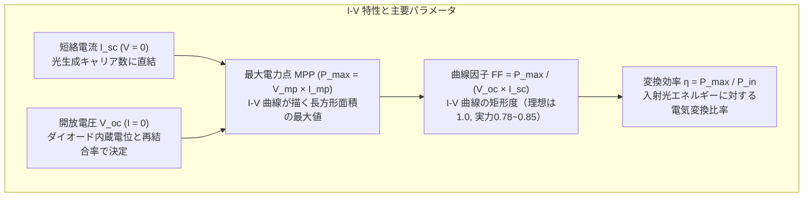

1. <strong>短絡電流（Short-Circuit Current, $I_{sc}$）</strong>:
   外部端子を短絡（$V = 0$）した際に流れる最大電流です。$R_s \approx 0, R_{sh} \to \infty$ の理想条件下では、$I_{sc} \approx I_{ph}$ となり、入射光の強度およびスペクトル特性に完全に比例します。
2. <strong>開放電圧（Open-Circuit Voltage, $V_{oc}$）</strong>:
   外部端子を開放（$I = 0$）した際に両端に現れる最大電圧です。$R_{sh} \to \infty$ と近似して方程式を解くと:
   $$V_{oc} = \frac{n k_B T}{q} \ln\left( \frac{I_{ph}}{I_0} + 1 \right) \approx \frac{n k_B T}{q} \ln\left( \frac{I_{sc}}{I_0} \right)$$
   $V_{oc}$ を高めるためには、逆方向飽和電流 $I_0$ を極限まで小さくする（すなわち半導体内部の結晶欠陥や界面での不要なキャリア再結合を徹底的に排除する）必要があります。
3. <strong>曲線因子（Fill Factor, $FF$）</strong>:
   I-V曲線上の点 $(V, I)$ の積である電力 $P(V) = V \times I$ が最大となる動作点を<strong>最大電力点（Maximum Power Point, MPP: $V_{mp}, I_{mp}$）</strong>と呼びます。曲線因子 $FF$ は、$V_{oc} \times I_{sc}$ という仮想的な最大矩形面積に対して、実際に取り出せる最大電力 $P_{max} = V_{mp} I_{mp}$ がどれだけ迫れているかを示す「矩形性」の指標です。
   $$FF = \frac{P_{max}}{V_{oc} I_{sc}} = \frac{V_{mp} I_{mp}}{V_{oc} I_{sc}}$$
   直列抵抗 $R_s$ が増大したり、シャント抵抗 $R_{sh}$ が低下すると、I-V曲線の角が丸くなり、$FF$ は著しく低下します。高性能な結晶シリコンセルでは $FF \approx 0.80\sim 0.84$ に達します。
4. <strong>エネルギー変換効率（Conversion Efficiency, $\eta$）</strong>:
   入射する太陽光エネルギー束 $P_{in}$（標準試験条件 STC では $1000\,\mathrm{W/m^2}$, AM1.5G スペクトル）に対する、出力最大電力 $P_{max}$ の割合です。
   $$\eta = \frac{P_{max}}{P_{in}} = \frac{V_{oc} I_{sc} FF}{P_{in}}$$

---

## 5. 変換効率の物理的限界：ショックレー・クワイサー限界（S-Q Limit）

なぜ一般的な単接合シリコン太陽電池の変換効率は $20\sim 26\%$ 程度にとどまり、100%に達することができないのでしょうか。その物理的根拠を熱力学的かつ量子力学的に厳密に解明したのが、ウィリアム・ショックレーとハンス・クワイサーが1961年に発表した<strong>ショックレー・クワイサー限界（Shockley-Queisser Limit）</strong>です。

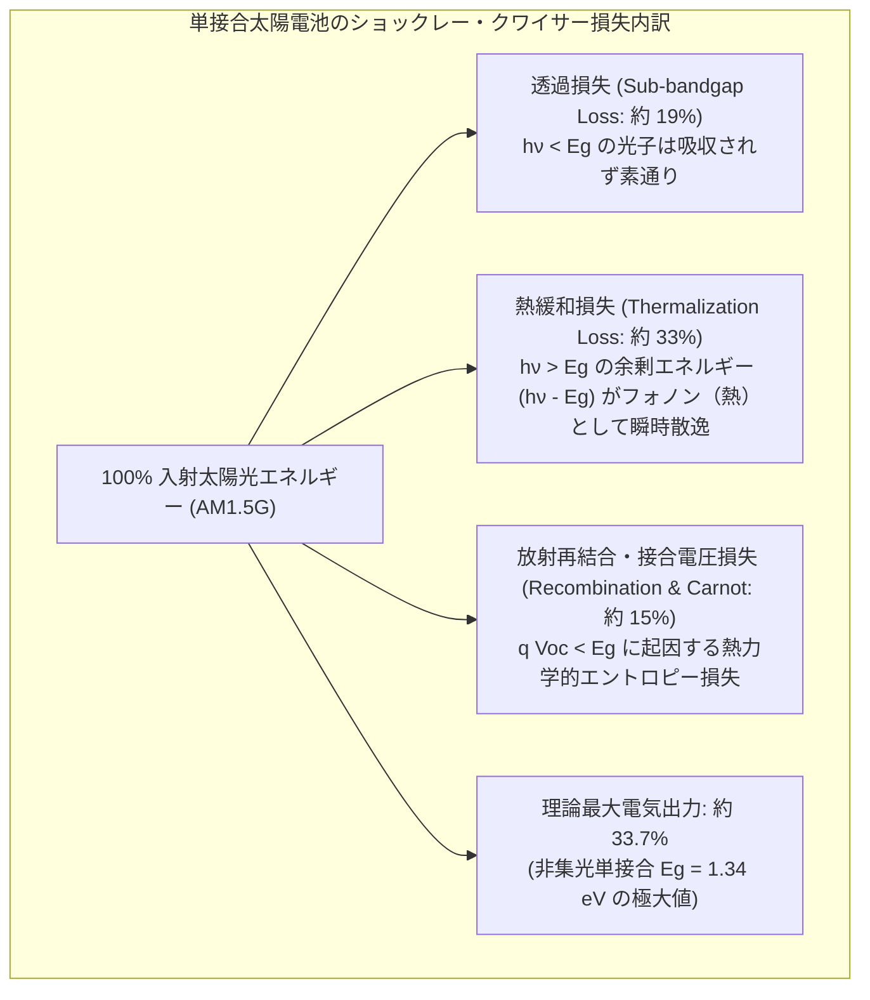

### 5.1 4大エネルギー損失メカニズム

単一のバンドギャップ $E_g$ を持つ半導体に太陽光（黒体輻射スペクトル）が入射した際、以下の不可避な物理損失が発生します。

1. <strong>未吸収透過損失（Sub-bandgap Transmission Loss）</strong>:
   エネルギーがバンドギャップに満たない光子（$h\nu < E_g$）は、価電子を伝導帯へ励起することができず、半導体を素通り（透過）してしまいます。シリコン（$E_g \approx 1.12\,\mathrm{eV}$）の場合、赤外線領域（波長 $\lambda > 1107\,\mathrm{nm}$）の光子は全く電気に変換されず、これだけで太陽エネルギーの約 <strong>$19\%$</strong> が失われます。
2. <strong>熱緩和損失（Thermalization Loss）</strong>:
   エネルギーがバンドギャップを大きく超える高エネルギー光子（紫外線や青色光など、$h\nu \gg E_g$）を吸収した場合、電子は伝導帯の遥か高いエネルギー準位へと励起されます。しかし、この高エネルギー電子（ホットキャリア）は、わずかピコ秒（$10^{-12}\,\mathrm{s}$）のオーダーで結晶格子と激しく衝突し、格子振動（フォノン）を放出して伝導帯の底 $E_c$ へと滑り落ちてしまいます。この余剰エネルギー $(h\nu - E_g)$ は純粋な廃熱として散逸し、太陽エネルギー全体の約 <strong>$33\%$</strong> に達します。
3. <strong>再結合損失（Recombination Loss）</strong>:
   分離されたキャリアの一部は、電極に到達する前に放射再結合（光子放出）や非放射再結合（欠陥やオージェ再結合）を起こして熱力学的可逆性の制約から消滅します。
4. <strong>開放電圧の熱力学的制約（$q V_{oc} < E_g$）</strong>:
   半導体の出力可能な最大電圧 $V_{oc}$ は、バンドギャップ $E_g/q$ に決して届きません。エントロピー生成と暗状態での黒体再放射フラックスとの動的平衡により、シリコンでは $E_g/q \approx 1.12\,\mathrm{V}$ に対し、理論限界でも $V_{oc} \approx 0.74\sim 0.84\,\mathrm{V}$ に制限されます。

### 5.2 バンドギャップ依存性と理論限界値

太陽スペクトルに対してバンドギャップ $E_g$ を横軸にとると、
- $E_g$ が小さすぎると、$V_{oc}$ が極端に低下し、熱緩和損失が爆発します。
- $E_g$ が大きすぎると、$V_{oc}$ は高くなるものの、吸収できる光子数が激減して透過損失が支配的になります。

両者のトレードオフを計算すると、理想的なバンドギャップは <strong>$E_g \approx 1.34\,\mathrm{eV}$</strong>（$\mathrm{GaAs}$ などの化合物半導体が近い）に存在し、非集光太陽光における単接合セルの理論最大変換効率は <strong>約 $33.7\%$</strong> となります。結晶シリコン（$E_g \approx 1.12\,\mathrm{eV}$）におけるオージェ再結合などを考慮した真の物理上限値は <strong>約 $29.4\%$</strong> です。

---

## 6. シリコン太陽電池の構造進化：ナノテクノロジーによる極限追求

現在市販されている結晶シリコン太陽電池は、研究室レベルで理論限界（$29.4\%$）の9割に迫る $26.8\%$ の世界記録を達成しています。この目覚ましい効率向上は、ナノスケールの界面工学とセル構造の進化によるものです。

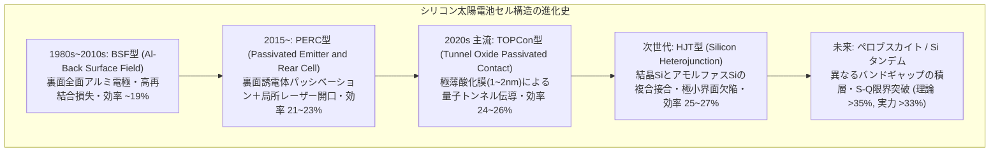

### 6.1 光学的光閉じ込め（Light Trapping）技術

光電変換を最大化するためには、光子を1個残らずシリコン内部に導き入れ、反射させずに吸収させなければなりません。
1. <strong>ランダムピラミッドテクスチャリング（Texturing）</strong>:
   平坦なシリコン表面の光反射率は約 $35\%$ に達します。水酸化カリウム（$\mathrm{KOH}$）溶液で単結晶シリコンの (100) 面を異方性アルカリエッチングすると、(111) 面で構成された無数の微小な四角錐ピラミッド構造（高さ数ミクロン）が自発的に形成されます。入射光線はピラミッドの斜面で多重反射し、シリコン内部へ屈折して侵入する確率が飛躍的に高まります。
2. <strong>反射防止膜（Anti-Reflective Coating, ARC）</strong>:
   屈折率 $n \approx 2.0$ の窒化シリコン膜（$\mathrm{SiN_x}$）を厚さ約 $75\,\mathrm{nm}$ でプラズマCVD成膜します。薄膜の上面反射波と下面反射波が位相差 $180^\circ$ で干渉し合い、波長 $600\,\mathrm{nm}$ 付近の反射率をほぼ $0\%$ に抑え込みます（太陽電池が美しい深青色や漆黒に見えるのはこのためです）。

### 6.2 キャリア再結合を封じるパッシベーション技術

従来のBSF型セルでは、シリコンウェハ裏面全体に直接アルミニウム電極を焼き付けていたため、金属と半導体の接触面で無数のダングリングボンド（未結合手）が深い欠陥準位を形成し、励起されたキャリアが猛烈な勢いで再結合（表面再結合）して失われていました。

1. <strong>PERC（Passivated Emitter and Rear Cell）</strong>:
   裏面に酸化アルミニウム（$\mathrm{Al_2O_3}$）と窒化シリコンのパッシベーション絶縁膜を挟み、レーザーで微小な点状の穴（局所開口）を開けて金属と接触させました。界面の未結合手を原子レベルで終端することで表面再結合速度を劇的に低減させ、裏面での光反射率も向上させました。
2. <strong>TOPCon（Tunnel Oxide Passivated Contact）</strong>:
   シリコンウェハ表面に、わずか <strong>$1\sim 2\,\mathrm{nm}$（原子数層分）</strong> という極限的な超薄膜二酸化シリコン（$\mathrm{SiO_2}$）トンネル酸化膜を形成し、その上に高ドープ多結晶シリコン層を積層した構造です。量子力学的トンネル効果により、多数キャリアのみが抵抗なく酸化膜を通り抜ける一方で、少数キャリアは完全に遮断されて界面欠陥への接近を防ぎます。
3. <strong>HJT（ヘテロ接合技術 / Heterojunction with Intrinsic Thin Layer）</strong>:
   n型単結晶シリコンウェハの両面を、極薄の真性アモルファスシリコン（$i\text{-}\mathrm{a\text{-}Si:H}$）で原子レベルで隙間なく包み込み、その外側にp型およびn型のアモルファスシリコン層を配置した構造です。低温プロセスで製造され、界面欠陥が極限まで少ないため、開放電圧 $V_{oc} > 0.75\,\mathrm{V}$ という驚異的な高電圧特性を達成できます。

---

## 7. 外部環境による発電性能の変動と物理的影響

太陽電池は周囲の環境変化（温度、照度、部分的な影）に対して極めて鋭敏かつ非線形に応答します。

### 7.1 温度上昇と開放電圧低下の熱力学

「太陽光発電は真夏の炎天下が最も効率よく発電する」というのは典型的な誤解です。実際には、太陽電池モジュールは<strong>温度が上昇するほど発電効率が低下</strong>します。

結晶シリコン太陽電池の出力温度係数は、通常 <strong>$-0.3\% \sim -0.4\% / ^\circ\mathrm{C}$</strong> です。夏季に屋根上のモジュール温度が $70^\circ\mathrm{C}$（基準温度 $25^\circ\mathrm{C}$ より $+45^\circ\mathrm{C}$ 上昇）に達した場合、発電能力は公称スペックから約 $15\sim 18\%$ も低下してしまいます。

```mermaid
flowchart TD
    subgraph TempMechanism ["温度上昇が太陽電池特性に及ぼす微視的物理"]
        TempRise["温度上昇 (T の増大)"] --> BandShrink["格子振動増大によるバンドギャップ縮小 Eg(T) ↓"]
        BandShrink --> IscSmallUp["吸収可能光子数の微増 → 短絡電流 I_sc がわずかに増加 (+0.05%/℃)"]
        TempRise --> IntrinsicDensity["真性キャリア密度 n_i^2 ∝ T³ exp(-Eg/kBT) の指数関数的爆増"]
        IntrinsicDensity --> SatCurrent["逆方向飽和電流 I_0 の激増"]
        SatCurrent --> VocDrop["開放電圧 V_oc = (kBT/q) ln(I_sc / I_0) の大幅低下 (-0.35%/℃)"]
        VocDrop --> PmaxDrop["最大出力 P_max = I_mp × V_mp の顕著な純減"]
        IscSmallUp --> PmaxDrop
    end
```

この主原因は<strong>開放電圧 $V_{oc}$ の劇的な低下</strong>にあります。
半導体の真性キャリア密度 $n_i$ は温度の関数として次のように指数関数的に増大します。

$$n_i^2(T) = N_C N_V \exp\left( -\frac{E_g}{k_B T} \right)$$

温度が上昇すると熱励起キャリアが増大するため、逆方向飽和電流 $I_0 \propto n_i^2$ が極めて鋭く跳ね上がります。開放電圧の数式 $V_{oc} \approx \frac{k_B T}{q} \ln\left( \frac{I_{sc}}{I_0} \right)$ において、対数内の分母 $I_0$ の増大が分子の増加や前置係数の増加を圧倒するため、$V_{oc}$ は温度に対してほぼ線形に急勾配で降下します。短絡電流 $I_{sc}$ はバンドギャップ縮小により長波長光の吸収が増えてわずかに増加（$+0.05\% / ^\circ\mathrm{C}$）しますが、電圧の低下分を到底補うことはできません。

### 7.2 部分影（Partial Shading）とホットスポット破壊

直列接続された太陽電池ストリング（数十枚のセルが数珠繋ぎになった回路）において、木の葉、鳥のフン、建物の影などで<strong>たった1枚のセルが遮光された場合</strong>、発電システム全体に致命的な非線形現象が生じます。

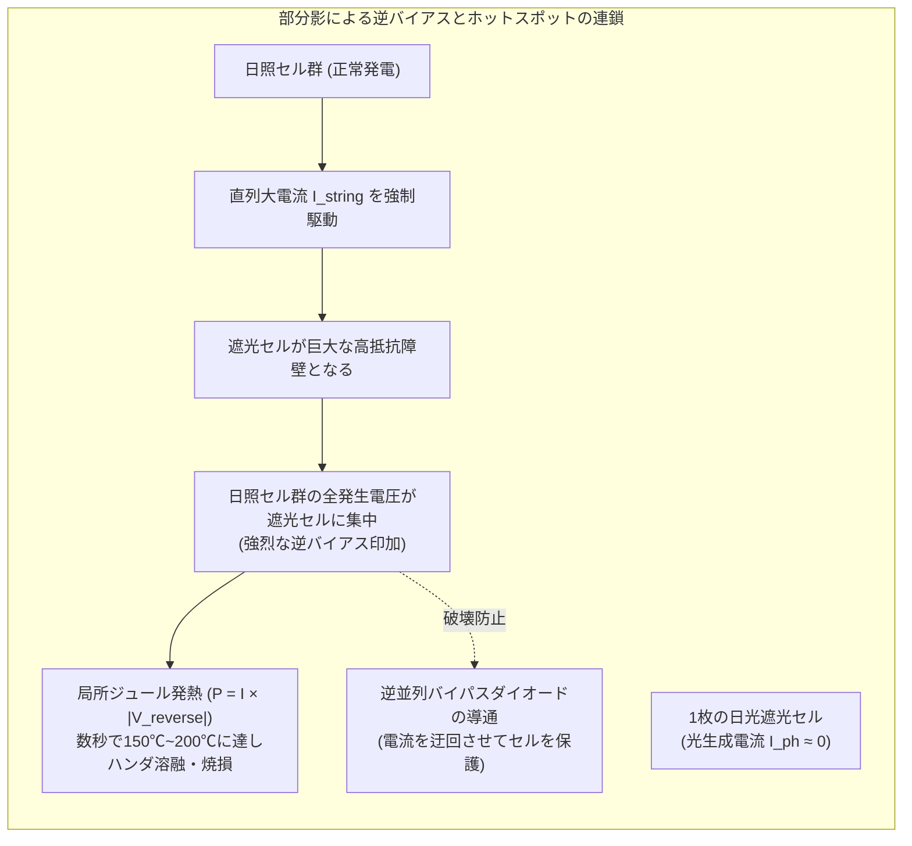

直列回路ではすべてのセルに同一の電流が流れる必要があります。健全なセル群が例えば 9A の電流を生成しているとき、影に隠れたセルは 1A しか流すことができません。
すると健全なセル群によって、遮光セルに対して<strong>強大な逆方向バイアス電圧（Reverse Bias Voltage）</strong>が強制的に印加されます。

遮光セルは「発電素子」から一転して「電力を消費する高抵抗負荷」へと転落し、消費電力 $P = I_{string} \times |V_{reverse}|$ がすべて微小な面積に集中して熱へと変わります。局所温度は数秒で <strong>$150^\circ\mathrm{C}\sim 200^\circ\mathrm{C}$ 以上</strong> に跳ね上がり、セル割れ、封止樹脂（EVA）の炭化、ガラス破損、火災を引き起こします。これが<strong>ホットスポット現象（Hot-spot Phenomenon）</strong>です。

これを防止するため、現代のモジュールは $18\sim 24$ 個のセルごとに<strong>バイパスダイオード（Bypass Diode）</strong>を逆並列に組み込んでいます。セルが逆バイアスに陥った瞬間にバイパスダイオードが導通（ターンオン）し、大電流を遮光セル群の外側へとバイパス（迂回）させて焼損を防ぎます。

---

## 8. 太陽光発電システム工学：パワーコンディショナーと系統連系

太陽電池セルから得られる電気は、天候や時間帯によって常に電圧と電流が激しく変動する「直流（DC）」です。これを家庭内の電化製品や商用電力網（グリッド）で安全に利用するためには、<strong>パワーコンディショナー（Power Conditioning Subsystem, PCS）</strong>が不可欠です。

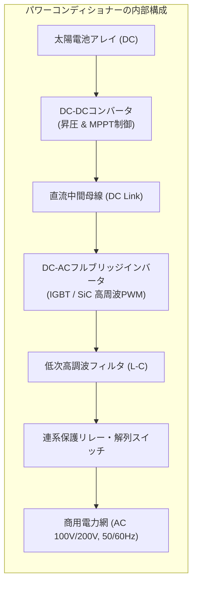

### 8.1 最大電力点追従（MPPT: Maximum Power Point Tracking）

太陽電池の出力特性は日射強度や温度によって刻一刻と変動し、その時々で最大電力を取り出せる最適動作電圧 $V_{mp}$ が激しく移動します。PCSの入力段に組み込まれたDC-DCコンバータは、負荷の等価インピーダンスをミリ秒単位で動的に調整し、常に動作点を最大電力点（MPP）に維持する<strong>MPPT制御</strong>を実行します。

主なMPPTアルゴリズム:
1. <strong>山登り法（P&O: Perturb and Observe）</strong>:
   動作電圧を微小量 $\Delta V$ だけ強制的に変化させ、電力の変化 $\Delta P$ を観測します。
   - $\Delta P > 0$（電力が増加）であれば、同じ方向へ電圧を変化させ続ける。
   - $\Delta P < 0$（電力が減少）であれば、電圧の変化方向を反転させる。
   アルゴリズムが極めて簡潔で広く採用されていますが、MPP近傍で定常振動が発生する微小損失があります。
2. <strong>インクリメンタル・コンダクタンス法（IncCond: 増分コンダクタンス法）</strong>:
   電力 $P = V \cdot I$ の微分 $\frac{dP}{dV} = I + V \frac{dI}{dV} = 0$ となる条件から、瞬時コンダクタンス $I/V$ と増分コンダクタンス $dI/dV$ を比較します。
   - $\frac{dI}{dV} = -\frac{I}{V} \implies$ MPP到達（探索停止）
   - $\frac{dI}{dV} > -\frac{I}{V} \implies$ MPPの左側（電圧上昇）
   - $\frac{dI}{dV} < -\frac{I}{V} \implies$ MPPの右側（電圧降下）
   日射急変時にも誤動作せず、高速かつ安定した追従を実現します。

### 8.2 DC-ACインバータ変換と系統連系保護

DC-DCコンバータで昇圧された直流電力は、高速スイッチング半導体素子（IGBTや次世代のSiC MOSFET）を用いたインバータ回路に入力されます。
- <strong>高周波正弦波PWM（パルス幅変調）制御</strong>:
  数十キロヘルツの三角波キャリア信号と商用系統の正弦波基準信号を比較してゲートパルスを生成し、交流へと変換します。
- <strong>LCローパスフィルタ</strong>:
  高周波スイッチングノイズを除去し、全高調波歪み率（THD）を $5\%$ 未満に抑えた極めて高品質な商用周波交流（50Hz / 60Hz、正弦波）を生成します。
- <strong>単独運転防止機能（Islanding Prevention）</strong>:
  電力会社の配電線が事故や工事で停電した際、系統から切り離された領域内で太陽光発電が送電を継続してしまう現象を「単独運転（Islanding）」と呼びます。線路作業員の感電死や機器破損の重大事故を招くため、PCSは周波数シフト法などの能動的・受動的検出技術により、系統遮断を数十ミリ秒以内で検知して即座に出力を遮断・解列（Disconnect）する厳格な保護協調機能を備えています。

---

## 9. 太陽電池の経年劣化（Degradation）と信頼性物理

太陽電池モジュールは、炎天下の熱、冬の降雪、紫外線、風雨に曝されながら、<strong>25年〜30年以上にわたり連続稼働</strong>することが求められます。長期間にわたる微小な物理的・化学的劣化現象の理解と対策は、システム寿命を左右する核心領域です。

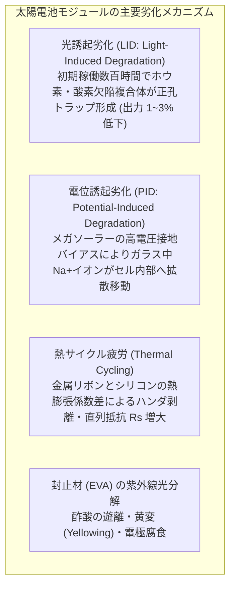

1. <strong>光誘起劣化（LID: Light-Induced Degradation）</strong>:
   従来のp型シリコンセルにおいて、製造直後のモジュールに初めて太陽光が当たると、最初の数百時間で発電効率が $1\sim 3\%$ 恒久的に低下する現象です。シリコン中の不純物酸素原子（$\mathrm{O_i}$）とアクセプターであるホウ素原子（$\mathrm{B}$）が光キャリアの存在下で結合し、エネルギー準位内に強い再結合中心（$\mathrm{B_s\text{-}O_{2i}}$ 複合体）を形成することが原因です。現在主流となったn型シリコン（リン注入）やガリウム（$\mathrm{Ga}$）ドープp型ウェハでは、このLIDが完全に原理的克服されています。
2. <strong>電位誘起劣化（PID: Potential-Induced Degradation）</strong>:
   メガソーラーなど、数十枚のモジュールを直列接続してシステム電圧を $1000\mathrm{V} \sim 1500\mathrm{V}$ まで昇圧した環境で顕在化する劣化です。アルミニウムフレーム（接地電位 0V）と内部セル（高負電位 $-1000\mathrm{V}$）の間に生じる超高電界により、表面カバーガラスに含まれるナトリウムイオン（$\mathrm{Na^+}$）が封止樹脂を突き抜けてセル表面のパッシベーション層へと強制マイグレーション（拡散泳動）します。ナトリウムイオンが界面欠陥準位を形成して接合を短絡させ、短期間で出力の $30\sim 80\%$ が不可逆的に喪失します。耐PID封止材（POE: ポリオレフィンエラストマー）の採用や帯電防止窒化膜の導入によって対策が講じられています。
3. <strong>機械的・熱疲労ストレス</strong>:
   シリコンの線熱膨張係数（約 $2.6 \times 10^{-6}/\mathrm{K}$）と電極銅リボンの線熱膨張係数（約 $16.5 \times 10^{-6}/\mathrm{K}$）の間には6倍以上の開きがあります。昼夜の寒暖差（$-20^\circ\mathrm{C}\sim +80^\circ\mathrm{C}$）を何万回と繰り返すうちに、ハンダ接合部に熱疲労せん断応力が蓄積し、マイクロクラックや剥離が生じて直列抵抗 $R_s$ が増大していきます。

---

## 10. まとめ：持続可能文明を拓く半導体光電変換の未来

太陽電池は、一見すると単なる薄い板に過ぎませんが、そこには現代物理学とナノテクノロジーの精華が余すところなく凝縮されています。

- <strong>量子力学的直接変換</strong>: アインシュタインの光量子仮説に基づき、光子エネルギーから電子を直接励起して熱機関を介さずに仕事を取り出す。
- <strong>p-n接合の内蔵電場</strong>: 拡散とドリフトが織りなす空間電荷領域が、電子と正孔を一瞬で引き裂いて起電力を生み出す。
- <strong>熱力学的限界への挑戦</strong>: ショックレー・クワイサー限界（33.7%）という物理の壁に対し、PERC、TOPCon、ヘテロ接合（HJT）、そしてペロブスカイト・タンデムセルが限界突破の道を切り拓く。
- <strong>システムとしての調和</strong>: 影や温度上昇という過酷な非線形環境を、バイパスダイオード、MPPT制御、PWMインバータが緻密に克服する。

地上に降り注ぐわずか1時間の太陽光エネルギーは、全人類が1年間に消費する総エネルギー量を上回ります。量子の世界から巨大な電力網に至る物理の連鎖を理解することは、人類が化石燃料の軛を脱し、恒星エネルギーを直接操る持続可能な文明へと進化していく歩みそのものを理解することに他なりません。
