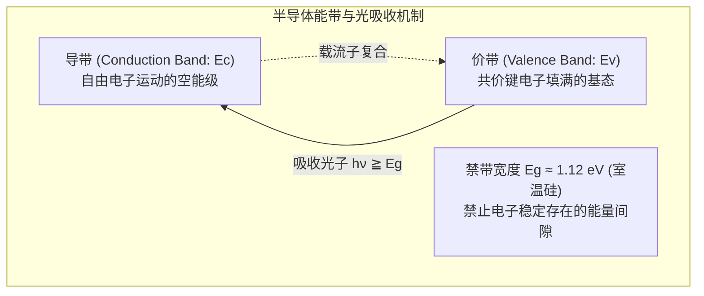
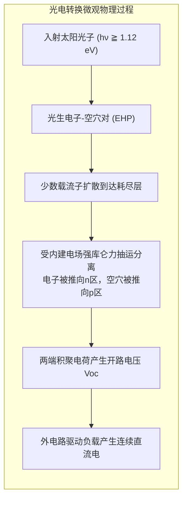

只需将深蓝或漆黑的面板朝向天空，无需燃烧燃料，没有任何机械转动部件，也不产生任何噪声与废气，电能便源源不断地产生。太阳能电池（Photovoltaic Cell）是现代固体物理与量子力学在能源领域的最高杰作之一。

与传统火力或核能发电必须经过“燃料燃烧-蒸汽膨胀-汽轮机旋转-电磁感应”这一受卡诺循环（Carnot Cycle）热力学严格制约的漫长路径截然不同，太阳能电池实现了<strong>光子量子能量向自由电子势能的直接跨越</strong>。

---

### 1. 光生伏特效应与量子直接转换

1839年，法国物理学家埃德蒙·贝克勒尔首次在电解液中发现了光生伏特效应。1905年，爱因斯坦提出了光量子假说，证明光是由能量为 $E = h\nu$ 的光子组成，奠定了光电转化的微观理论基础。1954年，贝尔实验室利用高纯硅p-n结制造出人类第一块实用的现代单晶硅太阳能电池。

在太阳能电池中，没有宏观的热机流动，光子直接与晶体中的束缚价电子碰撞，将其激发跨越禁带成为导电电子，再通过内部非对称电场抽运输出为直流电。

---

### 2. 固体能带理论与半导体物理基础

硅（$\mathrm{Si}$）原子外层具有4个价电子，在晶体中通过 $sp^3$ 杂化轨道形成牢固的金刚石立方晶格结构。

- <strong>价带（Valence Band, $E_v$）</strong>：绝对零度下被共价键电子完全填满的最高能带，满带电子无法在外电场下自由流动。
- <strong>导带（Conduction Band, $E_c$）</strong>：价带之上的空能带，电子被激发进入导带后成为自由载流子。
- <strong>禁带宽度（Bandgap, $E_g$）</strong>：价带顶与导带底之间的能量差，硅在室温下的禁带宽度约为 <strong>$1.12\,\mathrm{eV}$</strong>。
- <strong>掺杂（Doping）</strong>：
  - <strong>n型半导体</strong>：掺入微量5价磷（$\mathrm{P}$），多余的第5个电子极易电离进入导带，以电子为多数载流子。
  - <strong>p型半导体</strong>：掺入微量3价硼（$\mathrm{B}$），缺少1个价电子形成空穴，以空穴为多数载流子。

---

### 3. p-n结与内建电场的载流子分离

当p型与n型硅紧密结合时，高浓度的电子与空穴在界面处发生相互扩散并复合，形成缺乏移动载流子的<strong>空间电荷区（耗尽层 / Depletion Region）</strong>。
- n型一侧留下带正电的固定磷离子（$\mathrm{P^+}$）。
- p型一侧留下带负电的固定硼离子（$\mathrm{B^-}$）。

这产生了一个由n区指向p区的强<strong>内建电场（Built-in Electric Field $\mathbf{E}_{bi}$）</strong>，建立起约 $0.7\sim 0.9\,\mathrm{V}$ 的内建电势差 $V_{bi}$。

当入射光子能量 $h\nu \ge E_g$ 时，电子被激发跃迁至导带，在价带留下空穴。这些非平衡载流子扩散至耗尽层后，被内建电场迅速强行拉开：电子被推向n区，空穴被推向p区。两极聚集异号电荷，从而在电池两端形成<strong>光生伏特电压（开路电压 $V_{oc}$）</strong>，接通负载后即对外做功。

---

### 4. 肖克利-奎瑟极限（Shockley-Queisser Limit）

为什么单结硅太阳能电池的理论极限转换效率无法达到100%？1961年物理学家肖克利与奎瑟利用细致平衡原理证明，单结太阳能电池存在一个无法超越的理论上限（<strong>约 33.7%</strong>，硅的实际物理极限约为 <strong>29.4%</strong>）。

限制效率的四大根本物理损失包括：
1. <strong>带下透射损失（约 19%）</strong>：光子能量低于禁带宽度（$h\nu < E_g$，波长大于 $1107\,\mathrm{nm}$ 的红外光）无法被吸收，直接穿透电池基体。
2. <strong>热弛豫损失（约 33%）</strong>：高能光子（如紫外、蓝光 $h\nu \gg E_g$）激发的电子处于导带深处，多余能量 $(h\nu - E_g)$ 在皮秒级时间内以晶格振动（声子）形式迅速耗散为废热。
3. <strong>复合损失与黑体辐射损失</strong>：电子与空穴在被收集前的辐射复合与俄歇复合。
4. <strong>电位与能隙差损失（$q V_{oc} < E_g$）</strong>：热力学熵增导致开路电压 $V_{oc}$（约0.7V）显著小于禁带电势（1.12V）。

---

### 5. 电池架构进化：从 PERC 到 TOPCon 与异质结 HJT

为了无限逼近 29.4% 的理论天花板，光伏工业经历了纳米级界面的惊人革新：
- <strong>减反射金字塔与氮化硅（$\mathrm{SiN_x}$）镀膜</strong>：碱腐蚀形成的微米金字塔多重反射与 $75\,\mathrm{nm}$ 光学干涉减反射膜，将硅片表面反射率从 35% 降至 1.5% 以下。
- <strong>PERC（钝化发射极及背局域接触）</strong>：背表面引入氧化铝/氮化硅介质钝化层，并用激光开微孔，大幅压低背表面载流子复合率，效率达 21%~23%。
- <strong>TOPCon（隧穿氧化层钝化接触）</strong>：在背面生长仅 <strong>$1.2 \sim 1.5\,\mathrm{nm}$（数个原子层厚）</strong>的超薄氧化硅层，利用量子隧穿效应只允许多数载流子穿透，彻底阻断少数载流子与金属的复合，工业效率突破 25%~26%。
- <strong>HJT（异质结技术）</strong>：在单晶硅双面沉积超薄本征及掺杂非晶硅薄膜，开路电压突破 $750\,\mathrm{mV}$，具备极佳的温度系数。

---

### 6. 温度、阴影与热斑破坏物理

- <strong>温度负效应</strong>：温度升高时，本征载流子浓度 $n_i$ 指数级暴增，导致暗饱和电流 $I_0$ 剧烈上升，开路电压以 <strong>$-2.0\,\mathrm{mV}/^\circ\mathrm{C}$（约 $-0.35\%/^\circ\mathrm{C}$）</strong>大幅滑坡。炎夏暴晒下组件温度达 $70^\circ\mathrm{C}$，功率将缩水 15% 以上。
- <strong>局部阴影与热斑效应（Hot-Spot）</strong>：串联电池组中，若单个电池被树叶或鸟粪遮挡，其光生电流骤降，被其余正常电池反向强行充电。该遮光电池被迫承受高达数十伏的反向偏压，电能全部转化为局部焦耳热，温度可在数十秒内飙升至 <strong>$150^\circ\mathrm{C} \sim 200^\circ\mathrm{C}$</strong>，烧毁胶膜并引发火灾。工程上利用<strong>旁路二极管（Bypass Diode）</strong>在反偏时导通分流，化解热斑危机。

---

### 7. 光伏逆变器与并网系统工程

太阳能电池输出的是随光照剧烈波动的直流电，必须通过<strong>光伏逆变器（PCS）</strong>转换为稳定交流电：
- <strong>最大功率点跟踪（MPPT）</strong>：采用扰动观察法（P&O）或电导增量法（IncCond），以每秒数百次的高频动态调节输入阻抗，确保电池阵列始终工作在功率峰值点。
- <strong>高频 PWM 逆变</strong>：IGBT全桥高速开关生成工频纯正弦波，总谐波畸变率（THD）低于 3%。
- <strong>孤岛效应防护（Anti-Islanding）</strong>：在电网故障失电时，逆变器在数十毫秒内主动切断输出，防止孤岛带电威胁检修人员生命。

---

### 8. 等效电路模型与 I-V 输出特性方程

太阳能电池的宏观电学输出特性可用单二极管等效电路模型描述：

$$I = I_{ph} - I_0 \left[ \exp\left( \frac{q(V + I R_s)}{n k_B T} \right) - 1 \right] - \frac{V + I R_s}{R_{sh}}$$

- <strong>串联电阻 $R_s$</strong>：源自硅基底体电阻、表面电极金属网格线欧姆接触电阻。$R_s$ 越小，电池填充因子 $FF$ 越高。
- <strong>并联电阻 $R_{sh}$</strong>：源于电池边缘微裂纹与材料内部点缺陷造成的微漏电通路。理想情况下 $R_{sh} \to \infty$。
- <strong>填充因子（Fill Factor, $FF$）</strong>：
  $$FF = \frac{P_{max}}{V_{oc} I_{sc}} = \frac{V_{mp} I_{mp}}{V_{oc} I_{sc}}$$
  高质量单晶硅电池的填充因子通常在 0.80 到 0.85 之间，反映了 I-V 特性曲线的“方正度”。

---

### 9. 长期可靠性与老化物理机制（LID 与 PID）

光伏组件通常要求在户外极端气候下稳定服役 25 至 30 年：
1. <strong>光致衰减（LID: Light-Induced Degradation）</strong>：传统 p 型硅中微量残留氧原子与掺杂的硼原子在光照注入载流子作用下形成硼-氧缺陷对（$\mathrm{B_s\text{-}O_{2i}}$），在初始几十小时内导致转换效率下降 1%~3%。现代工业通过改用镓（Ga）掺杂或全面转向 n 型基底（TOPCon/HJT）彻底解决了这一问题。
2. <strong>电位诱发衰减（PID: Potential-Induced Degradation）</strong>：在高压大型地面光伏电站（系统电压达 1000V~1500V）中，接地的铝合金边框与带高负压的电池片之间形成极高电场，驱使前板玻璃中的钠离子（$\mathrm{Na^+}$）向电池表面抗反射膜扩散富集，引发严重短路漏电，数月内可导致组件功率衰减 30%~80%。采用抗 PID 的 POE 封装胶膜与无钠玻璃可有效根治 PID 隐患。
