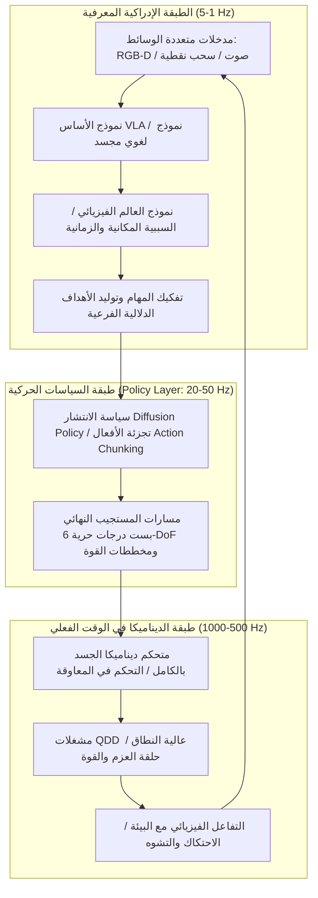

في أوائل عشرينيات القرن الحالي، أظهرت النماذج اللغوية الكبيرة (LLMs) ونماذج الرؤية واللغة (VLMs) طفرة غير مسبوقة في الإدراك الاصطناعي داخل الفضاء الرقمي. ومع ذلك، مهما بلغت براعة الشبكة العصبية في حل معادلات ميكانيكا الكم أو كتابة أنظمة التشغيل، فإنها تظل سجينة خلف شاشة زجاجية مسطحة. لا يمكنها تقديم كوب ماء دافئ لمريض مسن، ولا إحكام صمام نحاسي عالق في منشأة نفطية، ولا التحرك عبر ركام الزلازل لإنقاذ الأرواح.

لكي يغير الذكاء الاصطناعي الاقتصاد المادي والمجتمع الإنساني بصورة جذرية، يجب أن يكتسب جسداً مادياً: يحتاج إلى **التجسيد (Embodiment)**. هذا هو جوهر **الذكاء الاصطناعي الفيزيائي (Physical AI)** و**الذكاء المجسد**.

الذكاء الاصطناعي الفيزيائي ليس مجرد تشغيل نموذج ذكاء اصطناعي على متحكم دقيق. إنه فرع هندسي وعلمي جديد تماماً: **بناء أنظمة ذاتية التحكم قادرة على الإدراك الحسي والاستدلال الفيزيائي والتفاعل الفعلي مع العالم المادي في ظل قوانين الجاذبية والاحتكاك والقصور الذاتي وميكانيكا التلامس الصارمة**.

---

## 1. مفارقة مورافيك والمعضلة الجوهرية للذكاء الاصطناعي الفيزيائي

في تاريخ الذكاء الاصطناعي، تبرز ملاحظة عميقة تُعرف باسم **مفارقة مورافيك (Moravec's Paradox)**. لاحظ هانز مورافيك ومارفين مينسكي وزملاؤهم في ثمانينيات القرن الماضي أنه من السهل نسبياً جعل الحاسوب يضاهي البالغين في الشطرنج أو الحساب المنطقي والتفاضل، ولكن من الصعب للغاية تزويده بقدرات طفل عمره عام واحد في التوازن الحركي أو الإدراك البصري أو مهارات الإمساك بالأصابع.

يعود هذا التناقض إلى أسباب جوهرية:
1. **العبء الحسابي التطوري**: ظهر التفكير الرمزي التجريدي لدى الإنسان منذ عشرات الآلاف من السنين فقط. في المقابل، صُقل الجهاز الحسي الحركي عبر مئات الملايين من السنين من الانتخاب الطبيعي الصارم، مستهلكاً النصيب الأكبر من القدرة الحسابية البيولوجية.
2. **استمرارية العالم الفيزيائي وعدم قابليته للتراجع**: يتميز العالم الرقمي بكونه متقطعاً ويتيح التراجع عن الأخطاء (Undo). أما في الكون الفيزيائي، فالزمن يتدفق باستمرار، والقانون الثاني للديناميكا الحرارية يمنع العودة للوراء، وتلامس الأجسام يتسم بلاخطية شديدة.

يهدف الذكاء الاصطناعي الفيزيائي إلى كسر هذه المفارقة من خلال تحويل «العقل في الوعاء» إلى كائن مجسد متفاعل مع قوانين المادة.

---

## 2. بنية التحكم الهرمية: من الاستدلال المعرفي إلى التحكم في المعاوقة بتردد كيلوهرتز

في الروبوتات المادية، تعاني حلقة التحكم من فجوة ترددية هائلة: تعمل نماذج الاستدلال المعرفي العليا بتردد منخفض ($1 \sim 5\text{ Hz}$)، في حين يجب إغلاق حلقة التحكم في عزم المحركات وديناميكا التلامس خلال أجزاء من الألف من الثانية ($100 \sim 1000\text{ Hz}$) لمنع عدم الاستقرار والسقوط.

يعتمد الذكاء الاصطناعي الفيزيائي الحديث **بنية تحكم هرمية مفككة**:

تضمن هذه البنية:
- **الطبقة المعرفية ($1 \sim 5\text{ Hz}$)**: تفسير التعليمات اللغوية المعقدة ("نظف هذا الكوب الزجاجي بحذر وضعه مقلوباً على رف التجفيف").
- **طبقة السياسات ($20 \sim 50\text{ Hz}$)**: توليد كتل حركية متصلة (*Action Chunks*) لمنع تراكم التأخير في القرارات.
- **طبقة الوقت الفعلي ($500 \sim 1000\text{ Hz}$)**: تطبيق التحكم في المعاوقة لكامل الجسد (Whole-Body Impedance Control) ودوال حواجز التحكم (CBF) لامتصاص الصدمات وحماية البيئة المحيطة.

---

## 3. نماذج VLA (الرؤية-اللغة-الفعل) والرياضيات الكامنة وراء Diffusion Policy

### 1. الصياغة الرياضية لنماذج VLA
على عكس نماذج الرؤية واللغة التقليدية التي تولد رموزاً نصية:
$$y = f_{\text{VLM}}(I, T) \in \mathcal{V}^*$$
يقوم نموذج **VLA (Vision-Language-Action)** بربط المدخلات الحسية مباشرة بمتغيرات التحكم الفيزيائية المستمرة:
$$a_t = f_{\text{VLA}}(I_t, T, s_t) \in \mathbb{R}^D$$
حيث يتكون متجه الفعل عادة من إزاحات بست درجات حرية للمستجيب النهائي وحالة القابض:
$$a_t = [\Delta x, \Delta y, \Delta z, \Delta \phi, \Delta \theta, \Delta \psi, g_{\text{gripper}}]^\top$$

تثبت النماذج الرائدة مثل Google RT-2 وOpenVLA وPhysical Intelligence π0 إمكانية دمج المعرفة اللغوية الشاملة مع دقة التحكم الحركي.

### 2. الأسس الرياضية لسياسة الانتشار (Diffusion Policy)
يفشل التعلم بالتقليد التقليدي (Behavior Cloning) أمام **التوزيعات متعددة الأنماط (Multimodal Distributions)**. عند تجنب عائق ما، يكون الالتفاف يميناً أو يساراً حلين صحيحين؛ لكن الانحدار التقليدي المعتمد على متوسط المربعات يحسب المتوسط الحسابي، مما يؤدي إلى الاصطدام المباشر بالعائق.

تقوم **Diffusion Policy** بصياغة توليد الحركة كعملية تصادفية عكسية لإزالة التشويش المشروط:
لكتلة حركات مستقبلية $A_t = [a_t, \dots, a_{t+K_a}]$، تضيف عملية الانتشار الأمامية ضوضاء غاوسية:
$$q(A^k | A^0) = \mathcal{N}\left(A^k; \sqrt{\bar{\alpha}_k} A^0, (1 - \bar{\alpha}_k)\mathbf{I}\right)$$

تتعلم الشبكة العصبية $\epsilon_\theta$ التنبؤ بتلك الضوضاء:
$$\mathcal{L}(\theta) = \mathbb{E}_{k, A^0, \epsilon \sim \mathcal{N}(0, \mathbf{I})}\left[\|\epsilon - \epsilon_\theta(\sqrt{\bar{\alpha}_k}A^0 + \sqrt{1 - \bar{\alpha}_k}\epsilon, k, O_t)\|^2\right]$$

يمنح هذا النموذج الروبوتات براعة استثنائية في معالجة الأجسام المرنة (تمديد الأسلاك، طي الأقمشة، التجميع الدقيق).

---

## 4. نقل Sim-to-Real ونماذج العالم التوليدية

نظراً لارتفاع تكلفة جمع البيانات الواقعية ومخاطر الأعطال الميكانيكية، يعتمد الذكاء الاصطناعي الفيزيائي بشكل مكثف على محاكيات الفيزياء المتوازية على معالجات الرسومات (NVIDIA Isaac Sim, MuJoCo, Genesis).

### 1. عشوائية النطاق (Domain Randomization)
لتجاوز الفجوة بين المحاكاة والواقع (*Sim-to-Real Gap*)، يتم إدخال تقلبات عشوائية في معادلات الديناميكا:
$$M(q, \xi)\ddot{q} + C(q, \dot{q}, \xi)\dot{q} + g(q, \xi) = \tau + J^\top(q) F_{\text{ext}}$$
حيث يتم تغيير معاملات الاحتكاك $\mu$ وكتل الروابط وأزمنة الاستجابة عشوائياً، مما يجبر السياسة العصبية على تعلم حلول قوية ومستقرة ضد الاضطرابات الميكانيكية.

### 2. نماذج العالم الفيزيائي التوليدية
من خلال توقع الحالة الفيزيائية المستقبلية:
$$\hat{S}_{t+1} \sim \mathcal{P}_{\text{world}}(S_{t+1} | S_t, a_t)$$
يستطيع الروبوت تقييم عواقب أفعاله داخل فضاء خيالي عصبي دون المخاطرة بالأجهزة في العالم الواقعي.

---

## 5. الهندسة الميكاترونية: مشغلات QDD والاستشعار اللمسي البصري

لا يمكن للبرمجيات تجاوز الحدود الفيزيائية للعتاد:

1. **مشغلات الدفع شبه المباشر (QDD: Quasi-Direct Drive)**:
   على عكس الروبوتات الصناعية التقليدية ذات نسب التخفيض العالية والصلابة المفرطة (1:100)، تستخدم الروبوتات البشرية الحديثة محركات عزم متقدمة بنسب تخفيض منخفضة (1:6 إلى 1:10). توفر هذه المشغلات **قابلية تدوير عكسية ممتازة (Back-drivability)** ومرونة ميكانيكية تمتص الصدمات.

2. **الحساسات اللمسية البصرية (GelSight)**:
   تلتقط كاميرات دقيقة تشوه غشاء السيليكون الشفاف عند التلامس، وتسترجع عبر القياس الضوئي المجسم حقل إجهادات التلامس $\mathbf{T}(x, y)$ بدقة الميكرومتر لتنظيم الإمساك الدقيق.

---

## 6. ضمانات الأمان الرياضية: دوال حواجز التحكم (CBF)

لا يجوز ترك الشبكات العصبية غير المفسرة لتتحكم مباشرة في محركات عالية العزم دون قيود رياضية حتمية.

تعمل **دوال حواجز التحكم (Control Barrier Functions, CBF)** كمرشح أمان حتمي في الوقت الفعلي. لمجموعة الحالات الآمنة $\mathcal{C} = \{x \mid h(x) \ge 0\}$، يتم تعديل الفعل الاسمي $u_{\text{nom}}$ عبر البرمجة التربيعية (QP):
$$\min_u \frac{1}{2}\|u - u_{\text{nom}}\|^2 \quad \text{s.t.} \quad L_f h(x) + L_g h(x)u + \alpha(h(x)) \ge 0$$
يوفر ذلك إثباتاً رياضياً مبنياً على نظرية ليابونوف للاستقرار بأن الروبوت لن يتجاوز حدوده الميكانيكية الآمنة مطلقاً.

### خاتمة
يمثل الذكاء الاصطناعي الفيزيائي الاندماج النهائي بين الحوسبة الذكية وقوانين الطبيعة. ستشكل الروبوتات البشرية متعددة الاستخدامات حجر الزاوية في الصناعة والرعاية الصحية واستكشاف البيئات القاسية في القرن الحادي والعشرين.
