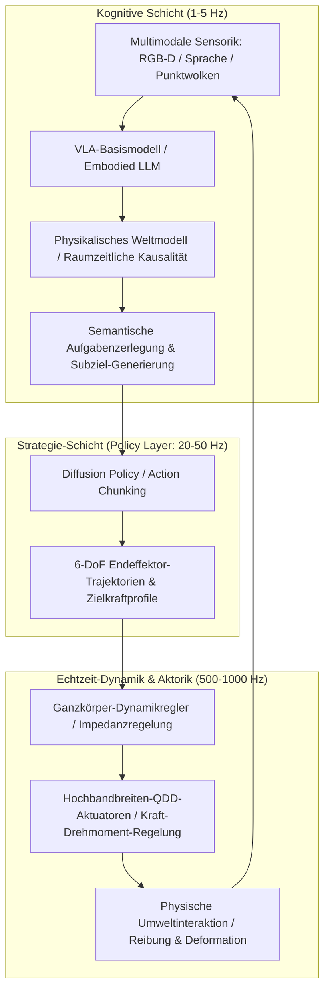

Zu Beginn der 2020er Jahre führten Large Language Models (LLMs) und Vision-Language Models (VLMs) zu einem beispiellosen Durchbruch der künstlichen Intelligenz in der digitalen Welt. Doch ganz gleich, wie brillant ein neuronales Netz Quantenmechanik herleitet oder komplexe Softwarearchitekturen entwickelt: Solange es hinter einem zweidimensionalen Bildschirm gefangen bleibt, kann es einem bettlägerigen Menschen kein Glas Wasser reichen, kein festsitzendes Ventil in einer Chemieanlage reparieren und keine Verschütteten aus Erdbebentrümmern retten.

Damit künstliche Intelligenz die reale physische Ökonomie und die menschliche Lebenswelt grundlegend transformieren kann, muss sie eine physische Existenz erhalten – einen Körper. Dies markiert den Beginn der **Embodied Intelligence (Verkörperte Intelligenz)** und der **Physical AI (Physikalische KI)**.

Physical AI ist keineswegs das bloße Aufspielen eines Standard-KI-Modells auf einen Mikrocontroller. Es handelt sich um eine neue fundamentale Disziplin: **Die Erschaffung autonomer Systeme, die unter den unnachgiebigen Gesetzen der Schwerkraft, Reibung, Trägheit und Kontaktmechanik ihre Umwelt wahrnehmen, physikalisch schlussfolgern und aktiv manipulieren können**.

---

## 1. Das Moravec-Paradoxon und das Grundproblem der Physical AI

In der Geschichte der KI-Forschung existiert eine fundamentale Erkenntnis, die als **Moravec-Paradoxon** bekannt ist: Hans Moravec, Marvin Minsky und Zeitgenossen erkannten bereits in den 1980er Jahren, dass es Computern erstaunlich leicht fällt, bei Logikrätseln, Schach oder Infinitesimalrechnung menschliches Erwachsenenniveau zu erreichen, während es extrem schwierig ist, ihnen die sensorischen und motorischen Fähigkeiten eines einjährigen Kindes beizubringen.

Die Ursachen liegen in:
1. **Evolutionärem Rechenaufwand**: Abstraktes symbolisches Denken existiert erst seit wenigen zehntausend Jahren. Die sensomotorische Koordination hingegen wurde über Hunderte Millionen Jahre natürlicher Selektion unter extremem evolutionärem Rechenaufwand optimiert.
2. **Kontinuierlicher und irreversibler Physik**: Digitale Informationsräume sind diskret und verlustfrei manipulierbar. Die physische Realität hingegen ist kontinuierlich, der zweite Hauptsatz der Thermodynamik verbietet ein simples Zurücksetzen (Undo), und mechanische Kontakte sind hochgradig nichtlinear und nicht-konvex.

Das Ziel von Physical AI ist die Überwindung dieses Paradoxons: Die Transformation des körperlosen "Gehirns im Tank" in einen physischen Agenten mit tiefem Gespür für physikalische Kausalität.

---

## 2. Hierarchische Systemarchitektur: Von kognitiver Planung bis zur kHz-Impedanzregelung

In physischen Robotersystemen klafft eine fundamentale Frequenzlücke: Kognitive Großmodelle mit Milliarden Parametern arbeiten bei $1 \sim 5\text{ Hz}$, während die Gelenkmotorregelung und die Kontaktkraftdynamik bei $100 \sim 1000\text{ Hz}$ geschlossen werden müssen, um dynamische Stabilität zu gewährleisten.

Moderne Physical AI nutzt daher eine **hierarchisch entkoppelte Kontrollarchitektur**:

Diese Schichtenarchitektur garantiert:
- **Kognitive Schicht ($1 \sim 5\text{ Hz}$)**: Dekodiert hochgradig abstrakte Instruktionen ("Hebe den Becher vorsichtig an und stelle ihn in das Spülbecken").
- **Policy-Schicht ($20 \sim 50\text{ Hz}$)**: Erzeugt zusammenhängende Trajektorienblöcke (*Action Chunks*), die Latenzen und akkumulierte Regelfehler drastisch reduzieren.
- **Echtzeitschicht ($500 \sim 1000\text{ Hz}$)**: Setzt über Ganzkörper-Impedanzregelung (Whole-Body Impedance Control) und Control Barrier Functions (CBF) eine nachgiebige, stoßdämpfende und inhärent sichere Kraftinteraktion um.

---

## 3. VLA-Modelle (Vision-Language-Action) und die Mathematik der Diffusion Policy

### 1. Mathematische Formulierung von VLA-Systemen
Klassische Vision-Language-Modelle (VLM) erzeugen Sprach-Token:
$$y = f_{\text{VLM}}(I, T) \in \mathcal{V}^*$$
Im Gegensatz dazu bildet ein **VLA-Modell (Vision-Language-Action)** multimodale Sensordaten direkt auf kontinuierliche Aktionsvektoren ab:
$$a_t = f_{\text{VLA}}(I_t, T, s_t) \in \mathbb{R}^D$$
wobei der Aktionsvektor typischerweise 6-DoF Posenänderungen des Endeffektors und Greiferzustände umfasst:
$$a_t = [\Delta x, \Delta y, \Delta z, \Delta \phi, \Delta \theta, \Delta \psi, g_{\text{gripper}}]^\top$$

Pionierarchitekturen wie Google RT-2, OpenVLA und Physical Intelligence π0 demonstrieren, wie semantisches Internet-Wissen auf feinmotorische Fertigkeiten übertragen werden kann.

### 2. Mathematische Grundlagen der Diffusion Policy
Klassisches Imitation Learning (Behavior Cloning) scheitert systematisch an **multimodalen Verteilungen**. Wenn ein Hindernis sowohl links als auch rechts umfahren werden kann, führt eine einfache Regression (MSE-Loss) zum Mittelwert beider Optionen – einer frontalen Kollision.

**Diffusion Policy** modelliert Roboteraktionssequenzen als bedingten Rückwärts-Entrauschungsprozess:
Gegeben sei ein zukünftiger Aktions-Chunk $A_t = [a_t, \dots, a_{t+K_a}]$ und Beobachtung $O_t$. Der Vorwärtsdiffusionsprozess fügt Gaußsches Rauschen hinzu:
$$q(A^k | A^0) = \mathcal{N}\left(A^k; \sqrt{\bar{\alpha}_k} A^0, (1 - \bar{\alpha}_k)\mathbf{I}\right)$$

Das Netzwerk $\epsilon_\theta$ wird darauf trainiert, das Rauschen zu schätzen:
$$\mathcal{L}(\theta) = \mathbb{E}_{k, A^0, \epsilon \sim \mathcal{N}(0, \mathbf{I})}\left[\|\epsilon - \epsilon_\theta(\sqrt{\bar{\alpha}_k}A^0 + \sqrt{1 - \bar{\alpha}_k}\epsilon, k, O_t)\|^2\right]$$

Dies ermöglicht die fehlerfreie Ausführung hochgradig mehrdeutiger und komplexer Kontaktmanipulationen (Kabelstecken, Teigkneten, Textilfalten).

---

## 4. Sim-to-Real-Transfer und generative Weltmodelle

Da Realdaten in der Robotik teuer und verschleißanfällig sind, trainiert Physical AI primär in hochparallelen GPU-Physiksimulatoren (NVIDIA Isaac Sim, MuJoCo, Genesis).

### 1. Domänenrandomisierung (Domain Randomization)
Um die Diskrepanz zwischen Simulation und Realität ("Reality Gap") zu überbrücken, werden physikalische Parameter im Zustandsraum $\Xi$ stochastisch variiert:
$$M(q, \xi)\ddot{q} + C(q, \dot{q}, \xi)\dot{q} + g(q, \xi) = \tau + J^\top(q) F_{\text{ext}}$$
Reibungskoeffizienten $\mu$, Verbindungsmasseverteilungen, Getriebespiel und Latenzen werden zufällig gestreut, sodass die trainierte Policy robuste Invarianzeigenschaften erlernt.

### 2. Generative physikalische Weltmodelle
Weltmodelle simulieren die zukünftige physikalische Dynamik:
$$\hat{S}_{t+1} \sim \mathcal{P}_{\text{world}}(S_{t+1} | S_t, a_t)$$
Sie gestatten dem Roboter, Konsequenzen in einer neuronalen Traumumgebung risikolos vorauszudenken.

---

## 5. Hardware-Architektur: QDD-Aktuatoren und taktile Sensorik

Fortschritte in der Physical AI sind untrennbar mit elektromechanischen Innovationen verknüpft:

1. **Quasi-Direct-Drive (QDD) Aktuatoren**:
   Im Gegensatz zu traditionellen Industrierobotern mit hohen Getriebeübersetzungen (1:100) nutzen moderne Humanoide getriebearme BLDC-Motoren (1:6 bis 1:10). Diese bieten exzellente **Rücktreibarkeit (Back-drivability)**, mechanische Stoßnachgiebigkeit und hohe Krafttransparenz.

2. **Optisch-taktile Sensoren (GelSight)**:
   Mikrokameras erfassen die Verformung einer elastischen Membran und rekonstruieren den Kontaktdruck-Tensoren $\mathbf{T}(x, y)$ im Mikrometerbereich, was ein feinfühliges Erkennen von Mikroschlupf ermöglicht.

---

## 6. Mathematische Sicherheitsgarantien mit Control Barrier Functions (CBF)

Ein unüberwachter End-to-End-Controller stellt im physischen Raum ein untragbares Risiko dar. **Control Barrier Functions (CBF)** fungieren als deterministische Sicherheitsfilter:
Für eine sichere Menge $\mathcal{C} = \{x \mid h(x) \ge 0\}$ wird die nominelle Aktion $u_{\text{nom}}$ via quadratischer Programmierung (QP) modifiziert:
$$\min_u \frac{1}{2}\|u - u_{\text{nom}}\|^2 \quad \text{s.t.} \quad L_f h(x) + L_g h(x)u + \alpha(h(x)) \ge 0$$
Dadurch wird mathematisch garantiert, dass kinetische und mechanische Grenzwerte niemals verletzt werden.

### Ausblick
Physical AI schlägt die Brücke zwischen digitaler Intelligenz und realer physikalischer Arbeit. Humanoide Roboter mit verkörperter Intelligenz werden das Fundament der industriellen Fertigung, der Pflege und der Erkundung extremer Lebensräume im 21. Jahrhundert bilden.
