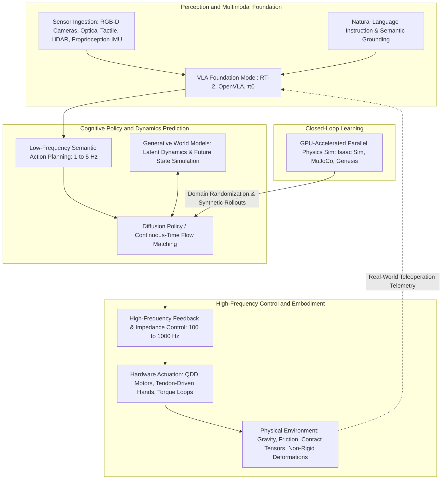
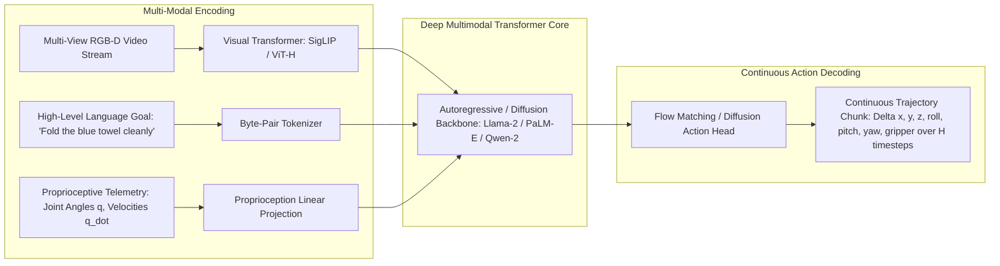
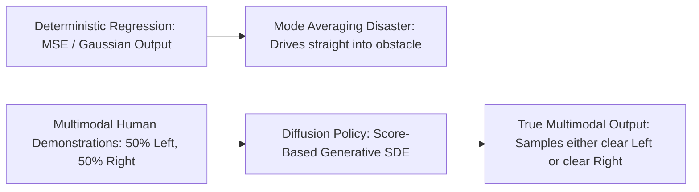
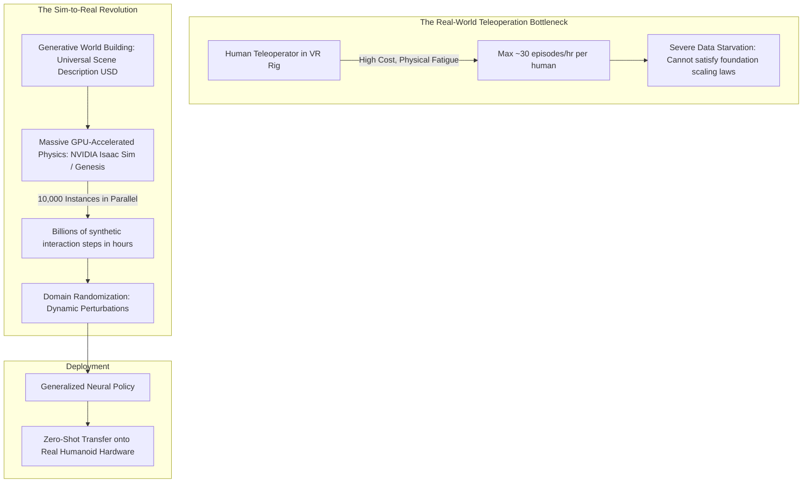
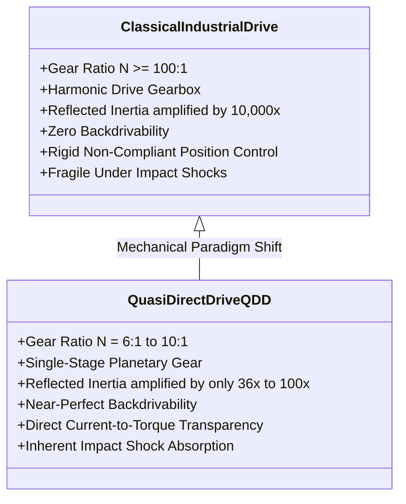
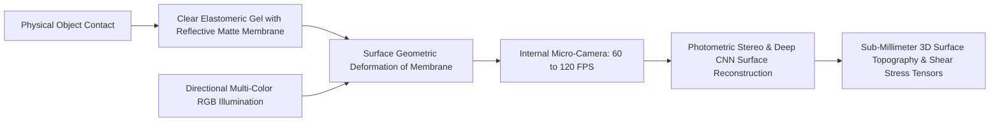
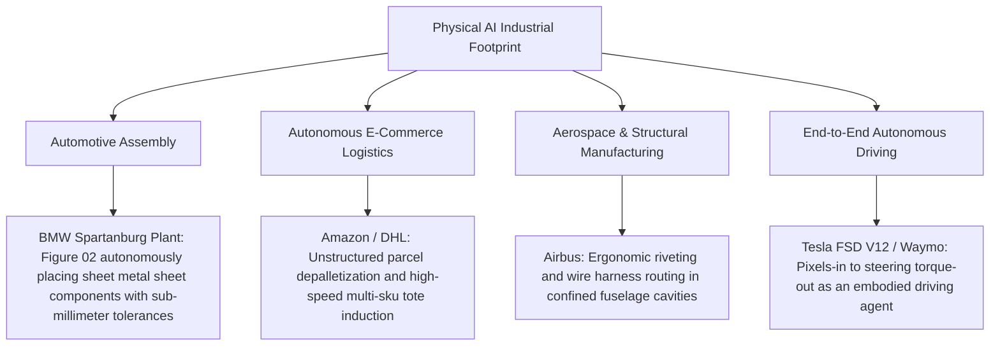

In the early 2020s, the emergence of Large Language Models (LLMs) and Vision-Language Models (VLMs) demonstrated an unprecedented leap in synthetic cognition within the digital domain. Yet, no matter how profoundly an artificial neural network can reason about quantum electrodynamics, write production-grade operating systems, or analyze global financial markets, it remains entirely trapped behind a two-dimensional glass screen. It cannot lift a glass of water to hydrate an elderly patient, cannot turn a stuck brass valve in an offshore petrochemical facility, and cannot navigate through earthquake debris to pull a survivor to safety.

For artificial intelligence to participate genuinely in human society and transform the global material economy, it must acquire a physical presence. It must obtain **Embodiment**.

Today, at the frontier where advanced deep learning intersects with mechanical engineering, a colossal paradigm shift is underway: the birth of **Physical AI (Embodied Intelligence)**.

Physical AI is not simply the deployment of a classical neural network onto a microcontroller. It represents an entirely new discipline: **the creation of autonomous intelligence capable of perceiving, reasoning through, and actively manipulating the physical universe under the unforgiving constraints of gravity, friction, momentum, contact mechanics, and fluid dynamics**.

This monograph provides an exhaustive, graduate-level dissection of the theoretical foundations, computational architectures, mathematical formulations, and engineering realities of Physical AI. We explore the resolution of Moravec’s paradox, the mechanics of Vision-Language-Action (VLA) foundation models, the formulation of Diffusion Policy for multimodal trajectory generation, massive GPU-parallel physics simulation with Sim-to-Real domain randomization, quasi-direct drive (QDD) actuators, optical tactile sensing (GelSight), and the emerging humanoid robotics industry.



---

## 1. The Paradigm Shift: From Disembodied LLMs to Physical AI

### 1.1 Overcoming Moravec's Paradox and the Necessity of Embodiment

For over four decades, artificial intelligence research was haunted by **Moravec’s Paradox**, formulated in the late 1980s by roboticists Hans Moravec, Rodney Brooks, and Marvin Minsky:

> **"It is comparatively easy to make computers exhibit adult level performance on intelligence tests or playing checkers, and difficult or impossible to give them the skills of a one-year-old when it comes to perception and mobility."**

The biological and evolutionary rationale for this paradox lies in the evolutionary allocation of computational resources. Abstract mathematical deduction, formal logic, chess, and linguistic syntax are evolutionary novelties, developed by hominids within only the last few hundred thousand to several thousand years. Conversely, dynamic locomotion, three-dimensional spatial navigation, stereoscopic vision, and fine-motor tactile manipulation are the result of **over five hundred million years of relentless natural selection across vertebrate biology**. The neural circuitry that allows an infant to grasp a glass of milk without crushing or dropping it represents an unimaginably vast, highly optimized biological computational architecture.

Classical robotics attempted to bypass this evolutionary heritage through analytical reductionism:
1. Deconstruct the world into exact Computer-Aided Design (CAD) geometric primitives;
2. Formulate explicit inverse kinematics ($q = f^{-1}(x)$);
3. Plan collision-free trajectories using deterministic sampling algorithms (e.g., RRT*, PRM);
4. Track these trajectories via high-gain Proportional-Integral-Derivative (PID) controllers.

While this classical paradigm triumphed within structured industrial assembly plants—where an automotive chassis is clamped to millimeter tolerances—it fails catastrophically in unconstrained, unstructured human environments. The moment a mug slips by two millimeters, a surface exhibits an unmodeled coefficient of friction, or a cloth wrinkles unexpectedly, classical deterministic pipelines collapse into execution failure.

Physical AI rejects the brittle assumption of deterministic geometric modeling. By unifying perception, semantics, and actuation into unified deep neural architectures trained directly on interaction data, Physical AI learns **sensorimotor representations that emerge organically from continuous interaction with the physical world**.

### 1.2 Atoms versus Bits: The Fundamental Engineering Divide

Operating in the realm of physical atoms imposes engineering constraints completely foreign to the software world of digital bits:

| Parameter | Cybernetic AI (LLMs / Vision / Code) | Physical AI (Robotics / Embodied Agents) |
| :--- | :--- | :--- |
| **Operational Domain** | Virtual memory, GPU VRAM, high-bandwidth interconnects | Physical space: Mass, inertia, gravity, stiction, fluid drag |
| **Control Frequency** | Asynchronous: 0.1 to 2.0 Hz (100 ms to seconds latency) | Synchronous: **100 to 1,000 Hz (1 to 10 ms hard real-time)** |
| **Failure Tolerance** | Hallucinations, syntax errors (resolved via re-prompting) | **Physical destruction, tipping over, catastrophic motor burnout, human injury** |
| **Data Scaling Pipeline** | Trillions of freely scrapable tokens across the public Internet | **Severe data starvation: teleoperation hours are physically bounded and expensive** |
| **Thermodynamic Reversibility**| Complete software rollback (undo stack, checkpoint restore) | Non-equilibrium thermodynamics: spilled liquids, glass breakage, plastic deformation |
| **Causal Grounding** | Statistical token co-occurrence | Newton-Euler dynamics, friction cones, conservation of momentum |

The grand technical objective of Physical AI is not merely the recognition of physical scenes, but the **real-time synthesis of dynamic closed-loop control policies** that can absorb unpredictable external perturbations while driving complex mechanical topologies toward a semantic goal.

---

## 2. VLA (Vision-Language-Action) Foundation Model Architectures

### 2.1 The Architectural Evolution: From VLM to VLA

In classical robotics, system architectures were divided into disjoint subsystems: visual object detection $\to$ 6D pose estimation $\to$ grasp synthesis $\to$ motion planning $\to$ joint trajectory tracking. Each handoff introduced compounding calibration errors, representation bottlenecks, and semantic blindness.

The **Vision-Language-Action (VLA)** model replaces this entire pipeline with a single unified foundation model. Pioneers in this space include Google DeepMind’s **RT-1** and **RT-2**, the open-source **OpenVLA**, UC Berkeley’s **Octo**, and Physical Intelligence’s **π0 (Pi-Zero)**.



The operational mechanics of these models represent a brilliant adaptation of large-scale pretraining:

- **Robotic Transformer 2 (RT-2, 2023):** Built upon internet-scale Vision-Language Models (PaLI-X and PaLM-E). RT-2 frames robot action generation as a sequence prediction task. Robotic actions—comprising 6DoF end-effector pose displacement ($\Delta x, \Delta y, \Delta z, \Delta \text{roll}, \Delta \text{pitch}, \Delta \text{yaw}$) and continuous gripper aperture—are discretized into 256 uniform bins and assigned reserved token IDs in the language vocabulary. When prompted with a task description and visual tokens, the model autoregressively decodes action tokens. Crucially, RT-2 demonstrated that internet-scale semantic knowledge transfers directly to physical grounding: instructed to "move the extinct animal to the basket," the model successfully recognized a plastic dinosaur without explicit task-specific training.
- **OpenVLA (2024):** A 7-billion-parameter open-source model based on Llama-2 and Prismatic VLM, trained on the massive Open X-Embodiment dataset spanning 970,000 diverse robot interaction episodes across 22 robot morphologies. OpenVLA achieved state-of-the-art multi-task performance and established an open standard for physical foundation research.
- **π0 (Physical Intelligence, 2024):** π0 introduced a fundamental architectural departure from purely autoregressive tokenization. Recognizing that autoregressive generation over discretized tokens introduces quantization noise and limits control bandwidth, π0 integrates a **Flow Matching (Continuous Diffusion)** action head into a pretrained VLM backbone. This allows the model to output fluid, continuous-time trajectories at 50 Hz, successfully conquering dexterity-heavy tasks such as folding deformable laundry, unpacking shopping bags, and clearing dishwashers.

### 2.2 Hierarchical Frequency Decoupling: Cognitive Planning vs. Reflex Loops

A fundamental engineering dilemma in Physical AI is the mismatch between model latency and real-time control stability. A multi-billion parameter transformer requires tens to hundreds of milliseconds to execute forward inference on an edge GPU (operating at 5 to 20 Hz). However, when a robot finger makes contact with a stiff surface, unmodeled contact forces can spike within 2 to 5 milliseconds. If motor torques are not updated at **500 to 1,000 Hz**, the system will either chatter destructively, shatter the manipulated object, or trip overcurrent protection circuits.

Physical AI resolves this via **Hierarchical Frequency Decoupling**:

```mermaid
flowchart TD
    subgraph Cognitive Layer: 1 to 5 Hz (Semantic Grounding)
        A[RGB-D Video Stream + Language Goal] --> B[Large Multimodal VLA Backbone]
        B --> C[Spatial-Temporal Goal Formulation & Action Chunks: Horizon H = 16 to 64 steps]
    end

    subgraph Dynamic Trajectory Synthesis: 20 to 50 Hz (Sensorimotor Coordination)
        C --> D[Continuous Diffusion Policy / Flow Matching Policy]
        D --> E[Smooth Cartesian / Joint Trajectory Waypoints in SE3]
    end

    subgraph Neuromuscular Reflex Layer: 500 to 1000 Hz (Force Regulation)
        E --> F[Operational Space Impedance Controller]
        G[Joint Encoders & 6-Axis Force/Torque & Tactile Sensors] --> F
        F --> H[Field-Oriented Control FOC PWM Motor Inverters]
        H --> I[Physical Contact Mechanics & Actuator Torques]
    end
```

By having the high-level VLA model output an **Action Chunk**—a multi-step trajectory covering the next 0.5 to 2.0 seconds—the high-frequency controller can smoothly interpolate and dynamically adapt torques via impedance control at 1,000 Hz. If the high-level model stutters or incurs a latency spike, the low-level controller maintains dynamic equilibrium, completely decoupling cognitive deliberation from physical reflex.

---

## 3. Policy Learning: Diffusion Policy and Dynamic Impedance Control

### 3.1 The Failure of Mean Squared Error and the Diffusion Policy Breakthrough

In imitation learning through Behavioral Cloning (BC), a deep neural network $\pi_\theta(a|s)$ is trained on state-action demonstrations recorded from human teleoperation. Historically, networks were optimized using standard Mean Squared Error (MSE) loss:

$$\mathcal{L}_{\text{MSE}}(\theta) = \mathbb{E}_{(s, a) \sim \mathcal{D}} \left[ \| a - \pi_\theta(s) \|^2 \right]$$

However, human demonstrations in the physical world are fundamentally **multimodal (non-Gaussian)**. When an operator is instructed to navigate around an obstacle to reach an object, they may decide to route to the left in 50% of the trials, and to the right in the remaining 50%. A deterministic regressor trained with MSE calculates the conditional expectation:

$$\pi^*(s) = \arg\min_f \mathbb{E}\left[ \| a - f(s) \|^2 \right] = \mathbb{E}[a | s]$$

The expected average of "go left" and "go right" is **"go straight ahead"**—causing the robotic arm to drive directly into the obstacle.



**Diffusion Policy**, formulated by Cheng Chi et al., overcomes this limitation by reformulating action generation as a conditional reverse-diffusion process. Rather than predicting actions directly, the network learns the gradient of the log-probability density (the score function) of the action distribution.

Let $A^0 \in \mathbb{R}^{H \times d_a}$ represent a continuous trajectory of actions across prediction horizon $H$. The forward diffusion process systematically corrupts the clean demonstration $A^0$ by adding Gaussian noise over $K$ discrete timesteps:

$$q(A^k | A^0) = \mathcal{N}\left(A^k; \sqrt{\bar{\alpha}_k} A^0, (1 - \bar{\alpha}_k) I\right)$$

Where $\alpha_k = 1 - \beta_k$ and $\bar{\alpha}_k = \prod_{i=1}^k \alpha_i$ according to a predefined variance schedule $\beta_1, \dots, \beta_K$.

A noise-prediction neural network $\epsilon_\theta(A^k, k, O)$—conditioned on the observation history $O$ (camera embeddings and proprioceptive state)—is trained to predict the injected noise via the objective:

$$\mathcal{L}_{\text{diff}}(\theta) = \mathbb{E}_{k \sim \mathcal{U}(1, K), A^0 \sim \mathcal{D}, \epsilon \sim \mathcal{N}(0, I)} \left[ \left\| \epsilon - \epsilon_\theta\left( \sqrt{\bar{\alpha}_k} A^0 + \sqrt{1 - \bar{\alpha}_k} \epsilon, k, O \right) \right\|^2 \right]$$

During real-time inference, the robot initializes a trajectory from pure standard normal noise $A^K \sim \mathcal{N}(0, I)$, and iteratively applies the learned reverse-diffusion steps:

$$A^{k-1} = \frac{1}{\sqrt{\alpha_k}} \left( A^k - \frac{\beta_k}{\sqrt{1 - \bar{\alpha}_k}} \epsilon_\theta(A^k, k, O) \right) + \sigma_k z, \quad z \sim \mathcal{N}(0, I)$$

This generative formulation grants Physical AI three decisive advantages:
1. **Arbitrary Multimodal Distributions:** Captures complex, discontinuous action choices without mode collapse.
2. **High-Dimensional Spatial Temporal Consistency:** Generates entire multi-step trajectories simultaneously, ensuring continuous derivatives (minimizing jerk).
3. **Graceful Degradation:** Incorporates stochasticity naturally, allowing the robot to explore slightly different recovery maneuvers if an initial attempt fails.

### 3.2 Manipulator Dynamics and Operational Space Impedance Control

Once an optimal Cartesian trajectory $x_d(t) \in SE(3)$ is generated by the diffusion policy, it must be converted into mechanical motor torques. The rigid-body dynamics of an $n$-degree-of-freedom manipulator in generalized coordinates $q \in \mathbb{R}^n$ are governed by the Newton-Euler equations of motion:

$$M(q)\ddot{q} + C(q, \dot{q})\dot{q} + g(q) = \tau + J^T(q) F_{\text{ext}}$$

Where:
- $M(q) \in \mathbb{R}^{n \times n}$ is the symmetric, positive-definite generalized mass/inertia matrix;
- $C(q, \dot{q})\dot{q} \in \mathbb{R}^n$ represents the non-linear Coriolis and centrifugal torque vectors;
- $g(q) \in \mathbb{R}^n$ is the gravitational torque vector;
- $\tau \in \mathbb{R}^n$ is the vector of control torques delivered by the motor actuators;
- $J(q) = \frac{\partial x}{\partial q} \in \mathbb{R}^{6 \times n}$ is the geometric manipulator Jacobian mapping joint velocities to end-effector Cartesian velocities ($\dot{x} = J(q)\dot{q}$);
- $F_{\text{ext}} \in \mathbb{R}^6$ is the external force-moment vector (wrench) exerted by the environment on the end-effector.

If a robot operates strictly via pure position control, any contact with a rigid environment yields an instantaneous spike in contact wrench ($F_{\text{ext}} \to \infty$). To ensure compliant physical interaction, Physical AI utilizes **Operational Space Impedance Control**. The target dynamics at the end-effector are regulated to behave like an adjustable virtual mass-spring-damper system:

$$M_d (\ddot{x} - \ddot{x}_d) + D_d (\dot{x} - \dot{x}_d) + K_d (x - x_d) = -F_{\text{ext}}$$

Where $M_d, D_d, K_d \in \mathbb{R}^{6 \times 6}$ are the user-specified virtual inertia, damping, and stiffness matrices.

By solving for $\ddot{q}$ through dynamic decoupling, the required instantaneous motor torque vector $\tau$ is synthesized as:

$$\tau = M(q) J^\dagger(q) \left( \ddot{x}_d - \dot{J}(q, \dot{q})\dot{q} - M_d^{-1} \left( D_d (\dot{x} - \dot{x}_d) + K_d (x - x_d) + F_{\text{ext}} \right) \right) + C(q, \dot{q})\dot{q} + g(q) - J^T(q) F_{\text{ext}}$$

Where $J^\dagger(q) = M^{-1}(q) J^T(q) (J(q) M^{-1}(q) J^T(q))^{-1}$ represents the dynamically consistent generalized inverse Jacobian.

Under this control law, if an unexpected human hand pushes the robot arm, the robot yields elastically with stiffness $K_d$, preventing injury and allowing delicate physical co-manipulation.

---

## 4. The Data Wall, Synthetic Generation, and Sim-to-Real Mastery

### 4.1 The Data Starvation Crisis in Physical AI

A foundational insight of modern AI scaling laws is that model capabilities scale as a power-law function of parameter count, compute, and dataset size. In Natural Language Processing, models digest tens of trillions of tokens.

In Physical AI, humanity faces an acute **Data Wall**. Teleoperating a dual-arm humanoid robot with dexterous hands requires a skilled human pilot equipped with a VR headset, motion-tracking gloves, and exoskeleton haptics. A single operator can collect at most 30 to 40 quality demonstration episodes per hour. Gathering 10,000,000 diverse episodes would require hundreds of millions of dollars and decades of human labor, during which mechanical wear and hardware drift would render early data obsolete.



The resolution to this data starvation crisis lies in **Synthetic Simulation Rollouts** combined with **Sim-to-Real Transfer**.

### 4.2 NVIDIA Isaac Sim, MuJoCo, and Domain Randomization (DR)

Modern physics engines designed for deep reinforcement learning—most prominently **NVIDIA Isaac Sim (built on PhysX and Omniverse)**, DeepMind’s **MuJoCo**, and the recently unveiled **Genesis**—execute thousands of complete multi-body physics simulations simultaneously on a single GPU cluster. By parallelizing forward dynamic integration on tensor cores, these engines simulate decades of continuous robotic experience in a single calendar day.

However, policies trained in an analytical simulation inevitably suffer from the **Reality Gap**: infinitesimal discrepancies in modeled friction, joint backlash, sensor latency, and aerodynamic drag compound, causing a simulated policy to fail immediately upon deployment to physical hardware.

To bridge this gap, Physical AI relies upon **Domain Randomization (DR)**. The physical universe is treated as a single random sample drawn from a broad, parameterized distribution of possible physics engines $\mathcal{P}(\Xi)$:

$$\xi \sim \mathcal{P}(\Xi) = \left\{ m_i \in [m_{\min}, m_{\max}], \; \mu_j \in [\mu_{\min}, \mu_{\max}], \; \Delta t \in [\Delta t_{\min}, \Delta t_{\max}], \; I_k \in \mathcal{U}(I_{\min}, I_{\max}) \right\}$$

During simulation training, every single environment instance runs with perturbed physics parameters:
- Mass and center of mass (CoM) are randomized by $\pm 20\%$;
- Surface friction coefficients $\mu$ vary from slick ice ($\mu = 0.05$) to high-tack rubber ($\mu = 1.5$);
- Motor torque constants fluctuate to emulate thermal degradation;
- Visual textures, camera poses, lighting intensities, and RGB sensor noise are dynamically shuffled.

The optimization objective maximizes expected return across all possible simulated universes:

$$\theta^* = \arg\max_\theta \mathbb{E}_{\xi \sim \mathcal{P}(\Xi)} \left[ \mathbb{E}_{\tau \sim \pi_\theta(\xi)} \left[ \sum_{t=0}^T \gamma^t r(s_t, a_t) \right] \right]$$

A policy that achieves high task performance across such a brutally chaotic ensemble of simulated environments learns to become inherently robust against unmodeled perturbations. When transferred to physical hardware, the real world is recognized simply as "just another randomized simulation instance," enabling **Zero-Shot Sim-to-Real Transfer**.

### 4.3 Generative Video Models as Foundation "World Simulators"

A revolutionary horizon in Physical AI research is the convergence of generative video models (such as OpenAI's Sora, Runway Gen-3, or Google's Lumiere) into **Latent World Models**.

Classical physics engines rely on explicit analytical equations (differential algebraic equations for rigid bodies). They struggle immensely with deformable soft objects, fluids, granular media (soil, sand), and tearing fabrics. Generative video diffusion models, however, learn the statistical and structural laws of spatio-temporal dynamics directly from raw visual reality.

By conditioning a video diffusion model on current visual state $s_t$ and proposed action trajectory $a_t$, the model acts as an internal visual simulator:

$$\hat{s}_{t+k} \sim p_\phi(s_{t+k} | s_t, a_{t:t+k-1})$$

A humanoid robot can "imagine" hundreds of hypothetical futures inside its latent generative engine, evaluate the physical consequences of each imagined manipulation trajectory, and execute the optimal sequence through Model Predictive Control (MPC) without ever having to touch the fragile physical object in trial-and-error.

---

## 5. The Hardware Revolution: QDD Actuation, GelSight Tactile Sensing, and Humanoid Platforms

The software architectures of Physical AI are entirely meaningless without the physical muscle and sensory nerves required to interact with the world. The field has witnessed a parallel revolution in electromechanical hardware design.

### 5.1 Quasi-Direct Drive (QDD) vs. Classical Industrial Actuators

For decades, industrial robot arms utilized servomotors coupled to **Harmonic Drive gearboxes** with reduction ratios exceeding 100:1 or 200:1. While harmonic drives achieve sub-millimeter positional repeatability, they are mechanically stiff and exhibit severe **reflected inertia**:

$$J_{\text{reflected}} = N^2 \cdot J_{\text{motor}}$$

Where $N$ is the gear reduction ratio. With $N = 100$, the reflected inertia is amplified by a factor of **10,000**. When an arm collides with a surface, the motor rotor cannot reverse quickly enough; the gearbox absorbs the kinetic impact, leading to chipped gear teeth or structural fracture.

Modern Physical AI hardware has universally transitioned to **Quasi-Direct Drive (QDD)** actuation.



By utilizing high-pole-count, large-diameter brushless DC motors (outrunner or frameless pancake topology) paired with low-ratio single-stage planetary gearsets ($N \approx 6:1$ to $10:1$), QDD actuators achieve:
- **Exceptional Backdrivability:** External forces back-drive the motor smoothly without mechanical resistance;
- **Proprioceptive Force Transparency:** Motor drive currents directly reflect physical external torques ($\tau \propto K_t \cdot I_q$), eliminating the need for delicate, expensive 6-axis force-torque load cells at every joint;
- **Extreme Impact Resistance:** Mechanical shock energy is dynamically dissipated back into electrical regeneration rather than shearing mechanical gears.

### 5.2 Optical Tactile Sensing: The GelSight Principle

Vision is insufficient for fine manipulation. When a robotic gripper closes around an object, the contact region is occluded by the gripper itself. The robot is effectively operating blind at the critical millimeter of interaction.

The **GelSight sensor**, invented at MIT by Edward Adelson’s laboratory, solved this fundamental tactile challenge through optical elastomer imaging.



A transparent elastomer pad coated with an opaque, specularly reflective membrane forms the contact skin. When an object presses into the pad, the membrane deforms to match the object’s micro-geometry. Multi-directional colored LEDs (red, green, blue) illuminate the deformation from different angles. An internal high-frame-rate micro-camera captures the illuminated indentation.

Using **Photometric Stereo algorithms**, the sensor reconstructs the surface normal field:

$$\mathbf{n}(x, y) = \frac{\nabla z(x, y)}{\sqrt{1 + \|\nabla z(x, y)\|^2}}$$

This yields:
1. **Sub-millimeter 3D surface topography** (detecting textures as fine as a human fingerprint or the thread pitch of a screw);
2. **Contact force and slip detection:** By tracking marker arrays embedded within the gel layer, the sensor computes normal force and 2D shear stress tensors in real time. The robot detects incipient slippage milliseconds before an object drops, tightening its grip reflexively.

### 5.3 Comparative Matrix of Frontier Humanoid Platforms

The current landscape of general-purpose bipedal and dexterous humanoid platforms represents an unprecedented concentration of capital and engineering talent:

| Platform | Organization | Height / Mass | Total DoF | Actuation Topology | Computing & AI Architecture |
| :--- | :--- | :--- | :--- | :--- | :--- |
| **Tesla Optimus Gen 2** | Tesla Motors (USA) | 173 cm / 57 kg | 28 body + 11 hand | Custom linear & rotary actuators; tendon-driven tactile fingers | End-to-End neural network running on custom FSD computer; fleet-wide learning from video telemetry. |
| **Figure 02** | Figure AI (USA) | 170 cm / 70 kg | Full humanoid | High-torque density custom electric rotary joints | In-house VLA models integrated with OpenAI models for speech-to-action reasoning; BMW Spartanburg assembly trials. |
| **Atlas (All-Electric)** | Boston Dynamics (USA) | Undisclosed (compact) | Full articulation | Ultra-high-torque custom electric actuators (360° continuous joint rotations) | Advanced reinforcement learning locomotion policies; superhuman kinematic joint mobility. |
| **Unitree G1 / H1** | Unitree Robotics (China)| 127 cm / 35 kg (G1) | 23 to 43 DoF | Ultra-high torque QDD motors (up to 120 N·m on G1) | Mass-market cost optimization ($16,000 price point for G1); dynamic acrobatic locomotion trained via Isaac Gym. |
| **Phoenix** | Sanctuary AI (Canada) | 170 cm / 70 kg | 20 DoF hand | Hydraulic & electric hybrid actuation | Carbon AI cognitive architecture; explicit focus on upper-body teleoperation and dexterous hand manipulation. |

---

## 6. Industrial Deployment and the Convergence with Autonomous Driving

### 6.1 Manufacturing and Logistics Case Studies

Physical AI has transitioned from academic proof-of-concept demonstrations into active pilot deployments within multi-billion-dollar supply chains:



In the automotive sector, Figure 02’s deployment at BMW’s manufacturing facility in Spartanburg demonstrated autonomous sheet-metal insertion into assembly fixtures. The robot enters the same physical workstations designed for human operators, using its VLA models to adapt dynamically to variations in component placement without requiring factory retooling or stationary safety cages.

### 6.2 The Unification of Autonomous Driving and Robotics

It is vital to recognize that **an autonomous automobile is simply a specialized, wheeled humanoid robot**.

The technical trajectory of autonomous driving over the past decade perfectly mirrors the current evolution of manipulation robotics. Historically, autonomous vehicles relied on modular heuristic pipelines: perception $\to$ Kalman tracking $\to$ HD vector mapping $\to$ behavior prediction $\to$ quadratic trajectory optimization.

Beginning with Tesla’s **FSD V12**, the automotive industry executed a wholesale migration to **End-to-End deep neural networks**. Over 300,000 lines of explicit C++ motion-planning rules were deleted and replaced by a single massive transformer that directly ingests multi-camera video streams and outputs vehicle steering angle and acceleration control:

$$\mathbf{u}_t = f_\Theta\left(\mathbf{I}_{t-k:t}^{\text{cameras}}, \mathbf{v}_t^{\text{ego}}, \mathcal{G}^{\text{navigation}}\right)$$

The core algorithmic foundations of FSD—occupancy networks, spatio-temporal video transformers, diffusion planners, and massive fleet data ingest pipelines—are identical to the software foundations driving bipedal humanoids. The data flywheels constructed for automotive autonomy are directly accelerating the deployment of general-purpose Physical AI.

---

## 7. Deterministic Safety, Control Barrier Functions, and the Philosophical Future

### 7.1 Mathematical Safety Guarantees: Control Barrier Functions (CBFs)

When an LLM produces an erroneous hallucination, the consequence is an awkward paragraph on a screen. When a 70-kilogram humanoid robot possessing joints capable of exerting 150 Newton-meters of torque suffers a neural network failure, the consequence can be a crushed human worker, a collapsed scaffolding, or an industrial fire.

Deep neural networks are fundamentally statistical approximators; they cannot offer absolute, deterministic bounds on their outputs. Consequently, Physical AI requires **mathematical safety wrappers** that sit between the neural policy and the motor inverters.

The premier framework for this safety layer is the **Control Barrier Function (CBF)**.

```mermaid
flowchart LR
    Policy[VLA / Diffusion Policy: Stochastic Action u_NN] --> Filter[Real-Time Quadratic Program QP Safety Filter]
    Barrier[Control Barrier Function Constraint: Safety Set Boundary h(x) >= 0] --> Filter
    Filter --> SafeAction[Certified Safe Torque u* to Motors]
```

Let the safe operating region of the robot be defined as the superlevel set of a continuously differentiable function $h(x): \mathbb{R}^n \to \mathbb{R}$:

$$\mathcal{C} = \left\{ x \in \mathbb{R}^n : h(x) \ge 0 \right\}$$

For a nonlinear control-affine system $\dot{x} = f(x) + g(x)u$, the function $h$ is a valid Control Barrier Function if there exists an extended class-$\mathcal{K}_\infty$ function $\alpha$ such that for all $x \in \mathcal{C}$:

$$\sup_{u \in \mathcal{U}} \left[ L_f h(x) + L_g h(x) u + \alpha(h(x)) \right] \ge 0$$

Where $L_f h(x) = \nabla h(x) \cdot f(x)$ and $L_g h(x) = \nabla h(x) \cdot g(x)$ represent the Lie derivatives of $h$ along $f$ and $g$.

At every single control tick (e.g., at 1,000 Hz), the robot solves a lightweight **Quadratic Program (QP)**:

$$u^* = \arg\min_{u \in \mathcal{U}} \frac{1}{2} \| u - u_{\text{NN}} \|^2 \quad \text{subject to} \quad L_f h(x) + L_g h(x) u + \alpha(h(x)) \ge 0$$

If the proposed neural network action $u_{\text{NN}}$ is safe, the QP outputs $u^* = u_{\text{NN}}$ unchanged. If $u_{\text{NN}}$ would cause the robot to exceed joint limits, collide with a detected human, or breach a virtual safety boundary, the QP minimally modifies the torque vector to graze the boundary of the safe set $\mathcal{C}$ without ever violating it. This architecture provides **rigorous, deterministic mathematical guarantees of physical safety** atop unverified statistical neural models.

### 7.2 The Philosophical Horizon: Grounded Meaning in an Atom-Based World

In his landmark 1945 work *Phenomenology of Perception*, French philosopher Maurice Merleau-Ponty argued that consciousness is not an ethereal observer contemplating an objective universe from afar; rather, **the body is our anchor in the world, and meaning arises solely through physical interaction**.

Digital AI models have absorbed humanity’s accumulated library of text—the symbols, reflections, and shadows of human experience. But these models lack intrinsic grounding. They do not know what weight feels like; they have never experienced the resistance of matter, the biting chill of water, or the fragile balance required to stand upright against gravitational torque.

Physical AI is the historic process through which artificial intelligence steps outside the Plato’s cave of the digital world. By feeling friction, bearing weight, and suffering the irrevocable consequences of mechanical error, artificial intelligence is finally acquiring a grounded understanding of causality, physics, and material reality.

As Physical AI systems scale across the manufacturing plants, hospitals, farms, and streets of the 21st century, they will not merely solve labor shortages or accelerate industrial productivity. They will complete the grand evolutionary trajectory of artificial cognition: bridging the divide between mind and matter, and giving birth to an era where intelligence and physical embodiment become one.
