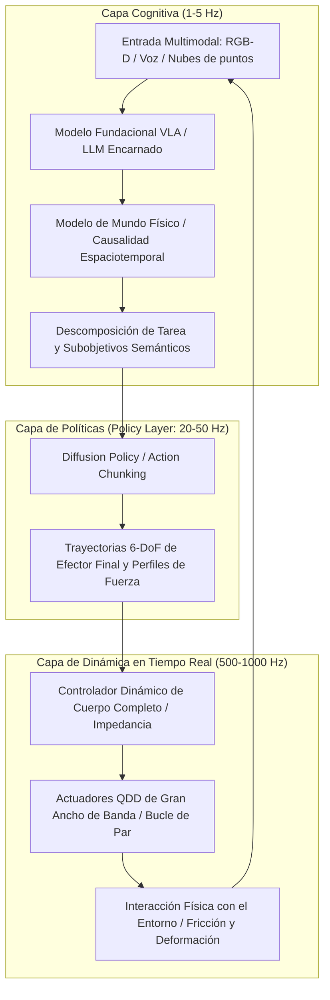

A principios de la década de 2020, los Grandes Modelos de Lenguaje (LLM) y los modelos de Visión-Lenguaje (VLM) demostraron un salto colosal en la cognición artificial dentro del dominio digital. Sin embargo, no importa cuán brillante sea una red neuronal deduciendo física cuántica, escribiendo sistemas operativos de nivel de producción o prediciendo mercados financieros globales: permanece completamente atrapada detrás de una pantalla plana de cristal. No puede acercar un vaso de agua para hidratar a un paciente anciano, no puede apretar una válvula atascada en una planta petroquímica, ni puede avanzar a través de los escombros de un terremoto para rescatar a un superviviente.

Para que la inteligencia artificial transforme genuinamente la economía material y la sociedad humana, debe adquirir presencia corpórea: debe alcanzar la **encarnación (Embodiment)**. Esto marca el nacimiento de la **IA Física (Physical AI)** y la **Inteligencia Encarnada**.

La IA Física no consiste en desplegar un modelo neuronal estándar en un microcontrolador. Representa una nueva disciplina de vanguardia: **la creación de sistemas autónomos capaces de percibir, razonar físicamente y manipular activamente el universo material bajo las leyes inexorables de la gravedad, la fricción, el momento, la mecánica de contacto y la dinámica de fluidos**.

---

## 1. La Paradoja de Moravec y el desafío fundacional de la IA Física

En la historia de la inteligencia artificial destaca una observación seminal: la **Paradoja de Moravec**. Hans Moravec, Marvin Minsky y sus colegas señalaron ya en la década de 1980 que es asombrosamente fácil lograr que una computadora alcance un rendimiento de nivel adulto en lógica formal, ajedrez o cálculo infinitesimal, pero resulta extraordinariamente complejo dotarla de las capacidades perceptivas, de locomoción o de destreza motriz de un bebé de un año.

Las razones subyacentes son:
1. **Cómputo biológico evolutivo**: El razonamiento abstracto tiene apenas unas decenas de miles de años de antigüedad. El sistema sensoriomotor, en cambio, se ha refinado a lo largo de cientos de millones de años de rigurosa selección natural, consumiendo la mayor parte de la capacidad de cómputo del cerebro biológico.
2. **Espacio físico continuo e irreversible**: Los entornos digitales son discretos y admiten operaciones reversibles (Undo). En el universo físico, el tiempo fluye de forma continua, la segunda ley de la termodinámica impone irreversibilidad y el contacto mecánico presenta fuertes no linealidades y restricciones no convexas.

La IA Física aborda directamente esta paradoja, transformando el "cerebro en una cubeta" en una entidad física capaz de interactuar armónicamente con las leyes del cosmos material.

---

## 2. Arquitectura de control jerárquico: De la cognición al control de impedancia en kHz

En los sistemas robóticos físicos, el bucle de control enfrenta una marcada disparidad de frecuencias: los modelos cognitivos de alto nivel requieren inferencias complejas que operan a baja frecuencia ($1 \sim 5\text{ Hz}$), mientras que el control de par motor y la respuesta dinámica al contacto deben cerrarse en milisegundos ($100 \sim 1000\text{ Hz}$) para evitar inestabilidades destructivas.

La IA Física moderna adopta una **arquitectura jerárquica desacoplada**:

Esta arquitectura estructurada garantiza:
- **Capa Cognitiva ($1 \sim 5\text{ Hz}$)**: Interpreta instrucciones complejas en lenguaje natural ("Lava con cuidado este vaso frágil y colócalo boca abajo en el escurridor").
- **Capa de Políticas ($20 \sim 50\text{ Hz}$)**: Genera bloques de acción continua (*Action Chunks*), suprimiendo la acumulación de retardos y desviaciones en bucle cerrado.
- **Capa en Tiempo Real ($500 \sim 1000\text{ Hz}$)**: Implementa control de impedancia de cuerpo completo (Whole-Body Impedance Control) y Funciones de Barrera de Control (CBF), garantizando adaptabilidad mecánica pasiva y protección contra colisiones.

---

## 3. Modelos VLA (Visión-Lenguaje-Acción) y Fundamentos Matemáticos de Diffusion Policy

### 1. Formulación matemática de los modelos VLA
A diferencia de los modelos de visión y lenguaje tradicionales que emiten tokens de texto:
$$y = f_{\text{VLM}}(I, T) \in \mathcal{V}^*$$
Un modelo **VLA (Vision-Language-Action)** proyecta de manera directa las observaciones hacia variables físicas continuas de actuación:
$$a_t = f_{\text{VLA}}(I_t, T, s_t) \in \mathbb{R}^D$$
donde el vector de acción describe incrementos espaciales del efector final en 6 grados de libertad y el estado de la pinza:
$$a_t = [\Delta x, \Delta y, \Delta z, \Delta \phi, \Delta \theta, \Delta \psi, g_{\text{gripper}}]^\top$$

Modelos pioneros como Google RT-2, OpenVLA y Physical Intelligence π0 ejemplifican cómo transferir la semántica de la web hacia el control físico motriz.

### 2. Formulación matemática de Diffusion Policy
El aprendizaje por imitación tradicional (Behavior Cloning) sucumbe habitualmente ante **distribuciones multimodales**. Al esquivar un obstáculo, desplazarse por la izquierda o por la derecha son ambas soluciones viables. La regresión con pérdida cuadrática (MSE) genera el promedio de ambas alternativas, provocando un impacto frontal directo.

La **Diffusion Policy** modela la síntesis de acciones como un proceso estocástico inverso de eliminación de ruido condicional:
Para un bloque de acciones futuras $A_t = [a_t, \dots, a_{t+K_a}]$ con observación $O_t$, la difusión directa agrega ruido gaussiano progresivo:
$$q(A^k | A^0) = \mathcal{N}\left(A^k; \sqrt{\bar{\alpha}_k} A^0, (1 - \bar{\alpha}_k)\mathbf{I}\right)$$

La red neuronal $\epsilon_\theta$ se optimiza para predecir el ruido inyectado:
$$\mathcal{L}(\theta) = \mathbb{E}_{k, A^0, \epsilon \sim \mathcal{N}(0, \mathbf{I})}\left[\|\epsilon - \epsilon_\theta(\sqrt{\bar{\alpha}_k}A^0 + \sqrt{1 - \bar{\alpha}_k}\epsilon, k, O_t)\|^2\right]$$

Esta formulación dota al robot de una destreza sin precedentes para manipular objetos altamente deformables (conexión de cables, manipulación de textiles y ensamblaje delicado).

---

## 4. Transferencia Sim-to-Real y Modelos de Mundo Generativos

Debido al elevadísimo costo y al riesgo de roturas en el mundo real, la IA Física entrena predominantemente en entornos de simulación física masivamente paralelos en GPU (NVIDIA Isaac Sim, MuJoCo, Genesis).

### 1. Aleatorización de Dominio (Domain Randomization)
Para cruzar la brecha entre simulación y realidad (*Sim-to-Real Gap*), se introduce variabilidad estocástica en las ecuaciones dinámicas:
$$M(q, \xi)\ddot{q} + C(q, \dot{q}, \xi)\dot{q} + g(q, \xi) = \tau + J^\top(q) F_{\text{ext}}$$
Parámetros como el coeficiente de rozamiento $\mu$, masas de eslabones, holguras de transmisión y latencias de comunicación se muestrean aleatoriamente, forzando a la red neuronal a converger hacia una política invariante y robusta.

### 2. Modelos Generativos del Mundo Físico
Al predecir el estado latente futuro ante una acción dada:
$$\hat{S}_{t+1} \sim \mathcal{P}_{\text{world}}(S_{t+1} | S_t, a_t)$$
El robot puede simular mentalmente las consecuencias dinámicas de sus movimientos, optimizando la trayectoria sin arriesgar la integridad física del equipo.

---

## 5. Ingeniería de Hardware: Actuadores QDD y Percepción Visotáctil

El software más avanzado no puede superar los límites mecánicos del hardware. En robótica moderna se han producido avances cruciales:

1. **Actuadores Cuasi-Directos (QDD: Quasi-Direct Drive)**:
   A diferencia de los reductores industriales rígidos (1:100), los humanoides modernos emplean motores síncronos sin escobillas de alto par acoplados a engranajes planetarios de baja relación (1:6 a 1:10). Los actuadores QDD ofrecen una sobresaliente **retroconducibilidad (Back-drivability)** y elasticidad mecánica pasiva, absorbiendo impactos imprevistos.

2. **Sensores Visotáctiles (GelSight / Piel Óptica)**:
   Mediante cámaras diminutas que observan la deformación elástica de una membrana de silicona, se reconstruye por estereorradiometría el campo tensorial de presiones de contacto $\mathbf{T}(x, y)$ a escala micrométrica, permitiendo regular el deslizamiento inminente.

---

## 6. Garantías Formales de Seguridad: Funciones de Barrera de Control (CBF)

Ninguna red neuronal de caja negra debe accionar actuadores de alta potencia sin salvaguardas formales.

Las **Funciones de Barrera de Control (CBF)** proporcionan un filtro de seguridad determinista en tiempo real. Para un conjunto seguro $\mathcal{C} = \{x \mid h(x) \ge 0\}$, la acción propuesta $u_{\text{nom}}$ se corrige mediante optimización cuadrática (QP):
$$\min_u \frac{1}{2}\|u - u_{\text{nom}}\|^2 \quad \text{s.t.} \quad L_f h(x) + L_g h(x)u + \alpha(h(x)) \ge 0$$
Esto garantiza formalmente, según la teoría de estabilidad de Lyapunov, que el robot jamás violará sus límites cinemáticos ni generará fuerzas lesivas.

### Conclusión
La IA Física simboliza la fusión definitiva entre el razonamiento computacional y las leyes del mundo material. Los robots humanoides generales constituirán la infraestructura esencial para transformar la industria manufacturera, la logística, la atención médica y la exploración del siglo XXI.
