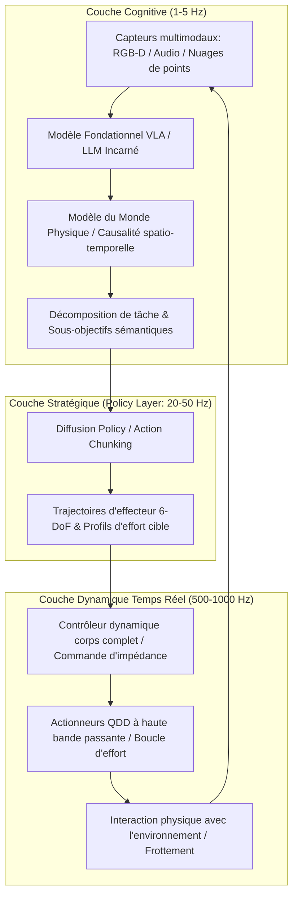

Au début des années 2020, les grands modèles de langage (LLM) et les modèles vision-langage (VLM) ont accompli un bond prodigieux au sein de la sphère numérique. Pourtant, quelle que soit l'aisance avec laquelle un réseau de neurones disserte sur la physique quantique ou conçoit des systèmes d'exploitation, il demeure impuissant derrière son écran plat. Il ne peut tendre un verre d'eau à un patient, réparer une vanne haute pression dans une usine chimique, ni dégager un survivant des décombres d'un séisme.

Pour que l'intelligence artificielle s'intègre pleinement à la réalité socio-économique humaine, elle doit acquérir une présence matérielle : une **incarnation (Embodiment)**. C'est l'avènement de l'**IA Physique (Physical AI)** et de l'**Intelligence Incarnée**.

L'IA Physique ne se résume pas au simple déploiement d'un réseau de neurones sur un microcontrôleur. Il s'agit d'une nouvelle science de pointe : **la création d'agents autonomes capables de percevoir, raisonner et agir sur l'environnement physique sous les contraintes impitoyables de la gravité, du frottement, de l'inertie et de la dynamique des contacts**.

---

## 1. Le Paradoxe de Moravec et la problématique de l'IA Physique

L'histoire de l'intelligence artificielle est jalonnée par une énigme majeure : **le paradoxe de Moravec**. Dès les années 1980, Hans Moravec, Marvin Minsky et leurs pairs ont mis en lumière ce phénomène frappant : il est aisé d'égaler un adulte humain aux échecs ou en analyse mathématique, mais extrêmement ardu de reproduire la motricité, la vision spatiale ou la préhension tactile d'un nourrisson d'un an.

Ce paradoxe s'explique par deux facteurs fondamentaux :
1. **Le coût computationnel de l'évolution** : Le raisonnement abstrait n'a émergé qu'il y a quelques dizaines de milliers d'années. En revanche, le système sensorimoteur s'est forgé au cours de centaines de millions d'années de sélection naturelle impitoyable, absorbant l'essentiel de la capacité de calcul biologique.
2. **La continuité et l'irréversibilité physique** : L'univers numérique est discret et permet l'annulation d'actions (Undo). Le monde physique s'écoule de manière continue, le second principe de la thermodynamique le rend irréversible, et les interactions de contact présentent de sévères non-linéarités non-convexes.

L'IA Physique s'attaque directement à ce paradoxe en connectant le "cerveau dans la cuve" à une enveloppe biomécanique capable d'épouser les lois de la nature.

---

## 2. Architecture système hiérarchique : De la cognition à la commande d'impédance en kHz

En robotique physique, la boucle de contrôle se heurte à une disparité critique de bande passante : les modèles cognitifs de haut niveau opèrent à basse fréquence ($1 \sim 5\text{ Hz}$), tandis que la commande en couple des moteurs et l'adaptation aux chocs nécessitent une réponse quasi instantanée ($100 \sim 1000\text{ Hz}$).

L'IA Physique moderne adopte une **architecture de contrôle hiérarchique et découplée** :

Cette structure garantit :
- **Couche Cognitive ($1 \sim 5\text{ Hz}$)** : Compréhension des instructions humaines en langage naturel ("Nettoie délicatement ce verre et place-le à l'envers sur l'égouttoir").
- **Couche Stratégique ($20 \sim 50\text{ Hz}$)** : Génération de segments d'action continus (*Action Chunks*) évitant l'accumulation de dérives d'inférence.
- **Couche Temps Réel ($500 \sim 1000\text{ Hz}$)** : Commande d'impédance globale (Whole-Body Impedance Control) et fonctions barrières de contrôle (CBF) garantissant la conformité mécanique aux chocs imprévus.

---

## 3. Modèles VLA (Vision-Langage-Action) et fondements des Diffusion Policies

### 1. Formalisation mathématique du VLA
Tandis qu'un modèle vision-langage traditionnel produit des tokens textuels :
$$y = f_{\text{VLM}}(I, T) \in \mathcal{V}^*$$
Un modèle **VLA (Vision-Language-Action)** prédit directement des grandeurs physiques de contrôle :
$$a_t = f_{\text{VLA}}(I_t, T, s_t) \in \mathbb{R}^D$$
où le vecteur d'action comprend généralement les déplacements relatifs à 6 degrés de liberté et l'état de préhension :
$$a_t = [\Delta x, \Delta y, \Delta z, \Delta \phi, \Delta \theta, \Delta \psi, g_{\text{gripper}}]^\top$$

Des modèles pionniers tels que Google RT-2, OpenVLA et Physical Intelligence π0 illustrent cette capacité d'ancrage sémantique dans l'espace moteur.

### 2. Principes mathématiques de la Diffusion Policy
En apprentissage par imitation, la régression quadratique classique (MSE) échoue face aux **distributions multimodales**. Face à un obstacle, contourner par la gauche ou la droite sont deux choix optimaux ; une régression naïve calcule la moyenne arithmétique, menant à une collision frontale directe.

La **Diffusion Policy** modélise la génération d'actions comme un processus stochastique inverse de débruitage conditionnel :
Pour un horizon d'actions $A_t = [a_t, \dots, a_{t+K_a}]$ et une observation $O_t$, le processus direct injecte du bruit gaussien :
$$q(A^k | A^0) = \mathcal{N}\left(A^k; \sqrt{\bar{\alpha}_k} A^0, (1 - \bar{\alpha}_k)\mathbf{I}\right)$$

Le réseau de neurones $\epsilon_\theta$ apprend à prédire ce bruit :
$$\mathcal{L}(\theta) = \mathbb{E}_{k, A^0, \epsilon \sim \mathcal{N}(0, \mathbf{I})}\left[\|\epsilon - \epsilon_\theta(\sqrt{\bar{\alpha}_k}A^0 + \sqrt{1 - \bar{\alpha}_k}\epsilon, k, O_t)\|^2\right]$$

Cette modélisation procure aux robots une dextérité sans précédent pour les manipulations hautement déformables (insertion de câbles, pliage de textile).

---

## 4. Transfert Sim-to-Real et Modèles du Monde Génératifs

Face à la rareté et au coût prohibitif des données réelles, l'IA Physique s'appuie massivement sur des simulateurs physiques hautement parallélisés sur GPU (NVIDIA Isaac Sim, MuJoCo, Genesis).

### 1. Randomisation de Domaine (Domain Randomization)
Pour combler le fossé de réalité (*Reality Gap*), des incertitudes dynamiques sont injectées dans les équations du mouvement :
$$M(q, \xi)\ddot{q} + C(q, \dot{q}, \xi)\dot{q} + g(q, \xi) = \tau + J^\top(q) F_{\text{ext}}$$
Les paramètres physiques $\xi \in \Xi$ (frottements $\mu$, masses des liaisons, latences de communication) sont échantillonnés aléatoirement, contraignant la politique neuronale à adopter une robustesse structurelle absolue.

### 2. Modèles du Monde Physiques Génératifs
En prédisant l'état physique futur :
$$\hat{S}_{t+1} \sim \mathcal{P}_{\text{world}}(S_{t+1} | S_t, a_t)$$
Le modèle permet à l'agent d'explorer et d'optimiser mentalement ses trajectoires dans un espace d'imagination simulé, éliminant les risques de destruction matérielle.

---

## 5. Ingénierie Mécatronique : Moteurs QDD et Vision-Tactile

L'IA ne peut dépasser les limites physiques de son corps. La mécatronique moderne a connu des ruptures technologiques majeures :

1. **Actionneurs Quasi-Direct-Drive (QDD)** :
   Abandonnant les réducteurs industriels à fort rapport (1:100), les humanoïdes modernes emploient des moteurs brushless à fort couple couplés à de faibles rapports d'engrenage (1:6 à 1:10). Les moteurs QDD offrent une **réversibilité mécanique (Back-drivability)** exemplaire, conférant une conformité passive face aux chocs.

2. **Capteurs Visio-Tactiles (GelSight)** :
   Une caméra miniature observe la déformation d'un élastomère translucide lors du contact. Par stéréo-photométrie, le capteur reconstruit le tenseur de pression de contact $\mathbf{T}(x, y)$ à l'échelle micrométrique, indispensable pour réguler le glissement naissant.

---

## 6. Garanties Formelles de Sécurité : Fonctions Barrières de Contrôle (CBF)

Les réseaux de neurones ne doivent pas commander directement des actionneurs à haute puissance sans garde-fous formels.

Les **Fonctions Barrières de Contrôle (CBF)** constituent un filtre déterministe temps réel. Pour un ensemble sécurisé $\mathcal{C} = \{x \mid h(x) \ge 0\}$, l'action nominale $u_{\text{nom}}$ est projetée via un problème d'optimisation quadratique (QP) :
$$\min_u \frac{1}{2}\|u - u_{\text{nom}}\|^2 \quad \text{s.t.} \quad L_f h(x) + L_g h(x)u + \alpha(h(x)) \ge 0$$
Ceci garantit mathématiquement le respect des limites physiques et cinématiques du robot, en vertu de la stabilité de Lyapunov.

### Conclusion
L'IA Physique représente la convergence ultime de l'intelligence computationnelle et de la réalité matérielle. Les robots humanoïdes généralistes incarnent le socle de la prochaine révolution industrielle, médicale et logistique du XXIe siècle.
