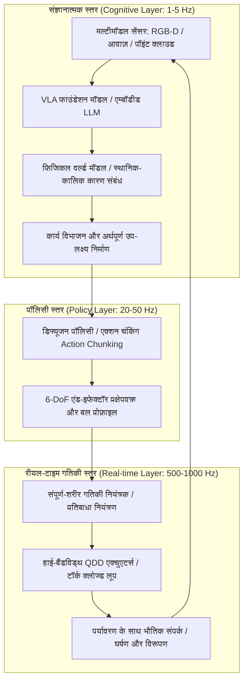

2020 के दशक की शुरुआत में, लार्ज लैंग्वेज मॉडल (LLM) और विज़न-लैंग्वेज मॉडल (VLM) ने डिजिटल आभासी दुनिया में कृत्रिम बुद्धिमत्ता की अभूतपूर्व क्षमता का प्रदर्शन किया। लेकिन चाहे कोई न्यूरल नेटवर्क क्वांटम भौतिकी के जटिल समीकरण कितनी भी सहजता से हल कर ले या ऑपरेटिंग सिस्टम का कोड लिख दे, वह कंप्यूटर की दो-आयामी स्क्रीन के पीछे कैद रहता है। वह किसी बीमार बुजुर्ग को पानी का गिलास नहीं पकड़ा सकता, तेल रिफाइनरी के जाम पीतल के वाल्व को नहीं घुमा सकता, और न ही भूकंप के मलबे से किसी को सुरक्षित निकाल सकता है।

कृत्रिम बुद्धिमत्ता को वास्तविक भौतिक दुनिया और मानव समाज का अभिन्न अंग बनाने के लिए उसे भौतिक शरीर की आवश्यकता है—इसे **एम्बॉडीड इंटेलिजेंस (Embodied Intelligence)** और **फिजिकल एआई (Physical AI)** कहा जाता है।

फिजिकल एआई केवल किसी माइक्रोकंट्रोलर में न्यूरल नेटवर्क को लोड करना नहीं है। यह एक नया इंजीनियरिंग अनुशासन है: **गुरुत्वाकर्षण, घर्षण, संवेग और संपर्क यांत्रिकी के अटल नियमों के तहत वास्तविक भौतिक वातावरण को स्वायत्त रूप से समझने, निर्णय लेने और शारीरिक क्रियाएं करने वाली बुद्धि का निर्माण करना**।

---

## 1. मोरावेक का विरोधाभास और फिजिकल एआई की मूल चुनौती

आर्टिफिशियल इंटेलिजेंस के इतिहास में एक प्रसिद्ध अवलोकन है जिसे **मोरावेक का विरोधाभास (Moravec's Paradox)** कहा जाता है। हैंस मोरावेक और मार्विन मिन्स्की जैसे शोधकर्ताओं ने 1980 के दशक में पाया कि कंप्यूटर को शतरंज, तर्कशास्त्र या कैलकुलस में वयस्कों के स्तर पर पहुंचाना आसान है, लेकिन उसे एक साल के बच्चे की तरह देखने, चलने, संतुलन बनाने या उंगलियों से चीजें पकड़ने की क्षमता देना बेहद कठिन है।

इसके प्रमुख कारण हैं:
1. **जैविक विकास की कंप्यूटेशनल लागत**: मानव का अमूर्त प्रतीकात्मक तर्क केवल कुछ दसियों हज़ार साल पुराना है। इसके विपरीत, संवेदी-मोटर प्रणाली (Sensorimotor System) करोड़ों वर्षों के प्राकृतिक चयन के दौरान विकसित हुई है, जिसने मस्तिष्क की अधिकांश जैविक क्षमता का उपभोग किया है।
2. **भौतिक अंतरिक्ष की निरंतरता और अपरिवर्तनीयता**: डिजिटल दुनिया असतत (Discrete) है और उसमें गलतियां पूर्ववत (Undo) की जा सकती हैं। भौतिक ब्रह्मांड में समय निरंतर बहता है, ऊष्मागतिकी का दूसरा नियम अपरिवर्तनीय है, और यांत्रिक संपर्क गैर-रेखीय (Non-linear) होते हैं।

फिजिकल एआई का उद्देश्य मोरावेक के विरोधाभास को तोड़कर डिजिटल बुद्धि को भौतिक रूप से सक्षम बनाना है।

---

## 2. पदानुक्रमित नियंत्रण आर्किटेक्चर: संज्ञानात्मक तर्क से kHz प्रतिबाधा नियंत्रण तक

भौतिक रोबोटिक्स में नियंत्रण प्रणाली को गंभीर बैंडविड्थ असमानता का सामना करना पड़ता है: उच्च-स्तरीय संज्ञानात्मक मॉडल कम आवृत्ति ($1 \sim 5\text{ Hz}$) पर काम करते हैं, जबकि जोड़ों के टॉर्क और संपर्क बलों का नियंत्रण मिलीसेकंड ($100 \sim 1000\text{ Hz}$) में होना अनिवार्य है, अन्यथा रोबोट गिर सकता है या क्षतिग्रस्त हो सकता है।

आधुनिक फिजिकल एआई **पदानुक्रमित नियंत्रण आर्किटेक्चर** का उपयोग करता है:

यह आर्किटेक्चर सुनिश्चित करता है:
- **संज्ञानात्मक स्तर ($1 \sim 5\text{ Hz}$)**: प्राकृतिक भाषा के जटिल निर्देशों को समझना ("इस कांच के कप को सावधानी से धोएं और सुखाने के लिए उल्टा रखें")।
- **पॉलिसी स्तर ($20 \sim 50\text{ Hz}$)**: क्रियाओं के निरंतर क्रम (*Action Chunks*) उत्पन्न करना, जिससे संचित विलंबता को रोका जा सके।
- **रीयल-टाइम स्तर ($500 \sim 1000\text{ Hz}$)**: संपूर्ण-शरीर प्रतिबाधा नियंत्रण (Whole-Body Impedance Control) और कंट्रोल बैरियर फ़ंक्शंस (CBF) द्वारा झटकों से सुरक्षा और लचीलापन सुनिश्चित करना।

---

## 3. VLA (विज़न-लैंग्वेज-एक्शन) मॉडल और डिफ्यूजन पॉलिसी के गणितीय सिद्धांत

### 1. VLA मॉडल का गणितीय निरूपण
पारंपरिक विज़न-लैंग्वेज मॉडल केवल टेक्स्ट टोकन उत्पन्न करते हैं:
$$y = f_{\text{VLM}}(I, T) \in \mathcal{V}^*$$
जबकि **VLA (Vision-Language-Action) मॉडल** संवेदी इनपुट को सीधे भौतिक नियंत्रण क्रियाओं में बदलता है:
$$a_t = f_{\text{VLA}}(I_t, T, s_t) \in \mathbb{R}^D$$
जहां क्रिया वेक्टर में 6-DoF विस्थापन और ग्रिपर स्थिति शामिल होती है:
$$a_t = [\Delta x, \Delta y, \Delta z, \Delta \phi, \Delta \theta, \Delta \psi, g_{\text{gripper}}]^\top$$

Google RT-2, OpenVLA और Physical Intelligence π0 जैसे मॉडल यह साबित करते हैं कि इंटरनेट-स्तरीय ज्ञान को मोटर नियंत्रण में ढाला जा सकता है।

### 2. डिफ्यूजन पॉलिसी (Diffusion Policy) का गणित
पारंपरिक इमिटेशन लर्निंग **मल्टीमॉडल वितरण (Multimodal Distributions)** में विफल हो जाती है। किसी बाधा से बचने के लिए बाएं या दाएं मुड़ना दोनों सही समाधान हैं; साधारण MSE रिग्रेशन दोनों का औसत निकालकर सीधे बाधा से टकरा जाता है।

**डिफ्यूजन पॉलिसी** क्रिया उत्पादन को रिवर्स स्टोकेस्टिक डिनॉइज़िंग प्रक्रिया के रूप में तैयार करती है:
भविष्य के एक्शन चंक $A_t = [a_t, \dots, a_{t+K_a}]$ के लिए फॉरवर्ड डिफ्यूजन गॉसियन नॉइज़ जोड़ता है:
$$q(A^k | A^0) = \mathcal{N}\left(A^k; \sqrt{\bar{\alpha}_k} A^0, (1 - \bar{\alpha}_k)\mathbf{I}\right)$$

न्यूरल नेटवर्क $\epsilon_\theta$ उस नॉइज़ का अनुमान लगाना सीखता है:
$$\mathcal{L}(\theta) = \mathbb{E}_{k, A^0, \epsilon \sim \mathcal{N}(0, \mathbf{I})}\left[\|\epsilon - \epsilon_\theta(\sqrt{\bar{\alpha}_k}A^0 + \sqrt{1 - \bar{\alpha}_k}\epsilon, k, O_t)\|^2\right]$$

यह तकनीक रोबोट को लचीली वस्तुओं (तार जोड़ना, कपड़े मोड़ना, नाजुक असेंबली) के संचालन में अभूतपूर्व निपुणता प्रदान करती है।

---

## 4. Sim-to-Real ट्रांसफर और जेनरेटिव वर्ल्ड मॉडल

वास्तविक दुनिया में डेटा एकत्र करना महंगा और जोखिम भरा है। इसलिए फिजिकल एआई जीपीयू-आधारित अत्यधिक समानांतर सिमुलेटर (NVIDIA Isaac Sim, MuJoCo, Genesis) पर निर्भर करता है।

### 1. डोमेन रैंडमाइज़ेशन (Domain Randomization)
सिमुलेशन और वास्तविकता के अंतर (*Sim-to-Real Gap*) को पाटने के लिए गतिज समीकरणों में अनिश्चितता जोड़ी जाती है:
$$M(q, \xi)\ddot{q} + C(q, \dot{q}, \xi)\dot{q} + g(q, \xi) = \tau + J^\top(q) F_{\text{ext}}$$
घर्षण गुणांक $\mu$, वजन और सिग्नल विलंबता को यादृच्छिक रूप से बदलकर न्यूरल नेटवर्क को अत्यधिक मजबूत बनाया जाता है।

### 2. जेनरेटिव फिजिकल वर्ल्ड मॉडल
क्रियाओं के आधार पर पर्यावरण की अगली स्थिति की भविष्यवाणी करके:
$$\hat{S}_{t+1} \sim \mathcal{P}_{\text{world}}(S_{t+1} | S_t, a_t)$$
रोबोट वास्तविक दुनिया में जोखिम उठाए बिना अपने न्यूरल सिमुलेशन में क्रियाओं के परिणामों का मूल्यांकन कर सकता है।

---

## 5. मेकाट्रॉनिक्स इंजीनियरिंग: QDD एक्चुएटर्स और स्पर्श संवेदन

सॉफ्टवेयर की क्षमताएं हमेशा हार्डवेयर की भौतिक सीमाओं से बंधी होती हैं:

1. **क्वासी-डायरेक्ट ड्राइव (QDD) एक्चुएटर्स**:
   पारंपरिक भारी रिडक्शन गियर (1:100) के बजाय आधुनिक ह्यूमनॉइड रोबोट कम रिडक्शन (1:6 से 1:10) वाले हाई-टॉर्क ब्रशलेस मोटर्स का उपयोग करते हैं। QDD एक्चुएटर्स उत्कृष्ट **बैक-ड्राइवेबिलिटी (Back-drivability)** और झटके अवशोषित करने की क्षमता प्रदान करते हैं।

2. **विज़िओ-टैक्टाइल सेंसर (GelSight)**:
   आंतरिक कैमरे पारदर्शी सिलिकॉन झिल्ली के विरूपण को रिकॉर्ड करते हैं और माइक्रोन सटीकता पर संपर्क दबाव टेंसर $\mathbf{T}(x, y)$ का पुनर्निर्माण करते हैं, जिससे सूक्ष्म फिसलन का तुरंत पता चलता है।

---

## 6. औपचारिक सुरक्षा गारंटी: कंट्रोल बैरियर फ़ंक्शंस (CBF)

गहरे न्यूरल नेटवर्क को बिना गणितीय सुरक्षा फिल्टर के सीधे उच्च-शक्ति वाले मोटर्स को नियंत्रित करने की अनुमति नहीं दी जा सकती।

**कंट्रोल बैरियर फ़ंक्शंस (CBF)** रीयल-टाइम सुरक्षा फिल्टर के रूप में कार्य करते हैं। सुरक्षित सेट $\mathcal{C} = \{x \mid h(x) \ge 0\}$ के लिए क्रिया $u_{\text{nom}}$ को क्वाड्रेटिक प्रोग्रामिंग (QP) द्वारा संशोधित किया जाता है:
$$\min_u \frac{1}{2}\|u - u_{\text{nom}}\|^2 \quad \text{s.t.} \quad L_f h(x) + L_g h(x)u + \alpha(h(x)) \ge 0$$
यह सुनिश्चित करता है कि रोबोट कभी भी अपनी भौतिक सुरक्षा सीमाओं का उल्लंघन न करे।

### निष्कर्ष
फिजिकल एआई कंप्यूटेशनल इंटेलिजेंस और भौतिक दुनिया के नियमों का अंतिम संगम है। सामान्य उद्देश्य वाले ह्यूमनॉइड रोबोट 21वीं सदी के विनिर्माण, स्वास्थ्य सेवा और पर्यावरण अन्वेषण की आधारशिला बनेंगे।
