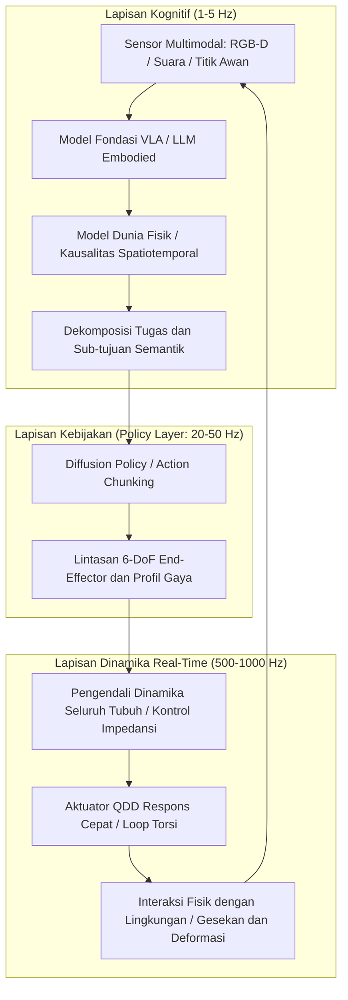

Pada awal dekade 2020-an, kemunculan Large Language Models (LLM) dan Vision-Language Models (VLM) menunjukkan lompatan spektakuler dalam kemampuan kognitif digital. Namun, betapapun canggihnya jaringan saraf tiruan dalam memecahkan persamaan fisika kuantum atau merancang sistem operasi, ia tetap terkurung di balik layar kaca dua dimensi. Ia tidak dapat memberikan segelas air hangat kepada pasien lanjut usia, tidak dapat mengencangkan katup kuningan yang macet di kilang minyak, dan tidak dapat menembus reruntuhan gempa untuk menyelamatkan korban.

Agar kecerdasan buatan dapat mengubah ekonomi material dan tatanan masyarakat manusia secara nyata, ia harus memiliki wujud fisik di dunia nyata: ia memerlukan **perwujudan (Embodiment)**. Inilah yang melahirkan era **Physical AI** dan **Embodied Intelligence**.

Physical AI bukan sekadar memasang model bahasa terlatih ke dalam mikrokontroler. Ini adalah disiplin rekayasa baru: **menciptakan sistem otonom yang mampu mempersepsikan, menalar secara fisik, dan berinteraksi aktif dengan alam semesta di bawah hukum gravitasi, gesekan, momentum, dan mekanika kontak yang tak terbantahkan**.

---

## 1. Paradoks Moravec dan Tantangan Mendasar Physical AI

Dalam sejarah kecerdasan buatan, terdapat sebuah pengamatan penting yang dikenal sebagai **Paradoks Moravec**. Hans Moravec, Marvin Minsky, dan para pelopor lainnya pada tahun 1980-an mengemukakan bahwa membuat komputer mencapai kecakapan setingkat orang dewasa dalam logika simbolik, catur, atau kalkulus adalah hal yang relatif mudah, namun memberikan kecakapan motorik, penglihatan spasial, dan manipulasi fisik seperti bayi berusia satu tahun adalah hal yang luar biasa sulit.

Penyebab fundamental dari fenomena ini adalah:
1. **Beban Komputasi Evolusioner**: Penalaran simbolik manusia baru berkembang puluhan ribu tahun yang lalu. Sebaliknya, sistem sensori-motorik telah disempurnakan melalui seleksi alam selama ratusan juta tahun, menyerap sebagian besar kapasitas komputasi biologis.
2. **Kontinuitas dan Irreversibilitas Dunia Fisik**: Ruang digital bersifat diskrit dan memiliki fungsi pembatalan (Undo). Di alam semesta fisik, waktu mengalir tanpa henti, hukum kedua termodinamika tidak dapat dibalik, dan kontak mekanis menghasilkan dinamika non-linear yang sangat rumit.

Physical AI bertujuan mengatasi paradoks ini dengan mengubah 'otak di dalam tabung' menjadi agen berwujud fisik yang mampu berinteraksi langsung dengan hukum alam.

---

## 2. Arsitektur Kontrol Hierarkis: Dari Kognisi ke Kontrol Impedansi kHz

Dalam sistem robot fisik, loop kontrol menghadapi kesenjangan frekuensi yang drastis: model kognitif tingkat tinggi beroperasi pada frekuensi rendah ($1 \sim 5\text{ Hz}$), sedangkan kontrol torsi motorik dan kontak dinamis harus diselesaikan dalam hitungan milidetik ($100 \sim 1000\text{ Hz}$) untuk mencegah kegagalan mekanis.

Physical AI modern mengadopsi **arsitektur kontrol terpisah bertingkat**:

Arsitektur ini memastikan:
- **Lapisan Kognitif ($1 \sim 5\text{ Hz}$)**: Memahami instruksi bahasa alami yang kompleks ("Cuci gelas kaca ini dengan hati-hati dan letakkan terbalik di rak pengering").
- **Lapisan Kebijakan ($20 \sim 50\text{ Hz}$)**: Menghasilkan potongan lintasan tindakan bersambung (*Action Chunks*), mengurangi latensi akumulatif.
- **Lapisan Real-Time ($500 \sim 1000\text{ Hz}$)**: Menggunakan kontrol impedansi seluruh tubuh (Whole-Body Impedance Control) dan Control Barrier Functions (CBF) untuk menjamin elastisitas mekanis pasif dan keselamatan benturan.

---

## 3. Model VLA (Vision-Language-Action) dan Matematika Diffusion Policy

### 1. Formulasi Matematis Model VLA
Berbeda dengan model visi-bahasa konvensional yang menghasilkan token kata:
$$y = f_{\text{VLM}}(I, T) \in \mathcal{V}^*$$
Model **VLA (Vision-Language-Action)** memetakan persepsi multimodal secara langsung menjadi perintah kendali fisik:
$$a_t = f_{\text{VLA}}(I_t, T, s_t) \in \mathbb{R}^D$$
di mana vektor aksi mencakup perubahan pose 6 derajat kebebasan dan status gripper:
$$a_t = [\Delta x, \Delta y, \Delta z, \Delta \phi, \Delta \theta, \Delta \psi, g_{\text{gripper}}]^\top$$

Model terdepan seperti Google RT-2, OpenVLA, dan Physical Intelligence π0 memperlihatkan integrasi sukses antara wawasan semantik global dan tindakan motorik terperinci.

### 2. Formulasi Matematis Diffusion Policy
Pembelajaran imitasi tradisional kerap gagal saat menghadapi **distribusi multimodal**. Ketika menghindari rintangan, berbelok ke kiri atau ke kanan sama-sama merupakan pilihan valid; regresi berbasis MSE akan mengambil nilai tengah keduanya, berujung pada tabrakan frontal.

**Diffusion Policy** memodelkan pembuatan aksi sebagai proses stokastik penghilangan derau terbalik (reverse denoising):
Untuk lintasan aksi masa depan $A_t = [a_t, \dots, a_{t+K_a}]$, proses difusi maju menambahkan derau gaussian:
$$q(A^k | A^0) = \mathcal{N}\left(A^k; \sqrt{\bar{\alpha}_k} A^0, (1 - \bar{\alpha}_k)\mathbf{I}\right)$$

Jaringan saraf $\epsilon_\theta$ dilatih untuk memprediksi derau tersebut:
$$\mathcal{L}(\theta) = \mathbb{E}_{k, A^0, \epsilon \sim \mathcal{N}(0, \mathbf{I})}\left[\|\epsilon - \epsilon_\theta(\sqrt{\bar{\alpha}_k}A^0 + \sqrt{1 - \bar{\alpha}_k}\epsilon, k, O_t)\|^2\right]$$

Pendekatan ini memberikan kelenturan manipulasi yang luar biasa pada benda-benda fleksibel (memasang kabel, melipat pakaian, perakitan presisi).

---

## 4. Transfer Sim-to-Real dan Generative World Models

Pengumpulan data langsung di dunia nyata sangat mahal dan berisiko merusak perangkat keras. Oleh karena itu, Physical AI sangat bergantung pada simulator fisika paralel bertenaga GPU (NVIDIA Isaac Sim, MuJoCo, Genesis).

### 1. Domain Randomization
Untuk menjembatani jurang antara simulasi dan dunia nyata (*Sim-to-Real Gap*), parameter ketidakpastian disuntikkan ke dalam persamaan dinamika:
$$M(q, \xi)\ddot{q} + C(q, \dot{q}, \xi)\dot{q} + g(q, \xi) = \tau + J^\top(q) F_{\text{ext}}$$
Koefisien gesekan $\mu$, distribusi massa link, dan latensi sinyal divariasikan secara acak, memaksa kebijakan saraf menghasilkan kendali yang kokoh terhadap gangguan tak terduga.

### 2. Generative Physical World Models
Dengan memprediksi keadaan lingkungan berikutnya:
$$\hat{S}_{t+1} \sim \mathcal{P}_{\text{world}}(S_{t+1} | S_t, a_t)$$
Robot dapat mensimulasikan dampak mekanis di dalam lingkungan imajinasi saraf sebelum bertindak secara nyata.

---

## 5. Rekayasa Perangkat Keras: Aktuator QDD dan Sensor Taktil

Kemampuan perangkat lunak selalu dibatasi oleh batas fisik perangkat keras:

1. **Aktuator Quasi-Direct Drive (QDD)**:
   Berbeda dengan robot industri yang kaku dengan rasio reduksi tinggi (1:100), robot humanoid modern memakai motor BLDC torsi tinggi dengan reduksi rendah (1:6 hingga 1:10). Desain QDD menawarkan **kemampuan penggerak balik (Back-drivability)** dan elastisitas pasif yang luar biasa.

2. **Sensor Visuotaktil (GelSight)**:
   Kamera internal menangkap deformasi membran elastomer transparan, merekonstruksi tensor tekanan kontak $\mathbf{T}(x, y)$ pada resolusi mikrometer untuk mendeteksi slip awal.

---

## 6. Jaminan Keamanan Formal: Control Barrier Functions (CBF)

Jaringan saraf tidak boleh menggerakkan aktuator bertenaga tinggi tanpa filter keamanan matematis.

**Control Barrier Functions (CBF)** berfungsi sebagai penyaring deterministik waktu nyata. Untuk ruang aman $\mathcal{C} = \{x \mid h(x) \ge 0\}$, aksi nominal $u_{\text{nom}}$ disesuaikan melalui Quadratic Programming (QP):
$$\min_u \frac{1}{2}\|u - u_{\text{nom}}\|^2 \quad \text{s.t.} \quad L_f h(x) + L_g h(x)u + \alpha(h(x)) \ge 0$$
Hal ini memberikan jaminan matematis berdasarkan teori stabilitas Lyapunov bahwa robot tidak akan melanggar batas keselamatan mekanis.

### Kesimpulan
Physical AI memadukan kecerdasan digital dengan realitas mekanika fisik. Robot humanoid serbaguna akan menjadi fondasi peradaban baru dalam manufaktur, layanan kesehatan, dan eksplorasi lingkungan ekstrem di abad ke-21.
