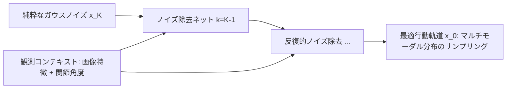
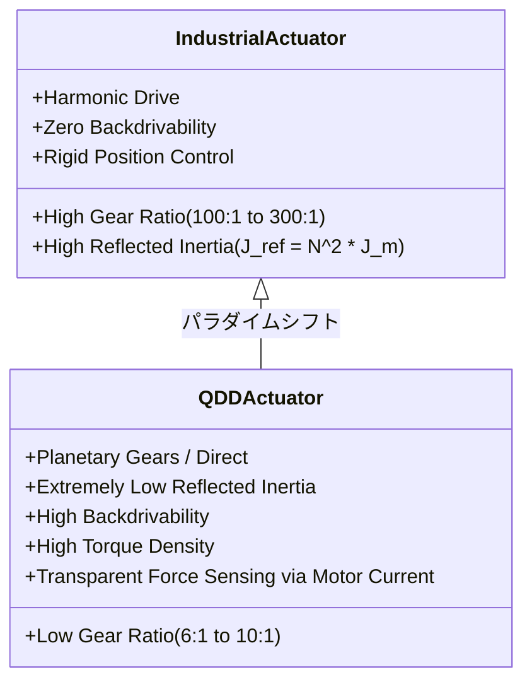
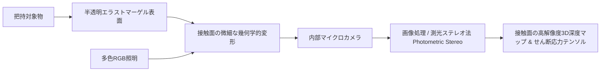
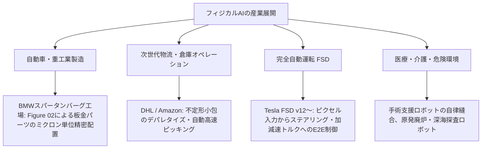

2020年代前半、大規模言語モデル（LLM）とマルチモーダルAI（VLM）は、テキスト、コード、画像、動画といった「情報空間（サイバー空間）」における知能の爆発的進化を証明しました。しかし、どれほど高度な知性を持つモデルであっても、ディスプレイの向こう側から現実世界のコップ一杯の水を運ぶことも、配管のバルブを締めることも、倒壊現場で瓦礫を掻き分けることもできません。知能が真に人間社会と物理的に交わり、実世界の課題を解決するためには、**「肉体（身体性：Embodiment）」**の獲得が不可避となります。

いま、AI研究とロボティクスの最前線で爆発的なパラダイムシフトが進行しています。それが**「フィジカルAI（Physical AI / 身体性知能：Embodied AI）」**です。

フィジカルAIとは、単なる「ロボットにAIを載せる」という従来の概念を根底から覆すものです。それは、**重力、慣性、摩擦、粘性、接触力学、流体力学といった過酷な物理法則が支配する非構造化環境を直接認識し、因果関係を予測（世界モデル）し、ミリ秒単位の高周波アクチュエーションによって物理世界に意図した変化を及ぼす「物質空間（アトム）の知能」**です。

本稿では、NVIDIAのジェンセン・フアン氏をはじめ世界的なAI研究者・産業界が「AIの第3の波」「知能の最終フロンティア」と位置づけるフィジカルAIについて、モラベックのパラドックスの克服から、VLA（Vision-Language-Action）モデルの内部構造、拡散ポリシー（Diffusion Policy）による軌道生成、Sim-to-Real転移を支える並列物理シミュレータ、準ダイレクトドライブ（QDD）モータや光学式触覚センシング（GelSight）、そしてテスラOptimusやFigure 02に代表されるヒューマノイドロボティクスまで、学術的・産業的基盤を徹底的に解剖します。

```mermaid
flowchart TD
    subgraph 知覚と基盤モデル (Perception & Foundation)
        A[マルチモーダル感覚入力: RGB-Dカメラ, 触覚センサ, LiDAR, IMU] --> B[VLA基盤モデル: RT-2, OpenVLA, π0]
        C[大規模言語・空間コンテキスト: タスク指示, 意味理解] --> B
    end

    subgraph 方策学習と予測 (Policy & Dynamics)
        B --> D[高次セマンティック行動計画: 1〜5Hz]
        D --> E[拡散ポリシー Diffusion Policy / Flow Matching]
        F[世界モデル World Models: 物理シミュレーション & 状態予測] <--> E
    end

    subgraph 制御と物理的実体 (Control & Embodiment)
        E --> G[低次フィードバック・インピーダンス制御: 100〜1000Hz]
        G --> H[ハードウェア: QDDモータ, 腱駆動ハンド, 触覚アクチュエータ]
        H --> I[実世界物理環境: 重力, 摩擦, 衝突力学, 接触テンソル]
    end

    subgraph 学習ループ (Sim-to-Real Loop)
        I -.->|実機テレオペレーションデータ| B
        J[GPU並列物理シミュレータ: Isaac Sim, MuJoCo] -->|ドメインランダム化| E
    end
```

---

## 1. 序論：デジタル知能から「フィジカルAI」への地殻変動

### 1.1 モラベックのパラドックスと身体性の再発見

人工知能の歴史において長年横たわってきた最大の謎の一つが、1980年代にハンス・モラベック、ロドニー・ブルックス、マービン・ミンスキーらが指摘した**「モラベックのパラドックス（Moravec's Paradox）」**です。

> **「チェスや高度な数学の定理証明、国家公認の資格試験で人間に勝つAIを作ることは極めて容易だが、1歳児のように障害物を避けながら二足歩行したり、机の上のリンゴを握りつぶさずに掴んだりするAIを作ることは極めて困難である。」**

なぜこのような逆転現象が起きるのでしょうか。その理由は**進化の計算資源**にあります。
論理的思考や抽象言語、チェスのような記号処理は、人類が進化の最後の数十万〜数千年で獲得した「薄い皮膜のような新しいスキル」にすぎません。一方で、知覚、バランス制御、手先の微細な力加減、視覚と触覚の協調といった運動知能は、カンブリア紀以降の**数億年におよぶ生物の生存競争の中で、神経系全体を極限まで最適化して獲得した超巨大な計算アーキテクチャ**の上に成り立っているからです。

従来の古典的ロボティクスは、この数億年の進化を「逆運動学（Inverse Kinematics）」「PID制御」「事前に完全に幾何モデリングされたCAD環境」という決定論的ルールで置き換えようと試みてきました。その結果、自動車工場のラインのように「1ミリの狂いもなく同じ動作を繰り返す」構造化環境では成功を収めたものの、家庭内の散らかった部屋、未知の形状の物体、あるいは人間の手渡しといった「少しの曖昧性や予期せぬ摩擦」が存在する非構造化環境では、瞬時に動作不能（フリーズ）に陥っていました。

フィジカルAIは、このアプローチを根本から覆します。ディープラーニング、自己教師あり学習、そして基盤モデルの表現力を物理的エージェントに直接流し込むことで、**「世界との相互作用そのものから運動知能を創発させる」**という、真の身体性（Embodiment）の獲得へ乗り出したのです。

### 1.2 ビット（情報空間）からアトム（物理空間）への転換

情報空間のAIと物理空間のAIには、越えがたい本質的な物理法則の断絶が存在します。

| 比較次元 | デジタルAI（LLM / 画像生成等） | フィジカルAI（Embodied AI / ロボティクス） |
| :--- | :--- | :--- |
| **主戦場** | サイバー空間（ビット、メモリ、GPU） | 実世界（アトム、質量、摩擦、粘性） |
| **レイテンシ要求** | 数百ミリ秒〜数秒でも許容 | **1ミリ秒〜10ミリ秒（100〜1000Hz）**のリアルタイム制御 |
| **失敗のコスト** | ハルシネーション（テキスト再生成で修復可能） | **物理的破壊、転倒、人身事故、高額な機体損壊** |
| **データスケーリング** | インターネット上の数兆トークンの公開テキスト・画像 | **物理的実機インタラクションデータの極度の希少性** |
| **状態の不可逆性** | undo（巻き戻し）や別プロンプトが可能 | 熱力学第二法則、不可逆な変形、液体のこぼれ、破損 |
| **因果律の検証** | 統計的相関関係で成立 | 接触力学、反作用、ニュートン力学の整合性 |

フィジカルAIが要求する技術的ブレイクスルーは、「静的なパターンの認識」ではなく、**「連続的なダイナミクス（状態の時間発展）を予測し、外乱に対して即座に補償トルクを発生させる閉ループ制御（Closed-loop Control）」**の実現にあります。

---

## 2. コア・アーキテクチャ：VLA（Vision-Language-Action）モデルの設計

### 2.1 VLMからVLAへの跳躍

2022年以降、視覚言語モデル（VLM: Vision-Language Model）の進化をロボット制御に直結させる**VLA（Vision-Language-Action）モデル**が爆発的な発展を遂げています。Google DeepMindの「RT-1」「RT-2」、オープンソースの「OpenVLA」、カリフォルニア大学バークレー校等の「Octo」、そしてPhysical Intelligence社が開発した汎用ロボット基盤モデル「π0（Pi-Zero）」がその代表格です。

```mermaid
flowchart LR
    subgraph 入力層
        Img[カメラ画像シーケンス: RGB-D] --> VisEnc[Vision Encoder: SigLIP / ViT]
        Prompt[言語指示: '赤いリンゴを右の皿に運べ'] --> TextEnc[Text Tokenizer]
    end

    subgraph トランスフォーマー主幹部
        VisEnc --> VLA[マルチモーダル・トランスフォーマー Backbone: PaLM-E / Llama / Qwen]
        TextEnc --> VLA
        Proprio[ロボット自己受容感覚: 現在の関節角度 q, 速度 q_dot] --> VLA
    end

    subgraph 出力・デコーダ層
        VLA --> ActionHead[Action Head: 拡散デコーダ / トークナイザ]
        ActionHead --> Traj[エンドエフェクタ6DoF軌道 Delta x, y, z, roll, pitch, yaw & グリッパ開度]
    end
```

VLAモデルの本質的ブレイクスルーは、従来の「物体検出 $\to$ 幾何推定 $\to$ 把持姿勢計算 $\to$ モーションプランニング」という**パイプライン型の分断された設計を排除し、画素情報と言語指示からロボットの行動へと End-to-End で直接マッピングした点**にあります。

- **RT-2（Robotic Transformer 2）**: インターネット規模の視覚言語データで事前学習されたVLM（PaLI-XやPaLM-E）の出力層に、ロボットの離散化された行動トークン（例：$\Delta x, \Delta y, \Delta z, \Delta \text{roll}, \Delta \text{pitch}, \Delta \text{yaw}, \text{gripper}$ を256ビンに量子化）を埋め込み、Web知識の「セマンティック推論能力」をロボット操作へ直接転移させました。例えば、「恐竜を拾って」という指示に対し、訓練データにないプラスチックの玩具の恐竜を認識して把持できる汎化能力を実証しました。
- **OpenVLA（2024年）**: Llama-2ベースの7Bオープンモデルとして構築され、97万件以上の実機ロボット軌道データ（Open X-Embodiment Dataset）で学習。7自由度アームに対する高精度な汎用方策を提供。
- **π0（Pi-Zero, 2024年）**: Flow Matching（連続時間拡散モデル）をアクションヘッドに採用し、洗濯物の折りたたみ、食器洗い機の食器配置、段ボール箱の組み立てといった、柔軟物や高周波の連続操作を単一の汎用重みで実現。

### 2.2 階層型周波数制御（Hierarchical Frequency Control）

VLAモデルを実機に適用する際の最大の物理的障害は、**推論レイテンシと制御周波数のギャップ**です。
数十億パラメータ（Billion parameters）を持つ大規模トランスフォーマーの推論は、高性能エッジGPUを用いても5Hz〜20Hz（50〜200ms）程度が限界です。しかし、ロボットが固いテーブルに接触した瞬間や、滑りやすい物体を把持する際に要求されるフィードバック制御は、**100Hz〜1000Hz（1〜10ms）**の超高周波でなければ、衝撃による破損や物体の落下を引き起こします。

この課題を解決するのが、**階層型周波数制御アーキテクチャ**です。

```mermaid
flowchart TD
    subgraph 低周波層: セマンティック・プランニング (1〜5Hz)
        A[画像 + 言語指示] --> B[VLA基盤モデル]
        B --> C[軌道チャンク生成: 将来1〜2秒間の目標ウェイポイント群]
    end

    subgraph 中周波層: 軌道補間と拡散ポリシー (20〜50Hz)
        C --> D[拡散ポリシー / オプティマイザ]
        D --> E[滑らかな状態空間軌道 SE3]
    end

    subgraph 高周波層: 物理インタラクション制御 (500〜1000Hz)
        E --> F[関節トルク計算 / インピーダンス制御]
        G[触覚センサ・関節トルクセンサ] --> F
        F --> H[モータ駆動インバータ (FOC: フィールド志向制御)]
    end
```

VLAモデルは単一ステップの行動を出力するのではなく、**「将来 $H$ ステップ分（例：16〜32ステップ）の行動チャンク（Action Chunking）」**を一度に生成します。低次の高周波制御コントローラは、この軌道チャンクを高速に補間しながら、手先の力センサや触覚センサからのフィードバックに基づいて関節トルクをミリ秒単位で微修正（インピーダンス補正）します。これにより、「意味理解の知性」と「物理反射の神経回路」の完全な同期が達成されます。

---

## 3. 方策学習の数理：拡散ポリシー（Diffusion Policy）と力学制御

### 3.1 模倣学習の限界と拡散確率モデルの数理

ロボットに人間の動作を模倣させる「行動クローン（Behavioral Cloning: BC）」において、従来の平均二乗誤差（MSE）最小化による決定論的方策学習は、**マルチモーダルな行動分布（多峰性：Multimodality）**に直面した際に致命的な破綻（モードアベレージング）を起こします。

例えば、「目の前の障害物を避けてカップを掴む」タスクにおいて、人間の手本データが「左から迂回する軌道」と「右から迂回する軌道」の2通りを含んでいた場合、ガウス分布の平均を予測するモデルは、その中間である**「障害物に正面衝突する軌道」**を出力してしまいます。

これを完全に解決したのが、スタンフォード大学のCheng Chiらによって提唱された**「拡散ポリシー（Diffusion Policy）」**です。方策を条件付き拡散確率過程（Score-based Diffusion Models）として定式化します。



観測コンテキスト $c_t$（過去の画像特徴およびロボット状態）が与えられたとき、ロボットの行動シーケンス $A_t = [a_t, a_{t+1}, \dots, a_{t+H-1}]$ の生成過程は、ランダムノイズ $A^K \sim \mathcal{N}(0, I)$ から逆拡散過程を経て生成されます：

$$p_\theta(A^{k-1} | A^k, c_t) = \mathcal{N}\left(A^{k-1}; \mu_\theta(A^k, k, c_t), \Sigma_k\right)$$

ネットワーク $\epsilon_\theta(A^k, k, c_t)$ は、ステップ $k$ において注入されたノイズ $\epsilon$ を予測するように訓練されます。損失関数は以下の二乗誤差で定義されます：

$$\mathcal{L}_{\text{diff}}(\theta) = \mathbb{E}_{k \sim \mathcal{U}(1, K), A^0 \sim \mathcal{D}, \epsilon \sim \mathcal{N}(0, I)}\left[ \left\| \epsilon - \epsilon_\theta\left( \sqrt{\bar{\alpha}_k} A^0 + \sqrt{1 - \bar{\alpha}_k} \epsilon, k, c_t \right) \right\|^2 \right]$$

拡散ポリシーは、複雑なマルチモーダル分布を忠実に表現できるだけでなく、高次元の軌道全体を滑らかに生成するため、ロボットの関節に対する急激な加速度（ジャーク）を大幅に抑制し、驚異的なタスク成功率を叩き出します。

### 3.2 マニピュレータ力学とインピーダンス制御の定式化

生成された軌道を物理世界で実行する際、ロボットは剛体として環境を押し潰してはなりません。外部接触力に応じて柔軟に応答する**コンプライアンス（柔軟性）制御**が不可欠です。

$n$ 自由度マニピュレータの一般化座標系 $q \in \mathbb{R}^n$ におけるニュートン・オイラー運動方程式は次のように記述されます：

$$M(q)\ddot{q} + C(q, \dot{q})\dot{q} + g(q) = \tau + J^T(q) F_{\text{ext}}$$

ここで：
- $M(q) \in \mathbb{R}^{n \times n}$: 対称正定値な慣性行列（Inertia Matrix）
- $C(q, \dot{q})\dot{q} \in \mathbb{R}^n$: コリオリ力および遠心力ベクトル（Coriolis and Centrifugal force）
- $g(q) \in \mathbb{R}^n$: 重力項（Gravity vector）
- $\tau \in \mathbb{R}^n$: アクチュエータが発生する関節制御トルク
- $J(q) = \frac{\partial x}{\partial q} \in \mathbb{R}^{6 \times n}$: 手先デカルト座標 $x$ と関節角 $q$ を結ぶ幾何学的ヤコビ行列（Jacobian Matrix）
- $F_{\text{ext}} \in \mathbb{R}^6$: 手先が外部環境から受ける外力およびモーメント（Wrench）

手先エンドエフェクタ空間における目標位置 $x_d$ に対し、望ましい仮想的なバネ・ダンパ力学系（インピーダンス）を以下のように設計します：

$$M_d (\ddot{x} - \ddot{x}_d) + D_d (\dot{x} - \dot{x}_d) + K_d (x - x_d) = -F_{\text{ext}}$$

- $M_d$: 仮想慣性パラメータ
- $D_d$: 仮想粘性減衰パラメータ
- $K_d$: 仮想剛性パラメータ（バネ定数）

このとき、必要なアクチュエータトルク $\tau$ は、ヤコビ行列の転置 $J^T(q)$ を用いて非線形項を補償しながら次のように計算されます：

$$\tau = M(q) J^\dagger(q) \left( \ddot{x}_d - \dot{J}(q, \dot{q})\dot{q} - M_d^{-1} \left( D_d (\dot{x} - \dot{x}_d) + K_d (x - x_d) + F_{\text{ext}} \right) \right) + C(q, \dot{q})\dot{q} + g(q) - J^T(q) F_{\text{ext}}$$

フィジカルAIの制御系は、VLAや拡散ポリシーが指令する軌道 $x_d(t)$ を追従しつつ、未知の接触が生じた際には $K_d$ の調整によって「しなやかに受け流す」ことで、人間との安全な協調や精密な組立作業を可能にしています。

---

## 4. データの壁とデジタルツイン：Sim-to-Real転移と世界モデル

### 4.1 実機データの枯渇問題と合成データ生成

LLMの学習には、インターネット上の数十億ページにおよぶWebテキスト（数十兆トークン）が使用されました。しかし、**フィジカルAIにはそのような公開データプールが存在しません**。

実機ロボットの軌道データ収集には、人間オペレータがVRゴーグルやハプティック装置を装着して遠隔操作（テレオペレーション）を行う必要があります。1回のタスク収集に数分を要し、数万回集めても多様な環境には到底足りず、機体の損壊や人的コストは莫大です。

```mermaid
flowchart TD
    subgraph 実機データ収集の限界
        A[人間のテレオペレーション] -->|高コスト・低速| B[数万〜数十万エピソードの蓄積が限界]
    end

    subgraph GPU並列シミュレーション (Sim-to-Real)
        C[USDシーン生成 & 生成AI環境構築] --> D[NVIDIA Isaac Sim / MuJoCo Genesis]
        D -->|数千台のロボットインスタンスを並列実行| E[数億ステップの相互作用データ生成: 実時間の10,000倍速]
        E --> F[ドメインランダム化: 物理パラメータ・テクスチャの撹乱]
    end

    subgraph 実世界へのゼロショット転移
        F --> G[ロバストなニューラル方策 Policy]
        G --> H[実機ロボットでの即時実行 Zero-Shot Transfer]
    end
```

この「データの壁」を打ち破る唯一の解が、**「シミュレーションによる大規模合成データ生成（Synthetic Data Generation）」**と**「Sim-to-Real（シミュレーションから実世界への転移）」**です。

### 4.2 NVIDIA Isaac Simとドメインランダム化（Domain Randomization）

NVIDIAの「Isaac Sim」や「Omniverse」、あるいはGoogleの「MuJoCo」、スタンフォード大学発の「Genesis」などの次世代GPU物理シミュレータは、数千台から数万台のロボットを単一のGPUクラスタ上で物理演算し、実時間の数百倍〜数万倍の速度で強化学習（RL）を進めることができます。

しかし、シミュレーション内で完璧に動作した方策を実機に投入すると、摩擦のわずかな違い、カメラノイズ、アクチュエータの熱ダレなどによって全く動かなくなる**「現実の溝（Reality Gap）」**に直面します。

これを克服する決定的な理論が**ドメインランダム化（Domain Randomization: DR）**です。
シミュレーション内の物理パラメータ $\xi$（質量、摩擦係数 $\mu$、接触反発係数、関節減衰比、遅延時間 $\Delta t$）や視覚テクスチャ（照明の強さ、影、色、カメラ画角）を、学習エピソードごとに広範な確率分布からランダムにサンプリングします：

$$\xi \sim \mathcal{P}(\Xi), \quad \mu \in [\mu_{\min}, \mu_{\max}], \quad m_i \in [m_{i,\min}, m_{i,\max}]$$

$$\theta^* = \arg\max_\theta \mathbb{E}_{\xi \sim \mathcal{P}(\Xi)} \left[ \mathbb{E}_{\tau \sim \pi_\theta(\xi)} \left[ \sum_{t=0}^T \gamma^t r(s_t, a_t) \right] \right]$$

シミュレータ上で無数の「あり得ない極端な物理環境」を経験させたニューラル方策 $\pi_\theta$ は、実世界の物理特性を単なる「シミュレーション内で経験した広大な分布の一つの点」として認識するため、**実機調整なしで一発で動作する「ゼロショット転移（Zero-Shot Sim-to-Real Transfer）」**が可能になります。

### 4.3 物理シミュレータとしての「世界モデル（World Models）」

さらに近年、物理方程式を手書きで記述する従来のシミュレータに代わり、OpenAIのSoraやRunwayのGen-3のような**動画生成基盤モデルを「物理世界シミュレータ（World Simulator）」として扱う研究**が加速しています。

世界モデルは、「現在の手先画像」と「選択しようとしている行動ベクトル $a_t$」を入力すると、「その行動を取った結果として生じる次のフレームの画像と触覚反応」を潜在空間（Latent space）上で自己回帰的に予測します：

$$\hat{s}_{t+1} = \mathcal{W}_\phi(s_t, a_t)$$

ロボットは物理世界を傷つけることなく、自らの脳内（潜在空間の世界モデル）の中で数万通りの行動試行をシミュレーションし、最適な軌道を選択（Model Predictive Control: MPC）して実行します。これこそが、動物や人間が頭の中で「コップを倒したら水がこぼれる」と直観的に予見する能力の正体です。

---

## 5. ハードウェアフロンティア：アクチュエータ、触覚センシング、ヒューマノイド

フィジカルAIの進化は、アルゴリズムだけで完結するものではありません。知能を具現化する**メカトロニクス（アクチュエータとセンサ）のハードウェア革命**が密接に結合しています。

### 5.1 準ダイレクトドライブ（QDD）と高逆駆動性アクチュエータ

従来の産業用ロボットは、位置決め精度を追求するため、減速比100:1以上のハーモニックドライブ（波動歯車）を用いていました。しかし、この構造は外部からの力に対する**逆駆動性（Backdrivability）が著しく低く**、環境と接触した瞬間に巨大な衝撃トルクが発生して壊れるか、相手を破壊してしまいます。

現代のヒューマノイドや四足歩行ロボットの標準となっているのが、**準ダイレクトドライブ（Quasi-Direct Drive: QDD）モータ**です。



QDDは、扁平型の大口径ブラシレスDCモータに、減速比6:1〜10:1程度の遊星歯車を組み合わせることで、**モータ電流値から手先にかかる外力を直接・高精度に推定（プロプリオセプティブセンシング）**できます。余分な外力センサなしで衝突を検知し、衝撃を柔軟にいなすことが可能になりました。

### 5.2 触覚センシング（Tactile Sensing）：GelSightの光学触覚革命

人間が暗闇でも手先の感覚だけで鍵穴に鍵を差し込めるのは、指先に数十万個の機械受容体（マイスナー小体・メルケル盤等）が存在するからです。カメラによる視覚だけでは、物体を握った瞬間に手で隠れて見えなくなる**「オクルージョン（遮蔽）」**が発生するため、精密作業は不可能です。

MITで開発された**「GelSight」に代表される光学式触覚センサ**は、この問題を劇的に解決しました。



エラストマーゲルの接触面変形を、内部のマイクロカメラで高解像度（数千〜数万点）の画像として捉え、光度ステレオ法によって**物体の微小なテクスチャ、滑り（Slippage）の予兆、接触面全体の垂直応力およびせん断応力テンソルをマイクロメートル単位でリアルタイム復元**します。これにより、生卵を割らずに把持したり、USBケーブルをコネクタに手探りで挿入したりする超精密な手先作業が実現しています。

### 5.3 主要ヒューマノイドロボットの徹底比較

現在、世界中で激しい開発競争が繰り広げられている主要ヒューマノイドプラットフォームのハードウェア・AI仕様を比較します。

| プラットフォーム | 開発企業 / 組織 | 全高 / 重量 | 自由度 (DoF) | アクチュエータ方式 | 搭載AIアーキテクチャ / 特徴 |
| :--- | :--- | :--- | :--- | :--- | :--- |
| **Optimus Gen 2** | Tesla（米国） | 173 cm / 57 kg | 28+（手先11） | 自社設計直動・回転アクチュエータ（腱駆動手先） | Tesla FSD共通のEnd-to-Endニューラルネットワーク。実機フリート学習。 |
| **Figure 02** | Figure AI（米国） | 170 cm / 70 kg | 完全稼働型 | カスタムトルク密度モータ | OpenAIと提携。VLAベースの音声対話とマニピュレーションの完全統合。BMW工場で実証。 |
| **Atlas (All-Electric)**| Boston Dynamics | 非公開（軽量） | 高自由度関節 | 完全電動高出力アクチュエータ（360度無限回転関節） | 従来の油圧式から完全電動化。極限のアクロバティック運動学と強化学習方策。 |
| **Unitree G1 / H1** | Unitree（中国） | 127 cm / 35 kg (G1) | 23〜43自由度 | 高トルク密度QDDモータ（最大120N・m） | 低価格量産モデル（G1は約1.6万ドル〜）。驚異的な跳躍・俊敏歩行の強化学習。 |
| **Phoenix** | Sanctuary AI（カナダ） | 170 cm / 70 kg | 20自由度（手先） | 油圧＋電動ハイブリッド | Carbon AIプラットフォーム。手先の器用さ（Dexterity）に特化した認知アーキテクチャ。 |

---

## 6. 産業応用と社会実装の最前線

フィジカルAIの社会実装は、研究室のデモを超えて、世界経済の心臓部である製造・物流・インフラ現場へ急速に浸透しています。



### 6.1 自動車組立ラインにおける実証（BMW × Figure）
2024年、BMWのスパータンバーグ工場において、Figure社のヒューマノイド「Figure 02」が板金部品の精密な位置決めと治具への装填作業を自律的に遂行するパイロット運用が成功しました。人間と同じ作業ステーションに入り、特別な治具や安全柵なしに、VLAモデルによってパーツのミリ単位のズレを自己補正しながら組み付ける様子は、製造ラインの完全自律化が現実のものとなったことを示しています。

### 6.2 自動運転（End-to-End FSD）との技術的収斂
見逃せないのは、**「自動運転車は、車輪を持つ最大のフィジカルAIロボットである」**という点です。
テスラのFSD（Full Self-Driving）V12以降は、従来の「認識 $\to$ 追跡 $\to$ 予測 $\to$ 経路計画 $\to$ 制御」という何十万行ものC++ルールベースコードを全廃し、カメラ画像を入力してステアリング角とアクセル/ブレーキの出力へ直結する**End-to-Endニューラルネットワーク（大規模VLAモデルの一種）**へと完全移行しました。車道という物理空間で学習された世界モデルや制御技術は、そのままヒューマノイドOptimusへと直接共有・移植されており、フィジカルAI技術の巨大なエコシステムが形成されています。

---

## 7. 課題・リスク・未来展望

物理世界を書き換える巨大な可能性の裏には、サイバー空間のAIには存在しなかった過酷な課題が横たわっています。

### 7.1 決定論的安全性の保証（Safety Guarantees）

LLMが誤った回答を出力した場合（ハルシネーション）、テキストを読み飛ばせば済みます。しかし、重量70kg、各関節が数百ニュートンメートルのトルクを発生できる金属の塊であるヒューマノイドが、ニューラルネットワークの予測ミスによって人間を殴打したり、高額な設備に衝突したりすれば、取り返しのつかない大惨事となります。

このため、フィジカルAIには**「ブラックボックスなニューラルネット」の出力を常に監視・遮断する数学的セーフガード機構**が必須となります。その中核技術が**制御バリア関数（CBF: Control Barrier Functions）**です。

安全集合 $\mathcal{C} = \{x \in \mathbb{R}^n : h(x) \ge 0\}$ が定義されているとき、CBFは制御入力 $u$ に対して以下の不平等制約を課します：

$$\dot{h}(x, u) + \alpha(h(x)) \ge 0$$

ニューラルネットワークが危険な行動 $u_{\text{NN}}$ を提案したとしても、リアルタイム二次計画問題（QP: Quadratic Program）のフィルタを通すことで、安全限界を超えない最も近い許容トルクへと瞬時に書き換えます：

$$u^* = \arg\min_u \frac{1}{2} \| u - u_{\text{NN}} \|^2 \quad \text{s.t.} \quad \dot{h}(x, u) + \alpha(h(x)) \ge 0$$

これにより、「AIがどれほど奇矯な出力をしようと、物理法則と安全領域を絶対に逸脱しない」という数学的保証を担保します。

### 7.2 社会経済的インパクトと労働市場の再定義

フィジカルAIの普及は、これまでの産業革命が自動化できなかった「ブルーカラー労働（身体労働）」の自動化を意味します。
- **少子高齢化社会の救世主**: 日本や欧州、東アジアをはじめとする深刻な労働力不足（建設、物流、介護、農業、製造）に対する構造的な解決策となります。
- **資本と労働の分配問題**: 人間労働の限界費用が劇的に低下する結果、富の集中が加速する懸念があり、「ロボット税（Robot Tax）」やユニバーサル・ベーシックインカム（UBI）の議論が現実的な政策課題へと浮上します。

### 7.3 結論：知能の最終到達点へ

哲学者メルロ＝ポンティが『知覚の現象学』で喝破したように、**「知能とは、客観的な世界を外部から眺めるカメラではなく、身体を通じて世界と直接かかわり合い、意味を紡ぎ出すプロセスそのもの」**です。

デジタルAIは、人類が何千年もの間に書き残したテキストという「影」を学習してきました。しかしフィジカルAIは、太陽の熱、地球の重力、物体の硬さ、風の冷たさといった**「物理世界の生々しい実体」**と直接格闘しながら学習を開始しています。

サイバー空間の制限から解き放たれ、強靭な肉体と繊細な感覚器官を手に入れた人工知能は、21世紀の人類文明をどのように再定義していくのか。ビットからアトムへ——フィジカルAIの夜明けは、私たちが目撃する知能革命の、最もスリリングで深遠な新章なのです。
