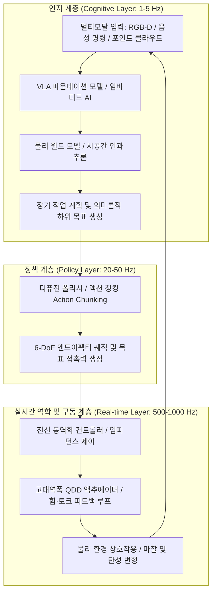

2020년대 초 대규모 언어 모델(LLM)과 멀티모달 비전-언어 모델(VLM)의 등장은 디지털 가상 세계에서 경이로운 지능의 도약을 증명했습니다. 그러나 신경망이 양자역학 방정식을 풀고, 완벽한 운영체제 코드를 작성하며, 금융 시장의 거시 경제를 예측하더라도 2차원 유리 스크린 뒤에 갇혀 있는 한, 병상의 노인에게 따뜻한 물 한 잔을 건넬 수 없고, 고장 난 화학 공장의 황동 밸브를 잠글 수 없으며, 지진 잔해 속에서 생존자를 구조할 수 없습니다.

인공지능이 진정으로 인류 물리 사회의 생산성을 혁신하기 위해서는 물질 세계에 존재하는 신체(Body)를 얻어야 합니다. 이것이 바로 **임바디드 인텔리전스(Embodied Intelligence, 체화된 지능)**이자 **피지컬 AI(Physical AI)**의 본질입니다.

피지컬 AI는 단순히 사전 학습된 모델을 마이크로컨트롤러에 탑재하는 것을 의미하지 않습니다. 이는 **중력, 마찰력, 관성, 접촉 역학, 유체 역학이라는 엄격한 물리 법칙의 제약 하에서 자율적으로 환경을 인지하고, 실시간으로 추론하며, 능동적으로 상호작용하는 물리적 지능을 구축하는 새로운 종합 공학 학문**입니다.

---

## 1. 모라벡의 역설과 피지컬 AI의 핵심 과제

인공지능 역사상 가장 심오한 통찰 중 하나는 바로 **모라벡의 역설(Moravec's Paradox)**입니다. 한스 모라벡(Hans Moravec)을 비롯한 선구자들은 컴퓨터가 성인 수준의 체스 경기, 논리 추론, 미적분 연산을 수행하게 만드는 것은 비교적 간단하지만, 한 살배기 아기 수준의 시각 인지, 보행 균형, 손가락 조작 능력을 부여하는 것은 극도로 어렵다는 사실을 발견했습니다.

이러한 현상이 발생하는 근본 원인은 다음과 같습니다:
1. **진화론적 계산량의 차이**: 고차원적 기호 논리 추론은 수만 년의 역사에 불과하지만, 감각운동계(Sensorimotor System)는 수억 년에 걸친 가혹한 자연선택 속에서 방대한 생물학적 계산 자원을 소모하며 진화했습니다.
2. **연속적이고 비가역적인 물리 공간**: 가상 세계는 이산적이며 언제든 되돌릴 수 있는(Undo) 무손실 공간이지만, 물리 세계는 시간이 연속적으로 흐르고 열역학 제2법칙이 지배하며, 접촉(Contact) 역학은 극단적인 비선형성과 비볼록(Non-convex) 제약 조건을 가집니다.

피지컬 AI의 궁극적인 사명은 모라벡의 역설을 극복하여 '통 속의 뇌'를 현실 세계와 완전하게 동기화된 물리적 지능체로 전환하는 것입니다.

---

## 2. 피지컬 AI 시스템 계층 구조: 고수준 인지부터 kHz 임피던스 제어까지

물리 로봇 시스템에서 제어 루프는 심각한 대역폭 및 지연 시간의 불일치를 겪습니다. 수십억 개의 파라미터를 가진 고수준 인지 모델은 $1 \sim 5\text{ Hz}$로 동작하는 반면, 관절 액추에이터의 실시간 토크 제어와 접촉 역학은 $100 \sim 1000\text{ Hz}$ 주기로 피드백 루프를 완성해야만 로봇이 넘어지거나 파손되지 않습니다.

현대 피지컬 AI는 엄격한 **계층형 이종 제어 아키텍처(Hierarchical Control Architecture)**를 채택합니다:

이 계층 분리 설계를 통해:
- **인지 계층 ($1 \sim 5\text{ Hz}$)**: 복잡한 자연어 지시(예: "식탁 위의 사과를 씻어 과일 바구니에 담아줘")를 이해하고 환경 기하학을 분해합니다.
- **정책 계층 ($20 \sim 50\text{ Hz}$)**: 시촉각 정보와 고유수용감각(Proprioception)을 결합하여 연속적인 동작 궤적 청크(Trajectory Action Chunks)를 생성함으로써 누적 오차를 제거합니다.
- **구동 계층 ($500 \sim 1000\text{ Hz}$)**: 전신 임피던스 제어(Whole-Body Impedance Control)와 제어 장벽 함수(CBF)를 통해 외란에 대한 유연한 순응성(Compliance)과 밀리초 단위의 동적 안전성을 보장합니다.

---

## 3. VLA(Vision-Language-Action) 모델과 디퓨전 폴리시(Diffusion Policy)

### 1. VLA의 수학적 정식화
기존의 비전-언어 모델(VLM)이 언어 토큰을 생성하는 것과 달리:
$$y = f_{\text{VLM}}(I, T) \in \mathcal{V}^*$$
**VLA(Vision-Language-Action) 모델**은 로봇의 다차원 물리 제어 입력을 직접 생성합니다:
$$a_t = f_{\text{VLA}}(I_t, T, s_t) \in \mathbb{R}^D$$
여기서 동작 벡터 $a_t$는 엔드이펙터 6자유도 위치 및 자세 증분과 그리퍼 작동 상태를 포함합니다:
$$a_t = [\Delta x, \Delta y, \Delta z, \Delta \phi, \Delta \theta, \Delta \psi, g_{\text{gripper}}]^\top$$

대표 모델인 Google RT-2, OpenVLA, Physical Intelligence π0는 웹 규모의 지식과 물리 조작 역량을 결합하는 데 성공했습니다.

### 2. 디퓨전 폴리시(Diffusion Policy)의 수학적 원리
기존의 모방 학습(행동 복제, BC)이 겪던 치명적인 문제는 **다중 모드(Multimodal) 분포의 붕괴**였습니다. 예를 들어 장애물을 회피할 때 왼쪽과 오른쪽 모두 유효한 해답이지만, 단순 평균제곱오차(MSE) 손실 함수를 사용하면 네트워크는 두 해의 평균인 중앙(장애물과 정면충돌)으로 이동하려 합니다.

**디퓨전 폴리시(Diffusion Policy)**는 로봇 동작 생성을 조건부 역확산 확률 과정으로 정식화합니다:
미래 동작 청크 $A_t = [a_t, \dots, a_{t+K_a}]$에 대해 노이즈를 주입하는 전방 확산 과정:
$$q(A^k | A^0) = \mathcal{N}\left(A^k; \sqrt{\bar{\alpha}_k} A^0, (1 - \bar{\alpha}_k)\mathbf{I}\right)$$

신경망 $\epsilon_\theta$는 주입된 노이즈를 예측하도록 학습됩니다:
$$\mathcal{L}(\theta) = \mathbb{E}_{k, A^0, \epsilon \sim \mathcal{N}(0, \mathbf{I})}\left[\|\epsilon - \epsilon_\theta(\sqrt{\bar{\alpha}_k}A^0 + \sqrt{1 - \bar{\alpha}_k}\epsilon, k, O_t)\|^2\right]$$

디퓨전 폴리시는 복잡한 접촉이 수반되는 작업(선 정리, 직물 접기, 도구 조작)에서 뛰어난 안정성과 표현력을 입증했습니다.

---

## 4. Sim-to-Real과 제너레이티브 물리 월드 모델

물리 세계에서 실제 로봇 데이터를 수집하는 것은 막대한 비용과 안전사고 위험을 수반합니다. 따라서 현대 피지컬 AI는 대규모 GPU 물리 시뮬레이션에 결정적으로 의존합니다.

### 1. 도메인 랜덤화(Domain Randomization)에 의한 갭 극복
시뮬레이션과 현실 사이의 물리적 차이(Sim-to-Real Gap)를 해결하기 위해 로봇 동역학 방정식의 파라미터 공간 $\Xi$에 확률적 변동성을 부여합니다:
$$M(q, \xi)\ddot{q} + C(q, \dot{q}, \xi)\dot{q} + g(q, \xi) = \tau + J^\top(q) F_{\text{ext}}$$
마찰 계수 $\mu$, 링크 질량, 관절 백래시, 통신 레이턴시 등을 무작위로 변동시키며 수만 개의 병렬 환경(NVIDIA Isaac Sim, MuJoCo)에서 정책을 학습시켜 강건한(Robust) 불변 제어기를 획득합니다.

### 2. 생성형 물리 월드 모델(Generative World Models)
물리 월드 모델은 로봇의 행동 $a_t$에 따른 환경의 미래 물리 상태 $\hat{S}_{t+1}$를 예측합니다:
$$\hat{S}_{t+1} \sim \mathcal{P}_{\text{world}}(S_{t+1} | S_t, a_t)$$
로봇은 실제 파괴 위험 없이 가상 신경망 시뮬레이션 내부에서 수천 번의 궤적을 '상상'하고 최적화할 수 있습니다.

---

## 5. 하드웨어 엔지니어링: 준직구동(QDD)과 시촉각 센싱

알고리즘의 성능은 궁극적으로 하드웨어의 물리적 한계에 종속됩니다. 현대 로보틱스는 기전 시스템에서 근본적인 전환기를 맞이했습니다:

1. **준직구동(QDD: Quasi-Direct Drive) 액추에이터**:
   전통적인 산업용 감속기(1:100 하모닉 드라이브)는 높은 기계적 강성으로 인해 충돌 시 파손되기 쉽습니다. 현대 휴머노이드 로봇은 낮은 감속비(1:6 ~ 1:10)를 가진 고토크 BLDC 모터를 사용하여 뛰어난 **역구동성(Back-drivability)**을 확보함으로써 충격을 흡수하고 부드러운 임피던스 제어를 구현합니다.

2. **시촉각 센서(GelSight / 광학 촉각 스킨)**:
   투명 탄성 중합체(Elastomer)와 내부 초소형 카메라를 결합하여 접촉면의 변형을 광도 입체법(Photometric Stereo)으로 캡처합니다. 접촉 압력 텐서 장 $\mathbf{T}(x, y)$을 마이크로미터 단위로 측정하여 미세 슬립 감지와 정밀 파지를 가능하게 합니다.

---

## 6. 수학적 안전성 보장: 제어 장벽 함수(CBF)

블랙박스 신경망 모델이 고출력 로봇의 토크를 직접 제어하는 것은 안전상 위험합니다. 따라서 피지컬 AI는 수학적으로 증명 가능한 안전성 필터를 탑재합니다.

**제어 장벽 함수(Control Barrier Functions, CBF)**는 안전 상태 집합 $\mathcal{C} = \{x \mid h(x) \ge 0\}$을 항상 보존하도록 강제합니다:
실시간 2차 프로그래밍(QP)을 통해 신경망의 공칭 출력 $u_{\text{nom}}$을 안전하게 투영합니다:
$$\min_u \frac{1}{2}\|u - u_{\text{nom}}\|^2 \quad \text{s.t.} \quad L_f h(x) + L_g h(x)u + \alpha(h(x)) \ge 0$$
이를 통해 리아푸노프(Lyapunov) 안정성 이론에 기반하여 하드웨어의 기계적 한계와 충돌 안전성을 수학적으로 보장합니다.

### 결론
피지컬 AI는 인공지능이 순수 디지털 소프트웨어를 넘어 물질 세계의 물리 법칙과 결합하는 궁극의 패러다임입니다. 지능을 갖춘 범용 휴머노이드 로봇은 제조, 물류, 가사 노동, 우주 탐사 등 인류 문명의 모든 물리적 현장을 근본적으로 재편할 것입니다.
