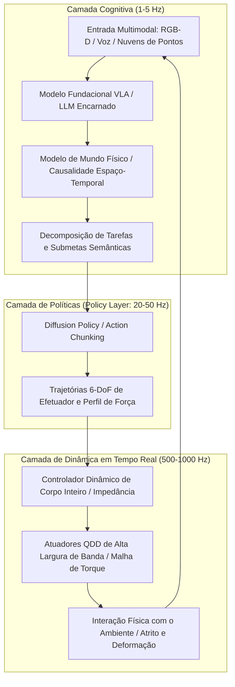

No início da década de 2020, os Grandes Modelos de Linguagem (LLMs) e os modelos de Visão e Linguagem (VLMs) demonstraram um avanço espetacular na cognição artificial dentro do domínio virtual. Contudo, não importa quão habilidosa seja uma rede neural para deduzir equações de mecânica quântica ou conceber sistemas operacionais complexos: ela permanece aprisionada atrás de uma tela plana de vidro. Ela não pode estender um copo de água a um paciente idoso, apertar uma válvula metálica emperrada em uma refinaria, nem resgatar sobreviventes em escombros de terremotos.

Para que a inteligência artificial transforme a economia física e a sociedade humana, ela precisa habitar o mundo material: necessita de **encarnação (Embodiment)**. Esse marco define a ascensão da **IA Física (Physical AI)** e da **Inteligência Encarnada**.

A IA Física não é meramente a instalação de um modelo de linguagem em um microcontrolador. Trata-se de uma nova disciplina científica: **a criação de sistemas autônomos capazes de perceber, raciocinar e interagir fisicamente com o universo sob as leis inexoráveis da gravidade, do atrito, da inércia e da dinâmica de contato**.

---

## 1. O Paradoxo de Moravec e o desafio central da IA Física

Na história da inteligência artificial, destaca-se uma observação fundamental: o **Paradoxo de Moravec**. Hans Moravec, Marvin Minsky e outros pesquisadores apontaram na década de 1980 que tarefas de alta complexidade intelectual como xadrez, cálculo diferencial ou dedução lógica exigem computação relativamente modesta, enquanto habilidades sensório-motoras e manipulativas inerentes a uma criança de um ano são extraordinariamente difíceis de reproduzir.

Os motivos fundamentais residem em:
1. **Computação evolutiva biológica**: O raciocínio simbólico abstrato surgiu há poucas dezenas de milhares de anos. Em contraste, a coordenação sensório-motora foi aperfeiçoada ao longo de centenas de milhões de anos de seleção natural, consumindo imensa capacidade de processamento do cérebro biológico.
2. **Continuidade e irreversibilidade física**: O mundo digital opera de forma discreta e permite desfazer ações (Undo). No cosmos físico, o tempo flui continuamente, o segundo princípio da termodinâmica impõe irreversibilidade e o contato mecânico é governado por restrições não lineares e não convexas.

A missão da IA Física é superar esse paradoxo, transformando algoritmos abstratos em agentes corpóreos capazes de operar com total maestria física.

---

## 2. Arquitetura hierárquica de controle: Da cognição ao controle de impedância em kHz

Em sistemas robóticos físicos, o ciclo de controle lida com uma enorme discrepância de frequências: modelos de raciocínio de alta complexidade operam em frequências reduzidas ($1 \sim 5\text{ Hz}$), enquanto a dinâmica de contato e torque motor requer tempos de resposta em milissegundos ($100 \sim 1000\text{ Hz}$) para garantir estabilidade.

A IA Física moderna emprega uma **arquitetura de controle hierárquica desacoplada**:

Essa concepção garante:
- **Camada Cognitiva ($1 \sim 5\text{ Hz}$)**: Compreende comandos complexos em linguagem natural ("Lave delicadamente esta taça e coloque-a no escorredor").
- **Camada de Políticas ($20 \sim 50\text{ Hz}$)**: Gera segmentos de ação contínua (*Action Chunks*), prevenindo a propagação de atrasos e erros cumulativos.
- **Camada de Tempo Real ($500 \sim 1000\text{ Hz}$)**: Utiliza controle de impedância de corpo inteiro (Whole-Body Impedance Control) e Funções de Barreira de Controle (CBF) para assegurar conformidade mecânica passiva e segurança física absoluta.

---

## 3. Modelos VLA (Visão-Linguagem-Ação) e Fundamentos da Diffusion Policy

### 1. Modelagem matemática de sistemas VLA
Ao contrário de modelos tradicionais de visão e linguagem que geram tokens textuais:
$$y = f_{\text{VLM}}(I, T) \in \mathcal{V}^*$$
Um modelo **VLA (Vision-Language-Action)** mapeia diretamente a percepção sensorial para grandezas contínuas de atuação:
$$a_t = f_{\text{VLA}}(I_t, T, s_t) \in \mathbb{R}^D$$
em que o vetor de ação compreende variações de pose a 6 graus de liberdade e o comando da garra:
$$a_t = [\Delta x, \Delta y, \Delta z, \Delta \phi, \Delta \theta, \Delta \psi, g_{\text{gripper}}]^\top$$

Modelos como Google RT-2, OpenVLA e Physical Intelligence π0 provam que é possível unificar representações da internet com controle motor fino.

### 2. Fundamentos matemáticos da Diffusion Policy
A aprendizagem por imitação clássica fracassa perante **distribuições multimodais**. Ao evitar um obstáculo, mover-se para a esquerda ou para a direita constituem soluções viáveis; um regressor MSE ingênuo calcula a média aritmética de ambas, conduzindo a uma colisão frontal.

A **Diffusion Policy** formula a geração de movimentos como um processo estocástico reverso de remoção de ruído condicional:
Para um bloco de ações futuras $A_t = [a_t, \dots, a_{t+K_a}]$ e observações $O_t$, o processo de difusão direta injeta ruído gaussiano:
$$q(A^k | A^0) = \mathcal{N}\left(A^k; \sqrt{\bar{\alpha}_k} A^0, (1 - \bar{\alpha}_k)\mathbf{I}\right)$$

A rede neural $\epsilon_\theta$ aprende a estimar o ruído introduzido:
$$\mathcal{L}(\theta) = \mathbb{E}_{k, A^0, \epsilon \sim \mathcal{N}(0, \mathbf{I})}\left[\|\epsilon - \epsilon_\theta(\sqrt{\bar{\alpha}_k}A^0 + \sqrt{1 - \bar{\alpha}_k}\epsilon, k, O_t)\|^2\right]$$

Essa formulação proporciona aos robôs uma destreza incomparável na manipulação de objetos deformáveis e em montagens de alta precisão.

---

## 4. Transferência Sim-to-Real e Modelos de Mundo Generativos

Coletar dados robóticos no mundo real envolve desgaste mecânico e custos imensos. Por essa razão, a IA Física depende intensamente de motores de simulação paralelos em GPU (NVIDIA Isaac Sim, MuJoCo, Genesis).

### 1. Randomização de Domínio (Domain Randomization)
Para transpor o abismo entre simulação e realidade (*Sim-to-Real Gap*), introduzem-se variações estocásticas nos parâmetros físicos:
$$M(q, \xi)\ddot{q} + C(q, \dot{q}, \xi)\dot{q} + g(q, \xi) = \tau + J^\top(q) F_{\text{ext}}$$
Ao variar aleatoriamente o coeficiente de atrito $\mu$, massas de elos e latências de transmissão, a política neural aprende uma estratégia conservadora e amplamente invariante a perturbações físicas.

### 2. Modelos de Mundo Físico Generativos
Ao antecipar as transições de estado físico causadas pelas ações:
$$\hat{S}_{t+1} \sim \mathcal{P}_{\text{world}}(S_{t+1} | S_t, a_t)$$
O robô pode avaliar mentalmente os desfechos cinemáticos e de força antes da execução, prevenindo acidentes materiais.

---

## 5. Engenharia Mecatrônica: Atuadores QDD e Sensoriamento Visotátil

Nenhum software supera as restrições impostas pela física mecânica:

1. **Atuadores Quase-Diretos (QDD: Quasi-Direct Drive)**:
   Substituindo redutores de alto impacto e rigidez excessiva (1:100), robôs modernos utilizam motores brushless de alto torque com engrenagens de baixa relação (1:6 a 1:10). Essa arquitetura confere alta **reversibilidade mecânica (Back-drivability)** e elasticidade passiva, amortecendo impactos súbitos.

2. **Sensores Visotáteis (GelSight)**:
   Câmeras internas capturam a deformação de elastômeros transparentes iluminados por LEDs coloridos, reconstruindo por fotometria estéreo o tensor de pressão de contato $\mathbf{T}(x, y)$ em resolução micrométrica, essencial para detectar escorregamento microscópico.

---

## 6. Garantias Formais de Segurança: Funções de Barreira de Controle (CBF)

Políticas neurais de caixa-preta não devem atuar diretamente sobre motores de alta potência sem validação analítica.

As **Funções de Barreira de Controle (CBF)** atuam como filtros determinísticos em tempo real. Para um domínio de segurança $\mathcal{C} = \{x \mid h(x) \ge 0\}$, o comando de controle $u_{\text{nom}}$ é corrigido via programação quadrática (QP):
$$\min_u \frac{1}{2}\|u - u_{\text{nom}}\|^2 \quad \text{s.t.} \quad L_f h(x) + L_g h(x)u + \alpha(h(x)) \ge 0$$
assegurando matematicamente, pela teoria de estabilidade de Lyapunov, que o robô jamais viole seus limites de força ou posição.

### Conclusão
A IA Física concretiza a fusão entre inteligência computacional e mecânica dos corpos. Robôs humanoides com inteligência encarnada serão a base transformadora da manufatura industrial, logística e assistência humana no século XXI.
