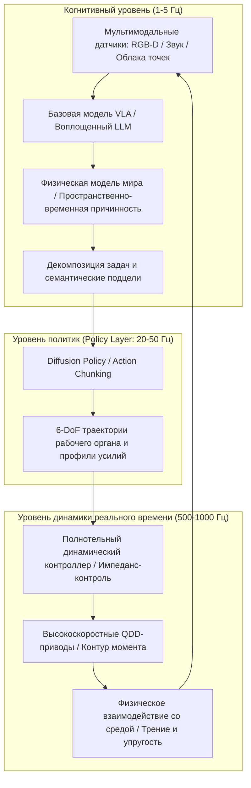

В начале 2020-х годов большие языковые модели (LLM) и визуально-языковые модели (VLM) продемонстрировали беспрецедентный скачок синтетического интеллекта в цифровом пространстве. Однако, сколь бы глубоко нейросеть ни разбиралась в квантовой механике или разработке операционных систем, она остается запертой за стеклом двумерного дисплея. Она не может подать стакан воды пожилому пациенту, перекрыть заклинивший вентиль на нефтехимическом заводе или разобрать завалы после землетрясения для спасения выживших.

Чтобы искусственный интеллект смог по-настоящему преобразовать материальную экономику человечества, ему необходимо обрести физическое тело — **Воплощение (Embodiment)**. Это положило начало эпохе **Физического ИИ (Physical AI)** и **Воплощенного Интеллекта**.

Физический ИИ — это не просто прошивка нейросети в микроконтроллер. Это принципиально новая междисциплинарная область науки: **создание автономных систем, способных воспринимать, физически рассуждать и активно воздействовать на реальный мир в жестких рамках законов гравитации, трения, инерции и контактной механики**.

---

## 1. Парадокс Моравека и фундаментальная проблема Физического ИИ

В истории искусственного интеллекта фундаментальное значение имеет **Парадокс Моравека**. Ханс Моравек, Марвин Минский и их современники еще в 1980-х годах обратили внимание на поразительный факт: научить компьютер логическому мышлению, игре в шахматы на уровне гроссмейстера или решению дифференциальных уравнений сравнительно просто, но наделить его зрительно-моторной координацией и ловкостью движений годовалого ребенка невероятно трудно.

Причины этого парадокса:
1. **Эволюционные вычислительные затраты**: Абстрактное логическое мышление появилось у человека лишь десятки тысяч лет назад. Напротив, сенсомоторный аппарат формировался сотни миллионов лет под давлением естественного отбора, поглотив львиную долю биологических вычислительных ресурсов.
2. **Непрерывность и необратимость физического пространства**: Цифровая среда дискретна и допускает отмену действий (Undo). В материальном же мире время непрерывно, второй закон термодинамики необратим, а физический контакт порождает резкие нелинейности и невыпуклые ограничения.

Цель Физического ИИ — преодолеть парадокс Моравека, превратив «мозг в колбе» в материального агента, гармонично взаимодействующего с физической реальностью.

---

## 2. Иерархическая архитектура управления: от когнитивного планирования до кГц-импеданса

В физических робототехнических системах контур управления сталкивается с критическим частотным разрывом: когнитивные модели рассуждают на низкой частоте ($1 \sim 5\text{ Гц}$), тогда как контур управления крутящим моментом и динамикой контактов должен замыкаться за миллисекунды ($100 \sim 1000\text{ Гц}$), чтобы избежать потери устойчивости.

Современный Физический ИИ использует **иерархическую декомпозированную архитектуру**:

Такая структура обеспечивает:
- **Когнитивный уровень ($1 \sim 5\text{ Гц}$)**: Понимание сложных команд на естественном языке («Аккуратно помой эту чашку и поставь ее сушиться вверх дном»).
- **Уровень политик ($20 \sim 50\text{ Гц}$)**: Формирование связных траекторных блоков (*Action Chunks*), предотвращающих запаздывание и накопление ошибок.
- **Уровень реального времени ($500 \sim 1000\text{ Гц}$)**: Реализация полнотельного импедансного управления (Whole-Body Impedance Control) и функций барьерного контроля (CBF), гарантирующих механическую податливость при ударах.

---

## 3. Модели VLA (Зрение-Язык-Действие) и математика Diffusion Policy

### 1. Математическая постановка моделей VLA
В отличие от классических мультимодальных моделей (VLM), генерирующих текстовые токены:
$$y = f_{\text{VLM}}(I, T) \in \mathcal{V}^*$$
Модель **VLA (Vision-Language-Action)** напрямую отображает наблюдения в непрерывные физические команды управления:
$$a_t = f_{\text{VLA}}(I_t, T, s_t) \in \mathbb{R}^D$$
где вектор действия включает 6-DoF смещения рабочего органа и степень сжатия схвата:
$$a_t = [\Delta x, \Delta y, \Delta z, \Delta \phi, \Delta \theta, \Delta \psi, g_{\text{gripper}}]^\top$$

Модели Google RT-2, OpenVLA и Physical Intelligence π0 доказывают возможность прямой трансляции абстрактных знаний в точные моторные траектории.

### 2. Математические основы Diffusion Policy
Классическое обучение с учителем (Behavior Cloning) терпит сбой при наличии **мультимодальных распределений**. При обходе препятствия обход слева и справа равноценны; регрессия со стандартной функцией потерь (MSE) выдает среднее значение, что приводит к лобовому столкновению.

**Diffusion Policy** моделирует генерацию действий как обратный стохастический процесс диффузионного шумоподавления:
Для будущего блока действий $A_t = [a_t, \dots, a_{t+K_a}]$ прямой процесс добавляет гауссов шум:
$$q(A^k | A^0) = \mathcal{N}\left(A^k; \sqrt{\bar{\alpha}_k} A^0, (1 - \bar{\alpha}_k)\mathbf{I}\right)$$

Нейросеть $\epsilon_\theta$ обучается восстанавливать добавленный шум:
$$\mathcal{L}(\theta) = \mathbb{E}_{k, A^0, \epsilon \sim \mathcal{N}(0, \mathbf{I})}\left[\|\epsilon - \epsilon_\theta(\sqrt{\bar{\alpha}_k}A^0 + \sqrt{1 - \bar{\alpha}_k}\epsilon, k, O_t)\|^2\right]$$

Это наделяет роботов непревзойденной ловкостью при операциях с деформируемыми телами (укладка кабелей, манипуляции с тканями, точная сборка).

---

## 4. Перенос Sim-to-Real и Генеративные Модели Мира

Сбор данных в физической среде дорог и чреват повреждениями оборудования. Поэтому Физический ИИ в значительной степени опирается на высокопараллельные физические симуляторы на GPU (NVIDIA Isaac Sim, MuJoCo, Genesis).

### 1. Рандомизация домена (Domain Randomization)
Для преодоления разрыва между симуляцией и реальностью (*Sim-to-Real Gap*) в динамические уравнения вносится параметрическая неопределенность:
$$M(q, \xi)\ddot{q} + C(q, \dot{q}, \xi)\dot{q} + g(q, \xi) = \tau + J^\top(q) F_{\text{ext}}$$
Коэффициенты трения $\mu$, массы звеньев, люфты передач и задержки каналов связи стохастически варьируются в пространстве $\Xi$, формируя сверхустойчивую политику управления.

### 2. Генеративные физические модели мира
Прогнозируя будущее состояние среды:
$$\hat{S}_{t+1} \sim \mathcal{P}_{\text{world}}(S_{t+1} | S_t, a_t)$$
Робот получает возможность ментально просчитывать последствия действий во внутреннем нейросетевом симуляторе, исключая аварийные ситуации в реальности.

---

## 5. Мехатроника: Квазипрямой привод (QDD) и оптико-тактильные сенсоры

Совершенство алгоритмов ограничено физическими возможностями механической платформы:

1. **Квазипрямой привод (QDD: Quasi-Direct Drive)**:
   В отличие от промышленных роботов с высокими передаточными отношениями (1:100), современные гуманоиды используют высокомоментные бесколлекторные двигатели с планетарными редукторами малого передаточного числа (1:6 — 1:10). Приводы QDD обладают великолепной **обратимостью (Back-drivability)** и пассивной податливостью к ударам.

2. **Оптико-тактильные сенсоры (GelSight)**:
   Миниатюрная камера фиксирует деформацию эластомерного покрытия при контакте, а алгоритмы фотометрической стереометрии восстанавливают тензор контактного давления $\mathbf{T}(x, y)$ с микронной точностью, позволяя фиксировать микропроскальзывание.

---

## 6. Формальные гарантии безопасности: Функции барьерного контроля (CBF)

Выходные сигналы глубоких нейронных сетей не должны напрямую поступать на мощные силовые приводы без аналитической фильтрации.

**Функции барьерного контроля (Control Barrier Functions, CBF)** формируют детерминированный фильтр безопасности. Для безопасного множества состояний $\mathcal{C} = \{x \mid h(x) \ge 0\}$ номинальное действие $u_{\text{nom}}$ корректируется методом квадратичного программирования (QP):
$$\min_u \frac{1}{2}\|u - u_{\text{nom}}\|^2 \quad \text{s.t.} \quad L_f h(x) + L_g h(x)u + \alpha(h(x)) \ge 0$$
Это математически гарантирует на основе теории устойчивости Ляпунова соблюдение предельных механических нагрузок.

### Заключение
Физический ИИ объединяет вычислительную мощь искусственного интеллекта с законами материальной Вселенной. Гуманоидные роботы общего назначения станут ключевой производительной силой промышленности, медицины и исследования космоса в XXI веке.
