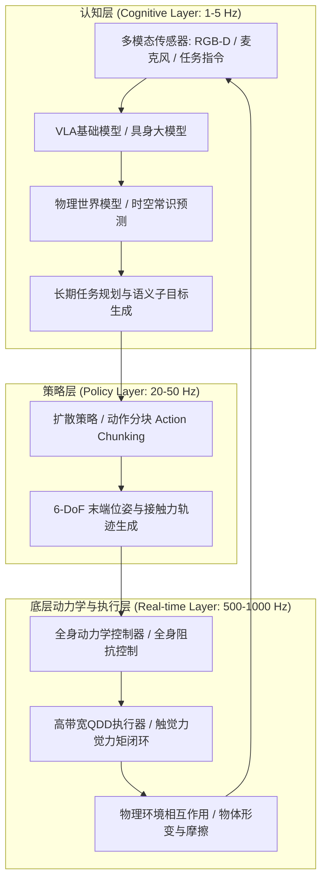

在2020年代初，大语言模型（LLM）和多模态视觉语言模型（VLM）在纯虚拟信息空间展现了惊人的智能飞跃。然而，无论神经网络在屏幕后如何精确地解答微分几何、编写操作系统或进行金融衍生品定价，它始终被禁锢在二维显示屏之后。它无法为病榻上的老人递上一杯温水，无法在极度复杂的化工厂中拧紧松动的黄铜阀门，更无法在地震废墟中搜寻并营救生命。

要让通用人工智能（AGI）真正重塑人类物理世界的生产力与生产关系，它必须走入物理现实，获得肉身——这就是<strong>具身智能（Embodied Intelligence）</strong>与**物理AI（Physical AI）**。

物理AI绝不是单纯将预训练模型烧录在嵌入式单片机上，而是一门全新的跨学科前沿科学：**在重力、摩擦力、惯性、接触碰撞和流体力学的物理定律铁律制约下，构建能够自主感知、实时规划并与复杂环境进行物理交互的闭环智能系统**。

---

## 一、 莫拉维克悖论与物理AI的核心命题

人工智能漫长发展史中存在一个著名的现象：**莫拉维克悖论（Moravec's Paradox）**。汉斯·莫拉维克（Hans Moravec）、马文·明斯基等人早在20世纪80年代就敏锐地指出：让计算机在逻辑推理、国际象棋或微积分测试中达到成人水准极其简单，但要让它具备一岁婴儿般的视觉识别、行走平衡或灵巧抓取能力，却极其困难。

这是因为：
1. **进化计算量**：人类的高级逻辑推理仅有数万年的演化史，是高度符号化、低维度的后天能力；而感觉运动系统（Sensorimotor System）历经了数亿年自然选择的残酷试错，消耗了生物进化中绝大部分的“计算量”。
2. **状态空间的连续性与不可逆性**：纯虚拟数字空间拥有离散且无物理损耗的确定性，而在物理世界中，时间以微秒连续流淌，热力学第二定律不可逆，力学接触具有高度的非凸与非线性特征。

物理AI的核心命题，正是攻克莫拉维克悖论，将无实体的“缸中之脑”演进为与现实世界严丝合缝交互的“具身实体”。

---

## 二、 物理AI的系统分层架构：从语义规划到高频阻抗控制

在实体机器人系统中，控制回路面临严苛的带宽与延迟鸿沟：高层语义推理依赖超大参数量的模型，延迟通常在几百毫秒到数秒（$1 \sim 5\text{ Hz}$）；而底层的电机力矩控制与接触动力学必须在千分之一秒内完成闭环（$100 \sim 1000\text{ Hz}$），否则机器人将在瞬间失稳倒地或损坏关节。

物理AI采用了典型的现代**分层异构控制架构**：

这种分级解耦设计实现了：
- **认知层（1-5 Hz）**：理解人类自然语言指令（如“请把桌面上的易拉罐捏扁后扔进蓝色可回收垃圾桶”），进行场景分解与因果推断。
- **策略层（20-50 Hz）**：结合视触觉多模态输入，生成连续平滑的轨迹序列（Trajectory Action Chunks），消除自回归逐步推断的累积误差与延迟。
- **执行层（500-1000 Hz）**：通过全身阻抗控制（Whole-Body Impedance Control）与控制屏障函数（CBF），在毫秒级保证接触柔顺性与动力学稳定性。

---

## 三、 VLA（视觉-语言-动作）模型与扩散策略（Diffusion Policy）数学原理

### 1. 从VLM到VLA的范式迁移
传统的视觉语言模型（如CLIP、LLaVA）将图像与文本映射到离散语义空间：
$$y = f_{\text{VLM}}(I, T) \in \mathcal{V}^*$$
其中 $\mathcal{V}$ 为语言词表。而在物理AI中，**VLA（Vision-Language-Action）模型**直接将低层动作空间映射为连续的物理控制向量：
$$a_t = f_{\text{VLA}}(I_t, T, s_t) \in \mathbb{R}^D$$
动作向量 $a_t$ 通常由末端执行器的6自由度位姿变化量、夹爪开合度或关节目标力矩组成：
$$a_t = [\Delta x, \Delta y, \Delta z, \Delta \phi, \Delta \theta, \Delta \psi, g_{\text{gripper}}]^\top$$

代表性架构（如Google RT-2、OpenVLA、Physical Intelligence π0）将连续动作分箱离散化或通过连续扩散头部进行联合建模。

### 2. 扩散策略（Diffusion Policy）的数学本质
传统机器人模仿学习（如基于均方误差的多层感知机）常常在面对多模态分布时发生崩溃（例如避开障碍物时，向左绕行或向右绕行均是可行解，简单回归会输出两者平均值——迎面撞上障碍物）。

**扩散策略**将机器人多步连续动作序列建模为条件反向去噪过程：
目标是学习条件概率分布 $p(A_t | O_t)$，其中 $A_t = [a_t, a_{t+1}, \dots, a_{t+K_a}]$ 为未来动作块，$O_t$ 为当前观测历史。

前向扩散过程向真实动作序列逐渐注入高斯噪声：
$$q(A^k | A^0) = \mathcal{N}\left(A^k; \sqrt{\bar{\alpha}_k} A^0, (1 - \bar{\alpha}_k)\mathbf{I}\right)$$

反向去噪过程通过噪声预测网络 $\epsilon_\theta(A^k, k, O_t)$ 参数化：
$$\mathcal{L}(\theta) = \mathbb{E}_{k, A^0, \epsilon \sim \mathcal{N}(0, \mathbf{I})}\left[\|\epsilon - \epsilon_\theta(\sqrt{\bar{\alpha}_k}A^0 + \sqrt{1 - \bar{\alpha}_k}\epsilon, k, O_t)\|^2\right]$$

通过这种方式，物理AI在灵巧操作中表现出无与伦比的多模态适应性与高平滑度。

---

## 四、 Sim-to-Real与物理世界模型（World Models）

数据瓶颈是物理AI面临的最大挑战。互联网上数十亿图文网页可轻易训练出顶级的语言模型，但高精度的机器人力觉、触觉与三维操作动力学数据却无法从互联网直接扒取。

### 1. 物理引擎与Sim-to-Real（仿真到真实迁移）
现代物理AI严重依赖高并行物理仿真引擎（如NVIDIA Isaac Sim / Isaac Lab、MuJoCo、Genesis），利用GPU光追与刚柔体接触求解器，以数万倍于现实世界的时间加速比并行采集数万条机器人执行轨迹。

为了弥合仿真与现实的力学误差（“Sim-to-Real Gap”），研究者采用了严密的**域随机化（Domain Randomization）**技术：
在系统动力学方程中引入不确定参数空间 $\Xi$：
$$M(q, \xi)\ddot{q} + C(q, \dot{q}, \xi)\dot{q} + g(q, \xi) = \tau + J^\top(q) F_{\text{ext}}$$
其中 $\xi \in \Xi$ 随机覆盖摩擦系数 $\mu \sim \mathcal{U}(\mu_{\min}, \mu_{\max})$、连杆质量分布、传感器噪声、通信延迟与传动回差，迫使神经网络策略在物理参数的不确定性边界内学习具备极端鲁棒性的保守不变特征。

### 2. 物理世界模型（Generative World Models）
超越简单渲染，物理世界模型（如Sora-like时空物理引擎、DreamerV3、Genie）尝试预测“行动下的未来物理状态”：
$$\hat{S}_{t+1} \sim \mathcal{P}_{\text{world}}(S_{t+1} | S_t, a_t)$$
机器人在想象空间内进行蒙特卡洛树搜索（MCTS）或梯度优化，大幅降低在真实世界中造成损坏的试错成本。

---

## 五、 机器人本体工程：准直驱动电机与多模态触觉

物理AI必须依托高强度的机电本体才能将算法转变为功。现代具身机器人在硬件上发生了一场深刻的技术换代：

1. **准直驱电机（QDD: Quasi-Direct Drive）与双向可逆性**：
   传统的工业机器人采用高减速比（如1:100的谐波减速器），惯量大且刚性极高，碰撞容易自毁或伤人。现代人形机器人采用大直径高极对数无刷外转子电机配合低减速比行星齿轮箱（1:6 ~ 1:10），具备出色的<strong>反向可驱动性（Back-drivability）</strong>和力矩透明度，使得机器人本体兼具高抗冲击弹性和毫秒级力感知。

2. **视触觉传感器（GelSight / DIGIT）**：
   人类手掌分布着上万个机械感受器。以GelSight为代表的视触觉指尖通过内部微型摄像头捕捉弹性透明硅胶膜在接触物体时的微米级形变，直接重建接触表面压力场张量分布 $\mathbf{T}(x, y)$，为精密装配、织物抓取提供了不可替代的高频微观反馈。

---

## 六、 安全性数学保证与未来通用人形机器人格局

在物理世界运行的算法必须拥有绝对的安全数学边界。依靠经验主义的端到端黑盒神经网络绝不能直接驱动具有数百牛顿剪切力的人形手臂。

**控制屏障函数（Control Barrier Functions, CBF）**构成了物理AI的安全护栏：
定义安全状态集合 $\mathcal{C} = \{x \in \mathcal{X} \mid h(x) \ge 0\}$。控制输入 $u$ 必须满足如下条件：
$$\sup_{u \in \mathcal{U}} \left[ \nabla h(x) \cdot f(x, u) + \alpha(h(x)) \right] \ge 0$$
高层VLA或扩散策略输出的标称动作 $u_{\text{nom}}$ 会通过实时二次规划（QP）安全滤波器修正：
$$\min_u \frac{1}{2}\|u - u_{\text{nom}}\|^2 \quad \text{s.t.} \quad L_f h(x) + L_g h(x)u + \alpha(h(x)) \ge 0$$
从而以严密的李雅普诺夫稳定性理论证明机器人永不越过力学安全边界。

### 结语
物理AI是人工智能发展的终极疆域。当数字世界的大脑终于学会了驾驭物理世界的肌肉与骨骼，通用人形机器人不再是科幻小说的想象，而是正在重塑人类文明的工业制造、物流分拣、医疗康复与太空探索的全新基础设施。
