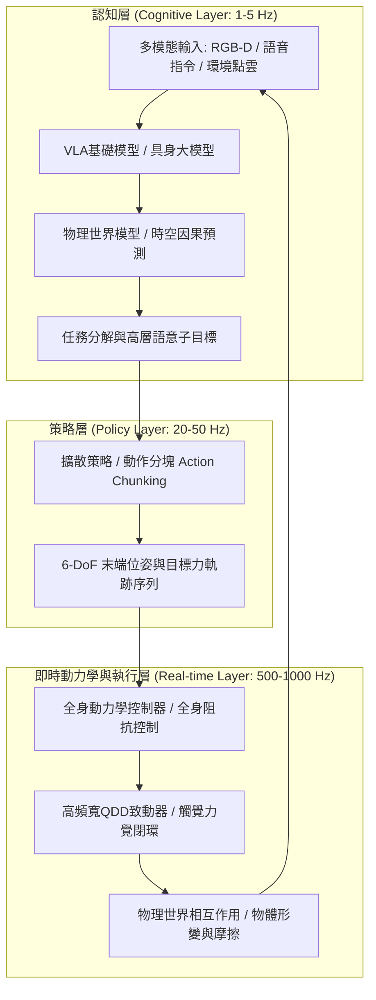

在2020年代初，大型語言模型（LLM）與多模態視覺語言模型（VLM）在純虛擬資訊空間展現了前所未有的智能飛躍。然而，無論神經網路在螢幕背後如何精確地推導微分幾何、編寫作業系統或分析全球金融市場，它始終被禁錮在二維螢幕之後。它無法為病榻上的長者遞上一杯溫水，無法在極端複雜的石化廠中轉動卡住的黃銅閥門，更無法在地震廢墟中穿越瓦礫搜救受困者。

要讓人工智慧真正融入人類社會並重塑實體經濟，它必須跨入物理實體，獲得軀體——這便是<strong>具身智能（Embodied Intelligence）</strong>與**物理AI（Physical AI）**。

物理AI絕非單純將預訓練模型部署至微控制器上，而是一門嶄新的跨學科科學：**在重力、摩擦力、動量、接觸碰撞與流體力學等不可違抗的物理法則制約下，構建具備自主感知、推理規劃並主動與實體世界互動的閉環智慧系統**。

---

## 一、 莫拉維克悖論與物理AI的核心命題

在人工智慧發展歷程中，有一個發人深省的觀察：**莫拉維克悖論（Moravec's Paradox）**。漢斯·莫拉維克（Hans Moravec）等人指出：讓電腦在邏輯推理、下西洋棋或微積分運算中達到成人水準相對容易，但要賦予電腦一歲幼兒般的視覺識別、平衡行走或靈巧手指抓取能力，卻異常艱鉅。

其深刻本質在於：
1. **生物演化計算量**：高級抽象符號推理僅有數萬年演化史，而感覺運動系統（Sensorimotor System）歷經數億年殘酷的自然淘汰，生物演化將絕大部分的神經計算能量皆投注於運動控制與物理交互。
2. **物理世界的連續性與不可逆性**：虛擬數位世界具有離散且可隨時撤銷的確定性；而實體世界中時間連續流逝，熱力學第二定律不可逆，力學接觸更具備高度非線性與非凸幾何約束。

物理AI的根本使命，即是打破莫拉維克悖論，將「缸中之腦」鍛造為具備實體肉身與物理常識的完整智慧體。

---

## 二、 物理AI的系統分層架構：從語意推理到千赫茲阻抗控制

在實體機器人架構中，控制迴路存在著巨大的帶寬與延遲落差：高層認知語意模型參數量龐大，推論頻率通常在 $1 \sim 5\text{ Hz}$；而底層關節伺服控制與接觸力學必須在毫秒級完成閉環（$100 \sim 1000\text{ Hz}$），否則機器人將發生劇烈振盪、翻倒或損壞執行器。

現代物理AI採用了嚴謹的**分層異構控制架構**：

這種解耦設計完美平衡了複雜推理能力與即時動態穩定性：
- **認知層（1-5 Hz）**：理解人類複雜指令（如「請將桌上的玻璃杯清洗乾淨並倒扣在瀝水架上」），進行幾何推理與任務編排。
- **策略層（20-50 Hz）**：結合即時本體感受與視覺回饋，生成平滑動作區塊（Action Chunks），大幅抑制延遲累積。
- **執行層（500-1000 Hz）**：透過全身阻抗控制（Whole-Body Impedance Control）與控制屏障函數（CBF），確保接觸柔順性與絕對安全性。

---

## 三、 VLA（視覺-語言-動作）模型與擴散策略（Diffusion Policy）

### 1. VLA架構的數理模型
傳統的多模態視覺語言模型（VLM）輸出文本Token：
$$y = f_{\text{VLM}}(I, T) \in \mathcal{V}^*$$
而在物理AI中，**VLA（Vision-Language-Action）模型**直接預測機器人在物理空間中的連續控制量：
$$a_t = f_{\text{VLA}}(I_t, T, s_t) \in \mathbb{R}^D$$
動作向量包含末端執行器的六自由度增量與抓手夾持力：
$$a_t = [\Delta x, \Delta y, \Delta z, \Delta \phi, \Delta \theta, \Delta \psi, g_{\text{gripper}}]^\top$$

代表模型如Google RT-2、OpenVLA與Physical Intelligence π0，成功將網路級預訓練的廣泛語意常識遷移至實體動作決策。

### 2. 擴散策略（Diffusion Policy）與多模態分佈建模
在傳統機器人模仿學習中，均方誤差（MSE）回歸常導致行為平均化問題（多峰分佈崩潰）。例如面對柱狀障礙物時，向左或向右均為合理決策，但簡單回歸會輸出中間路徑——直接撞上障礙物。

<strong>擴散策略（Diffusion Policy）</strong>將動作生成轉化為條件反向隨機去噪過程：
其目標是學習連續分佈 $p(A_t | O_t)$，其中 $A_t = [a_t, \dots, a_{t+K_a}]$。

前向加噪過程：
$$q(A^k | A^0) = \mathcal{N}\left(A^k; \sqrt{\bar{\alpha}_k} A^0, (1 - \bar{\alpha}_k)\mathbf{I}\right)$$

反向去噪訓練目標：
$$\mathcal{L}(\theta) = \mathbb{E}_{k, A^0, \epsilon \sim \mathcal{N}(0, \mathbf{I})}\left[\|\epsilon - \epsilon_\theta(\sqrt{\bar{\alpha}_k}A^0 + \sqrt{1 - \bar{\alpha}_k}\epsilon, k, O_t)\|^2\right]$$

藉由擴散模型的強大多峰表現力，機器人能夠優雅地學會打結、插拔線纜、折疊衣物等高度隨機且靈巧的雙手協同操作。

---

## 四、 Sim-to-Real與物理世界模型（World Models）

### 1. 物理模擬與領域隨機化（Domain Randomization）
真實世界中收集機器人動作資料昂貴且具破壞性。現代物理AI仰賴高平行GPU物理模擬器（NVIDIA Isaac Sim、MuJoCo、Genesis），以千萬倍加速比採集海量互動經驗。

為克服模擬與現實之間的「Sim-to-Real鴻溝」，<strong>領域隨機化</strong>在動力學方程式中引入廣泛的物理參數不確定性：
$$M(q, \xi)\ddot{q} + C(q, \dot{q}, \xi)\dot{q} + g(q, \xi) = \tau + J^\top(q) F_{\text{ext}}$$
其中隨機參數 $\xi \in \Xi$ 覆蓋摩擦係數、關節間隙阻尼、傳輸延遲與感測器雜訊，迫使神經網路策略收斂於具備高度抗干擾能力的保守控制解。

### 2. 生成式物理世界模型（Generative World Models）
透過預測物理環境隨時間演化的下一個隱狀態：
$$\hat{S}_{t+1} \sim \mathcal{P}_{\text{world}}(S_{t+1} | S_t, a_t)$$
機器人得以在內部模擬神經環境中展開多步驟推演，評估動作後果，大幅降低物理實體試錯的危險性。

---

## 五、 硬體本體工程：準直驅（QDD）與視觸覺感測

演算法的極限取決於硬體物理極限。近年來機器人本體迎來關鍵工程躍進：

1. **準直驅致動器（QDD）**：
   相較於傳統工業機器人高減速比（如1:100）的剛性關節，現代人形機器人廣泛採用低減速比（1:6 ~ 1:10）的高扭矩外轉子無刷馬達。QDD具備極佳的<strong>反向可驅動性（Back-drivability）</strong>與衝擊吸收能力，讓機器人天生具備機械彈性與被動順應性。

2. **視觸覺感測器（GelSight / 彈性光學皮膚）**：
   透過內部微型相機觀測彈性矽膠表面在受力時的光學形變，利用光度立體法直接重建接觸面壓力張量場 $\mathbf{T}(x, y)$。此項技術為機器人指尖賦予微米級表面紋理與剪切力感知能力。

---

## 六、 安全性保證：控制屏障函數（CBF）與人形機器人願景

在物理環境中運行的具身系統必須具備嚴密的數學安全驗證。

**控制屏障函數（Control Barrier Functions, CBF）**充當神經網路策略的即時安全護欄：
定義安全狀態集 $\mathcal{C} = \{x \mid h(x) \ge 0\}$。即時二次規劃（QP）過濾器在毫秒級介入：
$$\min_u \frac{1}{2}\|u - u_{\text{nom}}\|^2 \quad \text{s.t.} \quad L_f h(x) + L_g h(x)u + \alpha(h(x)) \ge 0$$
確保機器人在任何未知擾動或神經網路決策失常時，絕對不突破力學安全邊界。

### 結語
物理AI正在將人工智慧由純文字符號推向力學實體。當數位大腦真正駕馭金屬骨骼與合成肌肉，通用人形機器人必將成為二十一世紀重塑全球產業格局的核心驅動力。
