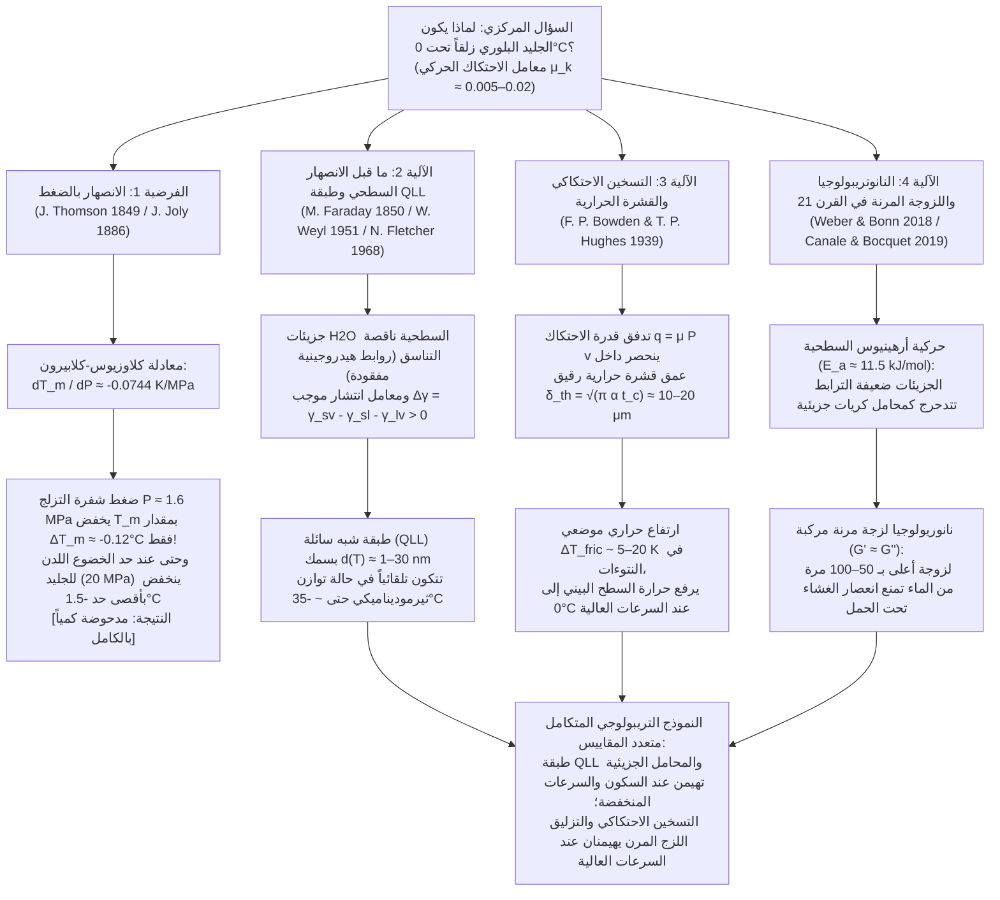

عندما تطأ بقدمك بركة متجمدة في صباح شتوي قارس، أو تشاهد متزلج سرعة ينعطف بسرعة $60\,\text{km/h}$، أو تراقب حجر الكيرلنغ الجرانيتي الذي يزن $20\,\text{kg}$ وهو ينزلق لمسافة أربعين متراً فوق الجليد دون أن يتباطأ تقريباً، فإنك تشهد واحدة من أكثر الظواهر الشاذة إثارة للدهشة في فيزياء المادة المكثفة وعلم الاحتكاك والتزليق (Tribology). بالنسبة للحدس اليومي، يبدو كون "الجليد زلقاً" أمراً بديهياً تماماً؛ ولكن من منظور فيزياء الحالة الصلبة الصارم، فإن السؤال <strong>"لماذا يتميز الجليد البلوري تحديداً بهذا الانخفاض الاستثنائي في معامل الاحتكاك؟"</strong> يمثل لغزاً علمياً عميقاً أثار جدلاً حاداً بين الفيزيائيين لأكثر من 170 عاماً.

عندما ينزلق جسمان صلبان بلوريان جافان عاديان — مثل الفولاذ على الزجاج، أو الجرانيت على الكوارتز، أو النحاس على أكسيد الألومنيوم — فوق بعضهما البعض دون مادة تشحيم خارجية، يكون معامل الاحتكاك الحركي مرتفعاً، وعادة ما يقع في النطاق $\mu_k \approx 0.4\text{–}0.8$. فعلى المستوى المجهري، تشكل النتوءات السطحية الدقيقة (Asperities) وصلات التصاق باردة يجب قصها باستمرار مع تبديد هائل للطاقة الميكانيكية. ومع ذلك، عندما تنزلق شفرة زلاجة فولاذية أو قاعدة تزلج من البولي إيثيلين فوق الجليد السداسي العادي (Ice $I_h$) عند درجة حرارة تتراوح بين $-5^\circ\text{C}$ و $-10^\circ\text{C}$ — أي أقل بكثير من نقطة الانصهار البالغة $0^\circ\text{C}$ — يهبط معامل الاحتكاك الحركي بشكل مذهل إلى <strong>$\mu_k \approx 0.005\text{–}0.02$</strong>! هذه القيمة أقل بمقدار رتبة إلى رتبتين أسيتين من أي مادة صلبة بلورية أخرى، بل وتتفوق حتى على متعدد رباعي فلورو الإيثيلين (PTFE / التيفلون، $\mu_k \approx 0.04\text{–}0.10$).

لأكثر من قرن من الزمان، كررت الكتب المدرسية والجامعية والموسوعات العلمية تفسيراً تقليدياً شائعاً:
<strong>"بما أن الماء يتمدد عند تجمده، فإن تسليط الضغط على الجليد يخفض من درجة انصهاره. وعندما يقف المتزلج على شفرة الزلاجة الرقيقة، يتركز وزنه بالكامل على مساحة ضئيلة للغاية، مما يولد ضغطاً هائلاً يذيب الجليد تحت الشفرة على الفور ليشكل غشاءً مائياً مزلقاً."</strong>

هذه هي <strong>نظرية الانصهار بالضغط (Pressure-Melting Theory)</strong> الشهيرة، التي صاغها جيمس طومسون ثيرموديناميكياً عام 1849 وطبقها جون جولي على التزلج على الجليد عام 1886. غير أن التحقق الكمي الصارم يكشف عن حقيقة قاطعة: <strong>على الرغم من أن معادلة كلاوزيوس-كلابيرون صحيحة تماماً، فإن فرضية الانصهار بالضغط كتفسير للتزلج على الجليد أو التزحلق بالأحذية خاطئة كمياً بعدة رتب أسية!</strong>

في هذه المقالة، سنشتق أولاً <strong>معادلة كلاوزيوس-كلابيرون (Clausius–Clapeyron Equation)</strong> من المبادئ الأولى لتوازن الجهد الكيميائي، ونثبت رياضياً لماذا لا يخفض ضغط شفرة المتزلج نقطة انصهار الجليد إلا بنحو عُشر درجة مئوية فقط. بعد ذلك، سنفكك <strong>تجربة فاراداي/بوتوملي الشهيرة للسلك المثقل بالأوزان الذي يخترق قالب الجليد (Regelation)</strong> عبر قانون فورييه للتوصيل الحراري، موضحين لماذا ينجح السلك النحاسي في اختراق الجليد بينما يفشل خيط النايلون تحت نفس الضغط تماماً. وأخيراً، سنستعرض الآليات الفيزيائية الثلاث الحقيقية التي تحكم انزلاق الجليد:
1. <strong>ما قبل الانصهار السطحي (Surface Premelting) والطبقة شبه السائلة النانوية (Quasi-Liquid Layer, QLL)</strong> (مايكل فاراداي 1850، فايل 1951، فليتشر 1968، داش وسومورجاي)؛
2. <strong>التسخين الاحتكاكي (Frictional Heating) والانصهار في عمق القشرة الحرارية</strong> (فرانك فيليب بودن وتوماس هيوز 1939)؛
3. <strong>النانوتريبولوجيا الحديثة في القرن الحادي والعشرين</strong>: التدحرج المنشط حرارياً لجزيئات الماء السطحية ضعيفة الترابط التي تعمل مثل "محامل كريات جزيئية" (Weber & Bonn et al., 2018)، و<strong>النانوريولوجيا اللزجة المرنة المركبة ($G' \approx G''$)</strong> للغشاء البيني الذي يمتلك لزوجة فعالة أعلى بـ 50 إلى 100 مرة من الماء السائل العادي (Canale & Bocquet et al., 2019).

---

## 1. الجليد كشذوذ تريبولوجي والمقاييس الفيزيائية الأربعة

دعونا نقارن معامل الاحتكاك الحركي لأمونتون-كولوم $\mu_k = F_f / F_N$ عبر أزواج مختلفة من المواد الصلبة:

| زوج الأسطح المتلامسة | درجة الحرارة $T$ | معامل الاحتكاك الحركي $\mu_k$ | الآلية الفيزيائية السائدة لتبديد الطاقة |
| :--- | :--- | :--- | :--- |
| <strong>فولاذ على فولاذ</strong> (هواء جاف) | $20^\circ\text{C}$ | $0.50\text{–}0.80$ | قص وصلات الالتصاق الباردة والحرث اللدن للنتوءات (Ploughing) |
| <strong>زجاج السيليكا على الزجاج</strong> | $20^\circ\text{C}$ | $0.40\text{–}0.90$ | التصاق روابط السيلانول الهيدروجينية/التساهمية والتكسر الهش الدقيق |
| <strong>جرانيت على جرانيت</strong> (صدع صخري) | $20^\circ\text{C}$ | $0.60\text{–}0.70$ | تكسر هش للنتوءات السطحية وتآكل كاشط ثلاثي الأجسام |
| <strong>PTFE (تيفلون) على فولاذ</strong> | $20^\circ\text{C}$ | $0.04\text{–}0.10$ | طاقة سطح فان دير فالس منخفضة وغشاء بوليمر ناقل موجه |
| <strong>جليد سداسي $I_h$ على فولاذ</strong> (تبريد عميق) | $-100^\circ\text{C}$ | $0.40\text{–}0.60$ | التصاق صلب عادي وقص هش (جليد غير زلق على الإطلاق!) |
| <strong>جليد سداسي $I_h$ على فولاذ</strong> (تزلج) | $-5^\circ\text{C}$ | <strong>$0.005\text{–}0.015$</strong> | طبقة QLL التوازنية + انصهار حراري احتكاكي + رفع هيدروديناميكي لزج مرن |
| <strong>جليد سداسي $I_h$ على بولي إيثيلين</strong> (زلاجة ثلج) | $-3^\circ\text{C}$ | <strong>$0.010\text{–}0.030$</strong> | انزلاق جداري كاره للماء (Wall Slip) + تزليق حراري مختلط |

عند درجة حرارة $-100^\circ\text{C}$ ($173\,\text{K}$)، لا يكون الجليد زلقاً على الإطلاق ($\mu_k \approx 0.5$). ويظهر الاحتكاك المنخفض للغاية فقط فوق $\approx -35^\circ\text{C}$ وفق المخطط التالي:

---

## 2. الدحض الصارم لفرضية الانصهار بالضغط عبر معادلة كلاوزيوس-كلابيرون

### 2.1 البنية البلورية للجليد السداسي ($I_h$) وشذوذ الحجم

في الشبكة البلورية للجليد السداسي العادي (<strong>Ice $I_h$</strong>)، يرتبط كل جزيء ماء $\text{H}_2\text{O}$ وفق قواعد برنال-فاولر بأربع روابط هيدروجينية اتجاهية ($\text{O}-\text{H}\cdots\text{O}$ بطول $\approx 2.76\,\text{\AA}$) في تنسيق رباعي السطوح ($109.5^\circ$). وتحتوي هذه البنية المفتوحة على فجوات بينية كبيرة فارغة. عند الانصهار عند $T_m = 273.15\,\text{K}$ ($0^\circ\text{C}$)، تنهار الشبكة رباعية السطوح جزئياً، فتزداد الكثافة $\rho$ وينقص الحجم النوعي $v = 1/\rho$:

* <strong>الجليد الصلب $I_h$ عند $0^\circ\text{C}$</strong>: $\rho_{\text{ice}} = 916.7\,\text{kg/m}^3 \implies v_{\text{ice}} = 1.0909 \times 10^{-3}\,\text{m}^3/\text{kg}$
* <strong>الماء السائل عند $0^\circ\text{C}$</strong>: $\rho_{\text{liquid}} = 999.84\,\text{kg/m}^3 \implies v_{\text{liquid}} = 1.0002 \times 10^{-3}\,\text{m}^3/\text{kg}$
* <strong>التغير في الحجم النوعي للانصهار</strong>:
  $$\Delta v_{\text{fus}} = v_{\text{liquid}} - v_{\text{ice}} = (1.0002 - 1.0909) \times 10^{-3}\,\text{m}^3/\text{kg} \approx -9.1 \times 10^{-5}\,\text{m}^3/\text{kg} < 0$$

### 2.2 اشتقاق معادلة كلاوزيوس-كلابيرون والحساب العددي

على طول منحنى التعايش بين الطورين الصلب والسائل $P(T_m)$، يتساوى الجهد الكيميائي (طاقة غيبس الحرة النوعية) $g_{\text{ice}}(T_m, P) = g_{\text{liquid}}(T_m, P)$. وباستخدام العلاقة التفاضلية الأساسية $dg = -s\,dT + v\,dP$ وتغير الإنتروبيا النوعية للانصهار $\Delta s_{\text{fus}} = s_{\text{liquid}} - s_{\text{ice}} = \frac{L_f}{T_m}$ مع الحرارة الكامنة للانصهار $L_f = 3.34 \times 10^5\,\text{J/kg}$، نحصل على <strong>معادلة كلاوزيوس-كلابيرون</strong>:

$$\frac{dP}{dT_m} = \frac{L_f}{T_m \left(v_{\text{liquid}} - v_{\text{ice}}\right)} = \frac{3.34 \times 10^5\,\text{J/kg}}{273.15\,\text{K} \times \left(-9.1 \times 10^{-5}\,\text{m}^3/\text{kg}\right)} \approx -1.344 \times 10^7\,\text{Pa/K} = -13.44\,\text{MPa/K}$$

وبأخذ المقلوب نحصل على معدل انخفاض درجة الانصهار لكل وحدة ضغط:

$$\frac{dT_m}{dP} \approx -0.0744\,\text{K/MPa} \quad \left(\text{أو } -0.00754^\circ\text{C/atm}\right)$$

<strong>أي أنه لخفض نقطة انصهار الجليد بمقدار درجة مئوية واحدة فقط ($1^\circ\text{C}$)، يجب تسليط ضغط هائل يبلغ $13.44\,\text{MPa}$ (حوالي $133\,\text{ضغط جوي}$)!</strong>

### 2.3 الضغط الفعلي للمتزلج وحد الخضوع اللدن للجليد

لنفترض متزلجاً كتلته $m = 75\,\text{kg}$ ($F_N = m g = 735.75\,\text{N}$) يقف على شفرة واحدة بطول تلامس $L = 30\,\text{cm} = 0.30\,\text{m}$ وعرض $w = 1.5\,\text{mm} = 1.5 \times 10^{-3}\,\text{m}$ ($A = L w = 4.5 \times 10^{-4}\,\text{m}^2$):

$$P = \frac{m g}{A} = \frac{735.75\,\text{N}}{4.5 \times 10^{-4}\,\text{m}^2} \approx 1.635\,\text{MPa} \implies \Delta T_m = \left(\frac{dT_m}{dP}\right) P \approx -0.122^\circ\text{C}$$

<strong>لا تنخفض نقطة الانصهار إلا بمقدار $0.12^\circ\text{C}$ فقط!</strong> وحتى لو أخذنا في الاعتبار تركز الإجهاد عند النتوءات المجهرية الدقيقة، فإن الضغط الموضعي $P_{\text{local}}$ لا يمكنه أبداً تجاوز إجهاد الخضوع اللدن للانضغاط (صلادة الثلم) للجليد، وهو $\sigma_{y,\text{ice}} \approx 10\text{–}20\,\text{MPa}$. وعند هذا الحد الأقصى البالغ $20\,\text{MPa}$، يكون أقصى انخفاض في درجة الانصهار هو $\Delta T_{m,\max} \approx -1.49^\circ\text{C}$، وهو ما يعجز تماماً عن تفسير التزلج عند $-15^\circ\text{C}$ أو انزلاق طفل يرتدي حذاءً مطاطياً مسطحاً ($P \approx 34\,\text{kPa}$، $\Delta T_m \approx -0.0026^\circ\text{C}$)!

---

## 3. ظاهرة إعادة التجمد لفاراداي وتجربة السلك المخترق للجليد

في تجربة بوتوملي الكلاسيكية (1872)، حيث يخترق سلك معلق به أوزان ثقيلة قالباً من الجليد عند $0^\circ\text{C}$ دون شطره إلى نصفين، لكي ينصهر الجليد تحت السلك يجب أن يمتص باستمرار الحرارة الكامنة للانصهار $L_f = 3.34 \times 10^5\,\text{J/kg}$. وتأتي هذه الحرارة من إعادة تجمد الماء فوق السلك، ويجب أن <strong>تنتقل بالتوصيل الحراري عبر قطر السلك نفسه</strong> إلى الأسفل وفق قانون فورييه (Nye 1967):

$$v_{\text{wire}} \approx \frac{\kappa_{\text{eff}} |\Delta T_m|}{\rho_{\text{ice}} L_f R}$$

يقوم <strong>السلك النحاسي</strong> ($\kappa_{\text{Cu}} \approx 400\,\text{W/(m}\cdot\text{K)}$) بتوصيل هذه الحرارة الكامنة بسرعة ويخترق الجليد بسرعة $v_{\text{wire}} \sim 10^{-5}\text{–}10^{-4}\,\text{m/s}$ (ومع ذلك يظل <strong>أبطأ بـ 5 إلى 6 رتب أسية</strong> من سرعة الزلاجة البالغة $10\,\text{m/s}$!)، بينما يفشل <strong>خيط النايلون</strong> ذو القطر نفسه ($\kappa_{\text{nylon}} \approx 0.25\,\text{W/(m}\cdot\text{K)}$، الأقل توصيلاً بـ $1600$ مرة) في اختراق الجليد تحت نفس الضغط! وعلاوة على ذلك، عندما اكتشف <strong>مايكل فاراداي</strong> ظاهرة إعادة التجمد عام 1850، رفض تفسير طومسون القائم على الضغط، واقترح بعبقرية أن سطح الجليد يمتلك بطبيعته غشاءً سطحياً شبه سائل.

---

## 4. ما قبل الانصهار السطحي والطبقة شبه السائلة النانوية (QLL)

1. <strong>نقص الروابط الهيدروجينية السطحية ومعيار ليندمان للانصهار</strong>:
   عند الواجهة بين البلورة والبخار، تفقد جزيئات الماء السطحية جيرانها العلويين وتشكل رابطتين أو 3 روابط هيدروجينية فقط بدلاً من 4. وبسبب انخفاض ثابت قوة الإرجاع $k_{\text{surf}}$ إلى النصف، تتجاوز سعة اهتزازها الحراري $\sqrt{\langle u_{\text{surf}}^2 \rangle} \propto \sqrt{k_B T / k_{\text{surf}}}$ عتبة ليندمان لعدم الاستقرار البلوري تحت $0^\circ\text{C}$ بكثير (بدءاً من $\approx -35^\circ\text{C}$)، مشكلةً <strong>طبقة شبه سائلة (QLL)</strong> بسمك $d(T) \sim 1\text{–}30\,\text{nm}$.
2. <strong>النموذج الثيرموديناميكي للطاقة الحرة البينية (Weyl, Fletcher, Dash)</strong>:
   بما أن معامل الانتشار موجب ($\Delta \gamma = \gamma_{sv} - \gamma_{sl} - \gamma_{lv} \approx 109 - 30 - 75.6 = +3.4\,\text{mJ/m}^2 > 0$)، فإن تقليل الطاقة الحرة السطحية:
   $$\Delta G_{\text{surf}}(d) = -\left(\gamma_{sv} - \gamma_{sl} - \gamma_{lv}\right)\left(1 - e^{-d/\xi}\right) + \rho_l L_f \left(\frac{T_m - T}{T_m}\right) d$$
   بالنسبة للسمك $d$ ($\frac{\partial \Delta G_{\text{surf}}}{\partial d} = 0$) يعطي قانون النمو اللوغاريتمي أو الأسي لسمك التوازن:
   $$d(T) = \xi \ln\!\left(\frac{\Delta \gamma \, T_m}{\xi \rho_l L_f (T_m - T)}\right) \quad \text{أو} \quad d(T) \propto \left(T_m - T\right)^{-1/3}$$

---

## 5. التسخين الاحتكاكي والطبقة الحدية الحرارية (Bowden & Hughes, 1939)

عند سرعات الانزلاق العالية ($v \sim 5\text{–}20\,\text{m/s}$)، تتجاوز خشونة السطح ($R_q \sim 0.1\text{–}1\,\mu\text{m}$) السمك النانوي لطبقة QLL الساكنة. وفي عام 1939 في كهف يونغفراويوخ الجليدي، أثبت <strong>فرانك فيليب بودن</strong> و<strong>توماس هيوز</strong> أن الزلاجات النحاسية ($\kappa \approx 110\,\text{W/(m}\cdot\text{K)}$) تسحب حرارة الاحتكاك وتظهر احتكاكاً عالياً، بينما الزلاجات العازلة المصنوعة من الخشب أو التيفلون ($\kappa \approx 0.2\,\text{W/(m}\cdot\text{K)}$) تحبس الحرارة عند سطح الجليد وتخفض الاحتكاك بشكل كبير.

خلال زمن التلامس $t_c = L/v$، لا يخترق تدفق حرارة الاحتكاك $q_{\text{fric}} = \mu_k P v$ سوى <strong>عمق قشرة حرارية ضئيل $\delta_{\text{th}} = \sqrt{\pi \alpha_{\text{ice}} t_c} = \sqrt{\pi \alpha_{\text{ice}} L / v} \approx 10\text{–}20\,\mu\text{m}$</strong>، مما يرفع درجة حرارة الواجهة بمقدار:

$$\Delta T_{\text{fric}} = \frac{2 \mu_k P \sqrt{v L}}{\sqrt{\pi} \left(\sqrt{\kappa_{\text{ice}} \rho_{\text{ice}} c_{p,\text{ice}}} + \sqrt{\kappa_{\text{slider}} \rho_{\text{slider}} c_{p,\text{slider}}}\right)}$$

وهذا يفسر الانصهار الموضعي عند $-10^\circ\text{C}$، ولماذا يصبح الثلج تحت $-35^\circ\text{C}$ في القارة القطبية الجنوبية أو سيبيريا خشناً مثل رمل الكوارتز الجاف ($\mu_k \approx 0.4$)، ولماذا يؤدي فائض الماء عند $0^\circ\text{C}$ إلى تكوين جسور شعرية ($\Delta P_{\text{cap}} = -2\gamma_{lv}\cos\theta / h$) ترفع الاحتكاك مجدداً.

---

## 6. نانوتريبولوجيا القرن الحادي والعشرين: المحامل الجزيئية واللزوجة المرنة (2018–2024)

1. <strong>محامل الكريات الجزيئية وقانون أرهينيوس (Weber & Bonn et al., 2018)</strong>:
   يتبع معامل احتكاك الجليد بين $-100^\circ\text{C}$ و $0^\circ\text{C}$ قانون أرهينيوس الأسي $\mu(T) \propto \exp(E_a / k_B T)$ بطاقة تنشيط <strong>$E_a \approx 11.5\,\text{kJ/mol}$</strong>، وهو ما يوافق جزيئات الماء السطحية ضعيفة الترابط التي تتدحرج فوق الشبكة البلورية مثل <strong>محامل كريات جزيئية</strong>.
2. <strong>النانوريولوجيا اللزجة المرنة المركبة للغشاء البيني (Canale & Bocquet et al., 2019)</strong>:
   الماء السائل النقي ($\eta_0 \approx 1.8\,\text{mPa}\cdot\text{s}$) سينعصر فوراً تحت ضغوط الميغاباسكال. وباستخدام مجهر القوة الذرية ذي الشوكة الرنانة الكوارتزية، اكتشف كانال وبوكيه أن الغشاء المقصوص دون الميكروني فوق الجليد يمتلك <strong>لزوجة فعالة أعلى بـ 50 إلى 100 مرة من الماء ($\eta_{\text{eff}} \sim 0.05\text{–}0.2\,\text{Pa}\cdot\text{s}$، شبيهة بزيت المحرك)</strong> ومعامل تخزين مرن كبير <strong>$G' \approx G'' \sim 10^4\text{–}10^5\,\text{Pa}$</strong>. هذا "الشحم اللزج المرن ذاتي الالتئام" يولد قوة رفع مرنة هيدروديناميكية تمنع انعصار الغشاء تحت الحمل مع الحفاظ على مقاومة قص منخفضة للغاية!
