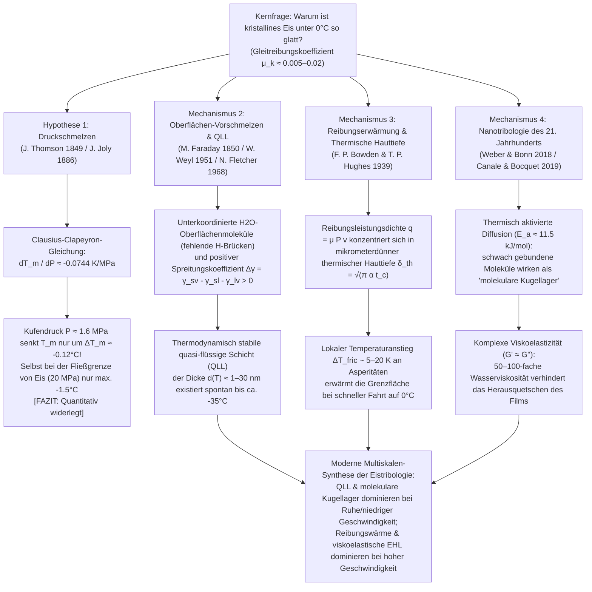

Wenn wir an einem frostigen Wintermorgen auf eine zugefrorene Pfütze treten, einem Eisschnellläufer zusehen, der mit $60\,\text{km/h}$ durch die Kurve gleitet, oder beobachten, wie ein $20\,\text{kg}$ schwerer Curlingstein aus Granit nahezu reibungslos über vierzig Meter Eis gleitet, erleben wir eine der bemerkenswertesten Anomalien der Festkörperphysik und Tribologie (der Wissenschaft von Reibung, Verschleiß und Schmierung). Für unsere Alltagsintuition erscheint die Glätte von Eis selbstverständlich. Doch aus der Perspektive der Physik der kondensierten Materie ist die Frage <strong>„Warum ist ausgerechnet kristallines Eis so außergewöhnlich glatt?“</strong> ein tiefgreifendes wissenschaftliches Rätsel, das Physiker seit mehr als 170 Jahren beschäftigt.

Wenn zwei gewöhnliche trockene kristalline Festkörper – etwa Stahl auf Glas, Granit auf Quarz oder Kupfer auf Aluminiumoxid – ohne Schmiermittel gegeneinander verschoben werden, liegt ihr Gleitreibungskoeffizient typischerweise im Bereich von $\mu_k \approx 0.4\text{–}0.8$. Auf mikroskopischer Ebene verschweißen Rauheitsspitzen (Asperitäten) kalt miteinander und müssen unter hohem Energieverlust abgeschert werden. Gleitet jedoch eine Schlittschuhkufe aus Stahl oder ein Schibelag aus Polyethylen bei $-5^\circ\text{C}$ bis $-10^\circ\text{C}$ über gewöhnliches hexagonales Wassereis (Eis $I_h$) – also tief im thermodynamischen Stabilitätsbereich der festen Phase –, sinkt der Gleitreibungskoeffizient dramatisch auf <strong>$\mu_k \approx 0.005\text{–}0.02$</strong>. Dieser Wert ist um ein bis zwei Größenordnungen niedriger als bei fast jedem anderen kristallinen Festkörper und unterbietet sogar Polytetrafluorethylen (PTFE / Teflon, $\mu_k \approx 0.04\text{–}0.10$).

In unzähligen Schulbüchern und Enzyklopädien findet sich bis heute eine scheinbar elegante Erklärung:
<strong>„Da sich Wasser beim Gefrieren ausdehnt, sinkt der Schmelzpunkt von Eis unter Druck. Wenn ein Schlittschuhläufer auf einer schmalen Kufe steht, konzentriert sich sein gesamtes Körpergewicht auf eine winzige Fläche. Der enorme Druck schmilzt das Eis unter der Kufe zu einem dünnen Wasserfilm, auf dem der Schlittschuh gleitet.“</strong>

Dies ist die berühmte <strong>Druckschmelz-Hypothese (Pressure-Melting Theory)</strong>, die 1849 von James Thomson thermodynamisch begründet und 1886 von John Joly auf das Schlittschuhlaufen übertragen wurde. Das Problem dabei: <strong>Obwohl die zugrundeliegende thermodynamische Gleichung vollkommen korrekt ist, erweist sich die Druckschmelz-Hypothese als Erklärung für das Schlittschuhlaufen, Skifahren oder Ausrutschen auf vereisten Gehwegen bei quantitativer Nachprüfung als ein um Größenordnungen verfehlter „Lehrbuch-Mythos“!</strong>

In dieser Abhandlung leiten wir zunächst die <strong>Clausius-Clapeyron-Gleichung</strong> aus dem chemischen Potentialgleichgewicht her und beweisen durch Einsetzen der exakten Naturkonstanten und des realen Kontaktdrucks einer Schlittschuhkufe mathematisch, warum Druckschmelzen den Eisschmelzpunkt nur um knapp ein Zehntel Grad Celsius absenkt. Anschließend analysieren wir <strong>Faradays Regelation und das berühmte Draht-durch-Eis-Experiment</strong> mittels Fourierscher Wärmeleitung und zeigen, warum ein Kupferdraht den Eisblock durchdringt, während eine Nylonschnur unter exakt demselben Druck scheitert. Schließlich entwickeln wir die vollständige moderne Synthese der Eistribologie über drei reale physikalische Mechanismen:
1. <strong>Oberflächen-Vorschmelzen (Surface Premelting) und die nanoskalige quasi-flüssige Schicht (Quasi-Liquid Layer, QLL)</strong> (Michael Faraday 1850, Woldemar Weyl 1951, Neville Fletcher 1968, J. G. Dash);
2. <strong>Reibungserwärmung (Frictional Heating) und thermisches Grenzschichtschmelzen</strong> (Frank Philip Bowden & Thomas P. Hughes 1939); und
3. <strong>Moderne Nanotribologie des 21. Jahrhunderts</strong>: thermisch aktivierte „molekulare Kugellager“ schwach gebundener Oberflächenmoleküle (Weber & Bonn et al. 2018) sowie die komplexe <strong>viskoelastische Nanorheologie ($G' \approx G''$)</strong> des gescherten Grenzflächenfilms mit einer 50- bis 100-fach höheren effektiven Viskosität als gewöhnliches Wasser (Canale & Bocquet et al. 2019).

---

## 1. Eis als tribologische Anomalie und die vier physikalischen Skalen

Um die Ausnahmestellung von Eis zu verdeutlichen, vergleichen wir den Coulomb-Amontons-Gleitreibungskoeffizienten $\mu_k = F_f / F_N$ verschiedener Festkörperpaarungen:

| Reibpaarung (ungeschmiert / selbstschmierend) | Temperatur $T$ | Typischer Gleitreibungskoeffizient $\mu_k$ | Dominanter physikalischer Dissipationsmechanismus |
| :--- | :--- | :--- | :--- |
| <strong>Stahl auf Stahl</strong> (trockene Luft) | $20^\circ\text{C}$ | $0.50\text{–}0.80$ | Abscheren kaltverschweißter Mikrokontakte und Furchenbildung (Ploughing) |
| <strong>Quarzglas auf Glas</strong> | $20^\circ\text{C}$ | $0.40\text{–}0.90$ | Silanol-Wasserstoffbrücken/kovalente Adhäsion und spröder Mikrobruch |
| <strong>Granit auf Granit</strong> (Tektonik) | $20^\circ\text{C}$ | $0.60\text{–}0.70$ | Sprödes Zerbrechen von Asperitäten und abrasiver Dreikörperverschleiß |
| <strong>PTFE (Teflon) auf Stahl</strong> | $20^\circ\text{C}$ | $0.04\text{–}0.10$ | Niedrige Van-der-Waals-Oberflächenenergie und Polymer-Transferfilm |
| <strong>Hexagonales Eis $I_h$ auf Stahl</strong> (kryogen) | $-100^\circ\text{C}$ | $0.40\text{–}0.60$ | Normale Festkörperadhäsion und spröde Scherung (nicht-glattes Eis!) |
| <strong>Hexagonales Eis $I_h$ auf Stahl</strong> (Eislauf) | $-5^\circ\text{C}$ | <strong>$0.005\text{–}0.015$</strong> | Gleichgewichts-QLL + Reibungswärmeschmelzen + viskoelastischer Auftrieb |
| <strong>Hexagonales Eis $I_h$ auf UHMWPE</strong> (Ski) | $-3^\circ\text{C}$ | <strong>$0.010\text{–}0.030$</strong> | Hydrophober Wandgleiteffekt (Wall Slip) + Mischreibung durch Reibwärme |

Wie die Tabelle zeigt, ist Eis bei $-100^\circ\text{C}$ ($173\,\text{K}$) mit $\mu_k \approx 0.5$ überhaupt nicht glatt, sondern verhält sich wie Glas oder Gestein. Die extrem niedrige Reibung tritt erst in einem Temperaturfenster oberhalb von ca. $-35^\circ\text{C}$ auf:

---

## 2. Widerlegung der Druckschmelz-Hypothese mittels der Clausius-Clapeyron-Gleichung

### 2.1 Kristallstruktur von hexagonalem Eis ($I_h$) und die Dichteanomalie

Im Kristallgitter von gewöhnlichem hexagonalem Eis (<strong>Eis $I_h$</strong>) ist jedes $\text{H}_2\text{O}$-Molekül gemäß den Bernal-Fowler-Eisregeln über vier gerichtete Wasserstoffbrückenbindungen ($\text{O}-\text{H}\cdots\text{O}$-Abstand $\approx 2.76\,\text{\AA}$, Tetraederwinkel $109.5^\circ$) tetraedrisch mit vier Nachbarmolekülen verknüpft. Diese offene, käfigartige Wurtzit-Struktur umschließt große strukturelle Hohlräume. Beim Schmelzen am normalen Schmelzpunkt $T_m = 273.15\,\text{K}$ ($0^\circ\text{C}$) bricht das starre Tetraedernetzwerk teilweise zusammen, sodass Wassermoleküle in die Hohlräume eindringen. Dadurch steigt die Dichte $\rho$ beim Schmelzen an, während das spezifische Volumen $v = 1/\rho$ abnimmt:

* <strong>Festes hexagonales Eis ($I_h$) bei $0^\circ\text{C}$</strong>: $\rho_{\text{ice}} = 916.7\,\text{kg/m}^3 \implies v_{\text{ice}} = 1.0909 \times 10^{-3}\,\text{m}^3/\text{kg}$
* <strong>Flüssiges Wasser bei $0^\circ\text{C}$</strong>: $\rho_{\text{liquid}} = 999.84\,\text{kg/m}^3 \implies v_{\text{liquid}} = 1.0002 \times 10^{-3}\,\text{m}^3/\text{kg}$
* <strong>Spezifische Volumenänderung beim Schmelzen</strong>:
  $$\Delta v_{\text{fus}} = v_{\text{liquid}} - v_{\text{ice}} = (1.0002 - 1.0909) \times 10^{-3}\,\text{m}^3/\text{kg} \approx -9.1 \times 10^{-5}\,\text{m}^3/\text{kg} < 0$$

### 2.2 Herleitung der Clausius-Clapeyron-Gleichung und Berechnung der Schmelzpunkterniedrigung

Entlang der Fest-Flüssig-Koexistenzkurve $P(T_m)$ müssen die spezifischen freien Enthalpien (Gibbs-Energien bzw. chemischen Potentiale) beider Phasen gleich sein: $g_{\text{ice}}(T_m, P) = g_{\text{liquid}}(T_m, P)$. Für eine infinitesimale Verschiebung $(dT_m, dP)$ entlang der Phasengrenze gilt mit der fundamentalen Relation $dg = -s\,dT + v\,dP$:

$$-s_{\text{ice}}\,dT_m + v_{\text{ice}}\,dP = -s_{\text{liquid}}\,dT_m + v_{\text{liquid}}\,dP \implies \left(v_{\text{liquid}} - v_{\text{ice}}\right) dP = \left(s_{\text{liquid}} - s_{\text{ice}}\right) dT_m$$

Mit der spezifischen Schmelzentropie $\Delta s_{\text{fus}} = s_{\text{liquid}} - s_{\text{ice}} = \frac{L_f}{T_m}$ (wobei $L_f = 3.34 \times 10^5\,\text{J/kg}$ die spezifische Schmelzwärme ist) folgt die <strong>Clausius-Clapeyron-Gleichung</strong>:

$$\frac{dP}{dT_m} = \frac{L_f}{T_m \left(v_{\text{liquid}} - v_{\text{ice}}\right)}$$

Setzen wir die exakten Zahlenwerte ein ($L_f = 3.34 \times 10^5\,\text{J/kg}$, $T_m = 273.15\,\text{K}$, $\Delta v = -9.1 \times 10^{-5}\,\text{m}^3/\text{kg}$):

$$\frac{dP}{dT_m} = \frac{3.34 \times 10^5\,\text{J/kg}}{273.15\,\text{K} \times \left(-9.1 \times 10^{-5}\,\text{m}^3/\text{kg}\right)} \approx -1.344 \times 10^7\,\text{Pa/K} = -13.44\,\text{MPa/K}$$

Der Kehrwert liefert die Schmelzpunktverschiebung pro Druckeinheit:

$$\frac{dT_m}{dP} \approx -0.0744\,\text{K/MPa} \quad \left(\text{bzw. } -0.00754^\circ\text{C/atm}\right)$$

<strong>Um den Schmelzpunkt von Eis um lediglich $1^\circ\text{C}$ abzusenken, ist ein gewaltiger Druck von $13.44\,\text{MPa}$ (rund $133\,\text{Atmosphären}$) erforderlich!</strong>

### 2.3 Der reale Druck eines Schlittschuhläufers und die Fließgrenze von Eis

Betrachten wir einen Schlittschuhläufer der Masse $m = 75\,\text{kg}$ ($F_N = m g = 735.75\,\text{N}$), der auf einer einzigen Kufe der Kontaktlänge $L = 30\,\text{cm} = 0.30\,\text{m}$ und Breite $w = 1.5\,\text{mm} = 1.5 \times 10^{-3}\,\text{m}$ ($A = L w = 4.5 \times 10^{-4}\,\text{m}^2$) gleitet:

$$P = \frac{m g}{A} = \frac{735.75\,\text{N}}{4.5 \times 10^{-4}\,\text{m}^2} \approx 1.635\,\text{MPa} \implies \Delta T_m = \left(\frac{dT_m}{dP}\right) P \approx -0.122^\circ\text{C}$$

<strong>Der Schmelzpunkt sinkt um nur $0.12^\circ\text{C}$!</strong> Selbst wenn man berücksichtigt, dass der Kontakt nur an mikroskopischen Rauheitsspitzen (Asperitäten) stattfindet, kann der lokale Kontaktdruck $P_{\text{local}}$ niemals die plastische Druckfließgrenze (Eindruckhärte) von Eis ($\sigma_{y,\text{ice}} \approx 10\text{–}20\,\text{MPa}$) überschreiten, da die Eisspitzen sonst sofort plastisch zerfließen, bis $A_{\text{real}} = F_N / \sigma_y$ erreicht ist. Selbst bei $\sigma_y = 20\,\text{MPa}$ beträgt die maximale Schmelzpunkterniedrigung nur $\Delta T_{m,\max} \approx -1.49^\circ\text{C}$. Damit lässt sich weder das Eislaufen bei $-10^\circ\text{C}$ noch das Ausrutschen eines Fußgängers mit flachen Gummisohlen ($P \approx 34\,\text{kPa}$, $\Delta T_m \approx -0.0026^\circ\text{C}$) erklären!

---

## 3. Faradays Regelation und das Draht-durch-Eis-Experiment

Beim klassischen Vorlesungsversuch von Bottomley (1872), bei dem eine mit Gewichten beschwerte Drahtschlinge langsam durch einen Eisblock wandert, ohne ihn zu zerteilen, schmilzt das Eis unter dem Draht bei $T_0 - |\Delta T_m|$ nur deshalb, weil das Schmelzwasser hinter dem Draht bei $T_0 = 0^\circ\text{C}$ wieder gefriert (Regelation) und die dabei freiwerdende Erstarrungswärme $L_f$ <strong>durch den Draht hindurch nach unten geleitet wird</strong> (Nye 1967):

$$v_{\text{wire}} \approx \frac{\kappa_{\text{eff}} |\Delta T_m|}{\rho_{\text{ice}} L_f R}$$

Ein <strong>Kupferdraht</strong> ($\kappa_{\text{Cu}} \approx 400\,\text{W/(m}\cdot\text{K)}$) leitet diese Wärme hervorragend und sinkt mit $v_{\text{wire}} \sim 10^{-5}\text{–}10^{-4}\,\text{m/s}$ durch das Eis (was immer noch <strong>5 bis 6 Größenordnungen zu langsam</strong> für einen $10\,\text{m/s}$ schnellen Schlittschuh ist!). Eine <strong>Nylonschnur</strong> gleichen Durchmessers ($\kappa_{\text{nylon}} \approx 0.25\,\text{W/(m}\cdot\text{K)}$) hingegen ist ein Wärmeisolator und schneidet unter exakt demselben Druck überhaupt nicht durch das Eis! Zudem hatte <strong>Michael Faraday</strong> bereits 1850 bei seiner Entdeckung der Regelation erkannt, dass nicht der Druck das Eis schmilzt, sondern dass Eisoberflächen von Natur aus einen flüssigkeitsähnlichen Film tragen, der im Inneren zwischen zwei sich berührenden Eisblöcken sofort erstarrt.

---

## 4. Oberflächen-Vorschmelzen und die quasi-flüssige Schicht (QLL)

1. <strong>Fehlende Wasserstoffbrücken und Lindemann-Kriterium</strong>:
   Im Inneren des Eiskristalls bildet jedes Wassermolekül 4 Wasserstoffbrücken. An der freien Kristall-Dampf-Grenzfläche fehlen die oberen Nachbarn, sodass Oberflächenmoleküle nur 2 oder 3 Bindungen aufweisen. Durch die halbierte Rückstellkraftkonstante $k_{\text{surf}}$ überschreitet ihre thermische Schwingungsamplitude $\sqrt{\langle u_{\text{surf}}^2 \rangle} \propto \sqrt{k_B T / k_{\text{surf}}}$ bereits weit unter $0^\circ\text{C}$ (ab ca. $-35^\circ\text{C}$) das Lindemann-Schmelzkriterium und bildet eine ungeordnete <strong>quasi-flüssige Schicht (Quasi-Liquid Layer, QLL)</strong> der Dicke $d(T) \sim 1\text{–}30\,\text{nm}$.
2. <strong>Thermodynamisches Grenzflächenmodell (Weyl, Fletcher, Dash)</strong>:
   Da der Spreitungskoeffizient $\Delta \gamma = \gamma_{sv} - \gamma_{sl} - \gamma_{lv} \approx 109 - 30 - 75.6 = +3.4\,\text{mJ/m}^2 > 0$ positiv ist, senkt die Bildung eines dünnen Flüssigkeitsfilms der Dicke $d$ die freie Oberflächenenergie $\Delta G_{\text{surf}}(d)$:
   $$\Delta G_{\text{surf}}(d) = -\left(\gamma_{sv} - \gamma_{sl} - \gamma_{lv}\right)\left(1 - e^{-d/\xi}\right) + \rho_l L_f \left(\frac{T_m - T}{T_m}\right) d$$
   Minimierung ($\frac{\partial \Delta G_{\text{surf}}}{\partial d} = 0$) liefert das logarithmische bzw. Potenz-Wachstumsgesetz der Gleichgewichtsdicke:
   $$d(T) = \xi \ln\!\left(\frac{\Delta \gamma \, T_m}{\xi \rho_l L_f (T_m - T)}\right) \quad \text{bzw.} \quad d(T) \propto \left(T_m - T\right)^{-1/3}$$

---

## 5. Reibungserwärmung und thermische Grenzschicht (Bowden & Hughes, 1939)

Bei hohen Gleitgeschwindigkeiten ($v \sim 5\text{–}20\,\text{m/s}$) übersteigt die Oberflächenrauheit von Kufen und Skiern ($R_q \sim 0.1\text{–}1\,\mu\text{m}$) die wenigen Nanometer der statischen QLL. <strong>Frank Philip Bowden</strong> und <strong>Thomas P. Hughes</strong> bewiesen 1939 im Eislabor auf dem Jungfraujoch, dass Messing-Skier ($\kappa \approx 110\,\text{W/(m}\cdot\text{K)}$) die Reibungswärme ableiten und hohe Reibung zeigen, während isolierende Holz- oder PTFE-Skier ($\kappa \approx 0.2\,\text{W/(m}\cdot\text{K)}$) die Reibungswärme an der Eisoberfläche stauen und viel besser gleiten.

Während der Kontaktzeit $t_c = L/v$ dringt die Reibungsheizleistung $q_{\text{fric}} = \mu_k P v$ nur in eine winzige <strong>thermische Hauttiefe $\delta_{\text{th}} = \sqrt{\pi \alpha_{\text{ice}} t_c} = \sqrt{\pi \alpha_{\text{ice}} L / v} \approx 10\text{–}20\,\mu\text{m}$</strong> ein und erzeugt den Temperaturanstieg:

$$\Delta T_{\text{fric}} = \frac{2 \mu_k P \sqrt{v L}}{\sqrt{\pi} \left(\sqrt{\kappa_{\text{ice}} \rho_{\text{ice}} c_{p,\text{ice}}} + \sqrt{\kappa_{\text{slider}} \rho_{\text{slider}} c_{p,\text{slider}}}\right)}$$

Dies erklärt sowohl das lokale Aufschmelzen bei $-10^\circ\text{C}$ als auch, warum Schnee unterhalb von $-35^\circ\text{C}$ in der Antarktis oder Sibirien stumpf wie trockener Quarzsand wird ($\mu_k \approx 0.4$), während bei $0^\circ\text{C}$ zu dicke Wasserfilme durch kapillare Meniskusbrücken ($\Delta P_{\text{cap}} = -2\gamma_{lv}\cos\theta / h$) eine starke Saugwirkung erzeugen.

---

## 6. Nanotribologie des 21. Jahrhunderts: Molekulare Kugellager und Viskoelastizität (2018–2024)

1. <strong>Molekulare Kugellager und Arrhenius-Mobilität (Weber & Bonn et al., 2018)</strong>:
   Der Reibungskoeffizient von Eis folgt zwischen $-100^\circ\text{C}$ und $0^\circ\text{C}$ einem strengen Arrhenius-Gesetz $\mu(T) \propto \exp(E_a / k_B T)$ mit einer Aktivierungsenergie von <strong>$E_a \approx 11.5\,\text{kJ/mol}$</strong>. Dies entspricht der thermischen Rotation doppelt unterkoordinierter Oberflächenmoleküle, die wie <strong>molekulare Kugellager</strong> über das Kristallgitter rollen.
2. <strong>Komplexe Viskoelastizität des Schmierfilms (Canale & Bocquet et al., 2019)</strong>:
   Reines flüssiges Wasser ($\eta_0 \approx 1.8\,\text{mPa}\cdot\text{s}$) würde unter dem Megapascal-Druck einer Kufe sofort herausgequetscht. Mittels Quarz-Stimmgabel-AFM wiesen Canale und Bocquet nach, dass der gescherte Grenzflächenfilm auf Eis eine <strong>50- bis 100-mal höhere effektive Viskosität als Wasser ($\eta_{\text{eff}} \sim 0.05\text{–}0.2\,\text{Pa}\cdot\text{s}$, ähnlich wie Motoröl)</strong> sowie einen großen elastischen Speichermodul <strong>$G' \approx G'' \sim 10^4\text{–}10^5\,\text{Pa}$</strong> besitzt. Dieses selbstheilende <strong>viskoelastische Schmierfett</strong> aus Nano-Eis-Wasser-Clustern erzeugt einen starken elastohydrodynamischen Auftrieb (Lift), der das Herausquetschen verhindert und gleichzeitig extrem niedrige Scherkräfte ermöglicht!
