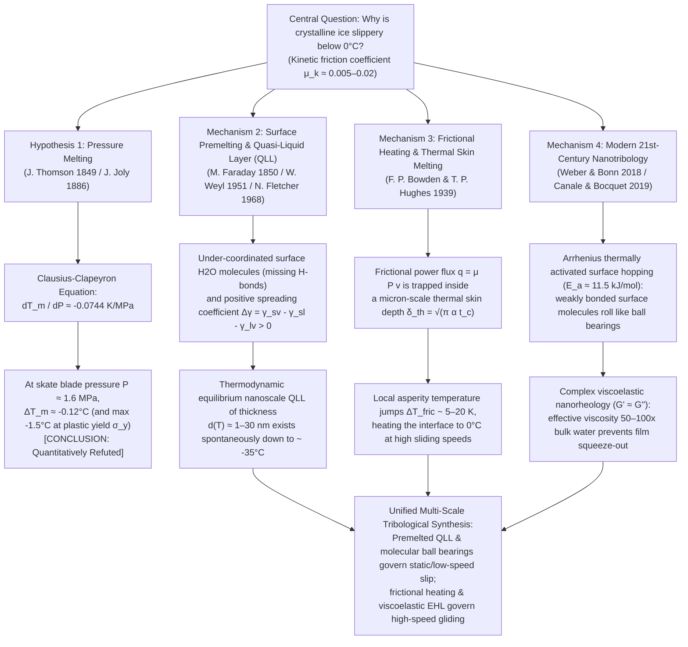
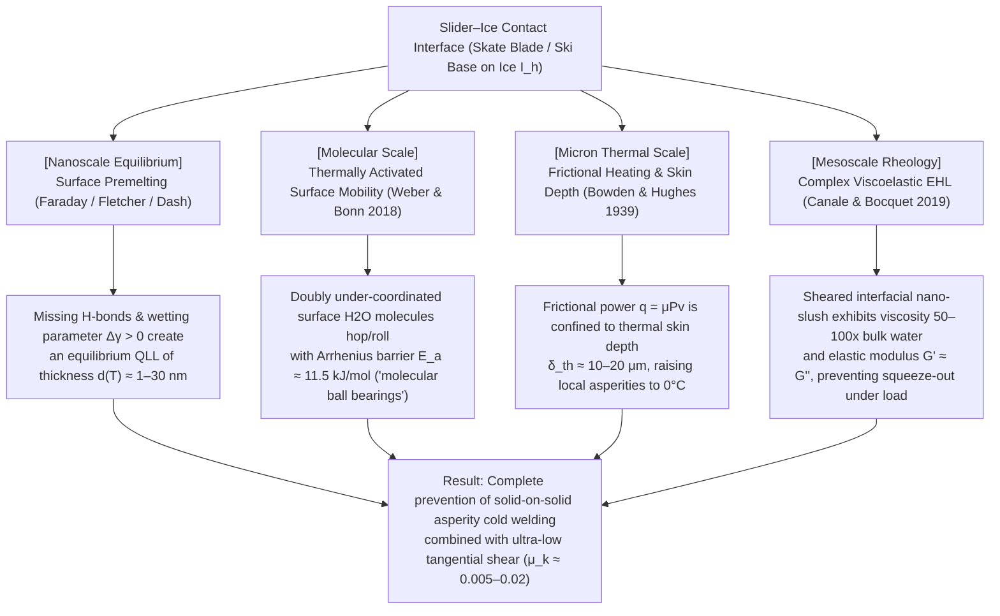

Step onto a frozen pond on a crisp winter morning, watch a speed skater carve around an oval track at $60\,\text{km/h}$, or observe a $20\,\text{kg}$ granite curling stone glide effortlessly across forty meters of pebbled ice, and you are witnessing one of the most striking anomalies in condensed matter physics. To everyday intuition, the slipperiness of ice feels entirely natural—after all, everyone knows ice is slippery. Yet when examined through the rigorous lens of solid-state physics and tribology (the science of friction, wear, and lubrication), the question <strong>"Why is ice so slippery?"</strong> turns out to be a profound scientific puzzle that has sparked fierce debate among physicists for more than 170 years.

When almost any two dry crystalline solids—such as steel on glass, granite on quartz, or copper on aluminum oxide—are slid against one another without an external lubricant, their coefficient of kinetic friction $\mu_k$ is large, typically falling in the range $\mu_k \approx 0.4\text{–}0.8$. At the microscopic scale, surface asperities (peaks of roughness) form cold-welded adhesive junctions that must be continuously sheared and ploughed through, dissipating enormous mechanical energy and causing severe stick-slip wear. Yet when a steel skate blade or a polyethylene ski glides over hexagonal crystalline ice (Ice $I_h$) at $-5^\circ\text{C}$ to $-10^\circ\text{C}$—well within the thermodynamic stability field of the solid phase—the kinetic friction coefficient plummets to <strong>$\mu_k \approx 0.005\text{–}0.02$</strong>. This value is one to two orders of magnitude lower than that of any other crystalline solid, outperforming even polytetrafluoroethylene (PTFE / Teflon, $\mu_k \approx 0.04\text{–}0.10$) and rivaling pressurized hydrodynamically lubricated journal bearings.

If you consult a high school physics textbook, an introductory university thermodynamics course, or a popular science encyclopedia, you will almost certainly encounter a familiar explanation:
<strong>"Because water expands when it freezes, applying pressure to ice lowers its melting point. When an ice skater stands on a thin skate blade, their body weight concentrates onto a tiny area, creating immense pressure that melts the ice beneath the blade into a thin lubricating film of water."</strong>

This is the celebrated <strong>Pressure-Melting Theory</strong> (originating with James Thomson in 1849 and applied to ice skating by John Joly in 1886). There is only one problem with this textbook explanation: <strong>while the underlying thermodynamic equation is completely correct, as an explanation for ice skating, skiing, or slipping on an icy sidewalk, the pressure-melting hypothesis is quantitatively wrong by orders of magnitude.</strong>

In this comprehensive physical treatise, we will first derive the <strong>Clausius–Clapeyron equation</strong> from first principles of chemical potential equilibrium and substitute the exact physical constants of water and ice alongside the real contact mechanics of an ice skate. We will prove mathematically why blade pressure lowers the melting point of ice by barely a tenth of a degree Celsius—leaving skating at $-10^\circ\text{C}$ or slipping in flat rubber boots completely unexplained. Next, we will deconstruct the famous <strong>Faraday/Bottomley weighted-wire regelation experiment</strong>, demonstrating via Fourier heat conduction why a copper wire passes through an ice block while a nylon thread under identical pressure fails. Finally, we will build the complete modern synthesis of ice tribology across three true physical mechanisms:
1. <strong>Surface Premelting and the Equilibrium Quasi-Liquid Layer (QLL)</strong> (Michael Faraday 1850, Woldemar Weyl 1951, Neville Fletcher 1968, J. G. Dash, Gabor Somorjai);
2. <strong>Frictional Heating and Thermal Skin-Depth Melting</strong> (Frank Philip Bowden & Thomas P. Hughes 1939); and
3. <strong>21st-Century Molecular and Viscoelastic Nanotribology</strong> (Bart Weber & Daniel Bonn et al. 2018; Loïc Canale & Lydéric Bocquet et al. 2019), revealing how under-coordinated surface water molecules act as thermally activated "molecular ball bearings" and how the sheared sub-micron film behaves not like ordinary liquid water, but like a self-healing, high-viscosity <strong>complex viscoelastic grease</strong> ($G' \approx G''$).

---

## 1. Ice as a Tribological Anomaly and the Four Physical Regimes

To appreciate just how extraordinary the surface of ice is, let us compare the Amontons–Coulomb kinetic friction coefficient $\mu_k = F_f / F_N$ (where $F_f$ is the tangential friction force and $F_N$ is the normal load) across representative solid-on-solid interfaces:

| Sliding Interface Pair (Unlubricated / Self-Lubricated) | Temperature $T$ | Typical Kinetic Friction $\mu_k$ | Dominant Physical Dissipation Mechanism |
| :--- | :--- | :--- | :--- |
| <strong>Steel on Steel</strong> (clean, dry air) | $20^\circ\text{C}$ | $0.50\text{–}0.80$ | Cold-welded metallic junction shearing and asperity ploughing |
| <strong>Silica Glass on Glass</strong> | $20^\circ\text{C}$ | $0.40\text{–}0.90$ | Silanol hydrogen/covalent bond adhesion and brittle micro-fracture |
| <strong>Granite on Granite</strong> (tectonic fault gouge) | $20^\circ\text{C}$ | $0.60\text{–}0.70$ | Interlocking asperity fracture and abrasive third-body wear |
| <strong>PTFE (Teflon) on Steel</strong> | $20^\circ\text{C}$ | $0.04\text{–}0.10$ | Low van der Waals surface energy and oriented polymer transfer film |
| <strong>Hexagonal Ice $I_h$ on Steel</strong> (cryogenic regime) | $-100^\circ\text{C}$ | $0.40\text{–}0.60$ | Normal crystalline solid adhesion and brittle shearing (non-slippery ice!) |
| <strong>Hexagonal Ice $I_h$ on Steel</strong> (ice skating regime) | $-5^\circ\text{C}$ | <strong>$0.005\text{–}0.015$</strong> | Surface QLL + frictional thermal boundary melting + viscoelastic lift |
| <strong>Hexagonal Ice $I_h$ on UHMWPE</strong> (alpine ski base) | $-3^\circ\text{C}$ | <strong>$0.010\text{–}0.030$</strong> | Hydrophobic wall slip + frictional melt film mixed lubrication |

Notice the crucial entry for cryogenic ice at $-100^\circ\text{C}$ ($173\,\text{K}$): at deep sub-zero temperatures, ice is <strong>not slippery at all</strong>. Its friction coefficient ($\mu_k \approx 0.5$) is virtually indistinguishable from glass, rock, or ceramics. The ultra-low friction of ice is an emergent phenomenon that switches on within roughly $35\,\text{K}$ of its bulk melting temperature $T_m = 273.15\,\text{K}$ ($0^\circ\text{C}$) and depends sensitively on sliding velocity, thermal conductivity, and interfacial rheology.

The historical evolution and multi-scale physical architecture of ice friction are summarized in the following diagram:

Let us now examine the first hypothesis—pressure melting—and see precisely where and why it fails.

---

## 2. The Rise and Fall of the "Pressure-Melting" Myth: A Rigorous Clausius–Clapeyron Analysis

### 2.1 Historical Genesis: James Thomson (1849) and John Joly (1886)

In 1849, the Scottish engineer and physicist <strong>James Thomson</strong> (elder brother of William Thomson, later Lord Kelvin) applied Sadi Carnot's theory of heat engines to the phase equilibrium between solid ice and liquid water. Unlike almost all normal substances, whose solid phase is denser than their liquid phase, ordinary water expands by approximately $9\%$ when it freezes at atmospheric pressure. Invoking thermodynamic consistency (what we now recognize as Le Chatelier's principle), James Thomson reasoned that subjecting ice to hydrostatic compression must favor the denser phase—liquid water—and therefore <strong>lower the freezing/melting temperature $T_m$</strong>. In 1850, William Thomson experimentally verified his brother's exact numerical prediction using a sensitive ether thermometer sealed inside a heavy glass pressure vessel filled with an ice-water mixture.

Nearly four decades later, in 1886, the Irish physicist and geologist <strong>John Joly</strong> published a landmark paper in the *Scientific Proceedings of the Royal Dublin Society* proposing that James Thomson's pressure-induced melting point depression was the physical secret behind ice skating. Joly argued that the narrow steel edge of an ice skate concentrates the skater's weight into a pressure high enough to liquefy the underlying ice, creating an instant water film that refreezes as soon as the skate passes. Because this explanation linked an everyday winter pastime to a triumph of 19th-century thermodynamics, it was uncritically adopted by generations of textbook authors.

### 2.2 Crystal Structure of Hexagonal Ice ($I_h$) and the Origin of the Negative Volume of Fusion

To evaluate Thomson and Joly's theory quantitatively, we must first understand why ice is less dense than liquid water. An individual $\text{H}_2\text{O}$ molecule has a bent geometry (bond angle $\approx 104.5^\circ$ in the gas phase, approaching the ideal $sp^3$ tetrahedral angle of $109.47^\circ$ in condensed phases), with two positively polarized hydrogen atoms (proton donors) and two lone pairs of electrons on the oxygen atom (proton acceptors).

In ordinary hexagonal ice (<strong>Ice $I_h$</strong>), which is the stable crystalline polymorph at ambient pressure from $273.15\,\text{K}$ down to $72\,\text{K}$, the oxygen atoms form a hexagonal wurtzite-like lattice governed by the <strong>Bernal–Fowler ice rules</strong> (which also give rise to Linus Pauling's famous residual configurational entropy $S_0 = R \ln(3/2)$). Every water molecule in bulk Ice $I_h$ is locked into a strict <strong>four-fold tetrahedral coordination</strong> via directional $\text{O}-\text{H}\cdots\text{O}$ hydrogen bonds of length $d_{\text{O}\cdots\text{O}} \approx 2.76\,\text{\AA}$. Because directional tetrahedral bonding prioritizes bond angles over close packing, the crystal lattice forms open hexagonal rings and channels containing large interstitial cages of empty space.

When Ice $I_h$ melts into liquid water at $0^\circ\text{C}$ ($273.15\,\text{K}$) and $1\,\text{atm}$ ($101.325\,\text{kPa}$), thermal agitation breaks roughly $10\text{–}15\%$ of the hydrogen bonds and distorts the rigid tetrahedral angles. Surrounding water molecules partially collapse into the open interstitial voids, raising the average first-shell coordination number from exactly $4.0$ in Ice $I_h$ to approximately $4.4\text{–}4.7$ in liquid water. Consequently, the mass density $\rho$ increases and the specific volume $v = 1/\rho$ (volume per unit mass) decreases upon melting:

* <strong>Solid Hexagonal Ice ($I_h$) at $0^\circ\text{C}$</strong>:
  $$\rho_{\text{ice}} = 916.7\,\text{kg/m}^3 \implies v_{\text{ice}} = \frac{1}{\rho_{\text{ice}}} = 1.0909 \times 10^{-3}\,\text{m}^3/\text{kg}$$
* <strong>Liquid Water at $0^\circ\text{C}$</strong>:
  $$\rho_{\text{liquid}} = 999.84\,\text{kg/m}^3 \implies v_{\text{liquid}} = \frac{1}{\rho_{\text{liquid}}} = 1.0002 \times 10^{-3}\,\text{m}^3/\text{kg}$$

The specific volume change of fusion, $\Delta v_{\text{fus}} = v_{\text{liquid}} - v_{\text{ice}}$, is therefore <strong>negative</strong>:

$$\Delta v_{\text{fus}} = v_{\text{liquid}} - v_{\text{ice}} = (1.0002 - 1.0909) \times 10^{-3}\,\text{m}^3/\text{kg} = -9.07 \times 10^{-5}\,\text{m}^3/\text{kg} \approx -9.1 \times 10^{-5}\,\text{m}^3/\text{kg}$$

### 2.3 First-Principles Derivation of the Clausius–Clapeyron Equation

Consider the coexistence curve $P(T)$ separating solid ice and liquid water in the pressure–temperature phase diagram. Along any point $(T_m, P)$ on this phase boundary, the two phases are in thermodynamic equilibrium, meaning their specific Gibbs free energies (chemical potentials per unit mass) must be identical:

$$g_{\text{ice}}(T_m, P) = g_{\text{liquid}}(T_m, P)$$

Suppose we move infinitesimally along the coexistence curve to a neighboring equilibrium state $(T_m + dT_m, P + dP)$. Equilibrium at the new state requires:

$$g_{\text{ice}} + dg_{\text{ice}} = g_{\text{liquid}} + dg_{\text{liquid}} \implies dg_{\text{ice}} = dg_{\text{liquid}}$$

From the fundamental thermodynamic relation for a simple compressible system, the differential of the specific Gibbs free energy $g = u + Pv - Ts$ is $dg = -s\,dT + v\,dP$, where $s$ is the specific entropy and $v$ is the specific volume. Substituting this into our coexistence condition yields:

$$-s_{\text{ice}}\,dT_m + v_{\text{ice}}\,dP = -s_{\text{liquid}}\,dT_m + v_{\text{liquid}}\,dP$$

Rearranging terms to group $dP$ and $dT_m$:

$$\left(v_{\text{liquid}} - v_{\text{ice}}\right) dP = \left(s_{\text{liquid}} - s_{\text{ice}}\right) dT_m$$

Because melting at equilibrium temperature $T_m$ and constant pressure $P$ is a reversible isothermal phase transition, the specific entropy change of fusion $\Delta s_{\text{fus}} = s_{\text{liquid}} - s_{\text{ice}}$ is related to the specific latent heat of fusion $L_f$ (enthalpy of fusion $\Delta h_{\text{fus}}$) by $\Delta s_{\text{fus}} = \frac{L_f}{T_m}$. Substituting this relation gives the celebrated <strong>Clausius–Clapeyron Equation</strong>:

$$\frac{dP}{dT_m} = \frac{L_f}{T_m \left(v_{\text{liquid}} - v_{\text{ice}}\right)}$$

Let us now plug in the exact experimental physical constants for water at $T_m = 273.15\,\text{K}$:
* Specific latent heat of fusion: $L_f = 3.3355 \times 10^5\,\text{J/kg} \approx 3.34 \times 10^5\,\text{J/kg}$
* Equilibrium melting temperature: $T_m = 273.15\,\text{K}$
* Specific volume change: $\Delta v_{\text{fus}} = v_{\text{liquid}} - v_{\text{ice}} = -9.1 \times 10^{-5}\,\text{m}^3/\text{kg}$

Evaluating the slope $\frac{dP}{dT_m}$:

$$\frac{dP}{dT_m} = \frac{3.34 \times 10^5\,\text{J/kg}}{(273.15\,\text{K}) \times (-9.1 \times 10^{-5}\,\text{m}^3/\text{kg})} = \frac{3.34 \times 10^5}{-2.4857 \times 10^{-2}}\,\text{Pa/K} \approx -1.344 \times 10^7\,\text{Pa/K} = -13.44\,\text{MPa/K}$$

Taking the reciprocal gives the rate of melting temperature depression per unit of applied pressure:

$$\frac{dT_m}{dP} = \frac{T_m \left(v_{\text{liquid}} - v_{\text{ice}}\right)}{L_f} \approx -0.0744\,\text{K/MPa} \quad \left(\text{or } -0.00754^\circ\text{C/atm}\right)$$

Pause and reflect on the magnitude of this number: <strong>to lower the melting point of ice by just $1^\circ\text{C}$, you must apply a colossal pressure of $13.44\,\text{MPa}$ ($132.6\,\text{atmospheres}$, or roughly $1,950\,\text{psi}$)!</strong>

### 2.4 Quantitative Test: What Pressure Does an Ice Skater Actually Exert?

Let us now compute the pressure exerted by an adult ice skater of mass $m = 75\,\text{kg}$. Under standard gravity $g = 9.81\,\text{m/s}^2$, the total downward normal force is:

$$F_N = m g = 75\,\text{kg} \times 9.81\,\text{m/s}^2 = 735.75\,\text{N}$$

To maximize the pressure, assume the skater is balancing their entire body weight on a <strong>single skate blade</strong>. A typical ice skate blade has an effective contact length on the ice of $L = 30\,\text{cm} = 0.30\,\text{m}$ and a blade width (thickness) of $w = 1.5\,\text{mm} = 1.5 \times 10^{-3}\,\text{m}$. The nominal contact area $A_{\text{nom}}$ is therefore:

$$A_{\text{nom}} = L \times w = (0.30\,\text{m}) \times (1.5 \times 10^{-3}\,\text{m}) = 4.5 \times 10^{-4}\,\text{m}^2 \quad (4.5\,\text{cm}^2)$$

Dividing the normal force by the contact area yields the average contact pressure $P$:

$$P = \frac{F_N}{A_{\text{nom}}} = \frac{735.75\,\text{N}}{4.5 \times 10^{-4}\,\text{m}^2} = 1.635 \times 10^6\,\text{Pa} = 1.635\,\text{MPa} \quad (\approx 16.1\,\text{atm})$$

Substituting $P = 1.635\,\text{MPa}$ into the Clausius–Clapeyron relation gives the resulting shift in melting point $\Delta T_m$:

$$\Delta T_m = \left(\frac{dT_m}{dP}\right) P = (-0.0744\,\text{K/MPa}) \times (1.635\,\text{MPa}) \approx -0.122^\circ\text{C}$$

<strong>A $75\,\text{kg}$ skater standing on a single skate blade lowers the melting point of ice by only $0.12^\circ\text{C}$—from $0.00^\circ\text{C}$ to $-0.12^\circ\text{C}$!</strong>
Yet indoor ice hockey and speed skating rinks are chilled to $-5^\circ\text{C}$ to $-10^\circ\text{C}$, and outdoor skaters and skiers glide effortlessly at $-15^\circ\text{C}$ to $-25^\circ\text{C}$. A melting point shift of $-0.12^\circ\text{C}$ is completely powerless to melt ice at $-10^\circ\text{C}$.

### 2.5 Addressing the "Micro-Asperity Real Contact Area" Objection and the Plastic Yield Limit of Ice

At this point, an astute physicist or mechanical engineer might raise an important objection from contact mechanics:
*"Wait! Real surfaces are rough, and figure-skate blades are curved (rockered) and hollow-ground. Because contact occurs only at the tips of microscopic asperities or along narrow hollow edges, the real contact area $A_{\text{real}}$ is much smaller than the nominal area $A_{\text{nom}} = 4.5\,\text{cm}^2$. Couldn't local pressure at microscopic contact points reach hundreds of megapascals?"*

This objection can be answered definitively using solid mechanics. In any contact between a hard solid (steel, compressive yield strength $\sigma_{y,\text{steel}} \sim 500\text{–}1500\,\text{MPa}$) and a much softer solid (ice), <strong>the local contact pressure $P_{\text{local}}$ at micro-asperities can never exceed the indentation hardness / compressive plastic yield strength (or brittle crushing strength) $\sigma_{y,\text{ice}}$ of the ice itself!</strong>

As soon as the local stress on an ice asperity reaches $\sigma_{y,\text{ice}}$, the ice asperity undergoes immediate plastic flow, dislocation creep, or brittle crushing until the real contact area expands to satisfy the plastic equilibrium bound:

$$A_{\text{real}} \ge \frac{F_N}{\sigma_{y,\text{ice}}} \implies P_{\text{local}} \le \sigma_{y,\text{ice}}$$

Extensive mechanical testing of hexagonal ice $I_h$ shows that its dynamic compressive yield/crushing strength under skating strain rates is $\sigma_{y,\text{ice}} \approx 10\text{–}20\,\text{MPa}$. Even if we grant the absolute maximum possible local yield pressure $P_{\max} = 20\,\text{MPa}$ ($\approx 200\,\text{atm}$) across the entire real contact area, the Clausius–Clapeyron equation gives:

$$\Delta T_{m,\max} = (-0.0744\,\text{K/MPa}) \times (20\,\text{MPa}) \approx -1.49^\circ\text{C}$$

Thus, even at the physical crushing limit of ice, pressure melting cannot possibly lower the melting temperature below $\approx -1.5^\circ\text{C}$.

Moreover, on the global high-pressure phase diagram of water (pioneered by Percy Bridgman), the negative slope of the melting curve terminates altogether at the <strong>Ice $I_h$–Ice $\text{III}$–Liquid triple point at $P = 209.9\,\text{MPa}$ and $T = 251.165\,\text{K}$ ($-21.985^\circ\text{C}$)</strong>. Above $209.9\,\text{MPa}$, the open hexagonal cages collapse into dense high-pressure ice polymorphs (Ice $\text{III}$, Ice $\text{V}$, Ice $\text{VI}$, Ice $\text{VII}$) that are all *denser* than liquid water ($\Delta v > 0$), causing the melting temperature to *increase* rapidly with pressure! Therefore, no amount of pressure in the universe can melt ice into liquid water below $-22^\circ\text{C}$.

Finally, consider the simplest empirical refutation of all: <strong>a child standing flat in rubber-soled boots, an alpine skier, or an ice hockey puck exerts negligible pressure on the ice, yet all of them slip with virtually zero resistance!</strong>

| Object on Ice | Mass $m$ | Contact Area $A$ | Average Pressure $P$ | Pressure Melting Shift $\Delta T_m$ | Empirical Reality |
| :--- | :--- | :--- | :--- | :--- | :--- |
| <strong>Ice Hockey Puck</strong> | $0.17\,\text{kg}$ | $4.5 \times 10^{-3}\,\text{m}^2$ | $370\,\text{Pa}$ ($0.0037\,\text{atm}$) | <strong>$-0.000028^\circ\text{C}$</strong> | Glides effortlessly across $-10^\circ\text{C}$ rinks |
| <strong>Alpine Skier (one ski)</strong> | $75\,\text{kg}$ | $0.15\,\text{m}^2$ | $4.9\,\text{kPa}$ ($0.048\,\text{atm}$) | <strong>$-0.00036^\circ\text{C}$</strong> | Glides at $100\,\text{km/h}$ on $-20^\circ\text{C}$ snow |
| <strong>Pedestrian in Flat Shoes</strong> | $70\,\text{kg}$ | $0.020\,\text{m}^2$ | $34.3\,\text{kPa}$ ($0.34\,\text{atm}$) | <strong>$-0.0026^\circ\text{C}$</strong> | Slips and falls instantly on $-10^\circ\text{C}$ ice |
| <strong>Curling Stone (running band)</strong> | $19.96\,\text{kg}$ | $6.3 \times 10^{-4}\,\text{m}^2$ | $310\,\text{kPa}$ ($3.06\,\text{atm}$) | <strong>$-0.023^\circ\text{C}$</strong> | Slides $40\,\text{m}$ on $-5^\circ\text{C}$ pebbled ice |
| <strong>Ice Skater (nominal blade)</strong> | $75\,\text{kg}$ | $4.5 \times 10^{-4}\,\text{m}^2$ | $1.635\,\text{MPa}$ ($16.1\,\text{atm}$) | <strong>$-0.122^\circ\text{C}$</strong> | Skates effortlessly at $-5^\circ\text{C}$ to $-15^\circ\text{C}$ |
| <strong>Ice Plastic Yield Limit ($\sigma_y$)</strong> | — | Micro-asperities | $20.0\,\text{MPa}$ ($197\,\text{atm}$) | <strong>$-1.49^\circ\text{C}$</strong> | Cannot explain any sliding below $-1.5^\circ\text{C}$ |

---

## 3. Demystifying Faraday's Regelation and the Wire-Through-Ice Experiment

If pressure melting cannot explain ice skating, why did generations of textbooks insist that it does? A primary culprit is the famous classroom lecture demonstration devised by James Bottomley in 1872: <strong>a thin wire with heavy weights suspended from its ends is draped over a block of ice at $0^\circ\text{C}$, and over the course of an hour, the wire slowly slices all the way through the ice block while leaving the block solidly fused behind it!</strong>

### 3.1 Heat Conduction Analysis of Wire Regelation: Why Copper Succeeds and Nylon Fails

Let us analyze the physics of the weighted-wire experiment (known as <strong>regelation</strong>) carefully, following the classic hydrodynamic and heat-transfer treatments of J. F. Nye (1967) and L. D. Drake & R. L. Shreve (1973).

Suppose a cylindrical wire of radius $R$ is pulled downward against an ice block at ambient temperature $T_0 \approx 0^\circ\text{C}$ with average contact pressure $P$ on its lower semi-circumference. Beneath the wire, the elevated pressure $P$ lowers the local equilibrium melting temperature by $\Delta T_m = T_m(P) - T_0 = -\left|\frac{dT_m}{dP}\right| P$ (typically $\sim -0.05^\circ\text{C}$ to $-0.2^\circ\text{C}$).

However, a crucial law of thermodynamics is routinely forgotten in popular explanations: <strong>reaching the melting temperature does not automatically turn ice into water! For solid ice to melt at downward velocity $v_{\text{wire}}$, it must continuously absorb the latent heat of fusion $L_f = 3.34 \times 10^5\,\text{J/kg}$, requiring a continuous heat flow $\dot{Q} = 2 R L_{\text{block}} \rho_{\text{ice}} L_f v_{\text{wire}}$.</strong>

Where does this latent heat come from?
As a thin film of ice melts beneath the wire, the squeeze-film pressure gradient forces the meltwater around the sides of the wire to the region <strong>above the wire</strong>, where the pressure drops back to atmospheric pressure $P_0$ and the equilibrium freezing temperature returns to $T_0 = 0^\circ\text{C}$. There, the water <strong>refreezes</strong>, releasing its latent heat of solidification $L_f$ at temperature $T_0$.

For the wire to continue descending at steady-state speed $v_{\text{wire}}$, the latent heat released by refreezing above the wire (at $T_0$) must be conducted <strong>downward across the diameter $2R$ of the wire</strong> (and the surrounding water film of thickness $h \ll R$) to the colder melting interface below the wire (at $T_0 - |\Delta T_m|$)! By Fourier's law of heat conduction, the descent velocity of the wire is governed by:

$$v_{\text{wire}} \approx \frac{\kappa_{\text{eff}} |\Delta T_m|}{\rho_{\text{ice}} L_f R} = \frac{\kappa_{\text{eff}}}{\rho_{\text{ice}} L_f R} \left|\frac{dT_m}{dP}\right| P$$

where $\kappa_{\text{eff}}$ is the effective thermal conductivity of the wire-film composite, which is dominated by the thermal conductivity $\kappa_{\text{wire}}$ of the wire itself!

This equation explains a devastating experimental test that immediately exposes the flaw in naïve pressure-melting explanations: <strong>compare a copper wire and a nylon fishing line (or Kevlar cord) of the exact same diameter carrying the exact same weights over the same block of ice at $0^\circ\text{C}$.</strong>

* <strong>Copper or steel wire</strong> has a high thermal conductivity ($\kappa_{\text{Cu}} \approx 400\,\text{W/(m}\cdot\text{K)}$, $\kappa_{\text{steel}} \approx 50\,\text{W/(m}\cdot\text{K)}$). Latent heat released at the top of the wire conducts rapidly across the metal cylinder to the bottom, allowing the wire to penetrate the ice block at $v_{\text{wire}} \sim 10^{-5}\text{–}10^{-4}\,\text{m/s}$ (a few millimeters per minute).
* <strong>Nylon fishing line</strong> has a thermal conductivity of only $\kappa_{\text{nylon}} \approx 0.25\,\text{W/(m}\cdot\text{K)}$—<strong>$1,600$ times lower than copper!</strong> Even though the nylon line exerts the exact same pressure $P$ on the ice, it acts as a thermal insulator, blocking the latent heat of refreezing at the top from reaching the bottom. As a result, the nylon line barely indents the ice at all!

Furthermore, even for a highly conductive copper wire near $0^\circ\text{C}$, the regelation penetration speed is only $v_{\text{wire}} \sim 10^{-5}\text{–}10^{-4}\,\text{m/s}$. An ice skate gliding at $v_{\text{skate}} = 10\,\text{m/s}$ passes over any given millimeter of ice in $\tau \sim 10^{-4}\,\text{s}$—meaning that heat-conduction-limited pressure melting is <strong>five to six orders of magnitude too slow</strong> to lubricate an ice skate!

### 3.2 Michael Faraday's 1850 Discovery and Historical Vindication

Here we encounter one of the most fascinating ironies in the history of physics. The phenomenon of <strong>regelation</strong> was actually discovered in 1850 by <strong>Michael Faraday</strong> at the Royal Institution in London (the term *regelation* was coined a few years later by John Tyndall and Joseph Dalton Hooker). Faraday noticed that when two pieces of moist ice at $0^\circ\text{C}$ are brought into gentle contact—even under warm water—they instantly freeze together into a single solid block.

James Thomson and his brother William Thomson (Lord Kelvin) immediately claimed Faraday's observation as a triumph of their newly discovered pressure-melting theory: pressing the two ice cubes together supposedly melted their contact point via pressure, which then refroze when the pressure was released.

Faraday, however, was an unmatched experimentalist. He demonstrated that two pieces of ice suspended by threads in water would weld together upon the slightest feather-light touch, with virtually zero applied pressure, and therefore <strong>rejected Thomson's pressure-melting explanation</strong>! Instead, in a brilliant lecture delivered on June 7, 1850, Faraday proposed that the surface of ice is fundamentally different from its interior:

> *"A particle of water on the surface of ice, having ice on one side only, is able to retain its fluid state at a temperature at which it would freeze if it had ice on both sides... When two pieces of thawing ice are brought together, this film of water between them is no longer on the surface, but becomes surrounded by ice on both sides, and therefore freezes solid."*

Because Faraday did not couch his arguments in differential equations, Lord Kelvin and the thermodynamic establishment dismissed Faraday's "pre-existing surface liquid film" as a qualitative fallacy that violated bulk phase equilibrium. For over a century, Thomson's pressure-melting view reigned supreme while Faraday's insight was forgotten—until late-20th-century surface physics proved that <strong>Faraday was completely right</strong>.

---

## 4. Surface Premelting and the Nanoscale Quasi-Liquid Layer (QLL)

Why was Faraday right? Why does a crystal of ice spontaneously form a nanometer-thick liquid-like film on its surface at temperatures far below its bulk melting point $T_m = 273.15\,\text{K}$? In modern condensed matter physics, this phenomenon is known as <strong>Surface Premelting (or Surface Melting)</strong>, and the resulting disordered surface film is called the <strong>Quasi-Liquid Layer (QLL)</strong>.

### 4.1 Molecular Origin: Under-Coordinated Surface Molecules and the Lindemann Criterion

Let us examine the crystal termination of hexagonal ice $I_h$ at the molecular level (Woldemar Weyl 1951, Neville Fletcher 1968, Gabor Somorjai).
Inside the bulk crystal lattice of Ice $I_h$, every $\text{H}_2\text{O}$ molecule is tetrahedrally coordinated by four nearest neighbors, held firmly in place by four hydrogen bonds (each with bond energy $E_{\text{HB}} \approx 20\text{–}23\,\text{kJ/mol}$, or $\approx 0.22\,\text{eV}$).

At the crystal–vapor interface (whether the basal $\{0001\}$ plane or primary prismatic $\{10\bar{1}0\}$ plane), the periodic lattice is abruptly truncated. Water molecules sitting in the outermost surface bilayer lack upper neighbors and are left with <strong>dangling $\text{O}-\text{H}$ bonds</strong> (or uncoordinated oxygen lone pairs) protruding into the vapor phase. Instead of forming 4 hydrogen bonds, these outermost molecules form only 2 or 3 hydrogen bonds.

Recall the <strong>Lindemann Criterion of Melting (1910)</strong> in solid-state physics: a crystalline lattice becomes mechanically unstable and melts when the root-mean-square (RMS) thermal vibrational amplitude $\sqrt{\langle u^2 \rangle}$ of its constituent atoms or molecules exceeds approximately $10\text{–}15\%$ of the nearest-neighbor lattice spacing $a$. In the harmonic approximation at temperature $T$ (above or near the Debye scale of intermolecular modes), the mean-square vibrational displacement is inversely proportional to the effective restoring force constant $k_{\text{eff}}$:

$$\langle u^2 \rangle \propto \frac{k_B T}{k_{\text{eff}}}$$

Because surface water molecules have fewer hydrogen bonds anchoring them to the lattice, their effective restoring constant $k_{\text{surf}}$ is roughly half that of bulk interior molecules ($k_{\text{surf}} \approx \frac{1}{2} k_{\text{bulk}}$). Consequently, at any given sub-zero temperature $T < T_m$, surface molecules vibrate with a much larger amplitude than bulk molecules ($\langle u_{\text{surf}}^2 \rangle \gg \langle u_{\text{bulk}}^2 \rangle$). Well below $273.15\,\text{K}$—starting around $-70^\circ\text{C}$ to $-35^\circ\text{C}$—the outermost molecular bilayers cross the Lindemann instability threshold and lose their long-range crystalline translational and orientational order!

Furthermore, as Woldemar Weyl (1951) and Neville Fletcher (1968) demonstrated, the $\text{H}_2\text{O}$ molecule possesses a large permanent electric dipole moment ($p_0 = 1.85\,\text{D}$ in vacuum, enhanced by induced polarization to $\approx 2.6\text{–}3.0\,\text{D}$ in ice/water). A rigid, unrelaxed crystalline termination creates a high-energy electrostatic dipole sheet at the surface; forming a disordered transition zone (the QLL) of thickness $d \sim 1\text{–}10\,\text{nm}$ across which molecular dipoles can freely reorient substantially lowers the electrostatic free energy of the surface.

### 4.2 Interfacial Thermodynamic Theory of Surface Premelting (Dash, Elbaum, & Schick)

We can formulate the thermodynamics of the Quasi-Liquid Layer rigorously using interfacial excess Gibbs free energy (J. G. Dash et al., 1989, 2006).
Consider a semi-infinite crystal of ice at temperature $T < T_m$ (undercooling $\Delta T = T_m - T > 0$) in equilibrium with its vapor. If the surface remained completely dry and crystalline right up to the vapor boundary ($d = 0$), its excess surface free energy per unit area would simply be the dry solid–vapor interfacial energy $\gamma_{sv}$.

Now suppose an equilibrium liquid-like film of uniform thickness $d$ intervenes between the bulk solid ($s$) and the vapor ($v$). The total surface excess Gibbs free energy per unit area, $G_{\text{surf}}(d)$, as a function of film thickness $d$ is given by:

$$G_{\text{surf}}(d) = \gamma_{sl} + \gamma_{lv} + \rho_l L_f \left(\frac{T_m - T}{T_m}\right) d + \mathcal{V}_{\text{int}}(d)$$

Let us examine each term carefully:
1. <strong>$\gamma_{sl} + \gamma_{lv}$</strong>: The asymptotic interfacial energy of creating a solid–liquid interface ($\gamma_{sl}$) and a liquid–vapor interface ($\gamma_{lv}$) in place of the dry solid–vapor interface ($\gamma_{sv}$).
2. <strong>$\rho_l L_f \left(\frac{T_m - T}{T_m}\right) d$</strong>: The bulk thermodynamic free-energy penalty per unit area of maintaining a layer of liquid water of thickness $d$ at temperature $T < T_m$ where the solid phase has lower bulk chemical potential (since $\Delta G_{\text{bulk}} = \Delta H_f - T \Delta S_f = \rho_l L_f \left(1 - \frac{T}{T_m}\right)$ per unit volume).
3. <strong>$\mathcal{V}_{\text{int}}(d)$</strong>: The effective interfacial interaction potential per unit area between the bounding $s\text{–}l$ and $l\text{–}v$ interfaces separated by distance $d$. In the limit $d \to 0$, the two interfaces merge back into a dry solid–vapor interface, so $\mathcal{V}_{\text{int}}(0) = \gamma_{sv} - (\gamma_{sl} + \gamma_{lv}) \equiv \Delta \gamma$, while $\mathcal{V}_{\text{int}}(\infty) = 0$.

Here $\Delta \gamma$ is the <strong>spreading coefficient (or wetting parameter)</strong>:

$$\Delta \gamma = \gamma_{sv} - \left(\gamma_{sl} + \gamma_{lv}\right)$$

For the ice–water–vapor system near $0^\circ\text{C}$, experimental measurements of the three interfacial energies yield:
* Solid–vapor interfacial energy: $\gamma_{sv} \approx 109\,\text{mJ/m}^2$
* Liquid–vapor surface tension: $\gamma_{lv} \approx 75.6\,\text{mJ/m}^2$
* Solid–liquid interfacial energy: $\gamma_{sl} \approx 29\text{–}32\,\text{mJ/m}^2$

Consequently:

$$\Delta \gamma \approx 109 - (30 + 75.6) = +3.4\,\text{mJ/m}^2 > 0$$

Because <strong>$\Delta \gamma > 0$</strong>, liquid water wets its own solid! Even below $0^\circ\text{C}$, the crystal can lower its total free energy by converting a nanoscale surface layer into a quasi-liquid film, trading a tiny bulk free-energy penalty ($\propto (T_m - T) d$) for a substantial reduction in interfacial energy ($\Delta \gamma$).

### 4.3 Deriving the Temperature Dependence of the QLL Thickness $d(T)$

The equilibrium thickness $d(T)$ of the Quasi-Liquid Layer at any temperature $T < T_m$ is found by minimizing $G_{\text{surf}}(d)$ with respect to $d$:

$$\frac{\partial G_{\text{surf}}(d)}{\partial d} = 0 \implies -\frac{\partial \mathcal{V}_{\text{int}}(d)}{\partial d} = \Pi(d) = \rho_l L_f \left(\frac{T_m - T}{T_m}\right)$$

where $\Pi(d) = -\frac{\partial \mathcal{V}_{\text{int}}}{\partial d}$ is Derjaguin's <strong>disjoining pressure</strong> pushing the $s\text{–}l$ and $l\text{–}v$ interfaces apart. Depending on the thickness regime, two functional forms of $\mathcal{V}_{\text{int}}(d)$ govern the growth of the QLL:

#### Case A: Short-Range Structural / Hydrogen-Bond Correlation Forces ($d \sim 0.5\text{–}3\,\text{nm}$)
When the film is only a few molecular layers thick, short-range structural ordering induced by the underlying hexagonal ice lattice dominates, decaying exponentially over a structural correlation length $\xi \sim 0.3\text{–}0.5\,\text{nm}$:

$$\mathcal{V}_{\text{int}}(d) = \Delta \gamma \, e^{-d/\xi} \implies \Delta G_{\text{surf}}(d) = G_{\text{surf}}(d) - \gamma_{sv} = -\Delta \gamma \left(1 - e^{-d/\xi}\right) + \rho_l L_f \left(\frac{T_m - T}{T_m}\right) d$$

Differentiating with respect to $d$ and setting the derivative to zero:

$$-\frac{\Delta \gamma}{\xi} e^{-d/\xi} + \rho_l L_f \left(\frac{T_m - T}{T_m}\right) = 0 \implies e^{d/\xi} = \frac{\Delta \gamma \, T_m}{\xi \rho_l L_f (T_m - T)}$$

Taking the natural logarithm yields the <strong>logarithmic growth law</strong> for the QLL thickness:

$$d(T) = \xi \ln\!\left(\frac{\Delta \gamma \, T_m}{\xi \rho_l L_f (T_m - T)}\right)$$

Setting $d(T_{\text{onset}}) = 0$ defines the thermodynamic onset temperature of surface premelting:

$$T_{\text{onset}} = T_m \left(1 - \frac{\Delta \gamma}{\xi \rho_l L_f}\right)$$

#### Case B: Long-Range Lifshitz–van der Waals Dispersion Forces ($d \sim 3\text{–}30\,\text{nm}$)
At temperatures very close to $T_m$ ($T_m - T \lesssim 1\,\text{K}$), where the film exceeds several nanometers, long-range electromagnetic dispersion (Lifshitz–van der Waals) forces dominate over short-range exponential forces. For non-retarded dispersion interactions characterized by an effective Hamaker constant $A_H$:

$$\mathcal{V}_{\text{vdW}}(d) = \frac{|A_H|}{12 \pi d^2}$$

Minimizing $G_{\text{surf}}(d)$ with respect to $d$ yields:

$$-\frac{|A_H|}{6 \pi d^3} + \rho_l L_f \left(\frac{T_m - T}{T_m}\right) = 0 \implies d(T) = \left(\frac{|A_H| \, T_m}{6 \pi \rho_l L_f (T_m - T)}\right)^{1/3} \propto \left(T_m - T\right)^{-1/3}$$

*(Note: In a famous 1991 theoretical study, Michael Elbaum and Michael Schick evaluated the full frequency-dependent Lifshitz dielectric integral for the ice–water–vapor trilayer. Because liquid water has a higher refractive index than ice in the visible/UV spectrum while ice has a different dielectric response in the infrared/zero-frequency limit, the effective Hamaker potential reverses sign at intermediate thickness $d \sim 3\text{–}15\,\text{nm}$, resulting in <strong>incomplete surface melting</strong> very close to $0^\circ\text{C}$, where micron-scale water droplets coexist at a tiny contact angle $\theta \sim 0.5^\circ\text{–}2^\circ$ atop a nanometer-thick premelted film—a phenomenon beautifully imaged via laser confocal differential interference contrast microscopy by Gen Sazaki and colleagues in 2012!)*

### 4.4 Experimental Verification of the QLL Across Techniques

Over the past four decades, the existence and thickness $d(T)$ of the premelted Quasi-Liquid Layer on ice have been directly measured using a wide array of surface-sensitive physical probes:
1. <strong>Proton Backscattering & Channeling</strong> (Golecki & Jaccard, 1977)
2. <strong>Ellipsometry & Optical Interferometry</strong> (Furukawa, Yamamoto, & Kuroda, 1987; Elbaum, Lipson, & Dash, 1993)
3. <strong>Grazing-Incidence X-ray Diffraction (GIXD) & X-ray Reflectivity</strong> (Dosch, Lied, & Bilgram, 1995)
4. <strong>Atomic Force Microscopy (AFM) Force Spectroscopy</strong> (Döppenschmidt & Butt, 2000)
5. <strong>Ambient-Pressure X-ray Photoelectron Spectroscopy (AP-XPS / NEXAFS)</strong> (Bluhm, Ogletree, & Salmeron, 2002)
6. <strong>Vibrational Sum-Frequency Generation (SFG) Spectroscopy</strong> (Shen et al., 1996; Sánchez, Bonn et al., *PNAS* 2017) — which revealed that surface melting begins in a <strong>stepwise bilayer-by-bilayer transition</strong>, with the first crystalline bilayer disordering around $-35^\circ\text{C}$ ($238\,\text{K}$) and the second bilayer melting around $-16^\circ\text{C}$ ($257\,\text{K}$).

Across these experimental techniques, the consensus equilibrium QLL thickness on clean ice is:
* <strong>Below $-35^\circ\text{C}$</strong>: $d \approx 0\,\text{nm}$ (crystalline surface with enhanced outer-layer thermal vibration)
* <strong>At $-20^\circ\text{C}$</strong>: $d \approx 0.5\text{–}1.0\,\text{nm}$ ($\sim 1\text{–}3$ molecular bilayers)
* <strong>At $-10^\circ\text{C}$</strong>: $d \approx 1.5\text{–}3.0\,\text{nm}$ ($\sim 5\text{–}10$ molecular layers)
* <strong>At $-2^\circ\text{C}$</strong>: $d \approx 5\text{–}15\,\text{nm}$
* <strong>At $-0.1^\circ\text{C}$</strong>: $d \approx 20\text{–}50\,\text{nm}$

This intrinsic equilibrium QLL explains why ice is slippery even at zero sliding velocity ($v \to 0$) and nearly zero normal pressure ($P \to 0$)—such as when a pedestrian steps onto an icy patch in flat shoes or a hockey puck sits on a frozen pond. The lubricating film does not need pressure to create it; thermodynamics has already placed it there!

---

## 5. Frictional Heating and Thermal Boundary-Layer Melting (Bowden & Hughes, 1939)

While the equilibrium nanometer-thick QLL accounts for static slipperiness and low-speed onset, it cannot by itself explain high-speed gliding in ice skating ($v \sim 5\text{–}15\,\text{m/s}$) or alpine skiing ($v \sim 10\text{–}35\,\text{m/s}$) under heavy loads. Why? Because the RMS surface roughness of a sharpened steel skate blade or a stone-ground polyethylene ski base is typically <strong>$R_q \sim 100\text{–}1000\,\text{nm}$ ($0.1\text{–}1.0\,\mu\text{m}$)</strong>—which is tens to hundreds of times larger than a $2\,\text{nm}$ equilibrium QLL at $-10^\circ\text{C}$! To prevent interlocking solid asperities from crashing through the nanoscale QLL during high-speed sliding, a much thicker lubricating layer ($h \sim 20\text{–}200\,\text{nm}$) must be dynamically generated. That dynamic engine is <strong>frictional heating</strong>.

### 5.1 The Jungfraujoch Glacier Cave Experiments of Bowden and Hughes (1939)

In 1939, the pioneering Cambridge tribologists <strong>Frank Philip Bowden</strong> and <strong>Thomas P. Hughes</strong> carried out a historic series of experiments inside an ice cave at the High Alpine Research Station Jungfraujoch in Switzerland ($3,454\,\text{m}$ elevation), published in the *Proceedings of the Royal Society of London A*.

Bowden and Hughes designed a decisive experiment to distinguish between <strong>pressure melting</strong> and <strong>frictional heating</strong> by varying the <strong>thermal conductivity $\kappa_{\text{slider}}$</strong> of the sliding ski/runner material while keeping the geometry, roughness, and normal load identical:
* <strong>Prediction of Pressure Melting</strong>: If pressure melting were responsible for the water film, a slider with *high* thermal conductivity (such as brass or copper, $\kappa_{\text{brass}} \approx 110\,\text{W/(m}\cdot\text{K)}$) should conduct ambient heat into the pressurized contact zone more rapidly (just like the copper wire in Bottomley's regelation experiment), producing *more* meltwater and *lower* friction than a thermally insulating slider.
* <strong>Prediction of Frictional Heating</strong>: If shear dissipation at the sliding interface generates the heat that melts the ice, then a highly conductive metal slider (brass) will act as a <strong>thermal heat sink</strong>, sucking the frictional heat away from the ice surface into the bulk slider and *preventing* the ice from melting—thereby causing <strong>higher friction</strong>! Conversely, a thermally insulating slider (such as wood, ebonite, or PTFE/polyethylene, $\kappa \approx 0.15\text{–}0.25\,\text{W/(m}\cdot\text{K)}$, nearly $500\times$ lower than brass) will trap the frictional heat right at the ice interface, driving the local surface temperature up to $0^\circ\text{C}$ and producing <strong>much lower friction</strong>!

Bowden and Hughes's experimental measurements confirmed the <strong>frictional heating prediction</strong> beyond a shadow of a doubt: across sub-zero temperatures down to $-40^\circ\text{C}$, skis made of insulating wood or ebonite exhibited drastically lower friction than skis surfaced with conductive brass!

### 5.2 Mathematical Derivation of the Thermal Skin Depth $\delta_{\text{th}}$ and Surface Temperature Rise $\Delta T_{\text{fric}}$

Let us derive the exact scaling law for frictional surface heating using the one-dimensional transient heat diffusion equation (following Jaeger 1942, Evans et al. 1976, Colbeck 1988, and Persson 2015).

Consider a slider (or a load-bearing asperity contact strip) of length $L$ sliding at velocity $v$ under local normal pressure $P$ with kinetic friction coefficient $\mu_k$. The frictional power dissipated per unit contact area (the interfacial heat flux $q_{\text{fric}}$) is:

$$q_{\text{fric}} = \tau_{\text{shear}} \, v = \mu_k P v \quad [\text{W/m}^2]$$

Any fixed point on the ice surface remains beneath the sliding contact of length $L$ for a <strong>contact residence time $t_c$</strong>:

$$t_c = \frac{L}{v}$$

During this brief interval $t_c$, the heat flux $q_{\text{fric}}$ diffuses vertically into the ice substrate ($z < 0$) and into the slider ($z > 0$) according to Fourier's heat diffusion equation:

$$\frac{\partial T}{\partial t} = \alpha \frac{\partial^2 T}{\partial z^2}, \qquad \alpha = \frac{\kappa}{\rho c_p}$$

where $\alpha$ is the thermal diffusivity, $\kappa$ is the thermal conductivity, $\rho$ is the mass density, and $c_p$ is the specific heat capacity. Over the contact duration $t_c$, heat can only penetrate into the ice up to a characteristic <strong>thermal skin depth (thermal boundary-layer thickness) $\delta_{\text{th}}$</strong>:

$$\delta_{\text{th}} = \sqrt{\pi \alpha_{\text{ice}} t_c} = \sqrt{\frac{\pi \alpha_{\text{ice}} L}{v}}$$

Let us plug in the thermophysical properties of hexagonal ice $I_h$:
* Thermal conductivity: $\kappa_{\text{ice}} \approx 2.22\,\text{W/(m}\cdot\text{K)}$
* Density: $\rho_{\text{ice}} \approx 917\,\text{kg/m}^3$
* Specific heat capacity: $c_{p,\text{ice}} \approx 2090\,\text{J/(kg}\cdot\text{K)}$
* Thermal diffusivity:
  $$\alpha_{\text{ice}} = \frac{\kappa_{\text{ice}}}{\rho_{\text{ice}} c_{p,\text{ice}}} \approx 1.16 \times 10^{-6}\,\text{m}^2/\text{s}$$

For a skate or ski moving at $v = 10\,\text{m/s}$ over a characteristic load-bearing contact patch of length $L = 1.0\,\text{mm} = 1.0 \times 10^{-3}\,\text{m}$, the contact residence time is $t_c = 10^{-4}\,\text{s}$ ($0.1\,\text{ms}$). The resulting thermal skin depth in the ice is:

$$\delta_{\text{th}} = \sqrt{\pi \times (1.16 \times 10^{-6}\,\text{m}^2/\text{s}) \times (1.0 \times 10^{-4}\,\text{s})} \approx 1.91 \times 10^{-5}\,\text{m} = 19.1\,\mu\text{m}$$

<strong>Because the slider passes by in a tenth of a millisecond, the frictional heat has no time to diffuse into the bulk ice block—it is completely trapped inside a microscopic thermal skin depth of just $\delta_{\text{th}} \approx 19\,\mu\text{m}$!</strong>

Solving the 1D heat equation with continuity of temperature and heat flux partitioning ($q_{\text{fric}} = q_{\text{ice}} + q_{\text{slider}}$) at the sliding interface $z = 0$ yields Jaeger's exact formula for the surface temperature rise $\Delta T_{\text{fric}}$ at the trailing edge of the contact:

$$\Delta T_{\text{fric}} = \frac{2 q_{\text{fric}} \sqrt{t_c}}{\sqrt{\pi} \left(e_{\text{ice}} + e_{\text{slider}}\right)} = \frac{2 \mu_k P \sqrt{v L}}{\sqrt{\pi} \left(\sqrt{\kappa_{\text{ice}} \rho_{\text{ice}} c_{p,\text{ice}}} + \sqrt{\kappa_{\text{slider}} \rho_{\text{slider}} c_{p,\text{slider}}}\right)}$$

where $e = \sqrt{\kappa \rho c_p}$ is the <strong>thermal effusivity</strong> of each medium ($e_{\text{ice}} \approx 2,060\,\text{J/(m}^2\cdot\text{K}\cdot\text{s}^{1/2}\text{)}$).

Look at how much physical insight is packed into this single equation:
1. <strong>Velocity Scaling ($\Delta T_{\text{fric}} \propto \sqrt{v}$)</strong>: As sliding speed $v$ increases, the contact time $t_c = L/v$ shrinks and the thermal skin depth $\delta_{\text{th}} \propto v^{-1/2}$ becomes thinner, concentrating higher power $\mu_k P v$ into a smaller volume of ice and driving $\Delta T_{\text{fric}}$ up as $\sqrt{v}$. At asperity contacts where $P_{\text{local}} \sim 5\text{–}15\,\text{MPa}$ and $v \sim 5\text{–}15\,\text{m/s}$, $\Delta T_{\text{fric}}$ easily reaches $5\text{–}20\,\text{K}$, bringing $-10^\circ\text{C}$ ice right up to the melting point $T_m = 0^\circ\text{C}$ and generating a meltwater film of thickness $h_{\text{melt}} \sim 10\text{–}100\,\text{nm}$.
2. <strong>Thermal Effusivity Partitioning ($e_{\text{slider}}$)</strong>: Because $e_{\text{slider}}$ sits in the denominator, a high-effusivity metal slider ($e_{\text{brass}} \approx 19,000\,\text{J/(m}^2\cdot\text{K}\cdot\text{s}^{1/2}\text{)}$) absorbs $\sim 90\%$ of the frictional heat, starving the ice of thermal energy, whereas a low-effusivity polymer ski base ($e_{\text{PE}} \approx 700\,\text{J/(m}^2\cdot\text{K}\cdot\text{s}^{1/2}\text{)}$) forces nearly $75\%$ of the frictional heat directly into the ice surface!

### 5.3 Explaining the "U-Shaped" Friction-vs-Temperature Curve: From Polar Sand to Wet Capillary Suction

Combining surface premelting (Section 4) and frictional heating (Section 5) naturally explains why the coefficient of friction of ice and snow exhibits a famous <strong>non-monotonic "U-shaped" curve</strong> as a function of ambient temperature $T$:

1. <strong>The Cryogenic / Polar Regime ($T < -35^\circ\text{C}$: Antarctica & Siberia)</strong>:
   Below $-35^\circ\text{C}$, the equilibrium QLL disappears ($d \to 0$) and the temperature gap $T_m - T > 35\,\text{K}$ is too large for moderate-speed frictional heating $\Delta T_{\text{fric}}$ to reach $0^\circ\text{C}$. Without a lubricating film, ice crystals rub together via dry solid-on-solid friction ($\mu_k \approx 0.3\text{–}0.5$), feeling exactly like <strong>dry abrasive quartz sand</strong>. During Captain Robert Falcon Scott's tragic 1912 Terra Nova expedition returning from the South Pole across the Ross Ice Shelf at $-40^\circ\text{C}$, Scott wrote in his diary that pulling the wooden sledges felt like dragging them across desert sand—a fatal tribological transition that contributed to the party's exhaustion and demise.
2. <strong>The Optimum Minimum-Friction Regime ($-10^\circ\text{C} < T < -2^\circ\text{C}$)</strong>:
   In this "sweet spot," the pre-existing nanoscale QLL initiates low-friction sliding and frictional heating builds a continuous film ($h \sim 10\text{–}100\,\text{nm}$) just thick enough to separate solid asperities without creating excess fluid drag. This is why Olympic speed skating rinks are maintained around $-6^\circ\text{C}$ to $-8^\circ\text{C}$ (high speed $v \approx 15\,\text{m/s}$, large $\Delta T_{\text{fric}}$) while figure skating rinks are kept warmer at $-3.5^\circ\text{C}$ to $-4^\circ\text{C}$ (lower average speed, requiring more pre-existing QLL and softer ice for jump edges).
3. <strong>The Warm / Wet Capillary Regime ($T \approx 0^\circ\text{C}$)</strong>:
   As the temperature reaches $0^\circ\text{C}$ and excess free water accumulates, friction <strong>rises sharply again</strong>! When water film thickness grows too large, liquid water forms thousands of concave <strong>capillary meniscus bridges</strong> around asperities between the slider and the snow/ice. By the Young–Laplace equation, each meniscus generates an attractive negative Laplace pressure (capillary suction):
   $$\Delta P_{\text{cap}} = -\frac{2 \gamma_{lv} \cos\theta}{h}$$
   pulling the ski or slider down against the ice, drastically increasing the effective normal load and viscous ploughing drag! (This is why cross-country and alpine skis designed for wet $0^\circ\text{C}$ spring snow require coarse linear grooves—"structure"—ground into their bases alongside hydrophobic fluorinated waxes so that the contact angle $\theta > 90^\circ$ breaks the capillary suction bridges).

---

## 6. Modern 21st-Century Nanotribology: Molecular Ball Bearings and Viscoelastic Rheology (2018–2024)

Even after the synthesis of surface premelting and frictional heating, two profound mysteries remained unresolved until the late 2010s:
1. How do surface water molecules actually move at the molecular scale across the sub-zero transition?
2. <strong>The Squeeze-Out Paradox</strong>: Pure bulk liquid water at $0^\circ\text{C}$ has a very low Newtonian dynamic viscosity of $\eta_0 \approx 1.79 \times 10^{-3}\,\text{Pa}\cdot\text{s}$ ($1.79\,\text{cP}$). In hydrodynamic lubrication engineering, pure water is a <strong>terrible lubricant</strong> under high pressure because a low-viscosity Newtonian liquid is rapidly squeezed out from beneath megapascal asperity contacts, leading to solid-on-solid crash! How can a nanometer-thin film of water on ice support the megapascal pressures of an ice skate without being squeezed out?

Between 2018 and 2024, two landmark experimental breakthroughs solved both mysteries and revolutionized our understanding of ice tribology.

### 6.1 Breakthrough 1: Thermally Activated "Molecular Ball Bearings" (Weber & Bonn et al., 2018)

In 2018, Bart Weber, Daniel Bonn, and colleagues at the University of Amsterdam and Karlsruhe Institute of Technology published a tour-de-force study in *The Journal of Physical Chemistry Letters*. They measured the macroscopic and microscopic friction of a smooth silicon nitride sphere sliding on clean ice across an unprecedented temperature span from $0^\circ\text{C}$ down to $-100^\circ\text{C}$, combining their friction measurements with Sum-Frequency Generation (SFG) spectroscopy and atomistic molecular dynamics (MD) simulations.

They discovered that below the hydrodynamic regime, the kinetic friction coefficient of ice $\mu(T)$ does not jump discontinuously; instead, it decreases exponentially with temperature over nearly two orders of magnitude according to a strict <strong>Arrhenius thermal activation law</strong>:

$$\mu(T) \propto \frac{1}{D_{\text{surf}}(T)} \propto \exp\!\left(\frac{E_a}{k_B T}\right)$$

where $D_{\text{surf}}(T)$ is the lateral self-diffusion coefficient of outermost surface water molecules, governed by an experimentally measured activation energy of:

$$E_a \approx 11.5\,\text{kJ/mol} \quad (\approx 0.12\,\text{eV per molecule})$$

Why is the value $E_a \approx 11.5\,\text{kJ/mol}$ a smoking gun?
In bulk ice or bulk liquid water, breaking the tetrahedral hydrogen-bond network to allow molecular diffusion requires breaking 2 to 3 hydrogen bonds simultaneously, which carries a high activation energy of <strong>$E_{a,\text{bulk}} \approx 45\text{–}55\,\text{kJ/mol}$</strong>. An activation barrier of only $11.5\,\text{kJ/mol}$ corresponds to roughly half of a single hydrogen bond!

Atomistic MD simulations revealed the exact microscopic mechanism: at the outermost surface of ice, there exists a population of doubly under-coordinated water molecules attached to the underlying crystal lattice by only one or two weak hydrogen bonds. Driven by thermal energy $k_B T$, these weakly bound surface molecules hop and rotate across the crystalline surface with an activation barrier of $11.5\,\text{kJ/mol}$, acting literally like <strong>"molecular ball bearings"</strong> rolling between the slider and the ice lattice!

### 6.2 Breakthrough 2: Stroke-Probe Nanorheology and the Complex Viscoelastic Grease of Ice (Canale & Bocquet et al., 2019)

The resolution of the <strong>Squeeze-Out Paradox</strong> came one year later, in 2019, when Loïc Canale, Alessandro Siria, Lydéric Bocquet, and colleagues at the École Normale Supérieure (ENS) in Paris published a landmark paper in *Physical Review X* ("Nanorheology of Interfacial Water during Ice Gliding").

Using a custom-built quartz tuning-fork Atomic Force Microscope (Stroke-Probe AFM) capable of simultaneously sliding macroscopically across ice while oscillating vertically at kilohertz frequencies with sub-nanometer amplitude, Canale et al. performed the first *in-situ* mechanical impedance measurements of the sub-micron lubricating layer directly beneath a gliding probe. By measuring the phase shift and amplitude damping of the normal oscillation during tangential sliding, they extracted the <strong>complex shear modulus $G^*(\omega) = G'(\omega) + i G''(\omega)$</strong>—both the elastic storage modulus $G'$ and the viscous loss modulus $G''$—of the sheared interfacial water film!

Their findings overturned 170 years of assumptions:
1. <strong>Viscosity 50 to 100 Times Higher Than Bulk Water</strong>:
   The interfacial film generated during ice gliding is <strong>NOT ordinary Newtonian liquid water</strong> ($\eta_0 = 1.8 \times 10^{-3}\,\text{Pa}\cdot\text{s}$). Instead, its effective complex viscosity $\eta_{\text{eff}} = G'' / \omega$ was measured to be <strong>$\eta_{\text{eff}} \sim 0.05\text{–}0.20\,\text{Pa}\cdot\text{s}$—up to two orders of magnitude more viscous than bulk water</strong>, approaching the viscosity of <strong>motor oil or liquid honey</strong>!
2. <strong>Strong Elastic Storage Modulus ($G' \approx G''$)</strong>:
   Whereas ordinary bulk water is a pure viscous fluid with zero elastic storage modulus ($G' = 0$), the sheared ice interface exhibited a large <strong>elastic storage modulus $G' \sim 10^4\text{–}10^5\,\text{Pa}$ comparable in magnitude to its loss modulus $G''$</strong>! In rheological terms, the premelted/sheared film on ice is a <strong>complex viscoelastic fluid (or soft yield-stress grease)</strong>.

Why does the interfacial film on ice behave like a high-viscosity viscoelastic grease rather than simple liquid water? Bocquet and colleagues showed that under concurrent normal compression and tangential shear, the nanoscale interface consists of an entangled, frustrated hydrogen-bond network mixed with crushed nanoscale ice crystallites—a confined "nano-slush" or glassy water state whose structural relaxation time $\tau_{\text{relax}}$ is orders of magnitude longer than that of bulk water.

And here is the crowning tribological insight: this complex viscoelasticity ($G' \approx G''$) is precisely why ice is such a miraculous lubricant!
* Because the film possesses a high elastic storage modulus $G'$ and oil-like viscosity $\eta_{\text{eff}}$, it generates a powerful <strong>elastohydrodynamic lift force</strong> under normal compression, completely resisting squeeze-out beneath megapascal skate blades and keeping solid asperities separated!
* Simultaneously, in the tangential direction, the hydrogen bonds continuously yield and reform (aided by hydrophobic wall slip when sliding against waxed skis), allowing effortless low-friction shearing!
* Thus, ice does not merely coat itself with water—it coats itself with a <strong>self-generating, self-healing viscoelastic grease</strong> that combines the load-bearing capacity of a soft solid with the low shear resistance of a liquid!

The complete multi-scale physical picture is illustrated below:

---

## 7. Summary Comparison of the Four Mechanisms

To consolidate our quantitative findings, the table below compares the four historical and modern mechanisms of ice tribology across their governing equations, active regimes, and physical validity:

| Mechanism / Hypothesis | Key Pioneers | Governing Equations & Physical Constants | Active Temperature & Velocity Regime | Physical Validity & True Role in Ice Slipperiness |
| :--- | :--- | :--- | :--- | :--- |
| <strong>1. Pressure Melting</strong> | J. Thomson (1849) J. Joly (1886) | Clausius–Clapeyron Equation: $$\frac{dT_m}{dP} = \frac{T_m \Delta v}{L_f} \approx -0.0744\,\text{K/MPa}$$ | $T > -0.12^\circ\text{C}$ (nominal skate) $T > -1.5^\circ\text{C}$ (plastic yield limit $\sigma_y$) Only at ultra-slow speeds ($v \lesssim 10^{-4}\,\text{m/s}$) | <strong>[Refuted Textbook Myth]</strong> Skate blade pressure ($\sim 1.6\,\text{MPa}$) lowers $T_m$ by only $0.12^\circ\text{C}$ and heat conduction is 5 orders of magnitude too slow for skating. |
| <strong>2. Surface Premelting & QLL</strong> | M. Faraday (1850) W. Weyl (1951) N. Fletcher (1968) J. G. Dash (1989) | Interfacial Free Energy Minimization: $$\Delta G(d) = -\Delta\gamma(1-e^{-d/\xi}) + \rho_l L_f \frac{\Delta T}{T_m} d$$ $$d(T) \propto \ln\!\left(\frac{T_m}{T_m - T}\right) \text{ or } (T_m - T)^{-1/3}$$ | $-35^\circ\text{C} \lesssim T < 0^\circ\text{C}$ Active even at zero velocity ($v = 0$) and zero pressure ($P = 0$) | <strong>[Primary Cause of Static & Low-Speed Slip]</strong> Under-coordinated surface molecules form a spontaneous $1\text{–}30\,\text{nm}$ quasi-liquid film in thermal equilibrium. |
| <strong>3. Frictional Heating</strong> | F. P. Bowden & T. P. Hughes (1939) | 1D Transient Heat Diffusion: $$\delta_{\text{th}} = \sqrt{\frac{\pi \alpha_{\text{ice}} L}{v}}$$ $$\Delta T_{\text{fric}} = \frac{2 \mu_k P \sqrt{v L}}{\sqrt{\pi}(e_{\text{ice}} + e_{\text{slider}})}$$ | High sliding speeds ($v \gtrsim 0.5\text{–}20\,\text{m/s}$) Strongly enhanced by low-effusivity insulating sliders (PE, PTFE, wood) | <strong>[Primary Engine at High Gliding Speeds]</strong> Traps shear dissipation inside a $\sim 10\text{–}20\,\mu\text{m}$ thermal skin depth, heating asperities to $0^\circ\text{C}$ and thickening the film. |
| <strong>4. Molecular Ball Bearings & Viscoelasticity</strong> | B. Weber & D. Bonn (2018) L. Canale & L. Bocquet (2019) | Arrhenius Mobility & Complex Modulus: $$\mu(T) \propto \exp\!\left(\frac{E_a}{k_B T}\right), \,\, E_a \approx 11.5\,\text{kJ/mol}$$ $$G^*(\omega) = G'(\omega) + i G''(\omega), \,\, G' \approx G''$$ | $-100^\circ\text{C} < T < 0^\circ\text{C}$ Nanoscale confined shear layer | <strong>[Microscopic & Rheological Foundation]</strong> Weakly bonded surface molecules roll like ball bearings, while $\eta_{\text{eff}} \sim 100\eta_0$ and elastic lift $G'$ prevent squeeze-out under load. |

The next time you step onto an ice rink or watch a winter Olympian glide effortlessly across the frost, remember that you are not watching pressure crush ice into ordinary water. You are witnessing a symphony of surface thermodynamics, non-equilibrium heat transport, and nanoscale viscoelasticity—where broken hydrogen bonds at the edge of a crystal transform solid ice into a self-lubricating molecular grease.

---

## References and Foundational Literature

1. <strong>Thomson, J.</strong> (1849). "Theoretical considerations on the effect of pressure in lowering the freezing point of water." *Transactions of the Royal Society of Edinburgh*, 16(5), 575–580.
2. <strong>Faraday, M.</strong> (1850). "On certain conditions of freezing water." *Athenaeum*, No. 1181, 640–641; and *Proceedings of the Royal Society of London*, 10, 440–450 (1859).
3. <strong>Joly, J.</strong> (1886). "The phenomena of skating and Professor J. Thomson's thermodynamic relation." *Scientific Proceedings of the Royal Dublin Society*, 5, 453–454.
4. <strong>Bowden, F. P., & Hughes, T. P.</strong> (1939). "The mechanism of sliding on ice and snow." *Proceedings of the Royal Society of London. Series A, Mathematical and Physical Sciences*, 172(949), 280–298.
5. <strong>Fletcher, N. H.</strong> (1968). "Surface structure of water and ice II. A revised model." *Philosophical Magazine*, 18(156), 1287–1300.
6. <strong>Nye, J. F.</strong> (1967). "Theory of regelation." *Philosophical Magazine*, 16(144), 1249–1266.
7. <strong>Elbaum, M., & Schick, M.</strong> (1991). "Application of the theory of dispersion forces to the surface melting of ice." *Physical Review Letters*, 66(13), 1713–1716.
8. <strong>Dash, J. G., Rempel, A. W., & Wettlaufer, J. S.</strong> (2006). "The physics of premelted ice and its geophysical consequences." *Reviews of Modern Physics*, 78(3), 695–741.
9. <strong>Rosenberg, R.</strong> (2005). "Why is ice slippery?" *Physics Today*, 58(12), 50–55.
10. <strong>Sánchez, M. A., Kling, T., Ishiyama, T., van Zadel, M. J., Bisson, P. J., Mezger, M., ... & Bonn, D.</strong> (2017). "Experimental and theoretical evidence for bilayer-by-bilayer surface melting of crystalline ice." *Proceedings of the National Academy of Sciences (PNAS)*, 114(2), 227–232.
11. <strong>Weber, B., Suhina, T., Junge, T., Pastewka, L., Brouwer, A. M., & Bonn, D.</strong> (2018). "Molecular insight into the slipperiness of ice." *The Journal of Physical Chemistry Letters*, 9(11), 2838–2842.
12. <strong>Canale, L., Comtet, J., Niguès, A., Cohen, C., Climent, E., Siria, A., & Bocquet, L.</strong> (2019). "Nanorheology of interfacial water during ice gliding." *Physical Review X*, 9(4), 041025.
