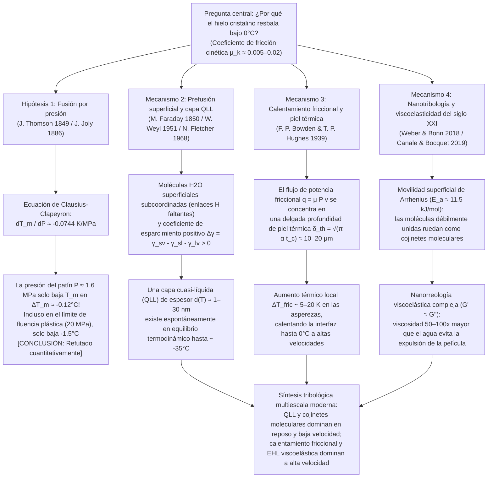

Pisar un charco congelado en una mañana de invierno, observar a un patinador de velocidad tomar una curva a $60\,\text{km/h}$ o contemplar cómo una piedra de curling de granito de $20\,\text{kg}$ se desliza cuarenta metros sobre el hielo casi sin frenar nos enfrenta a una de las anomalías más extraordinarias de la física de la materia condensada y la tribología (la ciencia de la fricción, el desgaste y la lubricación). Aunque para la intuición cotidiana parece obvio que "el hielo resbala", desde el punto de vista de la física del estado sólido la pregunta <strong>"¿Por qué el hielo cristalino es tan excepcionalmente resbaladizo?"</strong> constituye un profundo enigma científico que ha intrigado a los físicos durante más de 170 años.

Cuando dos sólidos cristalinos secos ordinarios —como acero sobre vidrio, granito sobre cuarzo o cobre sobre óxido de aluminio— se deslizan entre sí sin lubricante externo, su coeficiente de fricción cinética es elevado, típicamente $\mu_k \approx 0.4\text{–}0.8$. A escala microscópica, las asperezas superficiales forman uniones adhesivas que deben cizallarse continuamente con gran disipación de energía. Sin embargo, cuando una cuchilla de acero o un esquí de polietileno se desliza sobre hielo hexagonal ordinario (Hielo $I_h$) entre $-5^\circ\text{C}$ y $-10^\circ\text{C}$ —muy por debajo de su punto de fusión de $0^\circ\text{C}$—, el coeficiente de fricción cinética cae drásticamente a <strong>$\mu_k \approx 0.005\text{–}0.02$</strong>, uno o dos órdenes de magnitud menor que el de cualquier otro sólido cristalino, superando incluso al politetrafluoroetileno (PTFE / Teflón, $\mu_k \approx 0.04\text{–}0.10$).

Durante más de un siglo, los libros de texto escolares y universitarios han repetido una explicación estándar:
<strong>"Dado que el agua se expande al congelarse, aplicar presión al hielo reduce su punto de fusión. Cuando un patinador se apoya sobre la fina cuchilla de su patín, todo su peso se concentra en un área diminuta, generando una enorme presión que funde el hielo bajo la cuchilla y crea una película lubricante de agua."</strong>

Esta es la célebre <strong>teoría de la fusión por presión (Pressure-Melting Theory)</strong>, propuesta termodinámicamente por James Thomson en 1849 y aplicada al patinaje por John Joly en 1886. Sin embargo, el análisis cuantitativo riguroso demuestra una verdad contundente: <strong>aunque la ecuación de Clausius-Clapeyron es totalmente exacta, la hipótesis de la fusión por presión como explicación del patinaje, el esquí o los resbalones sobre el hielo es cuantitativamente falsa por varios órdenes de magnitud.</strong>

En este artículo deduciremos primero la <strong>ecuación de Clausius-Clapeyron</strong> a partir del equilibrio del potencial químico y demostraremos matemáticamente por qué la presión de un patinador apenas reduce el punto de fusión del hielo en una décima de grado Celsius. A continuación, desentrañaremos el famoso <strong>experimento de regelación de Faraday/Bottomley del alambre con pesas que atraviesa un bloque de hielo</strong> mediante la ley de conducción térmica de Fourier, explicando por qué un alambre de cobre atraviesa el hielo mientras que un hilo de nailon bajo la misma presión fracasa. Finalmente, desarrollaremos los tres mecanismos físicos reales que explican la resbaladicidad del hielo:
1. <strong>La prefusión superficial (Surface Premelting) y la capa cuasi-líquida nanométrica (Quasi-Liquid Layer, QLL)</strong> (Michael Faraday 1850, Woldemar Weyl 1951, Neville Fletcher 1968, J. G. Dash);
2. <strong>El calentamiento por fricción (Frictional Heating) y la fusión en la profundidad pelicular térmica</strong> (Frank Philip Bowden & Thomas P. Hughes 1939);
3. <strong>La nanotribología moderna del siglo XXI</strong>: el rodamiento térmicamente activado de moléculas de agua superficiales débilmente enlazadas que actúan como "rodamientos de bolas moleculares" (Weber & Bonn et al., 2018) y la <strong>nanorreología viscoelástica compleja ($G' \approx G''$)</strong> de la película interfacial con una viscosidad efectiva de 50 a 100 veces superior a la del agua líquida ordinaria (Canale & Bocquet et al., 2019).

---

## 1. El hielo como anomalía tribológica y las cuatro escalas físicas

Comparecemos el coeficiente de fricción cinética de Amontons-Coulomb $\mu_k = F_f / F_N$ entre distintos pares de sólidos:

| Par de superficies en contacto | Temperatura $T$ | Coeficiente de fricción $\mu_k$ | Mecanismo físico dominante de disipación |
| :--- | :--- | :--- | :--- |
| <strong>Acero sobre Acero</strong> (aire seco) | $20^\circ\text{C}$ | $0.50\text{–}0.80$ | Cizallamiento de uniones soldadas en frío y surcado plástico (Ploughing) |
| <strong>Vidrio de sílice sobre Vidrio</strong> | $20^\circ\text{C}$ | $0.40\text{–}0.90$ | Adhesión por enlaces silanol/covalentes y microfractura frágil |
| <strong>Granito sobre Granito</strong> (falla geológica) | $20^\circ\text{C}$ | $0.60\text{–}0.70$ | Fractura frágil de asperezas y abrasión de tercer cuerpo |
| <strong>PTFE (Teflón) sobre Acero</strong> | $20^\circ\text{C}$ | $0.04\text{–}0.10$ | Baja energía superficial de van der Waals y película de transferencia |
| <strong>Hielo hexagonal $I_h$ sobre Acero</strong> (criogénico) | $-100^\circ\text{C}$ | $0.40\text{–}0.60$ | Adhesión sólida normal y fractura frágil (¡hielo nada resbaladizo!) |
| <strong>Hielo hexagonal $I_h$ sobre Acero</strong> (patinaje) | $-5^\circ\text{C}$ | <strong>$0.005\text{–}0.015$</strong> | QLL de equilibrio + fusión térmica friccional + sustentación viscoelástica |
| <strong>Hielo hexagonal $I_h$ sobre UHMWPE</strong> (esquí) | $-3^\circ\text{C}$ | <strong>$0.010\text{–}0.030$</strong> | Deslizamiento parietal hidrófobo (Wall Slip) + lubricación térmica mixta |

Como muestra la tabla, a $-100^\circ\text{C}$ ($173\,\text{K}$) el hielo no resbala en absoluto ($\mu_k \approx 0.5$). Su fricción ultrabaja emerge por encima de $\approx -35^\circ\text{C}$ según el siguiente esquema:

---

## 2. Refutación rigurosa de la fusión por presión mediante la ecuación de Clausius-Clapeyron

### 2.1 Estructura cristalina del hielo hexagonal ($I_h$) y anomalía volumétrica

En la red cristalina del hielo hexagonal ordinario (<strong>Hielo $I_h$</strong>), cada molécula de $\text{H}_2\text{O}$ cumple las reglas del hielo de Bernal-Fowler y forma cuatro enlaces de hidrógeno direccionales ($\text{O}-\text{H}\cdots\text{O}$ de longitud $\approx 2.76\,\text{\AA}$) en coordinación tetraédrica ($109.5^\circ$). Esta estructura abierta encierra grandes cavidades intersticiales vacías. Al fundirse a $T_m = 273.15\,\text{K}$ ($0^\circ\text{C}$), la red tetraédrica colapsa parcialmente, aumentando la densidad $\rho$ y disminuyendo el volumen específico $v = 1/\rho$:

* <strong>Hielo sólido $I_h$ a $0^\circ\text{C}$</strong>: $\rho_{\text{ice}} = 916.7\,\text{kg/m}^3 \implies v_{\text{ice}} = 1.0909 \times 10^{-3}\,\text{m}^3/\text{kg}$
* <strong>Agua líquida a $0^\circ\text{C}$</strong>: $\rho_{\text{liquid}} = 999.84\,\text{kg/m}^3 \implies v_{\text{liquid}} = 1.0002 \times 10^{-3}\,\text{m}^3/\text{kg}$
* <strong>Cambio de volumen específico de fusión</strong>:
  $$\Delta v_{\text{fus}} = v_{\text{liquid}} - v_{\text{ice}} = (1.0002 - 1.0909) \times 10^{-3}\,\text{m}^3/\text{kg} \approx -9.1 \times 10^{-5}\,\text{m}^3/\text{kg} < 0$$

### 2.2 Deducción de la ecuación de Clausius-Clapeyron y evaluación numérica

A lo largo de la curva de coexistencia sólido-líquido $P(T_m)$, la igualdad de las energías libres de Gibbs específicas $g_{\text{ice}}(T_m, P) = g_{\text{liquid}}(T_m, P)$ y la relación diferencial $dg = -s\,dT + v\,dP$ implican:

$$-s_{\text{ice}}\,dT_m + v_{\text{ice}}\,dP = -s_{\text{liquid}}\,dT_m + v_{\text{liquid}}\,dP \implies \left(v_{\text{liquid}} - v_{\text{ice}}\right) dP = \left(s_{\text{liquid}} - s_{\text{ice}}\right) dT_m$$

Sustituyendo el cambio de entropía específica de fusión $\Delta s_{\text{fus}} = s_{\text{liquid}} - s_{\text{ice}} = \frac{L_f}{T_m}$ con el calor latente de fusión $L_f = 3.34 \times 10^5\,\text{J/kg}$, obtenemos la <strong>ecuación de Clausius-Clapeyron</strong>:

$$\frac{dP}{dT_m} = \frac{L_f}{T_m \left(v_{\text{liquid}} - v_{\text{ice}}\right)} = \frac{3.34 \times 10^5\,\text{J/kg}}{273.15\,\text{K} \times \left(-9.1 \times 10^{-5}\,\text{m}^3/\text{kg}\right)} \approx -1.344 \times 10^7\,\text{Pa/K} = -13.44\,\text{MPa/K}$$

Invirtiendo el resultado obtenemos el descenso del punto de fusión por unidad de presión:

$$\frac{dT_m}{dP} \approx -0.0744\,\text{K/MPa} \quad \left(\text{o } -0.00754^\circ\text{C/atm}\right)$$

<strong>¡Para rebajar el punto de fusión del hielo en tan solo $1^\circ\text{C}$ se requiere una presión descomunal de $13.44\,\text{MPa}$ (unas $133\,\text{atmósferas}$)!</strong>

### 2.3 Presión real de un patinador y límite de fluencia plástica del hielo

Un patinador de masa $m = 75\,\text{kg}$ ($F_N = m g = 735.75\,\text{N}$) apoyado sobre una sola cuchilla de longitud $L = 30\,\text{cm} = 0.30\,\text{m}$ y anchura $w = 1.5\,\text{mm} = 1.5 \times 10^{-3}\,\text{m}$ ($A = L w = 4.5 \times 10^{-4}\,\text{m}^2$) ejerce una presión media:

$$P = \frac{m g}{A} = \frac{735.75\,\text{N}}{4.5 \times 10^{-4}\,\text{m}^2} \approx 1.635\,\text{MPa} \implies \Delta T_m = \left(\frac{dT_m}{dP}\right) P \approx -0.122^\circ\text{C}$$

<strong>¡El punto de fusión solo baja $0.12^\circ\text{C}$!</strong> Incluso considerando las micro-asperezas de contacto, la presión local $P_{\text{local}}$ jamás puede superar la resistencia a la fluencia plástica por compresión (dureza de indentación) del hielo, $\sigma_{y,\text{ice}} \approx 10\text{–}20\,\text{MPa}$. En ese límite máximo de $20\,\text{MPa}$, el descenso térmico es de a lo sumo $\Delta T_{m,\max} \approx -1.49^\circ\text{C}$, lo cual es incapaz de explicar el patinaje o el esquí a $-15^\circ\text{C}$, ni por qué un niño con botas planas de goma ($P \approx 34\,\text{kPa}$, $\Delta T_m \approx -0.0026^\circ\text{C}$) resbala sobre el hielo.

---

## 3. La regelación de Faraday y el experimento del alambre a través del hielo

En el experimento clásico de Bottomley (1872), donde un alambre cargado con pesas atraviesa un bloque de hielo a $0^\circ\text{C}$ sin dividirlo en dos, para que el hielo bajo el alambre se funda debe absorber continuamente el calor latente $L_f = 3.34 \times 10^5\,\text{J/kg}$. Ese calor proviene de la recongelación (regelación) del agua por encima del alambre y debe <strong>conducirse térmicamente a través del diámetro del alambre</strong> según la ley de Fourier (Nye 1967):

$$v_{\text{wire}} \approx \frac{\kappa_{\text{eff}} |\Delta T_m|}{\rho_{\text{ice}} L_f R}$$

Un <strong>alambre de cobre</strong> ($\kappa_{\text{Cu}} \approx 400\,\text{W/(m}\cdot\text{K)}$) conduce rápidamente el calor latente y atraviesa el hielo a $v_{\text{wire}} \sim 10^{-5}\text{–}10^{-4}\,\text{m/s}$ (¡aun así, <strong>5 a 6 órdenes de magnitud demasiado lento</strong> para un patín que se mueve a $10\,\text{m/s}$!), mientras que un <strong>hilo de nailon</strong> del mismo diámetro ($\kappa_{\text{nylon}} \approx 0.25\,\text{W/(m}\cdot\text{K)}$, $1600$ veces menos conductor) no logra atravesar el hielo bajo la misma presión. Además, cuando <strong>Michael Faraday</strong> descubrió la regelación en 1850, rechazó la hipótesis de presión de Thomson y propuso acertadamente que el hielo posee de forma natural una película superficial cuasi-líquida.

---

## 4. Prefusión superficial y la capa cuasi-líquida nanométrica (QLL)

1. <strong>Subcoordinación de enlaces de hidrógeno y criterio de Lindemann</strong>:
   En la interfaz cristal-vapor, las moléculas de agua superficiales carecen de vecinos superiores y solo forman 2 o 3 enlaces de hidrógeno en lugar de 4. Al reducirse a la mitad su constante restauradora $k_{\text{surf}}$, su amplitud de vibración térmica $\sqrt{\langle u_{\text{surf}}^2 \rangle} \propto \sqrt{k_B T / k_{\text{surf}}}$ supera el umbral de inestabilidad de Lindemann mucho antes de $0^\circ\text{C}$ (desde $\approx -35^\circ\text{C}$), formando una <strong>capa cuasi-líquida (QLL)</strong> de espesor $d(T) \sim 1\text{–}30\,\text{nm}$.
2. <strong>Modelo termodinámico de energía libre interfacial (Weyl, Fletcher, Dash)</strong>:
   Como el coeficiente de esparcimiento $\Delta \gamma = \gamma_{sv} - \gamma_{sl} - \gamma_{lv} \approx 109 - 30 - 75.6 = +3.4\,\text{mJ/m}^2 > 0$ es positivo, la energía libre superficial:
   $$\Delta G_{\text{surf}}(d) = -\left(\gamma_{sv} - \gamma_{sl} - \gamma_{lv}\right)\left(1 - e^{-d/\xi}\right) + \rho_l L_f \left(\frac{T_m - T}{T_m}\right) d$$
   se minimiza ($\frac{\partial \Delta G_{\text{surf}}}{\partial d} = 0$) dando un espesor de equilibrio:
   $$d(T) = \xi \ln\!\left(\frac{\Delta \gamma \, T_m}{\xi \rho_l L_f (T_m - T)}\right) \quad \text{o} \quad d(T) \propto \left(T_m - T\right)^{-1/3}$$

---

## 5. Calentamiento por fricción y capa límite térmica (Bowden & Hughes, 1939)

A velocidades de deslizamiento macroscópicas ($v \sim 5\text{–}20\,\text{m/s}$), la rugosidad superficial ($R_q \sim 0.1\text{–}1\,\mu\text{m}$) supera el espesor nanométrico de la QLL estática. En 1939, en la cueva glaciar de Jungfraujoch, <strong>Frank Philip Bowden</strong> y <strong>Thomas P. Hughes</strong> demostraron que los esquís de latón ($\kappa \approx 110\,\text{W/(m}\cdot\text{K)}$) disipan el calor friccional y presentan alta fricción, mientras que los esquís aislantes de madera o PTFE ($\kappa \approx 0.2\,\text{W/(m}\cdot\text{K)}$) retienen el calor en la interfaz del hielo y reducen drásticamente la fricción.

Durante el tiempo de contacto $t_c = L/v$, el flujo de calor friccional $q_{\text{fric}} = \mu_k P v$ penetra solo hasta una <strong>profundidad pelicular térmica $\delta_{\text{th}} = \sqrt{\pi \alpha_{\text{ice}} t_c} = \sqrt{\pi \alpha_{\text{ice}} L / v} \approx 10\text{–}20\,\mu\text{m}$</strong>, elevando la temperatura interfacial en:

$$\Delta T_{\text{fric}} = \frac{2 \mu_k P \sqrt{v L}}{\sqrt{\pi} \left(\sqrt{\kappa_{\text{ice}} \rho_{\text{ice}} c_{p,\text{ice}}} + \sqrt{\kappa_{\text{slider}} \rho_{\text{slider}} c_{p,\text{slider}}}\right)}$$

Esto explica la fusión local a $-10^\circ\text{C}$, por qué por debajo de $-35^\circ\text{C}$ en la Antártida o Siberia la nieve se vuelve abrasiva como arena seca ($\mu_k \approx 0.4$), y por qué a $0^\circ\text{C}$ el exceso de agua forma puentes capilares ($\Delta P_{\text{cap}} = -2\gamma_{lv}\cos\theta / h$) que vuelven a incrementar la fricción.

---

## 6. Nanotribología del siglo XXI: Rodamientos moleculares y viscoelasticidad (2018–2024)

1. <strong>Rodamientos de bolas moleculares y ley de Arrhenius (Weber & Bonn et al., 2018)</strong>:
   El coeficiente de fricción del hielo entre $-100^\circ\text{C}$ y $0^\circ\text{C}$ obedece una ley exponencial de Arrhenius $\mu(T) \propto \exp(E_a / k_B T)$ con energía de activación <strong>$E_a \approx 11.5\,\text{kJ/mol}$</strong>, correspondiente a moléculas de agua superficiales débilmente enlazadas que ruedan sobre la red cristalina como <strong>rodamientos de bolas moleculares</strong>.
2. <strong>Nanorreología viscoelástica compleja de la película interfacial (Canale & Bocquet et al., 2019)</strong>:
   El agua líquida pura ($\eta_0 \approx 1.8\,\text{mPa}\cdot\text{s}$) sería expulsada instantáneamente bajo presiones de megapascales. Mediante microscopía de fuerza atómica con diapasón de cuarzo, Canale y Bocquet descubrieron que la película submicrónica cizallada sobre el hielo posee una <strong>viscosidad efectiva de 50 a 100 veces mayor que el agua ($\eta_{\text{eff}} \sim 0.05\text{–}0.2\,\text{Pa}\cdot\text{s}$, similar al aceite de motor)</strong> y un elevado módulo elástico de almacenamiento <strong>$G' \approx G'' \sim 10^4\text{–}10^5\,\text{Pa}$</strong>. Esta "grasa viscoelástica autorreparable" genera una sustentación elastohidrodinámica que impide el colapso de la película bajo carga mientras mantiene una resistencia al corte ultrabaja.
