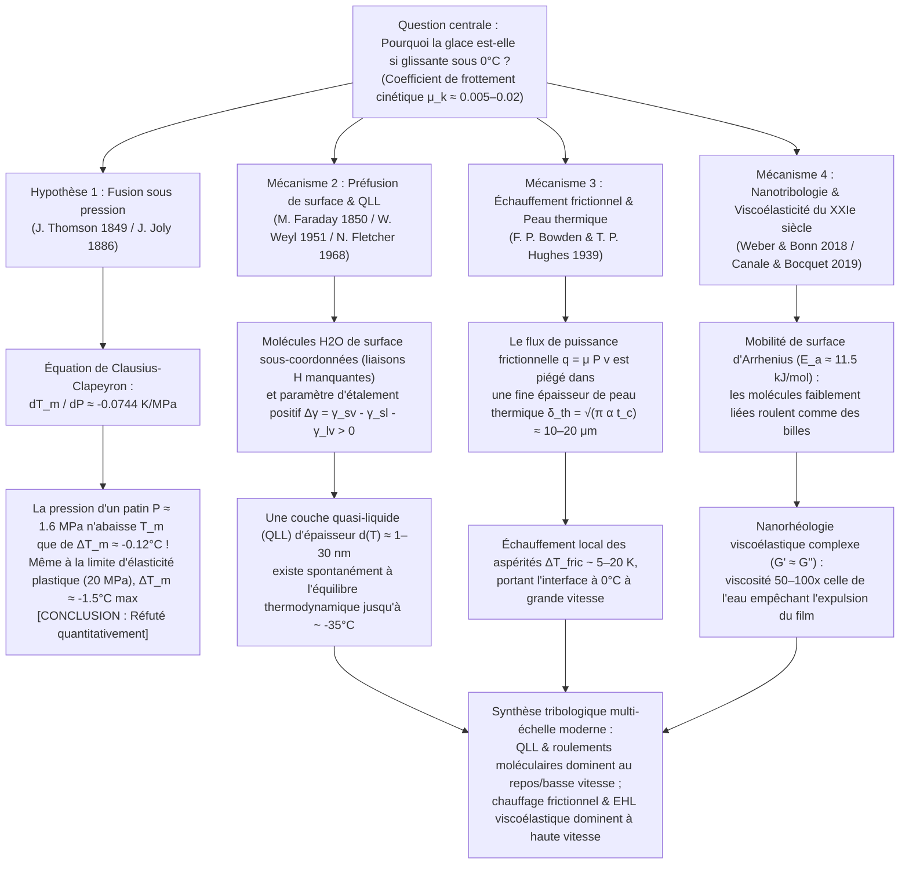

Poser le pied sur une flaque gelée par un matin d'hiver, admirer un patineur de vitesse négociant un virage à $60\,\text{km/h}$ ou observer une pierre de curling en granit de $20\,\text{kg}$ glisser sur quarante mètres sans presque ralentir, c'est être témoin de l'une des anomalies les plus fascinantes de la physique de la matière condensée et de la tribologie (la science du frottement, de l'usure et de la lubrification). Si notre intuition quotidienne considère comme évident que « la glace glisse », la question <strong>« Pourquoi la glace cristalline est-elle si exceptionnellement glissante ? »</strong> demeure une énigme scientifique profonde qui a suscité des débats passionnés parmi les physiciens depuis plus de 170 ans.

Lorsque deux solides cristallins secs ordinaires — tels que l'acier sur le verre, le granit sur le quartz ou le cuivre sur l'alumine — glissent l'un contre l'autre sans lubrifiant, leur coefficient de frottement cinétique est élevé, typiquement compris entre $\mu_k \approx 0.4$ et $0.8$. À l'échelle microscopique, les aspérités de surface forment des jonctions adhésives qui doivent être continuellement cisaillées avec une forte dissipation d'énergie. Pourtant, lorsqu'une lame de patin en acier ou une semelle de ski en polyéthylène glisse sur de la glace hexagonale ordinaire (Glace $I_h$) entre $-5^\circ\text{C}$ et $-10^\circ\text{C}$ — bien en dessous du point de fusion de $0^\circ\text{C}$ —, le coefficient de frottement chute brutalement à <strong>$\mu_k \approx 0.005\text{–}0.02$</strong>, soit un à deux ordres de grandeur plus bas que n'importe quel autre solide cristallin, surpassant même le polytétrafluoroéthylène (PTFE / Téflon, $\mu_k \approx 0.04\text{–}0.10$).

La plupart des manuels scolaires et des encyclopédies populaires proposent depuis plus d'un siècle l'explication suivante :
<strong>« Comme l'eau se dilate en gelant, l'application d'une pression sur la glace abaisse son point de fusion. Lorsqu'un patineur se tient sur une lame très fine, son poids se concentre sur une surface minuscule, générant une pression énorme qui fait fondre la glace sous la lame pour former un film d'eau lubrifiant. »</strong>

C'est la célèbre <strong>théorie de la fusion sous pression (Pressure-Melting Theory)</strong>, formulée thermodynamiquement par James Thomson en 1849 et appliquée au patinage par John Joly en 1886. Or, une vérification quantitative rigoureuse révèle un constat sans appel : <strong>bien que l'équation de Clapeyron soit parfaitement exacte, l'hypothèse de la fusion sous pression pour expliquer le patinage, le ski ou les glissades sur un trottoir verglacé est quantitativement fausse de plusieurs ordres de grandeur !</strong>

Dans cet article, nous allons d'abord dériver l'<strong>équation de Clausius-Clapeyron</strong> à partir de l'équilibre du potentiel chimique et démontrer mathématiquement pourquoi la pression d'un patin n'abaisse le point de fusion de la glace que d'environ un dixième de degré Celsius. Nous analyserons ensuite l'expérience classique du <strong>regel de Faraday et du fil lesté traversant un bloc de glace</strong> par la conduction thermique de Fourier, expliquant pourquoi un fil de cuivre traverse la glace alors qu'un fil de nylon sous la même pression échoue. Enfin, nous exposerons les trois véritables mécanismes physiques qui gouvernent la glissance de la glace :
1. <strong>La préfusion de surface (Surface Premelting) et la couche quasi-liquide nanométrique (Quasi-Liquid Layer, QLL)</strong> (Michael Faraday 1850, Woldemar Weyl 1951, Neville Fletcher 1968, J. G. Dash) ;
2. <strong>L'échauffement frictionnel (Frictional Heating) et la fusion dans l'épaisseur de peau thermique</strong> (Frank Philip Bowden & Thomas P. Hughes 1939) ;
3. <strong>La nanotribologie moderne du XXIe siècle</strong> : le roulement thermiquement activé des molécules d'eau de surface faiblement liées agissant comme des « roulements à billes moléculaires » (Weber & Bonn et al., 2018) et la <strong>nanorhéologie viscoélastique complexe ($G' \approx G''$)</strong> du film interfacial présentant une viscosité effective 50 à 100 fois supérieure à celle de l'eau liquide ordinaire (Canale & Bocquet et al., 2019).

---

## 1. L'anomalie tribologique de la glace et l'architecture multi-échelle

Comparons le coefficient de frottement cinétique d'Amontons-Coulomb $\mu_k = F_f / F_N$ pour différentes interfaces solides :

| Couple de matériaux en glissement | Température $T$ | Coefficient de frottement $\mu_k$ | Mécanisme physique dominant de dissipation |
| :--- | :--- | :--- | :--- |
| <strong>Acier sur Acier</strong> (air sec) | $20^\circ\text{C}$ | $0.50\text{–}0.80$ | Cisaillement des jonctions adhésives et labourage plastique (Ploughing) |
| <strong>Verre de silice sur Verre</strong> | $20^\circ\text{C}$ | $0.40\text{–}0.90$ | Adhésion par liaisons hydrogène/covalentes et micro-fracturation fragile |
| <strong>Granit sur Granit</strong> (faille rocheuse) | $20^\circ\text{C}$ | $0.60\text{–}0.70$ | Écrasement fragile des aspérités et abrasion à trois corps |
| <strong>PTFE (Téflon) sur Acier</strong> | $20^\circ\text{C}$ | $0.04\text{–}0.10$ | Faible énergie de surface de van der Waals et film de transfert orienté |
| <strong>Glace hexagonale $I_h$ sur Acier</strong> (cryogénique) | $-100^\circ\text{C}$ | $0.40\text{–}0.60$ | Adhésion solide normale et cisaillement fragile (glace non glissante !) |
| <strong>Glace hexagonale $I_h$ sur Acier</strong> (patinage) | $-5^\circ\text{C}$ | <strong>$0.005\text{–}0.015$</strong> | QLL d'équilibre + fusion thermique frictionnelle + portance viscoélastique |
| <strong>Glace hexagonale $I_h$ sur UHMWPE</strong> (ski) | $-3^\circ\text{C}$ | <strong>$0.010\text{–}0.030$</strong> | Glissement pariétal hydrophobe (Wall Slip) + lubrification mixte thermique |

À $-100^\circ\text{C}$ ($173\,\text{K}$), la glace n'est absolument pas glissante ($\mu_k \approx 0.5$). Sa super-lubrification n'apparaît qu'au-dessus d'environ $-35^\circ\text{C}$ selon l'architecture suivante :

---

## 2. Réfutation rigoureuse de la fusion sous pression par l'équation de Clapeyron

### 2.1 Structure cristalline de la glace hexagonale ($I_h$) et anomalie volumique

Dans le réseau cristallin de la glace hexagonale ordinaire (<strong>Glace $I_h$</strong>), chaque molécule $\text{H}_2\text{O}$ obéit aux règles de Bernal-Fowler et forme quatre liaisons hydrogène directionnelles ($\text{O}-\text{H}\cdots\text{O}$ de longueur $\approx 2.76\,\text{\AA}$) selon une géométrie tétraédrique parfaite ($109.5^\circ$). Ce réseau ouvert comporte de vastes cages interstitielles vides. Lors de la fusion à $T_m = 273.15\,\text{K}$ ($0^\circ\text{C}$), l'effondrement partiel du réseau tétraédrique augmente la masse volumique $\rho$ et diminue le volume massique $v = 1/\rho$ :

* <strong>Glace solide $I_h$ à $0^\circ\text{C}$</strong> : $\rho_{\text{ice}} = 916.7\,\text{kg/m}^3 \implies v_{\text{ice}} = 1.0909 \times 10^{-3}\,\text{m}^3/\text{kg}$
* <strong>Eau liquide à $0^\circ\text{C}$</strong> : $\rho_{\text{liquid}} = 999.84\,\text{kg/m}^3 \implies v_{\text{liquid}} = 1.0002 \times 10^{-3}\,\text{m}^3/\text{kg}$
* <strong>Variation de volume massique à la fusion</strong> :
  $$\Delta v_{\text{fus}} = v_{\text{liquid}} - v_{\text{ice}} = (1.0002 - 1.0909) \times 10^{-3}\,\text{m}^3/\text{kg} \approx -9.1 \times 10^{-5}\,\text{m}^3/\text{kg} < 0$$

### 2.2 Dérivation de l'équation de Clausius-Clapeyron et calcul numérique

Le long de la courbe de coexistence solide-liquide $P(T_m)$, l'égalité des enthalpies libres massiques $g_{\text{ice}}(T_m, P) = g_{\text{liquid}}(T_m, P)$ et la relation fondamentale $dg = -s\,dT + v\,dP$ imposent :

$$-s_{\text{ice}}\,dT_m + v_{\text{ice}}\,dP = -s_{\text{liquid}}\,dT_m + v_{\text{liquid}}\,dP \implies \left(v_{\text{liquid}} - v_{\text{ice}}\right) dP = \left(s_{\text{liquid}} - s_{\text{ice}}\right) dT_m$$

En introduisant l'entropie massique de fusion $\Delta s_{\text{fus}} = s_{\text{liquid}} - s_{\text{ice}} = \frac{L_f}{T_m}$ avec la chaleur latente de fusion $L_f = 3.34 \times 10^5\,\text{J/kg}$, on obtient l'<strong>équation de Clausius-Clapeyron</strong> :

$$\frac{dP}{dT_m} = \frac{L_f}{T_m \left(v_{\text{liquid}} - v_{\text{ice}}\right)} = \frac{3.34 \times 10^5\,\text{J/kg}}{273.15\,\text{K} \times \left(-9.1 \times 10^{-5}\,\text{m}^3/\text{kg}\right)} \approx -1.344 \times 10^7\,\text{Pa/K} = -13.44\,\text{MPa/K}$$

En inversant cette relation, la pente d'abaissement du point de fusion par unité de pression vaut :

$$\frac{dT_m}{dP} \approx -0.0744\,\text{K/MPa} \quad \left(\text{soit } -0.00754^\circ\text{C/atm}\right)$$

<strong>Il faut donc exercer une pression gigantesque de $13.44\,\text{MPa}$ (environ $133\,\text{atmosphères}$) pour abaisser le point de fusion de la glace d'un seul degré Celsius !</strong>

### 2.3 Pression exercée par un patineur et limite de fluage plastique de la glace

Considérons un patineur de masse $m = 75\,\text{kg}$ ($F_N = m g = 735.75\,\text{N}$) en appui sur une seule lame de longueur de contact $L = 30\,\text{cm} = 0.30\,\text{m}$ et d'épaisseur $w = 1.5\,\text{mm} = 1.5 \times 10^{-3}\,\text{m}$ ($A = L w = 4.5 \times 10^{-4}\,\text{m}^2$) :

$$P = \frac{m g}{A} = \frac{735.75\,\text{N}}{4.5 \times 10^{-4}\,\text{m}^2} \approx 1.635\,\text{MPa} \implies \Delta T_m = \left(\frac{dT_m}{dP}\right) P \approx -0.122^\circ\text{C}$$

<strong>Le point de fusion ne s'abaisse que de $0.12^\circ\text{C}$ !</strong> Même en tenant compte de la concentration des contraintes sur les micro-aspérités de surface, la pression locale $P_{\text{local}}$ ne peut jamais dépasser la limite d'écrasement plastique (dureté à l'indentation) de la glace, qui vaut $\sigma_{y,\text{ice}} \approx 10\text{–}20\,\text{MPa}$. Même à cette limite physique absolue de $20\,\text{MPa}$, l'abaissement du point de fusion atteint au maximum $\Delta T_{m,\max} \approx -1.49^\circ\text{C}$. Cela ne peut en aucun cas expliquer pourquoi les hockeyeurs et skieurs glissent à $-15^\circ\text{C}$, ni pourquoi un piéton en bottes plates ($P \approx 34\,\text{kPa}$, $\Delta T_m \approx -0.0026^\circ\text{C}$) ou un palet de hockey glisse sans effort !

---

## 3. Le regel de Faraday et l'expérience du fil traversant la glace

Dans l'expérience classique de Bottomley (1872) où un fil lesté traverse un bloc de glace à $0^\circ\text{C}$ sans le couper en deux, la fusion sous le fil exige l'absorption continue de la chaleur latente $L_f = 3.34 \times 10^5\,\text{J/kg}$. Cette chaleur provient du regel de l'eau au-dessus du fil (à $T_0 = 0^\circ\text{C}$) et doit être <strong>conduite thermiquement à travers l'épaisseur du fil</strong> vers le bas (à $T_0 - |\Delta T_m|$) selon la loi de Fourier (Nye 1967) :

$$v_{\text{wire}} \approx \frac{\kappa_{\text{eff}} |\Delta T_m|}{\rho_{\text{ice}} L_f R}$$

Un <strong>fil de cuivre</strong> ($\kappa_{\text{Cu}} \approx 400\,\text{W/(m}\cdot\text{K)}$) conduit rapidement cette chaleur latente et traverse le bloc à $v_{\text{wire}} \sim 10^{-5}\text{–}10^{-4}\,\text{m/s}$ (ce qui reste <strong>5 à 6 ordres de grandeur trop lent</strong> pour un patin filant à $10\,\text{m/s}$), tandis qu'un <strong>fil de nylon</strong> de même diamètre ($\kappa_{\text{nylon}} \approx 0.25\,\text{W/(m}\cdot\text{K)}$, $1600$ fois moins conducteur) échoue totalement à traverser la glace malgré une pression identique ! Rappelons d'ailleurs que dès 1850, <strong>Michael Faraday</strong> avait rejeté l'explication par la pression de James Thomson et proposé avec une intuition géniale que la glace possède naturellement un film superficiel quasi-liquide.

---

## 4. Préfusion de surface et couche quasi-liquide nanométrique (QLL)

1. <strong>Sous-coordination des molécules de surface et critère de Lindemann</strong> :
   À l'interface cristal-vapeur, les molécules d'eau perdent leurs voisines supérieures et ne forment plus que 2 ou 3 liaisons hydrogène au lieu de 4. Leur constante de rappel $k_{\text{surf}}$ étant réduite de moitié, l'amplitude quadratique moyenne de leurs vibrations thermiques $\sqrt{\langle u_{\text{surf}}^2 \rangle} \propto \sqrt{k_B T / k_{\text{surf}}}$ franchit le seuil d'instabilité de Lindemann bien en dessous de $0^\circ\text{C}$ (dès $-35^\circ\text{C}$), engendrant une <strong>couche quasi-liquide (QLL)</strong> d'épaisseur $d(T) \sim 1\text{–}30\,\text{nm}$.
2. <strong>Modèle thermodynamique de mouillage interfacial (Weyl, Fletcher, Dash)</strong> :
   Comme le coefficient d'étalement $\Delta \gamma = \gamma_{sv} - \gamma_{sl} - \gamma_{lv} \approx 109 - 30 - 75.6 = +3.4\,\text{mJ/m}^2 > 0$ est positif, l'énergie libre interfaciale par unité de surface :
   $$\Delta G_{\text{surf}}(d) = -\left(\gamma_{sv} - \gamma_{sl} - \gamma_{lv}\right)\left(1 - e^{-d/\xi}\right) + \rho_l L_f \left(\frac{T_m - T}{T_m}\right) d$$
   admet un minimum à l'équilibre ($\frac{\partial \Delta G_{\text{surf}}}{\partial d} = 0$) donnant l'épaisseur de la QLL :
   $$d(T) = \xi \ln\!\left(\frac{\Delta \gamma \, T_m}{\xi \rho_l L_f (T_m - T)}\right) \quad \text{ou} \quad d(T) \propto \left(T_m - T\right)^{-1/3}$$

---

## 5. Échauffement frictionnel et couche limite thermique (Bowden & Hughes, 1939)

À grande vitesse ($v \sim 5\text{–}20\,\text{m/s}$), la rugosité des lames et des skis ($R_q \sim 0.1\text{–}1\,\mu\text{m}$) dépasse largement l'épaisseur nanométrique de la QLL statique. En 1939, au laboratoire glaciaire du Jungfraujoch, <strong>Frank Philip Bowden</strong> et <strong>Thomas P. Hughes</strong> ont démontré que des skis en laiton ($\kappa \approx 110\,\text{W/(m}\cdot\text{K)}$) évacuent la chaleur de frottement et glissent très mal, tandis que des skis isolants en bois, ébonite ou PTFE ($\kappa \approx 0.2\,\text{W/(m}\cdot\text{K)}$) confinent la chaleur à la surface de la glace et réduisent drastiquement le frottement.

Pendant le temps de contact $t_c = L/v$, la puissance frictionnelle $q_{\text{fric}} = \mu_k P v$ reste confinée dans une mince <strong>épaisseur de peau thermique $\delta_{\text{th}} = \sqrt{\pi \alpha_{\text{ice}} t_c} = \sqrt{\pi \alpha_{\text{ice}} L / v} \approx 10\text{–}20\,\mu\text{m}$</strong>, produisant une élévation de température :

$$\Delta T_{\text{fric}} = \frac{2 \mu_k P \sqrt{v L}}{\sqrt{\pi} \left(\sqrt{\kappa_{\text{ice}} \rho_{\text{ice}} c_{p,\text{ice}}} + \sqrt{\kappa_{\text{slider}} \rho_{\text{slider}} c_{p,\text{slider}}}\right)}$$

Cela explique à la fois la génération dynamique d'un film d'eau de plusieurs dizaines de nanomètres à $-10^\circ\text{C}$, le comportement abrasif de la neige semblable à du sable sec en dessous de $-35^\circ\text{C}$ en Antarctique (l'expédition tragique de Scott en 1912), et la remontée du frottement à $0^\circ\text{C}$ par succion capillaire des ménisques d'eau ($\Delta P_{\text{cap}} = -2\gamma_{lv}\cos\theta / h$).

---

## 6. Nanotribologie du XXIe siècle : Roulements à billes moléculaires et rhéologie viscoélastique (2018–2024)

1. <strong>Roulements à billes moléculaires et loi d'Arrhenius (Weber & Bonn et al., 2018)</strong> :
   Le coefficient de frottement de la glace entre $-100^\circ\text{C}$ et $0^\circ\text{C}$ suit une loi d'activation thermique d'Arrhenius $\mu(T) \propto \exp(E_a / k_B T)$ avec une énergie d'activation <strong>$E_a \approx 11.5\,\text{kJ/mol}$</strong>, correspondant à la rotation et au saut des molécules d'eau superficielles faiblement liées qui roulent sur le réseau cristallin comme des <strong>roulements à billes moléculaires</strong>.
2. <strong>Nanorhéologie viscoélastique complexe du film interfacial (Canale, Siria & Bocquet et al., *Phys. Rev. X* 2019)</strong> :
   L'eau liquide pure ($\eta_0 \approx 1.8\,\text{mPa}\cdot\text{s}$) est un très mauvais lubrifiant qui serait instantanément expulsé (squeeze-out) sous la pression mégapascal d'une lame de patin. Grâce à un microscope à force atomique à diapason de quartz (Stroke-Probe AFM), l'équipe de Lydéric Bocquet à l'ENS Paris a découvert que le film nanométrique cisaillé sur la glace présente une <strong>viscosité effective 50 à 100 fois supérieure à celle de l'eau ($\eta_{\text{eff}} \sim 0.05\text{–}0.2\,\text{Pa}\cdot\text{s}$, comparable à une huile moteur)</strong> ainsi qu'un fort module élastique de conservation <strong>$G' \approx G'' \sim 10^4\text{–}10^5\,\text{Pa}$</strong> ! Cette « graisse viscoélastique auto-cicatrisante » génère une portance élastohydrodynamique qui empêche l'expulsion du film sous charge tout en offrant une résistance au cisaillement ultra-faible.
