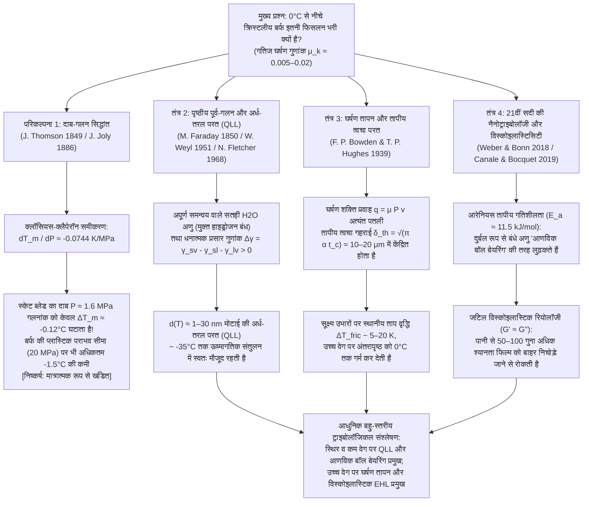

सर्दियों की ठंडी सुबह में जमी हुई बर्फ पर कदम रखना, किसी स्पीड स्केटर को $60\,\text{km/h}$ की रफ्तार से मोड़ पार करते देखना, या $20\,\text{kg}$ के ग्रेनाइट कर्लिंग स्टोन को बर्फ पर चालीस मीटर तक बिना रुके फिसलते हुए देखना—यह संघनित पदार्थ भौतिकी (Condensed Matter Physics) और ट्राइबोलॉजी (Tribology: घर्षण, टूट-फूट और स्नेहन का विज्ञान) की सबसे अद्भुत विसंगतियों में से एक का साक्षी बनना है। सामान्य सहज ज्ञान के लिए यह बात बिल्कुल स्वाभाविक लगती है कि "बर्फ फिसलन भरी होती है"। किंतु ठोस अवस्था भौतिकी के कठोर दृष्टिकोण से देखें तो यह प्रश्न कि <strong>"आखिर क्रिस्टलीय ठोस बर्फ की सतह ही इतनी असाधारण रूप से फिसलन भरी क्यों होती है?"</strong> एक गहन वैज्ञानिक पहेली है जिसने 170 से अधिक वर्षों से भौतिकीविदों को उलझाए रखा है।

जब दो सामान्य शुष्क क्रिस्टलीय ठोस—जैसे कांच पर स्टील, क्वार्ट्ज पर ग्रेनाइट, या एल्यूमीनियम ऑक्साइड पर तांबा—बिना किसी बाहरी स्नेहक (Lubricant) के एक-दूसरे पर रगड़े जाते हैं, तो उनका गतिज घर्षण गुणांक (Kinetic friction coefficient) बहुत अधिक होता है, जो आमतौर पर $\mu_k \approx 0.4\text{–}0.8$ के बीच रहता है। सूक्ष्म स्तर पर, सतह की सूक्ष्म विषमताएं (Asperities) आपस में जुड़ जाती हैं जिन्हें तोड़ने में भारी यांत्रिक ऊर्जा खर्च होती है। इसके विपरीत, जब स्टील की स्केट ब्लेड या पॉलीइथाइलीन की स्की $-5^\circ\text{C}$ से $-10^\circ\text{C}$ के तापमान पर सामान्य षट्कोणीय बर्फ (Hexagonal Ice, $I_h$) पर फिसलती है—जो कि $0^\circ\text{C}$ के गलनांक से काफी नीचे ठोस प्रावस्था का क्षेत्र है—तो गतिज घर्षण गुणांक गिरकर <strong>$\mu_k \approx 0.005\text{–}0.02$</strong> हो जाता है! यह किसी भी अन्य क्रिस्टलीय ठोस की तुलना में एक से दो परिमाण की कोटि (Orders of magnitude) कम है, और यहाँ तक कि टेफ्लॉन (PTFE, $\mu_k \approx 0.04\text{–}0.10$) से भी कहीं अधिक चिकना है।

एक सदी से भी अधिक समय से स्कूल और कॉलेज की भौतिकी पाठ्यपुस्तकों में यह पारंपरिक व्याख्या दी जाती रही है:
<strong>"चूंकि पानी जमने पर फैलता है, इसलिए बर्फ पर दबाव डालने से उसका गलनांक (Melting point) कम हो जाता है। जब कोई स्केटर पतली स्केट ब्लेड पर खड़ा होता है, तो उसका पूरा भार एक अत्यंत छोटे क्षेत्रफल पर केंद्रित हो जाता है, जिससे उत्पन्न भारी दबाव ब्लेड के नीचे की बर्फ को तुरंत पिघलाकर पानी की एक पतली स्नेहक परत बना देता है।"</strong>

यह प्रसिद्ध <strong>दाब-गलन सिद्धांत (Pressure-Melting Theory)</strong> है, जिसे 1849 में जेम्स थॉमसन (James Thomson) ने ऊष्मागतिक रूप से प्रस्तावित किया और 1886 में जॉन जॉली (John Joly) ने आइस स्केटिंग पर लागू किया। किंतु आधुनिक भौतिकी की सटीक गणना यह सिद्ध करती है कि: <strong>यद्यपि क्लॉसियस-क्लैपेरॉन समीकरण पूर्णतः सत्य है, फिर भी आइस स्केटिंग, स्कीइंग या बर्फ पर फिसलने की व्याख्या के रूप में 'दाब-गलन सिद्धांत' मात्रात्मक रूप से पूरी तरह गलत और एक 'पाठ्यपुस्तकीय मिथक (Textbook Myth)' है!</strong>

इस लेख में, हम सबसे पहले रासायनिक विभव संतुलन के प्रथम सिद्धांत से <strong>क्लॉसियस-क्लैपेरॉन समीकरण (Clausius–Clapeyron Equation)</strong> की व्युत्पत्ति करेंगे और गणितीय रूप से सिद्ध करेंगे कि स्केटर के ब्लेड का दबाव बर्फ के गलनांक को मात्र $0.12^\circ\text{C}$ ही कम कर पाता है। इसके बाद, हम फूरियर के ऊष्मा चालन नियम के माध्यम से <strong>फैराडे के पुनर्हिमायन (Regelation) और बर्फ के आर-पार तार निकलने के प्रयोग</strong> का विश्लेषण करेंगे और बताएंगे कि तांबे का तार बर्फ को पार कर जाता है जबकि समान दबाव पर नायलॉन का धागा विफल हो जाता है। अंत में, हम बर्फ की फिसलन के तीन वास्तविक भौतिक तंत्रों की व्याख्या करेंगे:
1. <strong>पृष्ठीय पूर्व-गलन (Surface Premelting) और नैनोमीटर अर्ध-तरल परत (Quasi-Liquid Layer, QLL)</strong> (माइकल फैराडे 1850, वेइल 1951, फ्लेचर 1968, डैश);
2. <strong>घर्षण तापन (Frictional Heating) और तापीय त्वचा गहराई (Thermal Skin Depth) में स्थानीय गलन</strong> (फ्रैंक फिलिप बाउडेन और थॉमस ह्यूजेस 1939);
3. <strong>21वीं सदी की आधुनिक नैनोट्राइबोलॉजी</strong>: दुर्बल रूप से बंधे सतही जल अणुओं की तापीय रूप से सक्रिय 'आणविक बॉल बेयरिंग' गति (Weber & Bonn et al., 2018) और अंतरापृष्ठीय परत की <strong>जटिल विस्कोइलास्टिक रियोलॉजी ($G' \approx G''$)</strong> जिसकी प्रभावी श्यानता सामान्य पानी से 50 से 100 गुना अधिक होती है (Canale & Bocquet et al., 2019)।

---

## 1. एक ट्राइबोलॉजिकल विसंगति के रूप में बर्फ और चार भौतिक तंत्र

आइए विभिन्न ठोस सतहों के बीच अमोंटन्स-कूलॉम्ब गतिज घर्षण गुणांक $\mu_k = F_f / F_N$ की तुलना करें:

| संपर्क सतहों का युग्म | तापमान $T$ | विशिष्ट घर्षण गुणांक $\mu_k$ | प्रमुख भौतिक ऊर्जा क्षय तंत्र |
| :--- | :--- | :--- | :--- |
| <strong>स्टील बनाम स्टील</strong> (शुष्क वायु) | $20^\circ\text{C}$ | $0.50\text{–}0.80$ | सूक्ष्म उभारों (Asperities) का शीत-वेल्डन आसंजन और प्लास्टिक अपरूपण |
| <strong>सिलिका कांच बनाम कांच</strong> | $20^\circ\text{C}$ | $0.40\text{–}0.90$ | सिलानॉल हाइड्रोजन/सहसंयोजक आसंजन और भंगुर सूक्ष्म-विभंजन |
| <strong>ग्रेनाइट बनाम ग्रेनाइट</strong> (चट्टानी भ्रंश) | $20^\circ\text{C}$ | $0.60\text{–}0.70$ | उभारों का भंगुर टूटना और अपघर्षक घिसाव |
| <strong>PTFE (टेफ्लॉन) बनाम स्टील</strong> | $20^\circ\text{C}$ | $0.04\text{–}0.10$ | निम्न वान डर वाल्स पृष्ठ ऊर्जा और बहुलक स्थानांतरण फिल्म |
| <strong>षट्कोणीय बर्फ $I_h$ बनाम स्टील</strong> (अति-निम्न ताप) | $-100^\circ\text{C}$ | $0.40\text{–}0.60$ | सामान्य ठोस आसंजन और भंगुर अपरूपण (बिल्कुल न फिसलने वाली बर्फ!) |
| <strong>षट्कोणीय बर्फ $I_h$ बनाम स्टील</strong> (आइस स्केटिंग) | $-5^\circ\text{C}$ | <strong>$0.005\text{–}0.015$</strong> | संतुलन QLL + घर्षण तापीय गलन + विस्कोइलास्टिक उत्थापन बल |
| <strong>षट्कोणीय बर्फ $I_h$ बनाम UHMWPE</strong> (स्की बेस) | $-3^\circ\text{C}$ | <strong>$0.010\text{–}0.030$</strong> | जलभीरु भित्ति सर्पण (Wall Slip) + घर्षण ताप मिश्रित स्नेहन |

$-100^\circ\text{C}$ ($173\,\text{K}$) पर बर्फ बिल्कुल भी फिसलन भरी नहीं होती ($\mu_k \approx 0.5$)। इसकी अति-निम्न घर्षण अवस्था केवल $\approx -35^\circ\text{C}$ से ऊपर सक्रिय होती है:

---

## 2. क्लॉसियस-क्लैपेरॉन समीकरण द्वारा दाब-गलन सिद्धांत का कठोर खंडन

### 2.1 षट्कोणीय बर्फ ($I_h$) की क्रिस्टल संरचना और आयतन विसंगति

सामान्य षट्कोणीय बर्फ (<strong>Ice $I_h$</strong>) के क्रिस्टल जालक में प्रत्येक $\text{H}_2\text{O}$ अणु बर्नल-फाउलर नियमों के अनुसार चार दिशात्मक हाइड्रोजन बंधों ($\text{O}-\text{H}\cdots\text{O}$ लंबाई $\approx 2.76\,\text{\AA}$, चतुष्फलकीय कोण $109.5^\circ$) से जुड़ा होता है। इस खुली पिंजरे जैसी संरचना में बड़े खाली स्थान (Voids) होते हैं। $T_m = 273.15\,\text{K}$ ($0^\circ\text{C}$) पर पिघलने पर यह जालक आंशिक रूप से ढह जाता है, जिससे घनत्व $\rho$ बढ़ता है और विशिष्ट आयतन $v = 1/\rho$ घटता है:

* <strong>ठोस बर्फ $I_h$ ($0^\circ\text{C}$ पर)</strong>: $\rho_{\text{ice}} = 916.7\,\text{kg/m}^3 \implies v_{\text{ice}} = 1.0909 \times 10^{-3}\,\text{m}^3/\text{kg}$
* <strong>तरल जल ($0^\circ\text{C}$ पर)</strong>: $\rho_{\text{liquid}} = 999.84\,\text{kg/m}^3 \implies v_{\text{liquid}} = 1.0002 \times 10^{-3}\,\text{m}^3/\text{kg}$
* <strong>गलन पर विशिष्ट आयतन परिवर्तन</strong>:
  $$\Delta v_{\text{fus}} = v_{\text{liquid}} - v_{\text{ice}} = (1.0002 - 1.0909) \times 10^{-3}\,\text{m}^3/\text{kg} \approx -9.1 \times 10^{-5}\,\text{m}^3/\text{kg} < 0$$

### 2.2 क्लॉसियस-क्लैपेरॉन समीकरण की व्युत्पत्ति और संख्यात्मक गणना

ठोस-तरल सह-अस्तित्व वक्र $P(T_m)$ पर विशिष्ट गिब्स मुक्त ऊर्जाएं समान होती हैं: $g_{\text{ice}}(T_m, P) = g_{\text{liquid}}(T_m, P)$। मूलभूत ऊष्मागतिक संबंध $dg = -s\,dT + v\,dP$ और विशिष्ट गलन एन्ट्रॉपी $\Delta s_{\text{fus}} = s_{\text{liquid}} - s_{\text{ice}} = \frac{L_f}{T_m}$ (जहाँ गलन की गुप्त ऊष्मा $L_f = 3.34 \times 10^5\,\text{J/kg}$ है) का उपयोग करने पर <strong>क्लॉसियस-क्लैपेरॉन समीकरण</strong> प्राप्त होता है:

$$\frac{dP}{dT_m} = \frac{L_f}{T_m \left(v_{\text{liquid}} - v_{\text{ice}}\right)} = \frac{3.34 \times 10^5\,\text{J/kg}}{273.15\,\text{K} \times \left(-9.1 \times 10^{-5}\,\text{m}^3/\text{kg}\right)} \approx -1.344 \times 10^7\,\text{Pa/K} = -13.44\,\text{MPa/K}$$

इसका व्युत्क्रम प्रति इकाई दाब पर गलनांक में गिरावट की दर देता है:

$$\frac{dT_m}{dP} \approx -0.0744\,\text{K/MPa} \quad \left(\text{या } -0.00754^\circ\text{C/atm}\right)$$

<strong>अर्थात् बर्फ के गलनांक को मात्र $1^\circ\text{C}$ कम करने के लिए $13.44\,\text{MPa}$ (लगभग $133\,\text{वायुमंडलीय दाब}$) का विशाल दबाव आवश्यक है!</strong>

### 2.3 स्केटर का वास्तविक दाब और बर्फ की प्लास्टिक पराभव सीमा

$m = 75\,\text{kg}$ द्रव्यमान ($F_N = m g = 735.75\,\text{N}$) का एक स्केटर जब लंबाई $L = 30\,\text{cm} = 0.30\,\text{m}$ और चौड़ाई $w = 1.5\,\text{mm} = 1.5 \times 10^{-3}\,\text{m}$ ($A = L w = 4.5 \times 10^{-4}\,\text{m}^2$) वाली एकल ब्लेड पर खड़ा होता है, तो औसत दाब होता है:

$$P = \frac{m g}{A} = \frac{735.75\,\text{N}}{4.5 \times 10^{-4}\,\text{m}^2} \approx 1.635\,\text{MPa} \implies \Delta T_m = \left(\frac{dT_m}{dP}\right) P \approx -0.122^\circ\text{C}$$

<strong>गलनांक केवल $0.12^\circ\text{C}$ ही कम होता है!</strong> सूक्ष्म उभारों (Asperities) पर प्रतिबल संकेंद्रण को ध्यान में रखने पर भी, स्थानीय दाब $P_{\text{local}}$ कभी भी बर्फ की संपीड़न प्लास्टिक पराभव सामर्थ्य (Indentation hardness) $\sigma_{y,\text{ice}} \approx 10\text{–}20\,\text{MPa}$ से अधिक नहीं हो सकता। $20\,\text{MPa}$ की इस अधिकतम भौतिक सीमा पर भी गलनांक में अधिकतम कमी केवल $\Delta T_{m,\max} \approx -1.49^\circ\text{C}$ होती है, जो $-15^\circ\text{C}$ पर स्केटिंग या सपाट रबर के जूतों ($P \approx 34\,\text{kPa}$, $\Delta T_m \approx -0.0026^\circ\text{C}$) में फिसलने की व्याख्या करने में पूरी तरह असमर्थ है!

---

## 3. फैराडे का पुनर्हिमायन (Regelation) और बर्फ के आर-पार तार का प्रयोग

बॉटमली (1872) के प्रसिद्ध प्रयोग में, जहाँ वजन लटका हुआ एक तार $0^\circ\text{C}$ की बर्फ की सिल्ली को दो टुकड़ों में काटे बिना पार कर जाता है, तार के नीचे बर्फ के पिघलने के लिए गुप्त ऊष्मा $L_f = 3.34 \times 10^5\,\text{J/kg}$ का निरंतर अवशोषण आवश्यक है। यह ऊष्मा तार के ऊपर पानी के पुनः जमने (Regelation) से मुक्त होती है और फूरियर के नियम के अनुसार <strong>तार के व्यास से होकर नीचे की ओर चालित</strong> होनी चाहिए (Nye 1967):

$$v_{\text{wire}} \approx \frac{\kappa_{\text{eff}} |\Delta T_m|}{\rho_{\text{ice}} L_f R}$$

<strong>तांबे का तार</strong> ($\kappa_{\text{Cu}} \approx 400\,\text{W/(m}\cdot\text{K)}$) इस गुप्त ऊष्मा का तेजी से चालन करता है और $v_{\text{wire}} \sim 10^{-5}\text{–}10^{-4}\,\text{m/s}$ की गति से बर्फ को पार करता है (जो फिर भी $10\,\text{m/s}$ की गति से चलने वाली स्केट के लिए <strong>5 से 6 परिमाण की कोटि धीमा</strong> है!), जबकि समान व्यास और समान भार वाला <strong>नायलॉन का धागा</strong> ($\kappa_{\text{nylon}} \approx 0.25\,\text{W/(m}\cdot\text{K)}$, तांबे से $1600$ गुना कम चालक) ऊष्मा रोधी होने के कारण बर्फ को बिल्कुल भी पार नहीं कर पाता! इसके अलावा, जब 1850 में <strong>माइकल फैराडे</strong> ने पुनर्हिमायन की खोज की थी, तो उन्होंने थॉमसन के दाब सिद्धांत को अस्वीकार कर दिया था और सही प्रस्ताव रखा था कि बर्फ की सतह पर प्राकृतिक रूप से एक अर्ध-तरल परत मौजूद रहती है।

---

## 4. पृष्ठीय पूर्व-गलन और नैनोमीटर अर्ध-तरल परत (QLL)

1. <strong>सतह पर हाइड्रोजन बंधों की कमी और लिंडेमान कसौटी</strong>:
   क्रिस्टल-वाष्प अंतरापृष्ठ पर सतही जल अणुओं के ऊपर कोई पड़ोसी अणु नहीं होता, जिससे वे 4 के बजाय केवल 2 या 3 हाइड्रोजन बंध बनाते हैं। प्रत्यानयन बल स्थिरांक $k_{\text{surf}}$ आधा हो जाने के कारण उनका तापीय कंपन आयाम $\sqrt{\langle u_{\text{surf}}^2 \rangle} \propto \sqrt{k_B T / k_{\text{surf}}}$ $0^\circ\text{C}$ से काफी नीचे ($\approx -35^\circ\text{C}$ से ही) लिंडेमान अस्थिरता सीमा को पार कर जाता है और $d(T) \sim 1\text{–}30\,\text{nm}$ मोटी <strong>अर्ध-तरल परत (QLL)</strong> का निर्माण करता है।
2. <strong>अंतरापृष्ठीय मुक्त ऊर्जा का ऊष्मागतिक मॉडल (Weyl, Fletcher, Dash)</strong>:
   चूंकि प्रसार गुणांक धनात्मक है ($\Delta \gamma = \gamma_{sv} - \gamma_{sl} - \gamma_{lv} \approx 109 - 30 - 75.6 = +3.4\,\text{mJ/m}^2 > 0$), पृष्ठीय मुक्त ऊर्जा:
   $$\Delta G_{\text{surf}}(d) = -\left(\gamma_{sv} - \gamma_{sl} - \gamma_{lv}\right)\left(1 - e^{-d/\xi}\right) + \rho_l L_f \left(\frac{T_m - T}{T_m}\right) d$$
   को $d$ के सापेक्ष न्यूनतम करने पर ($\frac{\partial \Delta G_{\text{surf}}}{\partial d} = 0$) संतुलन मोटाई प्राप्त होती है:
   $$d(T) = \xi \ln\!\left(\frac{\Delta \gamma \, T_m}{\xi \rho_l L_f (T_m - T)}\right) \quad \text{या} \quad d(T) \propto \left(T_m - T\right)^{-1/3}$$

---

## 5. घर्षण तापन और तापीय सीमांत परत (Bowden & Hughes, 1939)

उच्च वेग ($v \sim 5\text{–}20\,\text{m/s}$) पर सतह का खुरदरापन ($R_q \sim 0.1\text{–}1\,\mu\text{m}$) स्थैतिक QLL की नैनोमीटर मोटाई से कहीं अधिक होता है। 1939 में जंगफ्राउजोच ग्लेशियर गुफा में <strong>फ्रैंक फिलिप बाउडेन</strong> और <strong>थॉमस ह्यूजेस</strong> ने सिद्ध किया कि पीतल की स्की ($\kappa \approx 110\,\text{W/(m}\cdot\text{K)}$) घर्षण ऊष्मा को सोख लेती है जिससे घर्षण बढ़ जाता है, जबकि लकड़ी या PTFE की कुचालक स्की ($\kappa \approx 0.2\,\text{W/(m}\cdot\text{K)}$) ऊष्मा को बर्फ की सतह पर रोककर घर्षण को भारी मात्रा में कम कर देती है।

संपर्क समय $t_c = L/v$ के दौरान घर्षण ऊष्मा प्रवाह $q_{\text{fric}} = \mu_k P v$ केवल एक पतली <strong>तापीय त्वचा गहराई $\delta_{\text{th}} = \sqrt{\pi \alpha_{\text{ice}} t_c} = \sqrt{\pi \alpha_{\text{ice}} L / v} \approx 10\text{–}20\,\mu\text{m}$</strong> तक ही प्रवेश करता है, जिससे तापमान में वृद्धि होती है:

$$\Delta T_{\text{fric}} = \frac{2 \mu_k P \sqrt{v L}}{\sqrt{\pi} \left(\sqrt{\kappa_{\text{ice}} \rho_{\text{ice}} c_{p,\text{ice}}} + \sqrt{\kappa_{\text{slider}} \rho_{\text{slider}} c_{p,\text{slider}}}\right)}$$

यह समीकरण $-10^\circ\text{C}$ पर स्थानीय गलन, $-35^\circ\text{C}$ से नीचे अंटार्कटिका या साइबेरिया में बर्फ के सूखी रेत जैसा खुरदरा होने ($\mu_k \approx 0.4$), और $0^\circ\text{C}$ पर अतिरिक्त पानी द्वारा केशिका सेतु ($\Delta P_{\text{cap}} = -2\gamma_{lv}\cos\theta / h$) बनाकर घर्षण को पुनः बढ़ाने की व्याख्या करता है।

---

## 6. 21वीं सदी की नैनोट्राइबोलॉजी: आणविक बॉल बेयरिंग और विस्कोइलास्टिसिटी (2018–2024)

1. <strong>आणविक बॉल बेयरिंग और आरेनियस नियम (Weber & Bonn et al., 2018)</strong>:
   $-100^\circ\text{C}$ से $0^\circ\text{C}$ के बीच बर्फ का घर्षण गुणांक आरेनियस नियम $\mu(T) \propto \exp(E_a / k_B T)$ का पालन करता है जिसकी सक्रियण ऊर्जा <strong>$E_a \approx 11.5\,\text{kJ/mol}$</strong> है। यह क्रिस्टल जालक के ऊपर <strong>आणविक बॉल बेयरिंग</strong> की तरह लुढ़कने वाले दुर्बल रूप से बंधे सतही जल अणुओं की गति को दर्शाता है।
2. <strong>अंतरापृष्ठीय फिल्म की जटिल विस्कोइलास्टिक रियोलॉजी (Canale & Bocquet et al., 2019)</strong>:
   शुद्ध तरल पानी ($\eta_0 \approx 1.8\,\text{mPa}\cdot\text{s}$) मेगापास्कल दबाव के नीचे तुरंत बाहर निचोड़ दिया जाएगा। क्वार्ट्ज ट्यूनिंग-फोर्क AFM का उपयोग करते हुए कैनेल और बोके ने पाया कि बर्फ पर अपरूपित सब-माइक्रोन परत में <strong>पानी की तुलना में 50 से 100 गुना अधिक प्रभावी श्यानता ($\eta_{\text{eff}} \sim 0.05\text{–}0.2\,\text{Pa}\cdot\text{s}$, इंजन ऑयल के समान)</strong> और एक उच्च प्रत्यास्थ भंडारण मापांक <strong>$G' \approx G'' \sim 10^4\text{–}10^5\,\text{Pa}$</strong> होता है। यह "स्व-उपचारित विस्कोइलास्टिक ग्रीस" इलास्टोहाइड्रोडायनामिक उत्थापन बल उत्पन्न करता है जो भारी भार के नीचे भी फिल्म को दबने नहीं देता और न्यूनतम अपरूपण प्रतिरोध प्रदान करता है!
