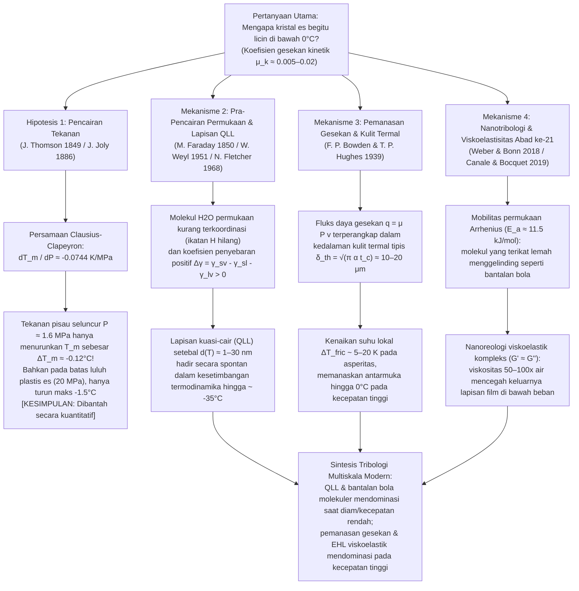

Melangkah ke atas permukaan es di pagi musim dingin, menyaksikan atlet seluncur cepat (speed skating) melesat di tikungan pada kecepatan $60\,\text{km/jam}$, atau mengamati batu curling granit seberat $20\,\text{kg}$ meluncur sejauh empat puluh meter di atas es hampir tanpa melambat adalah bukti nyata dari salah satu anomali paling luar biasa dalam fisika benda terkondensasi dan tribologi (ilmu tentang gesekan, keausan, dan pelumasan). Bagi intuisi sehari-hari, fakta bahwa "es itu licin" tampak begitu wajar. Namun, dari sudut pandang fisika zat padat yang ketat, pertanyaan <strong>"Mengapa kristal padat seperti es memiliki gesekan yang sangat rendah?"</strong> merupakan teka-teki ilmiah mendalam yang telah memicu perdebatan sengit di kalangan fisikawan selama lebih dari 170 tahun.

Ketika dua zat padat kristalin kering biasa—seperti baja di atas kaca, granit di atas kuarsa, atau tembaga di atas aluminium oksida—digesekkan satu sama lain tanpa pelumas, koefisien gesekan kinetiknya sangat besar, umumnya berada pada kisaran $\mu_k \approx 0.4\text{–}0.8$. Pada skala mikroskopis, puncak-puncak kekasaran permukaan (asperitas) membentuk sambungan adhesif yang harus terus-menerus digeser dengan disipasi energi yang besar. Namun, ketika bilah sepatu luncur baja atau papan ski polietilena meluncur di atas es heksagonal biasa (Es $I_h$) pada suhu $-5^\circ\text{C}$ hingga $-10^\circ\text{C}$—jauh di bawah titik leleh $0^\circ\text{C}$—koefisien gesekan kinetiknya anjlok drastis menjadi <strong>$\mu_k \approx 0.005\text{–}0.02$</strong>! Nilai ini satu hingga dua orde besaran lebih rendah daripada zat padat kristalin lainnya, bahkan mengalahkan politetrafluoroetilena (PTFE / Teflon, $\mu_k \approx 0.04\text{–}0.10$).

Selama lebih dari satu abad, buku teks sekolah dan ensiklopedia populer menyajikan penjelasan standar berikut:
<strong>"Karena air memuai saat membeku, pemberian tekanan pada es akan menurunkan titik lelehnya. Ketika seorang pemain seluncur es berdiri di atas bilah pisau yang tipis, seluruh berat tubuhnya terkonsentrasi pada area yang sangat kecil, menghasilkan tekanan raksasa yang mencairkan es di bawah bilah menjadi lapisan air pelumas."</strong>

Inilah <strong>Teori Pencairan Tekanan (Pressure-Melting Theory)</strong> yang terkenal, yang dirumuskan secara termodinamika oleh James Thomson pada tahun 1849 dan diterapkan pada seluncur es oleh John Joly pada tahun 1886. Namun, verifikasi kuantitatif yang ketat menunjukkan fakta yang tak terbantahkan: <strong>meskipun persamaan Clausius-Clapeyron sepenuhnya benar, hipotesis pencairan tekanan sebagai penjelasan untuk seluncur es, ski, atau terpeleset di atas es salah secara kuantitatif hingga beberapa orde besaran!</strong>

Dalam artikel ini, pertama-tama kita akan menurunkan <strong>persamaan Clausius-Clapeyron</strong> dari prinsip kesetimbangan potensial kimia dan membuktikan secara matematis mengapa tekanan bilah sepatu luncur hanya menurunkan titik leleh es sekitar sepersepuluh derajat Celsius. Selanjutnya, kita akan membedah <strong>eksperimen regelasi Faraday/Bottomley tentang kawat berpemberat yang menembus balok es</strong> melalui hukum konduksi panas Fourier, menjelaskan mengapa kawat tembaga berhasil menembus es sedangkan benang nilon pada tekanan yang sama gagal. Terakhir, kita akan membahas tiga mekanisme fisik sejati yang mengatur kelicinan es:
1. <strong>Pra-pencairan permukaan (Surface Premelting) dan lapisan kuasi-cair berskala nanometer (Quasi-Liquid Layer, QLL)</strong> (Michael Faraday 1850, Woldemar Weyl 1951, Neville Fletcher 1968, J. G. Dash);
2. <strong>Pemanasan gesekan (Frictional Heating) dan pencairan pada kedalaman kulit termal</strong> (Frank Philip Bowden & Thomas P. Hughes 1939);
3. <strong>Nanotribologi modern abad ke-21</strong>: pergerakan aktif secara termal dari molekul air permukaan yang terikat lemah seperti "bantalan bola molekuler" (Weber & Bonn et al., 2018) serta <strong>nanoreologi viskoelastik kompleks ($G' \approx G''$)</strong> dari lapisan antarmuka yang memiliki viskositas efektif 50 hingga 100 kali lebih tinggi daripada air cair biasa (Canale & Bocquet et al., 2019).

---

## 1. Es sebagai Anomali Tribologi dan Empat Skala Fisika

Mari kita bandingkan koefisien gesekan kinetik Amontons-Coulomb $\mu_k = F_f / F_N$ di berbagai pasangan antarmuka zat padat:

| Pasangan Permukaan Geser | Suhu $T$ | Koefisien Gesekan $\mu_k$ | Mekanisme Fisik Disipasi Dominan |
| :--- | :--- | :--- | :--- |
| <strong>Baja di atas Baja</strong> (udara kering) | $20^\circ\text{C}$ | $0.50\text{–}0.80$ | Geseran sambungan las dingin asperitas dan pembajakan plastis (Ploughing) |
| <strong>Kaca Silika di atas Kaca</strong> | $20^\circ\text{C}$ | $0.40\text{–}0.90$ | Adhesi ikatan hidrogen/kovalen silanol dan retakan mikro getas |
| <strong>Granit di atas Granit</strong> (patahan batuan) | $20^\circ\text{C}$ | $0.60\text{–}0.70$ | Penghancuran getas asperitas dan abrasi benda ketiga |
| <strong>PTFE (Teflon) di atas Baja</strong> | $20^\circ\text{C}$ | $0.04\text{–}0.10$ | Energi permukaan van der Waals rendah dan lapisan transfer polimer |
| <strong>Es Heksagonal $I_h$ di atas Baja</strong> (kriogenik) | $-100^\circ\text{C}$ | $0.40\text{–}0.60$ | Adhesi zat padat normal dan geseran getas (es sama sekali tidak licin!) |
| <strong>Es Heksagonal $I_h$ di atas Baja</strong> (seluncur es) | $-5^\circ\text{C}$ | <strong>$0.005\text{–}0.015$</strong> | QLL kesetimbangan + pencairan panas gesekan + gaya angkat viskoelastik |
| <strong>Es Heksagonal $I_h$ di atas UHMWPE</strong> (ski) | $-3^\circ\text{C}$ | <strong>$0.010\text{–}0.030$</strong> | Slip dinding hidrofobik (Wall Slip) + pelumasan campuran panas gesekan |

Pada suhu $-100^\circ\text{C}$ ($173\,\text{K}$), es sama sekali tidak licin ($\mu_k \approx 0.5$). Gesekan ultra-rendah muncul di atas suhu $\approx -35^\circ\text{C}$ sesuai diagram alir berikut:

---

## 2. Membantah Teori Pencairan Tekanan melalui Persamaan Clausius-Clapeyron

### 2.1 Struktur Kristal Es Heksagonal ($I_h$) dan Anomali Volume

Dalam kisi kristal es heksagonal biasa (<strong>Es $I_h$</strong>), setiap molekul $\text{H}_2\text{O}$ mengikuti aturan es Bernal-Fowler dan membentuk empat ikatan hidrogen terarah ($\text{O}-\text{H}\cdots\text{O}$ dengan panjang $\approx 2.76\,\text{\AA}$) dalam koordinasi tetrahedral ($109.5^\circ$). Struktur terbuka ini memiliki rongga interstisial yang besar. Saat mencair pada $T_m = 273.15\,\text{K}$ ($0^\circ\text{C}$), jaringan tetrahedral runtuh sebagian sehingga massa jenis $\rho$ meningkat dan volume spesifik $v = 1/\rho$ menurun:

* <strong>Es padat $I_h$ pada $0^\circ\text{C}$</strong>: $\rho_{\text{ice}} = 916.7\,\text{kg/m}^3 \implies v_{\text{ice}} = 1.0909 \times 10^{-3}\,\text{m}^3/\text{kg}$
* <strong>Air cair pada $0^\circ\text{C}$</strong>: $\rho_{\text{liquid}} = 999.84\,\text{kg/m}^3 \implies v_{\text{liquid}} = 1.0002 \times 10^{-3}\,\text{m}^3/\text{kg}$
* <strong>Perubahan volume spesifik peleburan</strong>:
  $$\Delta v_{\text{fus}} = v_{\text{liquid}} - v_{\text{ice}} = (1.0002 - 1.0909) \times 10^{-3}\,\text{m}^3/\text{kg} \approx -9.1 \times 10^{-5}\,\text{m}^3/\text{kg} < 0$$

### 2.2 Penurunan Persamaan Clausius-Clapeyron dan Evaluasi Numerik

Sepanjang kurva koeksistensi padat-cair $P(T_m)$, kesamaan energi bebas Gibbs spesifik $g_{\text{ice}}(T_m, P) = g_{\text{liquid}}(T_m, P)$ dan hubungan diferensial $dg = -s\,dT + v\,dP$ menghasilkan:

$$-s_{\text{ice}}\,dT_m + v_{\text{ice}}\,dP = -s_{\text{liquid}}\,dT_m + v_{\text{liquid}}\,dP \implies \left(v_{\text{liquid}} - v_{\text{ice}}\right) dP = \left(s_{\text{liquid}} - s_{\text{ice}}\right) dT_m$$

Dengan mensubstitusikan perubahan entropi spesifik peleburan $\Delta s_{\text{fus}} = s_{\text{liquid}} - s_{\text{ice}} = \frac{L_f}{T_m}$ dengan kalor laten peleburan $L_f = 3.34 \times 10^5\,\text{J/kg}$, diperoleh <strong>persamaan Clausius-Clapeyron</strong>:

$$\frac{dP}{dT_m} = \frac{L_f}{T_m \left(v_{\text{liquid}} - v_{\text{ice}}\right)} = \frac{3.34 \times 10^5\,\text{J/kg}}{273.15\,\text{K} \times \left(-9.1 \times 10^{-5}\,\text{m}^3/\text{kg}\right)} \approx -1.344 \times 10^7\,\text{Pa/K} = -13.44\,\text{MPa/K}$$

Kebalikannya memberikan laju penurunan titik leleh per satuan tekanan:

$$\frac{dT_m}{dP} \approx -0.0744\,\text{K/MPa} \quad \left(\text{atau } -0.00754^\circ\text{C/atm}\right)$$

<strong>Untuk menurunkan titik leleh es sebesar $1^\circ\text{C}$ saja, diperlukan tekanan luar biasa sebesar $13.44\,\text{MPa}$ (sekitar $133\,\text{atmosfer}$)!</strong>

### 2.3 Tekanan Nyata Pemain Seluncur Es dan Batas Luluh Plastis Es

Seorang pemain seluncur es bermassa $m = 75\,\text{kg}$ ($F_N = m g = 735.75\,\text{N}$) yang berdiri di atas satu bilah dengan panjang kontak $L = 30\,\text{cm} = 0.30\,\text{m}$ dan lebar $w = 1.5\,\text{mm} = 1.5 \times 10^{-3}\,\text{m}$ ($A = L w = 4.5 \times 10^{-4}\,\text{m}^2$) memberikan tekanan rata-rata:

$$P = \frac{m g}{A} = \frac{735.75\,\text{N}}{4.5 \times 10^{-4}\,\text{m}^2} \approx 1.635\,\text{MPa} \implies \Delta T_m = \left(\frac{dT_m}{dP}\right) P \approx -0.122^\circ\text{C}$$

<strong>Titik leleh hanya turun sebesar $0.12^\circ\text{C}$!</strong> Bahkan jika memperhitungkan konsentrasi tegangan pada mikro-asperitas, tekanan lokal $P_{\text{local}}$ tidak pernah dapat melampaui kekuatan luluh tekan plastis (kekerasan indentasi) es, yaitu $\sigma_{y,\text{ice}} \approx 10\text{–}20\,\text{MPa}$. Pada batas maksimum $20\,\text{MPa}$ tersebut, penurunan titik leleh paling banyak hanya $\Delta T_{m,\max} \approx -1.49^\circ\text{C}$, yang sama sekali tidak mampu menjelaskan mengapa atlet hoki dan ski meluncur dengan mudah pada suhu $-15^\circ\text{C}$, atau mengapa pejalan kaki dengan sepatu karet datar ($P \approx 34\,\text{kPa}$, $\Delta T_m \approx -0.0026^\circ\text{C}$) tetap terpeleset di atas es!

---

## 3. Regelasi Faraday dan Eksperimen Kawat Menembus Es

Dalam eksperimen klasik Bottomley (1872), di mana kawat yang diberi beban menembus balok es pada suhu $0^\circ\text{C}$ tanpa membelahnya menjadi dua, agar es di bawah kawat mencair, ia harus terus-menerus menyerap kalor laten peleburan $L_f = 3.34 \times 10^5\,\text{J/kg}$. Kalor ini berasal dari pembekuan kembali (regelasi) air di atas kawat dan harus <strong>dikonduksikan secara termal menembus diameter kawat</strong> menurut hukum Fourier (Nye 1967):

$$v_{\text{wire}} \approx \frac{\kappa_{\text{eff}} |\Delta T_m|}{\rho_{\text{ice}} L_f R}$$

<strong>Kawat tembaga</strong> ($\kappa_{\text{Cu}} \approx 400\,\text{W/(m}\cdot\text{K)}$) menghantarkan kalor laten dengan cepat dan menembus es pada kecepatan $v_{\text{wire}} \sim 10^{-5}\text{–}10^{-4}\,\text{m/s}$ (meski demikian masih <strong>5 hingga 6 orde besaran terlalu lambat</strong> untuk sepatu luncur yang bergerak pada $10\,\text{m/s}$!), sedangkan <strong>benang nilon</strong> berdiameter sama ($\kappa_{\text{nylon}} \approx 0.25\,\text{W/(m}\cdot\text{K)}$, $1600$ kali kurang konduktif) gagal menembus es di bawah tekanan yang persis sama. Selain itu, ketika <strong>Michael Faraday</strong> menemukan regelasi pada tahun 1850, ia menolak hipotesis tekanan Thomson dan secara tepat mengusulkan bahwa permukaan es secara alami memiliki lapisan film kuasi-cair.

---

## 4. Pra-Pencairan Permukaan dan Lapisan Kuasi-Cair Nanometer (QLL)

1. <strong>Kekurangan Ikatan Hidrogen Permukaan dan Kriteria Lindemann</strong>:
   Pada antarmuka kristal-uap, molekul air permukaan kehilangan tetangga bagian atas dan hanya membentuk 2 atau 3 ikatan hidrogen, bukan 4. Karena konstanta gaya pemulih $k_{\text{surf}}$ berkurang setengahnya, amplitudo getaran termal $\sqrt{\langle u_{\text{surf}}^2 \rangle} \propto \sqrt{k_B T / k_{\text{surf}}}$ melampaui ambang batas ketidakstabilan Lindemann jauh di bawah $0^\circ\text{C}$ (mulai dari $\approx -35^\circ\text{C}$), membentuk <strong>lapisan kuasi-cair (QLL)</strong> dengan ketebalan $d(T) \sim 1\text{–}30\,\text{nm}$.
2. <strong>Model Termodinamika Energi Bebas Antarmuka (Weyl, Fletcher, Dash)</strong>:
   Karena koefisien penyebaran $\Delta \gamma = \gamma_{sv} - \gamma_{sl} - \gamma_{lv} \approx 109 - 30 - 75.6 = +3.4\,\text{mJ/m}^2 > 0$ bernilai positif, energi bebas permukaan:
   $$\Delta G_{\text{surf}}(d) = -\left(\gamma_{sv} - \gamma_{sl} - \gamma_{lv}\right)\left(1 - e^{-d/\xi}\right) + \rho_l L_f \left(\frac{T_m - T}{T_m}\right) d$$
   diminimalkan ($\frac{\partial \Delta G_{\text{surf}}}{\partial d} = 0$) menghasilkan ketebalan kesetimbangan:
   $$d(T) = \xi \ln\!\left(\frac{\Delta \gamma \, T_m}{\xi \rho_l L_f (T_m - T)}\right) \quad \text{atau} \quad d(T) \propto \left(T_m - T\right)^{-1/3}$$

---

## 5. Pemanasan Gesekan dan Lapisan Batas Termal (Bowden & Hughes, 1939)

Pada kecepatan luncur tinggi ($v \sim 5\text{–}20\,\text{m/s}$), kekasaran permukaan ($R_q \sim 0.1\text{–}1\,\mu\text{m}$) jauh melebihi ketebalan nanometer QLL statis. Pada tahun 1939 di gua gletser Jungfraujoch, <strong>Frank Philip Bowden</strong> dan <strong>Thomas P. Hughes</strong> membuktikan bahwa ski kuningan ($\kappa \approx 110\,\text{W/(m}\cdot\text{K)}$) menyerap panas gesekan dan menghasilkan gesekan tinggi, sedangkan ski isolator dari kayu atau PTFE ($\kappa \approx 0.2\,\text{W/(m}\cdot\text{K)}$) menahan panas di permukaan es dan menurunkan gesekan secara drastis.

Selama waktu kontak $t_c = L/v$, fluks panas gesekan $q_{\text{fric}} = \mu_k P v$ hanya menembus <strong>kedalaman kulit termal $\delta_{\text{th}} = \sqrt{\pi \alpha_{\text{ice}} t_c} = \sqrt{\pi \alpha_{\text{ice}} L / v} \approx 10\text{–}20\,\mu\text{m}$</strong>, menaikkan suhu antarmuka sebesar:

$$\Delta T_{\text{fric}} = \frac{2 \mu_k P \sqrt{v L}}{\sqrt{\pi} \left(\sqrt{\kappa_{\text{ice}} \rho_{\text{ice}} c_{p,\text{ice}}} + \sqrt{\kappa_{\text{slider}} \rho_{\text{slider}} c_{p,\text{slider}}}\right)}$$

Hal ini menjelaskan pencairan lokal pada $-10^\circ\text{C}$, mengapa di bawah $-35^\circ\text{C}$ di Antartika atau Siberia salju terasa kasar seperti pasir kuarsa kering ($\mu_k \approx 0.4$), dan mengapa pada $0^\circ\text{C}$ kelebihan air membentuk jembatan meniskus kapiler ($\Delta P_{\text{cap}} = -2\gamma_{lv}\cos\theta / h$) yang kembali meningkatkan gesekan.

---

## 6. Nanotribologi Abad ke-21: Bantalan Bola Molekuler dan Viskoelastisitas (2018–2024)

1. <strong>Bantalan Bola Molekuler dan Hukum Arrhenius (Weber & Bonn et al., 2018)</strong>:
   Koefisien gesekan es antara $-100^\circ\text{C}$ dan $0^\circ\text{C}$ mengikuti hukum eksponensial Arrhenius $\mu(T) \propto \exp(E_a / k_B T)$ dengan energi aktivasi <strong>$E_a \approx 11.5\,\text{kJ/mol}$</strong>, yang sesuai dengan molekul air permukaan yang terikat lemah yang menggelinding di atas kisi kristal seperti <strong>bantalan bola molekuler</strong>.
2. <strong>Nanoreologi Viskoelastik Kompleks Lapisan Antarmuka (Canale & Bocquet et al., 2019)</strong>:
   Air cair murni ($\eta_0 \approx 1.8\,\text{mPa}\cdot\text{s}$) akan langsung terperas keluar di bawah tekanan megapascal. Menggunakan mikroskop gaya atom garpu tala kuarsa, Canale dan Bocquet menemukan bahwa lapisan submikron yang tergeser di atas es memiliki <strong>viskositas efektif 50 hingga 100 kali lebih tinggi daripada air ($\eta_{\text{eff}} \sim 0.05\text{–}0.2\,\text{Pa}\cdot\text{s}$, setara oli mesin)</strong> serta modulus penyimpanan elastis yang besar <strong>$G' \approx G'' \sim 10^4\text{–}10^5\,\text{Pa}$</strong>. "Gemuk viskoelastik penyembuhan diri" ini menghasilkan gaya angkat elastohidrodinamik yang mencegah lapisan film terperas keluar di bawah beban sekaligus mempertahankan tahanan geser yang sangat rendah!
