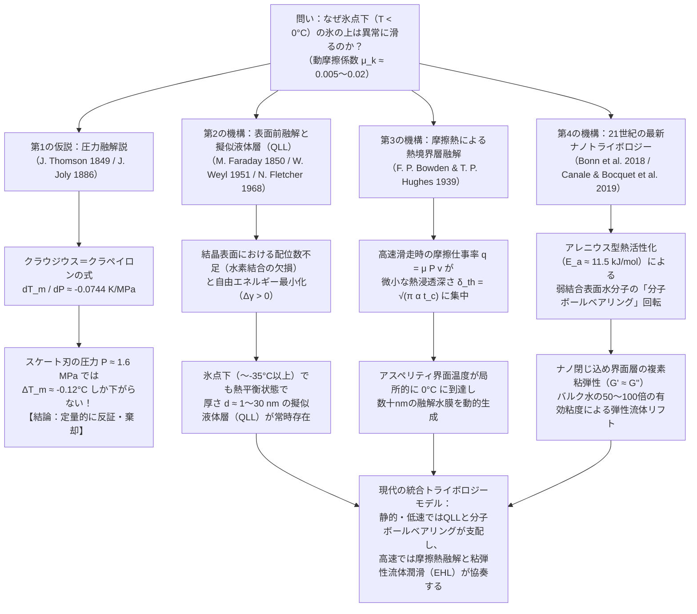
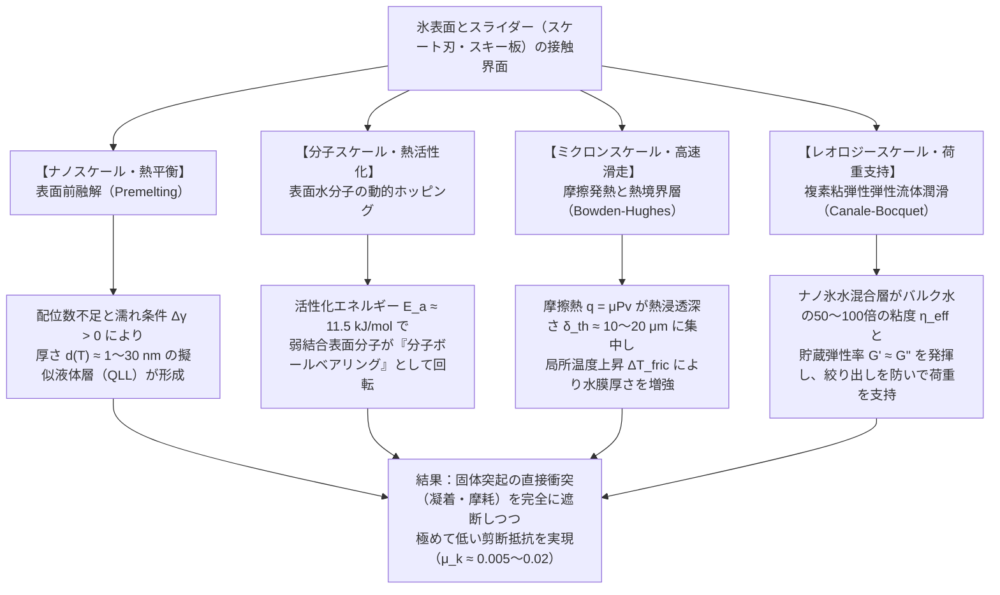

冬の凍てついた朝、凍結したアスファルトや氷の張った池の上に足を踏み出した瞬間、私たちは足元がすくわれるような強烈な「滑りやすさ」を経験する。フィギュアスケートの選手は氷上で時速 $30\,\text{km}$ を超える速度で滑走し、スピードスケートの選手は時速 $60\,\text{km}$ 近い猛スピードでコーナーを駆け抜ける。また、重さ約 $20\,\text{kg}$ の花崗岩で作られたカーリングのストーンは、一度押し出されると氷の上を数十メートルにわたってほとんど減速することなく滑り続ける。

しかし、凝縮系物理学（Condensed Matter Physics）およびトライボロジー（Tribology：摩擦・摩耗・潤滑の科学）の視点から冷静に考えてみると、<strong>「なぜ氷という結晶固体の上だけが、これほどまでに異常に滑るのか？」</strong>という問いは、驚くほど深く、そして170年以上にわたって物理学者たちを悩ませ続けてきた難問である。

通常の結晶固体同士——たとえば鋼鉄とガラス、花崗岩と石英、あるいはアルミニウムと酸化物セラミックス——を潤滑油なしで擦り合わせた場合、動摩擦係数 $\mu_k$ はおよそ $0.4 \sim 0.8$ という大きな値を示す。そこでは接触界面の微小突起（アスペリティ）同士が凝着・破断を繰り返し、激しい摩耗とスティック・スリップ振動が発生する。ところが、同じ結晶固体であるはずの氷（六方晶氷 $I_h$）の上で鋼鉄のスケートブレードやポリエチレンのスキー板を滑らせると、氷点下 $-5^\circ\text{C} \sim -10^\circ\text{C}$ という明確に「固相」の安定領域にあるにもかかわらず、その動摩擦係数は <strong>$\mu_k \approx 0.005 \sim 0.02$</strong> という桁違いに小さな値へと劇的に低下する。これは他のいかなる結晶固体よりも1桁から2桁低く、精密に設計された流体潤滑軸受や、最も滑りやすい合成高分子として知られるポリテトラフルオロエチレン（PTFE：テフロン）同士の摩擦係数（$\mu_k \approx 0.04 \sim 0.1$）すら大きく下回る異常値である。

多くの人々は、学校の理科の授業や一般向け科学書で次のような説明を聞いたことがあるだろう。
<strong>「水は氷になると体積が増える異常液体である。そのため、氷に高い圧力をかけると融点（氷点）が下がる。スケートの細い刃の上に体重が集中することで巨大な圧力が生じ、刃の下の氷が瞬時に溶けて水の膜ができるため、スケートは滑るのだ」</strong>——いわゆる<strong>「圧力融解説（Pressure Melting Theory）」</strong>である。

結論から述べよう。<strong>この「圧力融解説」は、熱力学の理論式としては正しいものの、実際のスケートやスキー、あるいは靴底で氷の上を滑る現象の説明としては、定量的に完全に破綻している「科学神話（Textbook Myth）」である。</strong>

本稿では、まず熱力学の根幹をなす<strong>クラウジウス＝クラペイロンの式（Clausius–Clapeyron Equation）</strong>を厳密に導出し、物理定数とスケーターの実際の接触圧力を代入することで、圧力融解説がなぜ氷上の滑走を説明できないのかを数学的に証明する。さらに、圧力融解説の「証拠」として誤用され続けてきた<strong>「ファラデーの復氷（Regelation）と針金の氷抜け実験」</strong>に隠された熱伝導のトリックを暴く。その上で、現代の物理学が到達した3つの真のメカニズム——<strong>① 表面前融解（Surface Premelting）によるナノメートル擬似液体層（Quasi-Liquid Layer: QLL）</strong>、<strong>② 摩擦熱（Frictional Heating）による熱境界層の局所融解</strong>、そして<strong>③ 21世紀の最新ナノトライボロジーが解明した「表面水分子のボールベアリング運動」と「界面層の複雑な粘弾性（Viscoelasticity）レオロジー」</strong>——の全貌を、数式と実験データに基づき徹底的に解き明かす。

---

## 1. 固体摩擦の異常値としての氷と4つの物理階層

まず、氷の摩擦がいかに物質界の中で特異な位置にあるかを定量的に整理しておこう。クーロン・アモントンの摩擦法則において、垂直抗力 $F_N$ に対する摩擦力 $F_f$ の比として定義される動摩擦係数 $\mu_k = F_f / F_N$ をさまざまな固体界面で比較すると、氷の特異性が浮き彫りになる。

| 接触界面の組み合わせ（乾燥または自己潤滑状態） | 温度条件 | 代表的な動摩擦係数 $\mu_k$ | 支配的な摩擦・散逸メカニズム |
| :--- | :--- | :--- | :--- |
| <strong>鋼鉄 vs. 鋼鉄</strong>（無潤滑・大気中） | $20^\circ\text{C}$ | $0.50 \sim 0.80$ | 微小突起の凝着結合のせん断・掘り起こし（Ploughing） |
| <strong>ガラス vs. ガラス</strong>（清浄表面） | $20^\circ\text{C}$ | $0.40 \sim 0.90$ | 共有結合・水素結合ネットワークの凝着と脆性微小破壊 |
| <strong>花崗岩 vs. 花崗岩</strong>（断層・岩石摩擦） | $20^\circ\text{C}$ | $0.60 \sim 0.70$ | アスペリティの脆性破砕と摩耗粉（ガウジ）の噛み合い |
| <strong>PTFE（テフロン） vs. 鋼鉄</strong> | $20^\circ\text{C}$ | $0.04 \sim 0.10$ | 剛直なフッ素被覆分子鎖の低表面エネルギーと移着膜形成 |
| <strong>氷 $I_h$ vs. 鋼鉄</strong>（極低温・乾燥領域） | $-100^\circ\text{C}$ | $0.40 \sim 0.60$ | 通常の結晶固体と同様の凝着・脆性せん断（滑らない氷） |
| <strong>氷 $I_h$ vs. 鋼鉄</strong>（スケート滑走条件） | $-5^\circ\text{C}$ | <strong>$0.005 \sim 0.015$</strong> | 擬似液体層（QLL）＋摩擦熱融解＋粘弾性流体潤滑 |
| <strong>氷 $I_h$ vs. ポリエチレン（スキー板）</strong> | $-3^\circ\text{C}$ | <strong>$0.010 \sim 0.030$</strong> | 疎水性界面でのスリップ増大＋摩擦熱による混合潤滑 |

上の表から明らかなように、氷であっても $-100^\circ\text{C}$（$173\,\text{K}$）のような極低温下では、動摩擦係数は $\mu_k \approx 0.5$ に達し、ガラスや岩石とまったく変わらない「滑らない普通の結晶固体」として振る舞う。氷が異常な低摩擦を示すのは、融点 $T_m = 273.15\,\text{K}$（$0^\circ\text{C}$）に近い比較的高温の領域（およそ $-35^\circ\text{C} \sim 0^\circ\text{C}$）および特定の滑走速度領域に限られている。

この現象をめぐる170年間の科学史と現代の物理的描像は、以下のフローチャートに示す4つのメカニズムの階層として統合される。

それでは、第1の仮説である「圧力融解説」がなぜ誤りなのか、熱力学の第一原理から検証していこう。

---

## 2. 「圧力融解説」の興隆と崩壊：クラウジウス＝クラペイロン方程式による厳密検証

### 2.1 ジェームズ・トムソンとジョン・ジョリーの歴史的提案

1849年、絶対温度目盛りで知られるウィリアム・トムソン（後のケルビン卿）の兄である物理学者<strong>ジェームズ・トムソン（James Thomson）</strong>は、カルノーの熱機関の理論を水と氷の相転移に応用し、驚くべき理論的予言を行った。大多数の物質は液体から固体へ凝固する際に体積が収縮するが、水（$\text{H}_2\text{O}$）は例外的に、液体から六方晶の氷（Ice $I_h$）へと凍結する際に体積が約 $9\%$ 膨張する。ルシャトリエの原理（Le Chatelier's principle）に従えば、系に外部から静水圧 $P$ を加えたとき、系は体積の小さい相（すなわち液体の水）を安定化させる方向へシフトする。したがって、<strong>氷に圧力をかけると融点 $T_m$ が低下するはずである</strong>とトムソンは計算し、翌1850年に弟のウィリアム・トムソンが実験室でこれを実証した。

それから37年後の1886年、アイルランドの物理学者<strong>ジョン・ジョリー（John Joly）</strong>は、ロイヤル・ダブリン協会の論文において、この圧力融解現象をアイススケートの滑走原理に適用した。「スケーターの体重が極めて細いスケートブレードの接触面積に集中することで数百気圧もの高圧が発生し、氷点下の氷が圧力によって融解して水膜を作る」というジョリーの仮説は、直感的にわかりやすく、しかも熱力学という最新の科学に裏打ちされているように見えたため、瞬く間に世界中の物理教科書へと広まっていった。

### 2.2 六方晶氷 $I_h$ の結晶構造と体積異常の微視的起源

計算に入る前に、なぜ氷が液体の水よりも密度が低いのかを分子レベルで確認しておこう。水分子 $\text{H}_2\text{O}$ の酸素原子は $sp^3$ 混成軌道に近い電子配置をとり、2つの共有結合（$\text{O}-\text{H}$ 結合長 $\approx 0.96\,\text{\AA}$）と2つの非共有電子対（ローンペア）が正四面体（四面体角 $\approx 109.5^\circ$）の4頂点方向を向いている。

大気圧下で凍結した通常の氷である<strong>六方晶氷（Hexagonal Ice, $I_h$）</strong>の結晶格子内では、バーナル＝ファウラーの氷規則（Bernal–Fowler ice rules）に従い、すべての水分子が周囲の4つの水分子と厳密に4本の直線的な水素結合（$\text{O}-\text{H}\cdots\text{O}$ 酸素間距離 $\approx 2.76\,\text{\AA}$）を形成する。この方向性の強い正四面体ネットワークは、ダイヤモンド格子やヴルツ鉱（Wurtzite）構造とトポロジー的に同型の六員環ケージ構造を作るため、結晶内部に分子が入り込めない巨大な「構造的空隙（Open interstitial voids）」を抱え込むことになる。

その結果、$0^\circ\text{C}$（$273.15\,\text{K}$）、$1\,\text{atm}$（$101.325\,\text{kPa}$）における氷 $I_h$ と液体の水の密度 $\rho$ および比体積（単位質量あたりの体積 $v = 1/\rho$）は以下のようになる。

* <strong>六方晶氷 $I_h$（固相）</strong>：
  $$\rho_{\text{ice}} = 916.7\,\text{kg/m}^3 \implies v_{\text{ice}} = \frac{1}{\rho_{\text{ice}}} \approx 1.0909 \times 10^{-3}\,\text{m}^3/\text{kg}$$
* <strong>液体の水（液相）</strong>：
  $$\rho_{\text{liquid}} = 999.84\,\text{kg/m}^3 \implies v_{\text{liquid}} = \frac{1}{\rho_{\text{liquid}}} \approx 1.0002 \times 10^{-3}\,\text{m}^3/\text{kg}$$

氷が融解して液体の水になるとき、結晶の厳密な四面体水素結合ネットワークが部分的に崩壊・屈曲し、空隙の中に隣接する水分子が入り込む（平均配位数が固相の $4.0$ から液相では約 $4.4 \sim 4.7$ へと増加する）。したがって、融解に伴う比体積の変化 $\Delta v_{\text{fus}}$ は<strong>負の値</strong>をとる：

$$\Delta v_{\text{fus}} = v_{\text{liquid}} - v_{\text{ice}} = (1.0002 - 1.0909) \times 10^{-3}\,\text{m}^3/\text{kg} = -9.07 \times 10^{-5}\,\text{m}^3/\text{kg} \approx -9.1 \times 10^{-5}\,\text{m}^3/\text{kg}$$

### 2.3 クラウジウス＝クラペイロンの式の導出と融点降下率の算出

温度 $T$ と圧力 $P$ の相図（$P$-$T$ 平面）上において、固相（氷）と液相（水）が熱力学的平衡を保って共存している境界線（融解曲線）を考えよう。熱力学の一般原理より、2つの相が平衡共存するための必要十分条件は、両相の単位質量あたりのギブズ自由エネルギー（比ギブズ自由エネルギー、すなわち化学ポテンシャル）$g(T, P)$ が等しいことである：

$$g_{\text{ice}}(T, P) = g_{\text{liquid}}(T, P)$$

いま、この相共存曲線に沿って $(T, P)$ から微小変化した別の平衡点 $(T + dT, P + dP)$ へと移動したとすると、そこでも両相の比ギブズ自由エネルギーは等しくなければならないため、微小変化量について次式が成り立つ：

$$dg_{\text{ice}} = dg_{\text{liquid}}$$

熱力学の基本関係式 $dg = -s\,dT + v\,dP$（ここで $s$ は比エントロピー、$v$ は比体積）を両辺に代入すると、

$$-s_{\text{ice}}\,dT + v_{\text{ice}}\,dP = -s_{\text{liquid}}\,dT + v_{\text{liquid}}\,dP$$

これを整理すると、

$$(v_{\text{liquid}} - v_{\text{ice}})\,dP = (s_{\text{liquid}} - s_{\text{ice}})\,dT$$

ここで、平衡融解温度 $T_m$ において単位質量の氷が定温・定圧下で融解する際に吸収する融解潜熱（比潜熱）を $L_f$ とすると、可逆過程におけるエントロピー変化の定義より、

$$\Delta s_{\text{fus}} = s_{\text{liquid}} - s_{\text{ice}} = \frac{L_f}{T_m}$$

が成立する。これを代入することで、固液相境界の傾きを与える<strong>クラウジウス＝クラペイロンの式（Clausius–Clapeyron Equation）</strong>が得られる：

$$\frac{dP}{dT_m} = \frac{L_f}{T_m \left(v_{\text{liquid}} - v_{\text{ice}}\right)}$$

この式に、水の正確な熱力学物性値を代入してみよう。
* 氷の比融解潜熱：$L_f = 3.3355 \times 10^5\,\text{J/kg} \approx 3.34 \times 10^5\,\text{J/kg}$
* 標準融解温度：$T_m = 273.15\,\text{K}$
* 融解に伴う比体積変化：$\Delta v = v_{\text{liquid}} - v_{\text{ice}} = -9.1 \times 10^{-5}\,\text{m}^3/\text{kg}$

これらを代入して $\frac{dP}{dT_m}$ を計算すると、

$$\frac{dP}{dT_m} = \frac{3.34 \times 10^5\,\text{J/kg}}{273.15\,\text{K} \times \left(-9.1 \times 10^{-5}\,\text{m}^3/\text{kg}\right)} = \frac{3.34 \times 10^5}{-2.4857 \times 10^{-2}}\,\text{Pa/K} \approx -1.344 \times 10^7\,\text{Pa/K} = -13.44\,\text{MPa/K}$$

すなわち、<strong>氷の融点をわずか $1\,\text{K}$（$1^\circ\text{C}$）下げるだけでも、約 $13.44\,\text{MPa}$（約 $133\,\text{気圧}$）もの巨大な静水圧が必要になる</strong>のである！逆数をとって、単位圧力上昇あたりの融点変化率 $\frac{dT_m}{dP}$ を求めると、

$$\frac{dT_m}{dP} = \frac{T_m \left(v_{\text{liquid}} - v_{\text{ice}}\right)}{L_f} \approx -0.0744\,\text{K/MPa} \quad \left(\text{あるいは } -0.00754^\circ\text{C/atm}\right)$$

となる。$1\,\text{気圧}$（$\approx 0.1013\,\text{MPa}$）の圧力を加えても、氷の融点はたったの $0.0075^\circ\text{C}$ しか下がらない。

### 2.4 スケーターが氷に及ぼす実際の圧力と融点降下の計算

では、実際にアイススケートをしている人間が氷の表面にどれほどの圧力を及ぼしているのかを計算してみよう。
体重 $m = 75\,\text{kg}$ の成人スケーターを考える。重力加速度を $g = 9.81\,\text{m/s}^2$ とすると、スケーターにかかる重力（垂直荷重）は、

$$F_N = m g = 75\,\text{kg} \times 9.81\,\text{m/s}^2 = 735.75\,\text{N}$$

である。このスケーターが<strong>片足（1本のスケートブレードのみ）</strong>に全荷重を乗せて滑走している状況を考えよう。標準的なスケートブレードの氷との有効接触長さを $L = 30\,\text{cm} = 0.30\,\text{m}$、ブレードの刃幅（厚さ）を $w = 1.5\,\text{mm} = 1.5 \times 10^{-3}\,\text{m}$ とすると、見かけの接触面積 $A_{\text{nom}}$ は、

$$A_{\text{nom}} = L \times w = 0.30\,\text{m} \times 1.5 \times 10^{-3}\,\text{m} = 4.5 \times 10^{-4}\,\text{m}^2 \quad (4.5\,\text{cm}^2)$$

となる。したがって、ブレードが氷に及ぼす平均接触圧力 $P$ は、

$$P = \frac{F_N}{A_{\text{nom}}} = \frac{735.75\,\text{N}}{4.5 \times 10^{-4}\,\text{m}^2} = 1.635 \times 10^6\,\text{Pa} = 1.635\,\text{MPa} \quad (\text{約 } 16.1\,\text{atm})$$

である。この圧力 $P = 1.635\,\text{MPa}$ を先ほど導出したクラウジウス＝クラペイロンの式に代入すると、融点降下量 $\Delta T_m$ は、

$$\Delta T_m = \left(\frac{dT_m}{dP}\right) P = (-0.0744\,\text{K/MPa}) \times 1.635\,\text{MPa} \approx -0.122\,\text{K} \quad (-0.122^\circ\text{C})$$

と求まる。<strong>なんと、体重 $75\,\text{kg}$ の大人が片足のスケート刃に乗っても、氷の融点は $-0.12^\circ\text{C}$ までしか下がらないのである！</strong>

実際のアイスホッケーリンクの表面温度は $-5^\circ\text{C} \sim -7^\circ\text{C}$、スピードスケートリンクは $-6^\circ\text{C} \sim -10^\circ\text{C}$ に保たれており、屋外の寒冷地では $-15^\circ\text{C} \sim -20^\circ\text{C}$ でも人々は問題なくスケートやスキーを楽しんでいる。$-0.12^\circ\text{C}$ の融点降下では、$-5^\circ\text{C}$ や $-15^\circ\text{C}$ の氷を溶かすことなど到底不可能である。

### 2.5 「微小突起（アスペリティ）への応力集中」と氷の塑性降伏限界の壁

ここで、トライボロジーに詳しい読者なら次のような反論を思いつくかもしれない。
「上記の見積もりは見かけの接触面積 $A_{\text{nom}}$ を使ったものだ。実際のブレード表面や氷表面にはミクロな凹凸（アスペリティ）があり、あるいはフィギュアスケートの刃にはホローグラインド（溝）やロッカー（曲率）がついているため、<strong>真実接触面積 $A_{\text{real}}$</strong> は見かけの面積より1桁以上小さいのではないか？ もし接触面積が $1/100$ になれば、局所圧力は $160\,\text{MPa}$ になり、$-12^\circ\text{C}$ でも溶けるのではないか？」

この疑問に対しても、固体力学（材料力学）から極めて明快かつ決定的な反証が存在する。<strong>固体界面の局所接触圧力 $P_{\text{local}}$ は、柔らかい方の材料（この場合は氷）の「圧縮降伏応力（Compressive Yield Strength）」または「押し込み硬さ（Indentation Hardness）」を絶対に超えることができない</strong>という物理的上限である。

もし微小な突起先端に過大な荷重が集中して局所圧力が氷の塑性降伏限界 $\sigma_y$（あるいは脆性破砕強度）を超えると、その瞬間に氷の突起は塑性変形（クリープ降伏）または破砕を起こして潰れ、真実接触面積 $A_{\text{real}}$ が次の平衡条件を満たすまで瞬時に拡大する：

$$A_{\text{real}} \ge \frac{F_N}{\sigma_y} \implies P_{\text{local}} \le \sigma_y$$

氷 $I_h$ の圧縮降伏応力（押し込み硬さ）$\sigma_y$ は、ひずみ速度と温度に依存するものの、通常のスケート条件下ではおよそ <strong>$\sigma_y \approx 10 \sim 20\,\text{MPa}$</strong> である。仮に局所圧力が氷の構造が耐えうる絶対的な上限値 $P_{\max} = 20\,\text{MPa}$（約 $200\,\text{気圧}$）に達したとしても、クラウジウス＝クラペイロンの式による融点降下は、

$$\Delta T_{m,\max} = (-0.0744\,\text{K/MPa}) \times 20\,\text{MPa} \approx -1.49^\circ\text{C}$$

にしかならない。つまり、アスペリティの応力集中を極限まで考慮しても、圧力融解によって氷が溶けるのはせいぜい $-1.5^\circ\text{C}$ までであり、$-10^\circ\text{C}$ のスケートリンクで滑る理由は依然として説明できない。

さらに水の相図（高圧相平衡図）を広く見渡しても、圧力融解には熱力学的な絶対限界が存在する。圧力をどんどん上げていくと、圧力 $P = 209.9\,\text{MPa}$、温度 $T = 251.165\,\text{K}$（<strong>$-21.985^\circ\text{C}$</strong>）にある「氷 $I_h$・氷 $\text{III}$・液体の水」の三重点（Triple Point）において、水の融点は最低値に達する。これ以上の高圧領域では、空隙の潰れた高密度な高圧氷多形（氷 $\text{III}$、氷 $\text{V}$、氷 $\text{VI}$、氷 $\text{VII}$：いずれも液体の水より密度が高く $\Delta v > 0$）へと相転移するため、圧力をかければかけるほど融点は逆に<strong>上昇</strong>していくのである。したがって、いかなる超巨大な圧力をかけようとも、圧力だけで $-22^\circ\text{C}$ 未満の氷を液体の水にすることは熱力学的に不可能である。

そして何より決定的な日常の事実として、<strong>平底のゴム靴を履いた子どもや、アイスホッケーのパックは、ほとんど圧力をかけていないにもかかわらず氷の上でツルツルと滑る</strong>。各種物体の接触圧力と圧力融解による融点降下量を比較した以下の表を見れば、圧力融解説の破綻は一目瞭然である。

| 氷上の物体・状況 | 質量 $m$ | 接触面積 $A$ | 平均接触圧力 $P$ | 圧力による融点降下 $\Delta T_m$ | 実際の滑走可能温度との矛盾 |
| :--- | :--- | :--- | :--- | :--- | :--- |
| <strong>アイスホッケーのパック</strong> | $0.17\,\text{kg}$ | $4.5 \times 10^{-3}\,\text{m}^2$ | $370\,\text{Pa}$ ($0.0037\,\text{atm}$) | <strong>$-0.000028^\circ\text{C}$</strong> | $-10^\circ\text{C}$ のリンク上を猛烈に滑る |
| <strong>アルペンスキーヤー（片足）</strong> | $75\,\text{kg}$ | $0.15\,\text{m}^2$ | $4.9\,\text{kPa}$ ($0.048\,\text{atm}$) | <strong>$-0.00036^\circ\text{C}$</strong> | $-20^\circ\text{C}$ の雪山を高速滑降する |
| <strong>カーリングのストーン</strong> | $19.96\,\text{kg}$ | $6.3 \times 10^{-4}\,\text{m}^2$ | $310\,\text{kPa}$ ($3.06\,\text{atm}$) | <strong>$-0.023^\circ\text{C}$</strong> | $-5^\circ\text{C}$ のシート上を $40\,\text{m}$ 滑る |
| <strong>平底の靴で立つ歩行者（片足）</strong> | $70\,\text{kg}$ | $0.020\,\text{m}^2$ | $34.3\,\text{kPa}$ ($0.34\,\text{atm}$) | <strong>$-0.0026^\circ\text{C}$</strong> | $-15^\circ\text{C}$ の凍結路面で転倒する |
| <strong>スケーター（ブレード平均）</strong> | $75\,\text{kg}$ | $4.5 \times 10^{-4}\,\text{m}^2$ | $1.635\,\text{MPa}$ ($16.1\,\text{atm}$) | <strong>$-0.122^\circ\text{C}$</strong> | $-10^\circ\text{C}$ のリンクで自在に滑走する |
| <strong>氷の塑性降伏限界（突起極限）</strong> | — | 微小突起先端 | $20.0\,\text{MPa}$ ($197\,\text{atm}$) | <strong>$-1.49^\circ\text{C}$</strong> | $-1.5^\circ\text{C}$ 以下の滑走を一切説明不可 |

---

## 3. ファラデーの「復氷（Regelation）」と針金の氷抜け実験の真実

圧力融解説がこれほど明白に誤っているにもかかわらず、なぜ1世紀以上もの間、教科書の記述が訂正されなかったのだろうか？ その最大の要因は、1872年にジェームズ・ボトムリー（James Bottomley）が考案した有名な演示実験——<strong>「両端に重りを吊るした細い針金を $0^\circ\text{C}$ 付近の氷塊にかけると、氷を2つに切断することなく針金が氷塊を通り抜ける実験（復氷実験）」</strong>——が、圧力融解説の視覚的な「決定打」として誤解され続けてきたことにある。

### 3.1 針金が氷を通り抜ける熱伝導メカニズム：銅線とナイロン糸の決定的な違い

この針金の実験（Wire Regelation Experiment）で実際に何が起きているのかを、熱移動論（Heat Transfer）と相変化の連成問題として正確に解析しよう。

半径 $R$ の針金に重りを吊るし、長さ $L$ の氷塊（温度 $T_0 \approx 0^\circ\text{C}$）の上に乗せる。針金の下側では、接触圧力 $P$ によって局所的な融点が $T_m(P) = T_0 - |\Delta T_m|$ へとわずかに（たとえば $-0.1^\circ\text{C}$ だけ）低下する。
しかし、ここで極めて重要な熱力学の事実がある。<strong>温度が融点に達しただけでは、氷は自動的には溶けない。氷が融解して水になるためには、外部から1グラムあたり $334\,\text{J}$ という膨大な「融解潜熱 $L_f$」が熱流として供給されなければならないのである！</strong>

では、針金の下側で氷を溶かすための融解潜熱はどこから供給されるのか？
それは、針金の下で溶けた水が針金の側面を回り込んで<strong>針金の上側</strong>へと移動し、圧力が大気圧 $P_0$ に戻った場所で<strong>再び凍結（復氷：Regelation）する際に放出される凝固潜熱</strong>である。
すなわち、針金が速度 $v_{\text{wire}}$ で氷の中を降下し続けるためには、以下の定常サイクルが回らなければならない：

1. 針金の上側（温度 $T_0 = 0^\circ\text{C}$）で水が再凍結し、単位時間・単位長さあたり $\dot{q} = 2 R \rho_{\text{ice}} L_f v_{\text{wire}}$ の潜熱を放出する。
2. この熱量 $\dot{q}$ が、温度勾配 $\approx \frac{|\Delta T_m|}{2 R}$ に駆動されて、<strong>針金自身の内部（および周囲の薄い水膜）を上から下へと熱伝導（Thermal Conduction）によって通過する</strong>。
3. 針金の下側（温度 $T_0 - |\Delta T_m|$）に到達した熱量 $\dot{q}$ が氷に吸収され、氷を融解させる。

フーリエの熱伝導法則（Fourier's law of heat conduction）を用いて、ジェイ・ナイ（J. F. Nye, 1967）およびドレイクとシュリーブ（L. D. Drake & R. L. Shreve, 1973）が導出した針金の降下速度 $v_{\text{wire}}$ の近似式は次式で与えられる：

$$v_{\text{wire}} \approx \frac{\kappa_{\text{eff}} |\Delta T_m|}{\rho_{\text{ice}} L_f R} = \frac{\kappa_{\text{eff}}}{\rho_{\text{ice}} L_f R} \left|\frac{dT_m}{dP}\right| P$$

ここで $\kappa_{\text{eff}}$ は、針金と周囲の水膜・氷を含めた有効熱伝導率であり、針金自身の熱伝導率 $\kappa_{\text{wire}}$ に強く依存する。
この式から、科学教育における極めて劇的な検証実験が導かれる。同じ太さ・同じ重りを吊るした<strong>「銅線（Copper wire）」</strong>と<strong>「ナイロン糸（Nylon fishing line / Kevlar thread）」</strong>を並べて同じ氷塊にかけた場合、何が起きるだろうか？

* <strong>銅線</strong>の熱伝導率は $\kappa_{\text{Cu}} \approx 400\,\text{W/(m}\cdot\text{K)}$ と極めて高い。そのため、針金の上側で発生した凝固潜熱が瞬時に針金の下側へと伝導し、銅線は毎分ミリメートル単位の目に見える速度で氷塊を通り抜けていく。
* 一方、<strong>ナイロン糸</strong>の熱伝導率は $\kappa_{\text{nylon}} \approx 0.25\,\text{W/(m}\cdot\text{K)}$ であり、銅の<strong>約1600分の1</strong>しかない（熱絶縁体）。もし単に「圧力だけで氷が溶ける」のであれば、同じ圧力をかけているナイロン糸も銅線と同じ速度で氷を通り抜けるはずである。しかし実際には、ナイロン糸は上側の凝固潜熱を下側へ伝えることができないため、<strong>氷塊の中にほとんど食い込むことすらできない</strong>！

さらに、熱伝導率の極めて高い銅線を使った場合でさえ、針金が氷を溶かして進む速度は $v_{\text{wire}} \sim 10^{-5} \sim 10^{-4}\,\text{m/s}$（秒速 $0.01 \sim 0.1\,\text{mm}$）程度にすぎない。これに対して、スケーターのブレードは $v_{\text{skate}} \sim 10\,\text{m/s}$ で氷上を通過し、ある一点の氷がブレードと接触している滞在時間は $\tau = w / v_{\text{skate}} \sim 10^{-4}\,\text{s}$ しかない。圧力融解に伴う熱伝導のタイムスケールは、スケートの滑走現象を説明するには<strong>5桁から6桁も遅すぎる</strong>のである。

### 3.2 マイケル・ファラデーの洞察（1850年）と歴史の皮肉

ここで科学史上の驚くべき皮肉に触れないわけにはいかない。「復氷（Regelation）」という現象を1850年にロンドンの王立研究所（Royal Institution）で最初に発見したのは、電磁気学の父<strong>マイケル・ファラデー（Michael Faraday）</strong>であった（"Regelation" という用語自体は1857年にジョン・ティンダルとジョセフ・フッカーが命名）。

ファラデーは、$0^\circ\text{C}$ 近い2つの氷片を軽く触れ合わせるだけで、たとえ周囲が温かい水の中であっても、2つの氷が瞬時に凍りついて1つの塊になることを発見した。このとき、ジェームズ・トムソンとウィリアム・トムソン（ケルビン卿）の兄弟は、「2つの氷を押し付けた接触面の圧力で氷が一旦溶け、圧力が抜けた瞬間に再凍結したのだ（圧力融解説）」と主張した。

しかし、実験の天才であったファラデーは、ほとんど圧力をかけずに羽毛のようにそっと2つの氷を触れ合わせても凝着が起きることを観察し、トムソン兄弟の圧力融解説に真っ向から異を唱えた。ファラデーが1850年6月7日の王立研究所の金曜講話で提唱した仮説は、次のような驚くべきものだった。

> 「氷の表面には、たとえ周囲の温度が氷点下であっても、結晶の内部（バルク）とは異なり、常に<strong>ごく薄い液体のような性質を持つ膜（liquid-like film）</strong>が自然に存在している。2つの氷片を接触させると、それまで『表面』であった2枚の液体膜が合体して氷の『内部（バルク）』へと変わるため、もはや液体として存在できなくなり、瞬時に凍結して2つの氷を結合させるのである。」

数式を使わずに直感と実験観察だけで真実を見抜いたファラデーのこの「表面液体膜説」は、当時主流となりつつあった数理熱力学の権威であるケルビン卿らによって「熱力学の法則に反する非科学的な思いつき」として一蹴され、その後100年近くにわたり歴史の闇に葬り去られた。しかし20世紀後半、表面物理学と量子力学の発展によって、<strong>ファラデーこそが完全に正しかった</strong>ことが証明されることになる。それが次に解説する<strong>「表面前融解（Surface Premelting）」</strong>と<strong>「擬似液体層（Quasi-Liquid Layer: QLL）」</strong>である。

---

## 4. 表面前融解とナノメートル擬似液体層（QLL）の熱力学・分子物理学

なぜ氷の表面には、融点 $0^\circ\text{C}$ よりもはるかに低い氷点下の温度領域においてさえ、熱力学的平衡状態として薄い液体状の層が存在するのだろうか？ この現象は現在、凝縮系物理学において<strong>「表面前融解（Surface Premelting または Surface Melting）」</strong>と呼ばれ、そこで形成されるナノメートルスケールの非晶質・液体状水膜は<strong>「擬似液体層（Quasi-Liquid Layer: QLL）」</strong>と呼ばれている。

### 4.1 結晶表面における水素結合の欠損とリンデマン融解基準

まず、微視的な分子結合の視点からQLLの起源を理解しよう（Woldemar Weyl 1951, Neville Fletcher 1968, Gabor Somorjai）。
第2節で述べたように、氷 $I_h$ の結晶内部（バルク）にある水分子は、周囲の4つの水分子と4本の強い水素結合（結合エネルギー1本あたり約 $20 \sim 23\,\text{kJ/mol}$）を形成し、3次元的に対称なポテンシャル井戸の中に強固に束縛されている。

ところが、結晶が気相（空気または水蒸気）と接する<strong>自由表面（Crystal–Vapor Interface）</strong>においては、結晶格子が突然断ち切られる。表面の最外層（ベーサル面 $\{0001\}$ やプリズム面 $\{10\bar{1}0\}$）に位置する水分子の上方には、結合すべき相手の水分子が存在しない。その結果、表面の水分子は4本のうち1本または2本の水素結合を失い、未結合のダングリングボンド（Dangling $\text{O}-\text{H}$ bonds：自由 $\text{O}-\text{H}$ 基）や不対電子対を表面外側に突き出した<strong>「配位数不足（Under-coordinated）」</strong>の状態に置かれる。

固体物理学における<strong>リンデマンの融解基準（Lindemann Melting Criterion, 1910）</strong>によれば、結晶の融解は、格子点周りの原子・分子の熱振動の平均二乗変位振幅 $\sqrt{\langle u^2 \rangle}$ が最近接分子間距離 $a$ の一定割合（リンデマン定数 $c_L \approx 0.10 \sim 0.15$、すなわち $10 \sim 15\%$）を超えたときに生じる。調和近似において、温度 $T$ における分子の熱振動振幅の二乗平均は、実効的なバネ定数（復元力定数）$k_{\text{eff}}$ に反比例する：

$$\langle u^2 \rangle \propto \frac{k_B T}{k_{\text{eff}}}$$

氷の表面分子は水素結合の本数が少ないため、バルク分子に比べて復元力定数が大幅に小さい（$k_{\text{surf}} \approx \frac{1}{2} k_{\text{bulk}}$）。したがって、同じ温度 $T$ であっても、表面分子の熱振動振幅はバルク内部の分子よりもはるかに大きくなる（$\langle u_{\text{surf}}^2 \rangle \gg \langle u_{\text{bulk}}^2 \rangle$）。その結果、バルクの結晶格子が融解する温度 $T_m = 273.15\,\text{K}$ よりもずっと低い温度（実験的には約 $-70^\circ\text{C} \sim -35^\circ\text{C}$ 付近）において、表面最外層の分子がまずリンデマン限界を超えて結晶の周期的配向秩序を失い、続いてそのすぐ下の分子層も連鎖的に秩序を失って、液体に近い高い分子運動性を持つ<strong>擬似液体層（QLL）</strong>へと緩和するのである。

さらに、ヴォルデマール・ワイル（W. A. Weyl, 1951）およびネヴィル・フレッチャー（N. H. Fletcher, 1968）が指摘したように、水分子は大きな電気双極子モーメント（気相で $p_0 = 1.85\,\text{Debye}$、凝縮相で実効的に約 $2.6 \sim 3.0\,\text{Debye}$）を持つ極性分子である。結晶表面で双極子が規則正しく配向したままだと巨大な静電表面エネルギーが生じるため、表面から数ナノメートルの領域にわたって水分子が双極子の向きを再配列できる「遷移的な無秩序層（QLL）」を形成した方が、静電自由エネルギーが劇的に低下する。

### 4.2 界面自由エネルギーによる表面前融解の熱力学モデル

この現象を、界面熱力学（Interfacial Thermodynamics）を用いて定式化しよう（J. G. Dash et al., 1989–2006）。
融点 $T_m$ よりわずかに低い温度 $T < T_m$（過冷却度 $\Delta T = T_m - T > 0$）にある氷の半無限結晶を考える。もし氷の表面が完全に乾燥した固相のままで気相と接しているなら、単位面積あたりの過剰表面自由エネルギーは固気界面張力 $\gamma_{sv}$（Solid–Vapor interfacial free energy）である。

ここで、固相（$s$）と気相（$v$）の間に、厚さ $d$ の均一な液相膜（$l$）が挿入された状態を考える。このとき、単位面積あたりの系のギブズ自由エネルギー変化（表面過剰自由エネルギー）$G_{\text{surf}}(d)$ は、次の3つの寄与の和として書ける：

$$G_{\text{surf}}(d) = \gamma_{sl} + \gamma_{lv} + \rho_l L_f \left(\frac{T_m - T}{T_m}\right) d + \mathcal{V}_{\text{int}}(d)$$

各項の物理的意味は以下の通りである：
1. <strong>$\gamma_{sl} + \gamma_{lv}$</strong>：固気界面（$\gamma_{sv}$）が消滅する代わりに、新たに形成された「固液界面（Solid–Liquid, $\gamma_{sl}$）」と「気液界面（Liquid–Vapor, $\gamma_{lv}$）」の2つの界面エネルギーの和。
2. <strong>$\rho_l L_f \left(\frac{T_m - T}{T_m}\right) d$</strong>：温度 $T < T_m$ では本来は固相の方が安定であるため、厚さ $d$ の液相を維持することに伴うバルクの熱力学的自由エネルギーのペナルティ（単位体積あたりの固液自由エネルギー差 $\Delta G_v \approx \rho_l L_f \frac{T_m - T}{T_m}$ に厚さ $d$ を掛けたもの）。
3. <strong>$\mathcal{V}_{\text{int}}(d)$</strong>：距離 $d$ だけ離れた固液界面（$s$-$l$）と気液界面（$l$-$v$）の間に働く有効界面間相互作用ポテンシャル（構造力およびファンデルワールス分散力）。$d = 0$ の極限では液膜が消滅して乾燥した固気界面に戻るため、境界条件として $\mathcal{V}_{\text{int}}(0) = \gamma_{sv} - (\gamma_{sl} + \gamma_{lv}) \equiv \Delta \gamma$ を満たし、$d \to \infty$ で $\mathcal{V}_{\text{int}}(\infty) = 0$ となる。

ここで定義した <strong>$\Delta \gamma$ は「拡張係数（Spreading Coefficient）」または「濡れパラメータ（Wetting Parameter）」</strong>と呼ばれる極めて重要な物理量である：

$$\Delta \gamma = \gamma_{sv} - \left(\gamma_{sl} + \gamma_{lv}\right)$$

氷と水の場合、それぞれの界面エネルギーの実測値はおよそ以下の通りである：
* 固気界面エネルギー（氷–水蒸気）：$\gamma_{sv} \approx 109\,\text{mJ/m}^2$
* 気液界面エネルギー（水–水蒸気、表面張力）：$\gamma_{lv} \approx 75.6\,\text{mJ/m}^2$（$0^\circ\text{C}$）
* 固液界面エネルギー（氷–水）：$\gamma_{sl} \approx 29 \sim 32\,\text{mJ/m}^2$

これらを代入すると、

$$\Delta \gamma \approx 109 - (30 + 75.6) = +3.4\,\text{mJ/m}^2 > 0$$

となり、<strong>$\Delta \gamma > 0$ が成立する！</strong> すなわち、むき出しの氷表面（$\gamma_{sv}$）をそのまま露出させておくよりも、その表面を薄い液体の水の膜で覆って「氷–水界面（$\gamma_{sl}$）」と「水–空気界面（$\gamma_{lv}$）」の2枚に分割した方が、界面エネルギーが約 $3.4\,\text{mJ/m}^2$ 低くなる（熱力学的に得をする）のである。

### 4.3 擬似液体層の平衡膜厚 $d(T)$ の温度依存性の導出

平衡状態における擬似液体層（QLL）の厚さ $d(T)$ は、自由エネルギー $G_{\text{surf}}(d)$ を $d$ で微分してゼロとおく熱力学的平衡条件（$\frac{\partial G_{\text{surf}}}{\partial d} = 0$、すなわち分離圧 $\Pi(d) = -\frac{\partial \mathcal{V}_{\text{int}}}{\partial d}$ とバルクの融解ペナルティの釣り合い）から決定される。界面間相互作用ポテンシャル $\mathcal{V}_{\text{int}}(d)$ の距離依存性には、膜厚の領域に応じて2つの代表的な理論モデルが存在する。

#### (A) 短距離構造力モデル（水素結合相関長 $\xi$ による指数関数減衰）
膜厚 $d$ が数分子層（$d \sim 0.5 \sim 3\,\text{nm}$）の領域では、氷の結晶格子による水分子の配向秩序化効果（短距離構造力）が支配的となり、相互作用ポテンシャルは相関長 $\xi$（数オングストローム程度）で指数関数的に減衰する：

$$\mathcal{V}_{\text{int}}(d) = \Delta \gamma \, e^{-d/\xi}$$

このとき、乾燥表面を基準とした自由エネルギー差 $\Delta G_{\text{surf}}(d) = G_{\text{surf}}(d) - \gamma_{sv}$ は次式となる：

$$\Delta G_{\text{surf}}(d) = -\Delta \gamma \left(1 - e^{-d/\xi}\right) + \rho_l L_f \left(\frac{T_m - T}{T_m}\right) d$$

これを $d$ で微分して $0$ とおくと、

$$\frac{\partial \Delta G_{\text{surf}}}{\partial d} = -\frac{\Delta \gamma}{\xi} e^{-d/\xi} + \rho_l L_f \left(\frac{T_m - T}{T_m}\right) = 0$$

$$e^{d/\xi} = \frac{\Delta \gamma \, T_m}{\xi \rho_l L_f (T_m - T)}$$

両辺の自然対数をとることで、<strong>短距離領域におけるQLL膜厚の対数則</strong>が導出される：

$$d(T) = \xi \ln\!\left(\frac{\Delta \gamma \, T_m}{\xi \rho_l L_f (T_m - T)}\right)$$

また、この式で $d(T) = 0$ となる温度を求めると、表面前融解が始まる臨界開始温度 $T_{\text{onset}}$ が得られる：

$$T_{\text{onset}} = T_m \left(1 - \frac{\Delta \gamma}{\xi \rho_l L_f}\right)$$

#### (B) 長距離ファンデルワールス（Lifshitz）分散力モデル（べき乗則）
融点 $T_m$ に極めて近い領域で膜厚 $d$ が数ナノメートル以上に成長すると、電磁場の量子揺らぎ・熱揺らぎに起因する長距離のファンデルワールス力（Lifshitz分散力）が支配的となる。非遅延領域における単位面積あたりのファンデルワールス相互作用ポテンシャルは、有効ハマカー定数（Hamaker Constant）$A_H$ を用いて次のように表される：

$$\mathcal{V}_{\text{vdW}}(d) = \frac{|A_H|}{12 \pi d^2}$$

このとき、自由エネルギーの平衡条件 $\frac{\partial G_{\text{surf}}}{\partial d} = 0$ は、

$$-\frac{|A_H|}{6 \pi d^3} + \rho_l L_f \left(\frac{T_m - T}{T_m}\right) = 0$$

となり、これを $d$ について解くことで、<strong>長距離領域におけるQLL膜厚の $-1/3$ 乗べき乗則</strong>が得られる：

$$d(T) = \left(\frac{|A_H| \, T_m}{6 \pi \rho_l L_f (T_m - T)}\right)^{1/3} \propto \left(T_m - T\right)^{-1/3}$$

（※なお、マイケル・エルバウムとマイケル・シック（M. Elbaum & M. Schick, 1991）がLifshitzの誘電分散理論を用いて氷・水・空気の周波数依存誘電率 $\epsilon(i\omega)$ を精密に計算したところ、赤外・マイクロ波領域と紫外領域で氷と水の分極率の大小関係が逆転するため、ハマカー定数 $A_H(d)$ の符号が $d \approx 3 \sim 15\,\text{nm}$ 付近で変化し、融点直下ではQLLの上に微小な水滴が共存する<strong>「不完全表面融解（Incomplete Surface Melting）」</strong>が起きるという非常に精緻な現象も解明されている。）

### 4.4 最新実験技術による擬似液体層（QLL）の直接観測

かつては理論上の存在であったQLLは、1970年代以降の先端表面分析技術によってその実在と厚さが直接測定されてきた。
* <strong>陽子後方散乱（Proton Backscattering / チャネリング法）</strong>（Golecki & Jaccard, 1977）
* <strong>エリプソメトリー（偏光解析法）およびレーザー干渉顕微鏡</strong>（Furukawa, Yamamoto & Kuroda, 1987; Elbaum, Lipson & Dash, 1993; Sazaki et al., 2012）
* <strong>X線反射率法およびすれすれ入射X線回折（GIXD）</strong>（Dosch, Lied & Bilgram, 1995）
* <strong>原子間力顕微鏡（AFM）によるフォースカーブ測定</strong>（Döppenschmidt & Butt, 2000）
* <strong>和周波発生（SFG）振動分光法および大気圧X線光電子分光（AP-XPS / NEXAFS）</strong>（Shen et al., 1996; Bluhm, Ogletree & Salmeron, 2002; Sánchez, Bonn et al., 2017）

特に2017年にボン（Daniel Bonn）らの研究グループが『米国科学アカデミー紀要（PNAS）』に発表したSFG分光研究では、氷表面の自由 $\text{O}-\text{H}$ 伸縮振動（波数 $\approx 3700\,\text{cm}^{-1}$）と水素結合ネットワークのスペクトルを極低温から連続追跡し、<strong>氷の表面前融解は単一の連続現象ではなく、約 $-35^\circ\text{C}$（$238\,\text{K}$）付近で最初の結晶二重層（Bilayer）が融解し、次に約 $-16^\circ\text{C}$（$257\,\text{K}$）付近で第2の二重層がステップワイズ（段階的）に融解していく</strong>という鮮明な分子描像を明らかにした。

一般に、標準的な氷表面における平衡QLLの厚さ $d(T)$ のオーダーは以下の通りである：
* <strong>$T < -35^\circ\text{C}$</strong>：ほぼ $0\,\text{nm}$（最外層の分子振動のみ、実質的に固相結晶表面）
* <strong>$T = -20^\circ\text{C}$</strong>：$d \approx 0.5 \sim 1.0\,\text{nm}$（約 $1 \sim 3$ 分子層）
* <strong>$T = -10^\circ\text{C}$</strong>：$d \approx 1.5 \sim 3.0\,\text{nm}$（約 $5 \sim 10$ 分子層）
* <strong>$T = -2^\circ\text{C}$</strong>：$d \approx 5.0 \sim 15\,\text{nm}$
* <strong>$T = -0.1^\circ\text{C}$</strong>：$d \approx 20 \sim 50\,\text{nm}$

この平衡QLLの存在こそが、<strong>「なぜ圧力をほとんどかけない平底の靴やアイスホッケーのパックでも、氷の上に置いた瞬間から滑るのか（静摩擦係数が極端に低いのか）」</strong>という問いに対する第一の根本的な答えである。氷の表面は、誰かがその上に乗る前から、すでに最初からナノメートルの「水のベール」をまとっているのである！

---

## 5. 摩擦熱による熱境界層の局所融解：バウデンとヒューズの革新（1939年）

さて、表面前融解による平衡QLL（厚さ $1 \sim 10\,\text{nm}$）の存在によって、氷が最初から滑りやすい理由は説明できた。しかし、これだけで時速 $40 \sim 60\,\text{km}$ で滑走するスピードスケートやアルペンスキーのトライボロジーをすべて説明できるかというと、そうではない。

なぜなら、現実のスケートブレードやスキー板の滑走面の表面粗さ（二乗平均平方根粗さ $R_q$）は、どれほど鏡面に研磨しても通常 <strong>$R_q \sim 100 \sim 1000\,\text{nm}$（$0.1 \sim 1\,\mu\text{m}$）</strong> 程度存在するからである。氷点下 $-10^\circ\text{C}$ における熱平衡状態のQLLの厚さはわずか $2\,\text{nm}$ 前後にすぎないため、そのまま重い荷重をかけてマクロな速度で滑走すれば、高さ数百ナノメートルの突起（アスペリティ）は薄いQLLを容易に突き破ってしまう。高荷重・高速滑走下においてアスペリティ同士の固体接触を防ぎ、数十ナノメートルからサブミクロンの十分な潤滑水膜を維持するためには、もう一つの強力な物理機構が不可欠である。それが<strong>「摩擦熱による局所融解（Frictional Heating and Melting）」</strong>である。

### 5.1 ユングフラウヨッホ氷河洞窟での決定的実験（Bowden & Hughes, 1939）

現代トライボロジーの創始者であるケンブリッジ大学の物理学者<strong>フランク・フィリップ・バウデン（Frank Philip Bowden）</strong>と<strong>トーマス・ヒューズ（Thomas P. Hughes）</strong>は、1939年に『王立協会紀要（Proceedings of the Royal Society A）』に発表した歴史的論文において、スイス・アルプスの標高 $3,454\,\text{m}$ にあるユングフラウヨッホ高地研究所の氷河洞窟内に実験装置を持ち込み、氷と雪の摩擦メカニズムに決定的なメスを入れた。

バウデンとヒューズは、「圧力融解説」と「摩擦熱融解説」のどちらが真実であるかを一刀両断に判定するため、極めて巧妙な実験を設計した。それは、<strong>「熱伝導率 $\kappa$ が極端に異なる材料で作られたスキー（スライダー）の摩擦係数を比較する」</strong>という実験である。

* <strong>もし「圧力融解説」が正しいならば</strong>：氷が溶けるためには周囲から融解潜熱を吸収する必要があるため、熱伝導率の高い<strong>金属（真鍮や銅：$\kappa \approx 110 \sim 400\,\text{W/(m}\cdot\text{K)}$）</strong>のスライダーの方が周囲の熱を効率よく接触面に供給して氷を溶かしやすく、摩擦係数が低くなるはずである（先述の針金の復氷実験と同じ論理）。
* <strong>逆に、もし「摩擦熱による融解説」が正しいならば</strong>：摩擦仕事によって接触界面で発生した貴重な熱エネルギーが氷を溶かす源となる。このとき、熱伝導率の高い<strong>真鍮（Brass）</strong>のスライダーを使うと、せっかく界面で発生した摩擦熱が真鍮の内部へと急速に逃げて放열（ヒートシンクとして作用）してしまい、氷の表面温度が上がらず、結果として氷が溶けずに<strong>摩擦係数が高くなる</strong>はずである。反対に、熱伝導率の極めて低い<strong>木材やエボナイト、プラスチック（$\kappa \approx 0.15 \sim 0.25\,\text{W/(m}\cdot\text{K)}$：真鍮の約500分の1）</strong>のスライダーを使えば、摩擦熱がスライダー側へ逃げずに氷の極表面だけに閉じ込められ、効率よく氷を溶かして<strong>摩擦係数が劇的に低くなる</strong>はずである！

実験の結果は、一点の曇りもなく<strong>「摩擦熱融解説」の完全勝利</strong>であった。特に $-10^\circ\text{C} \sim -20^\circ\text{C}$ の低温領域において、真鍮製のスキーは木製やエボナイト製のスキーに比べて著しく大きな摩擦を示し、滑走が困難になったのである。これこそが、現代の競技用スキーやスノーボードの滑走面（ソール）に、熱伝導率が低く疎水性の高い超高分子量ポリエチレン（UHMWPE）やフッ素ワックスが使われる物理学的な理由の一つである。

### 5.2 摩擦発熱による熱境界層（Thermal Skin Depth）と界面温度上昇 $\Delta T_{\text{fric}}$ の導出

では、滑走するスケートやスキーの接触面において、摩擦熱は実際にどれほど温度を上昇させることができるのだろうか？ 1次元非定常熱伝導方程式（1D Heat Diffusion Equation）を用いて定量的に導出しよう（Jaeger 1942, Evans et al. 1976, Colbeck 1988, Persson 2015）。

接触長さ $L$ のスライダー（または長さ $L_{\text{asp}}$ のアスペリティ接触領域）が、垂直圧力 $P$、動摩擦係数 $\mu_k$ のもとで、氷の表面を速度 $v$ で滑走しているとする。このとき、接触界面の単位面積・単位時間あたりに発生する摩擦発熱フラックス（摩擦仕事率密度）$q_{\text{fric}}$ は次式で与えられる：

$$q_{\text{fric}} = \tau_{\text{shear}} \, v = \mu_k P v \quad [\text{W/m}^2]$$

氷の上のある一点がスライダーの接触領域（長さ $L$）の下を通過するのに要する<strong>接触滞在時間（Contact Residence Time）$t_c$</strong> は、

$$t_c = \frac{L}{v}$$

である。この短い接触時間 $t_c$ の間に、界面で発生した熱フラックス $q_{\text{fric}}$ は、氷の内部（$z < 0$）およびスライダーの内部（$z > 0$）へと熱拡散方程式に従って浸透していく：

$$\frac{\partial T}{\partial t} = \alpha \frac{\partial^2 T}{\partial z^2} \quad \left(\text{熱拡散率 } \alpha = \frac{\kappa}{\rho c_p}\right)$$

時間 $t_c$ の間に熱が拡散できる特徴的な深さ——すなわち<strong>熱浸透深さ（熱境界層厚さ：Thermal Skin Depth）$\delta_{\text{th}}$</strong>——は、拡散方程式のスケーリング解より次式となる：

$$\delta_{\text{th}} = \sqrt{\pi \alpha_{\text{ice}} t_c} = \sqrt{\frac{\pi \alpha_{\text{ice}} L}{v}}$$

ここに、氷の熱物性値を代入して $\delta_{\text{th}}$ の実際の大きさを見積もってみよう。
* 氷の熱伝導率：$\kappa_{\text{ice}} \approx 2.22\,\text{W/(m}\cdot\text{K)}$
* 氷の密度：$\rho_{\text{ice}} \approx 917\,\text{kg/m}^3$
* 氷の定圧比熱容量：$c_{p,\text{ice}} \approx 2090\,\text{J/(kg}\cdot\text{K)}$
* 氷の熱拡散率：
  $$\alpha_{\text{ice}} = \frac{\kappa_{\text{ice}}}{\rho_{\text{ice}} c_{p,\text{ice}}} = \frac{2.22}{917 \times 2090} \approx 1.16 \times 10^{-6}\,\text{m}^2/\text{s}$$

いま、スケートブレードが速度 $v = 10\,\text{m/s}$（時速 $36\,\text{km}$）で滑走し、実効的なアスペリティ接触長さが $L = 1.0\,\text{mm} = 1.0 \times 10^{-3}\,\text{m}$ であるとすると、接触滞在時間は $t_c = \frac{10^{-3}\,\text{m}}{10\,\text{m/s}} = 1.0 \times 10^{-4}\,\text{s}$（$0.1\,\text{ミリ秒}$）である。このときの氷側の熱浸透深さ $\delta_{\text{th}}$ は、

$$\delta_{\text{th}} = \sqrt{\pi \times 1.16 \times 10^{-6}\,\text{m}^2/\text{s} \times 1.0 \times 10^{-4}\,\text{s}} \approx 1.91 \times 10^{-5}\,\text{m} = 19.1\,\mu\text{m}$$

となる！ <strong>なんと、高速滑走時には接触時間がわずか $0.1\,\text{ミリ秒}$ しかないため、発生した摩擦熱は氷の内部へ逃げる暇がなく、表面からわずか約 $19\,\mu\text{m}$（$0.019\,\text{mm}$）という極薄の熱境界層の中にすべて閉じ込められるのである！</strong>

イェーガー（J. C. Jaeger, 1942）の移動熱源理論に従い、摩擦熱フラックス $q_{\text{fric}}$ が氷とスライダーの双方に分配されることを考慮すると、接触領域後端における界面の最大温度上昇 $\Delta T_{\text{fric}}$ は、両物質の<strong>熱浸透率（Thermal Effusivity：$e = \sqrt{\kappa \rho c_p}$）</strong>を用いて次のように厳密に表現される：

$$\Delta T_{\text{fric}} = \frac{2 q_{\text{fric}} \sqrt{t_c}}{\sqrt{\pi} \left(e_{\text{ice}} + e_{\text{slider}}\right)} = \frac{2 \mu_k P \sqrt{v L}}{\sqrt{\pi} \left(\sqrt{\kappa_{\text{ice}} \rho_{\text{ice}} c_{p,\text{ice}}} + \sqrt{\kappa_{\text{slider}} \rho_{\text{slider}} c_{p,\text{slider}}}\right)}$$

この美しい方程式は、氷上滑走の物理における極めて重要な事実をすべて物語っている：
1. <strong>速度 $v$ と圧力 $P$ の効果</strong>：分子に $\mu_k P \sqrt{v L}$ があるため、滑走速度 $v$ が速くなるほど、またアスペリティ局所圧力 $P$ が高いほど、界面温度上昇 $\Delta T_{\text{fric}}$ は増大する。アスペリティ接触点（$P_{\text{local}} \sim 10\,\text{MPa}$）では、わずか数ミリ秒のうちに $\Delta T_{\text{fric}} \sim 5 \sim 20\,\text{K}$ の温度上昇が容易に達成され、$-10^\circ\text{C}$ の氷表面が局所的に $0^\circ\text{C}$ の融点へと一気に加熱されて数十ナノメートルの融解水膜を生成する。
2. <strong>スライダーの熱浸透率 $e_{\text{slider}}$ の効果</strong>：分母に $e_{\text{slider}} = \sqrt{\kappa_{\text{slider}} \rho_{\text{slider}} c_{p,\text{slider}}}$ があるため、バウデンとヒューズが実証した通り、熱伝導率 $\kappa_{\text{slider}}$ の小さい断熱的な材料（木材やPTFE、ポリエチレン）ほど分母が小さくなり、$\Delta T_{\text{fric}}$ が大きくなって氷が溶けやすくなる。

### 5.3 氷の摩擦の温度依存性（U字型曲線）と極寒の「砂のような雪」

さらに、この熱境界層モデルとQLLモデルを組み合わせると、<strong>「なぜ氷の摩擦係数は温度に対して単純な単調変化ではなく、$-5^\circ\text{C} \sim -7^\circ\text{C}$ 付近で最小値をとる『U字型曲線』を描くのか？」</strong>という長年の謎が完全に解明される。

* <strong>極低温領域（$T < -35^\circ\text{C}$：シベリアや南極大陸内陸部）</strong>：
  この温度域では、熱平衡状態の擬似液体層（QLL）はほぼ完全に消失している（$d \to 0$）。さらに、バルク温度 $T$ が融点 $0^\circ\text{C}$ から $35\,\text{K}$ 以上も離れているため、通常の歩行やソリの滑走速度では摩擦熱による温度上昇 $\Delta T_{\text{fric}}$ を足しても界面温度が融点に届かない。その結果、潤滑水膜は一切形成されず、氷や雪の結晶は<strong>乾燥した石英砂（乾いた砂浜）</strong>とまったく同じ固体摩擦（$\mu_k \approx 0.3 \sim 0.5$）を示す。1912年に南極点からの帰途に遭難したロバート・スコット（Robert Falcon Scott）の探検隊の日誌には、$-40^\circ\text{C}$ の極寒の雪原でソリがまるで乾いた砂の上を引きずるかのように全く滑らなくなり、隊員たちの体力を奪い去った悲劇が生々しく記録されている。
* <strong>最適滑走領域（$-10^\circ\text{C} < T < -2^\circ\text{C}$：スケート・スキーの黄金領域）</strong>：
  氷表面には最初から数ナノメートルのQLLが存在し、さらに滑走に伴う摩擦熱が界面をちょうど $0^\circ\text{C}$ 付近まで温めることで、アスペリティの高さと同程度（$h \sim 10 \sim 100\,\text{nm}$）の理想的な水膜が形成される。これにより固体同士の直接接触が回避されると同時に、水膜が厚すぎないため流体の粘性抵抗や水の掻き分け抵抗も最小となり、$\mu_k \approx 0.005$ という極小の摩擦係数が実現する（スピードスケートリンクが約 $-7^\circ\text{C}$、運動量の少ないフィギュアスケートリンクが約 $-3.5^\circ\text{C}$ に設定されるのはこのためである）。
* <strong>高温・湿潤領域（$T \approx 0^\circ\text{C}$ 以上：春スキーのベタ雪）</strong>：
  温度が $0^\circ\text{C}$ に達して余剰の融解水が大量に発生すると、摩擦係数は逆に<strong>急上昇</strong>する！ なぜなら、アスペリティの周囲に厚い水膜が集まると、表面張力 $\gamma_{lv}$ によって無数の<strong>毛管メニスカス架橋（Capillary Meniscus Bridges）</strong>が形成されるからである。ヤング＝ラプラスの式（Young–Laplace equation）により、親水性の界面に挟まれた厚さ $h$ の水膜内部には負のラプラス圧力（毛管吸引力）$\Delta P_{\text{cap}} = -\frac{2 \gamma_{lv} \cos\theta}{h}$ が発生し、スキー板を氷面へと強力に吸い付ける（吸盤効果）。これにより実効的な垂直抗力が増大し、さらに過剰な水を押し退ける流体抵抗（Ploughing drag）が加わるため、春先の溶けかけた雪ではスキーが急激に滑らなくなるのである（これを防ぐため、春雪用のスキー板には毛管水膜を分断する深い溝「ストラクチャー」と高フッ素撥水ワックスが施される）。

---

## 6. 21世紀の最新ナノトライボロジー：分子ボールベアリングと粘弾性レオロジー（2018〜2024年）

バウデンとヒューズの摩擦熱理論と、ファラデーおよびフレッチャーの表面前融解（QLL）理論によって、20世紀末までに氷の摩擦の大枠は理解されたかに見えた。しかし、21世紀に入り、ナノスケールの摩擦測定技術（原子間力顕微鏡やクォーツ音叉型ナノレオロジー）と非線形レーザー分光、分子動力学（MD）シミュレーションが飛躍的に進歩すると、従来の「氷の表面にただの液体の水（バルク水）の層ができて流体潤滑している」という古典的な描像を根底から覆す<strong>2つの歴史的ブレイクスルー</strong>が相次いで報告された。

### 6.1 表面水分子の「分子ボールベアリング」効果とアレニウス活性化則（Weber & Bonn et al., 2018）

2018年、アムステルダム大学のダニエル・ボン（Daniel Bonn）とバート・ウェーバー（Bart Weber）らの国際共同研究チームは、『Journal of Physical Chemistry Letters』誌において、平滑な球状スライダーと氷表面の間の摩擦係数を $0^\circ\text{C}$ から極低温の $-100^\circ\text{C}$ まで精密測定し、和周波発生（SFG）分光および分子動力学シミュレーションと直接対比させる画期的な研究を発表した。

もし氷の低摩擦が「マクロな水膜による流体潤滑」だけで決まっているならば、水膜が凍結して消滅する温度以下で摩擦係数は不連続にジャンプするはずである。ところがウェーバーらが発見したのは、氷の動摩擦係数 $\mu(T)$ が $-100^\circ\text{C}$ から $0^\circ\text{C}$ に至る広大な温度領域にわたって、ほぼ2桁にわたり極めて美しい<strong>アレニウス型の指数関数則（Arrhenius Exponential Law）</strong>に従うという事実であった：

$$\mu(T) \propto \frac{1}{D_{\text{surf}}(T)} \propto \exp\!\left(\frac{E_a}{k_B T}\right)$$

ここで $D_{\text{surf}}(T)$ は氷の最表面における水分子の自己拡散係数（移動度）であり、実験データから決定された熱活性化エネルギー $E_a$ の値は、驚くべきことに以下の値を示した：

$$E_a \approx 11.5\,\text{kJ/mol} \quad (\text{分子1個あたり約 } 0.12\,\text{eV})$$

この <strong>$E_a \approx 11.5\,\text{kJ/mol}$</strong> という数値は、水と氷の分子物理学において決定的な意味を持っている。
結晶内部（バルク）の氷において、水分子1個は4本の水素結合（1本あたり約 $20 \sim 23\,\text{kJ/mol}$）で縛られており、バルク氷の中で水分子が格子欠陥を介して拡散したり融解したりするための活性化エネルギーは <strong>$E_{a,\text{bulk}} \approx 45 \sim 55\,\text{kJ/mol}$</strong>（水素結合2〜3本の切断に相当）という大きな値をとる。

それに対し、摩擦実験から得られた活性化エネルギー $E_a \approx 11.5\,\text{kJ/mol}$ は、水素結合1本分のエネルギーのさらに半分程度にすぎない。分子動力学シミュレーションによってその正体を追跡したところ、氷の最表面に存在する水分子のうち、下層の結晶格子とわずか1〜2本の弱い水素結合しか持たない「過剰に緩く束縛された表面分子（Weakly hydrogen-bonded outer surface molecules）」が、熱エネルギー $k_B T$ に助けられて次々と結合を組み替えながら、結晶テラスの上をまるで<strong>「分子サイズのボールベアリング（Molecular Ball Bearings）」</strong>のように転がり回っていることが判明したのである！ Temperature が上がるにつれてこの弱結合表面分子の数と熱ホッピング速度がアレニウス則 $\exp(-E_a / k_B T)$ に従って指数関数的に増大し、それがそのままマクロな摩擦係数の指数関数的低下を生み出していたのである。

### 6.2 界面水膜の正体は「ただの水」ではなかった：複素粘弾性と高粘度グリース挙動（Canale & Bocquet et al., 2019）

しかし、さらに衝撃的な発見が翌2019年に続いた。
それまで170年間、すべての物理学者は暗黙のうちに「氷の表面にできる潤滑膜は、通常の液体の水（バルク水：粘度 $\eta_0 \approx 1.79 \times 10^{-3}\,\text{Pa}\cdot\text{s}$）と同じ性質を持っている」と思い込んでいた。しかし実は、<strong>純粋な液体の水（バルク水）は、トライボロジー的には「極めて劣悪な潤滑剤」である</strong>という重大なパラドックスが存在していたのである！

なぜか？ 機械工学の流体潤滑理論（レイノルズ方程式）が教える通り、バルク水のように粘度 $\eta$ が非常に低いサラサラのニュートン流体は、スケートブレードのような数メガパスカルの高い垂直圧力 $P$ を受けると、<strong>接触面の間から瞬時に横方向へと絞り出されて（Squeeze-out現象）消滅してしまい、荷重を支えることができない</strong>からである。通常の機械軸受で水の代わりに粘度の高い「油（オイルやグリース）」を使うのは、高粘度でなければ高荷重下で潤滑膜厚を維持できないからである。では、なぜ氷の上の薄い水膜はスケーターの体重で絞り出されずに荷重を支えられるのか？

2019年、パリ高等師範学校（ENS）のリュydéric・ボケ（Lydéric Bocquet）とアレッサンドロ・シリア（Alessandro Siria）、ロイック・カナレ（Loïc Canale）らの研究チームは、『Physical Review X』誌に発表した論文において、クォーツ音叉（Quartz Tuning Fork）を組み込んだ特殊な高速原子間力顕微鏡（Stroke-Probe AFM）を開発し、氷の上をミリメートル毎秒からセンチメートル毎秒で滑走しているミリメートル球の直下にある「剪断されているサブミクロン界面層」の力学的インピーダンス（貯蔵弾性率 $G'(\omega)$ と損失弾性率 $G''(\omega)$）を世界で初めて直接測定することに成功した。

その結果は、物理学界に衝撃を与えた：
1. <strong>バルク水の最大50〜100倍に達する異常な高粘度</strong>：
   滑走界面に形成されているナノ〜サブミクロン水膜の有効粘度 $\eta_{\text{eff}}$ を測定したところ、通常のバルク水の粘度（$\eta_0 \approx 1.8\,\text{mPa}\cdot\text{s}$）ではなく、その<strong>最大50倍から100倍も高い $\eta_{\text{eff}} \sim 0.05 \sim 0.20\,\text{Pa}\cdot\text{s}$</strong> という、まさに<strong>「機械油（オイル）」に匹敵する高い粘度</strong>を示したのである！
2. <strong>強い弾性応答を持つ「複素粘弾性流体（Complex Viscoelastic Fluid）」</strong>：
   通常のバルク水は純粋な粘性流体であるため、貯蔵弾性率はゼロ（$G' = 0$）であり、損失弾性率 $G'' = \omega \eta$ のみを持つ。ところが氷の滑走界面層は、損失弾性率 $G''$ と同程度以上の大きな<strong>貯蔵弾性率 $G' \sim 10^4 \sim 10^5\,\text{Pa}$（$G' \approx G''$）</strong>を示した。すなわち、氷の表面層は単なる液体ではなく、<strong>「粘性と弾性を併せ持つ複素粘弾性体（Viscoelastic Grease / Slush）」</strong>として振る舞っていたのである！

なぜ氷の界面層はこれほど高い粘弾性を示すのか？ ボケらは、滑走時のアスペリティ破砕と圧力・剪断の連成によって、界面層が「完全な液体の水」になるのではなく、<strong>ナノスケールの氷の微結晶クラスターと高密度に絡み合った水素結合ネットワークが混ざり合った「ナノシャーベット状（またはガラス状過冷却液体）の懸濁層」</strong>になっているためであると結論づけた。

この発見によって、氷がなぜこれほど理想的な自己潤滑材料なのかという最後のミッシングリンクが完璧に繋がった。
界面層が $G' \approx G''$ の高い粘弾性と油並みの有効粘度 $\eta_{\text{eff}}$ を持っているため、スケートブレードで上から強く踏みつけても<strong>弾性流体潤滑（Elastohydrodynamic Lubrication: EHL）の揚力（リフト力）</strong>が発生して膜が絞り出されず、固体突起同士の衝突を完全に防ぐクッションとして機能する。その一方で、接線方向の剪断に対しては弱い水素結合が素早く組み替わることで小さな剪断応力で滑ることができる。さらに、もしスライダーの表面が<strong>疎水性（Hydrophobic：たとえばフッ素ワックスを塗ったスキー板）</strong>であれば、この高粘度粘弾性層とスライダー界面の間で流体力学的な<strong>壁面スリップ（Wall Slip：スリップ長 $b \sim$ 数十ナノメートル）</strong>が発生し、摩擦係数はさらに劇的に低下する！

このマルチスケールな物理機構の全体像を、以下のフローチャートにまとめる。

---

## 7. 総括：4つのメカニズムの徹底比較と物理学的結論

最後に、これまで検証してきた氷のトライボロジーに関する4つの理論・メカニズムを、物理的原理・支配方程式・有効温度範囲・特徴的スケールの観点から一覧表として統合しよう。

| メカニズム・仮説 | 提唱者・年代 | 支配方程式・物理法則 | 有効な温度・速度領域 | 氷上滑走における真の役割と評価 |
| :--- | :--- | :--- | :--- | :--- |
| <strong>1. 圧力融解説</strong> (Pressure Melting) | J. Thomson (1849) J. Joly (1886) | クラウジウス＝クラペイロンの式： $$\frac{dT_m}{dP} = \frac{T_m \Delta v}{L_f} \approx -0.0744\,\text{K/MPa}$$ | $T > -0.15^\circ\text{C}$（ブレード平均） $T > -1.5^\circ\text{C}$（突起降伏極限） かつ極低速・長時間接触のみ | <strong>【反証・棄却】</strong> スケート刃の圧力（$\sim 1.6\,\text{MPa}$）では融点は $0.12^\circ\text{C}$ しか下がらず、$-5^\circ\text{C} \sim -20^\circ\text{C}$ での滑走や靴底での転倒を全く説明できない。 |
| <strong>2. 表面前融解と擬似液体層（QLL）</strong> (Surface Premelting) | M. Faraday (1850) W. Weyl (1951) N. Fletcher (1968) J. G. Dash (1989) | 表面自由エネルギー最小化： $$\Delta G(d) = -\Delta\gamma(1-e^{-d/\xi}) + \rho_l L_f \frac{\Delta T}{T_m} d$$ $$d(T) \propto \ln\!\left(\frac{T_m}{T_m - T}\right) \text{ or } (T_m - T)^{-1/3}$$ | $-35^\circ\text{C} \lesssim T < 0^\circ\text{C}$ 速度 $v \approx 0$（静止・極低速）から有効 | <strong>【静的・初期滑走の主因】</strong> 結晶表面の水素結合欠損により、外力ゼロの熱平衡状態で $1 \sim 30\,\text{nm}$ の液体状薄膜が常時存在し、静摩擦を劇的に下げる。 |
| <strong>3. 摩擦熱による熱境界層融解</strong> (Frictional Heating) | F. P. Bowden & T. P. Hughes (1939) | 熱拡散と移動熱源方程式： $$\delta_{\text{th}} = \sqrt{\frac{\pi \alpha_{\text{ice}} L}{v}}$$ $$\Delta T_{\text{fric}} = \frac{2 \mu_k P \sqrt{v L}}{\sqrt{\pi}(e_{\text{ice}} + e_{\text{slider}})}$$ | 高速滑走領域（$v \gtrsim 0.5 \sim 20\,\text{m/s}$） 断熱性の高いスライダーほど顕著 | <strong>【高速滑走時の主因】</strong> 摩擦仕事率が十数ミクロンの熱境界層に集中してアスペリティを局所的に $0^\circ\text{C}$ へ加熱し、粗さを超える数十nmの融解水膜を動的生成する。 |
| <strong>4. 分子ボールベアリングと複素粘弾性</strong> (Modern Nanotribology) | B. Weber & D. Bonn (2018) L. Canale & L. Bocquet (2019) | アレニウス分子移動度と複素弾性率： $$\mu(T) \propto \exp\!\left(\frac{E_a}{k_B T}\right), \,\, E_a \approx 11.5\,\text{kJ/mol}$$ $$G^*(\omega) = G'(\omega) + i G''(\omega), \,\, G' \approx G''$$ | $-100^\circ\text{C} < T < 0^\circ\text{C}$ の全領域 ナノ閉じ込め剪断界面 | <strong>【微視的・レオロジー的本質】</strong> 弱結合表面水分子がボールベアリングのように転がり、かつ剪断層がバルク水の50〜100倍の粘度と弾性 $G'$ を持つことで高荷重を支え抜く。 |

「なぜ氷の上は滑るのか？」——この一見すると小学生でも知っているような素朴な疑問の背後には、古典熱力学の相平衡理論、結晶表面の水素結合ネットワークの量子化学、非定常熱伝導の境界層理論、そしてナノスケール閉じ込め流体の複素粘弾性レオロジーという、物理学のあらゆる分野が交差する壮大なドラマが隠されていた。

私たちがスケートリンクの上を軽やかに滑るとき、私たちの足元を支えているのは「圧力で無理やり溶かされたただの水」ではない。それは、結晶の端で自由を得た水分子たちが自発的に作り出したナノメートルの擬似液体層であり、ミクロの摩擦熱によって瞬時に紡ぎ出され、自らの粘弾性によって重力を跳ね返す<strong>「自己修復する分子のグリース」</strong>なのである。

---

## 参考文献・主要学術論文

1. <strong>Thomson, J.</strong> (1849). "Theoretical considerations on the effect of pressure in lowering the freezing point of water." *Transactions of the Royal Society of Edinburgh*, 16(5), 575–580.
2. <strong>Faraday, M.</strong> (1850). "On certain conditions of freezing water." *Athenaeum*, No. 1181, 640–641; and *Proceedings of the Royal Society of London*, 10, 440–450 (1859).
3. <strong>Joly, J.</strong> (1886). "The phenomena of skating and Professor J. Thomson's thermodynamic relation." *Scientific Proceedings of the Royal Dublin Society*, 5, 453–454.
4. <strong>Bowden, F. P., & Hughes, T. P.</strong> (1939). "The mechanism of sliding on ice and snow." *Proceedings of the Royal Society of London. Series A, Mathematical and Physical Sciences*, 172(949), 280–298.
5. <strong>Fletcher, N. H.</strong> (1968). "Surface structure of water and ice II. A revised model." *Philosophical Magazine*, 18(156), 1287–1300.
6. <strong>Nye, J. F.</strong> (1967). "Theory of regelation." *Philosophical Magazine*, 16(144), 1249–1266.
7. <strong>Elbaum, M., & Schick, M.</strong> (1991). "Application of the theory of dispersion forces to the surface melting of ice." *Physical Review Letters*, 66(13), 1713–1716.
8. <strong>Dash, J. G., Rempel, A. W., & Wettlaufer, J. S.</strong> (2006). "The physics of premelted ice and its geophysical consequences." *Reviews of Modern Physics*, 78(3), 695–741.
9. <strong>Rosenberg, R.</strong> (2005). "Why is ice slippery?" *Physics Today*, 58(12), 50–55.
10. <strong>Sánchez, M. A., Kling, T., Ishiyama, T., van Zadel, M. J., Bisson, P. J., Mezger, M., ... & Bonn, D.</strong> (2017). "Experimental and theoretical evidence for bilayer-by-bilayer surface melting of crystalline ice." *Proceedings of the National Academy of Sciences (PNAS)*, 114(2), 227–232.
11. <strong>Weber, B., Suhina, T., Junge, T., Pastewka, L., Brouwer, A. M., & Bonn, D.</strong> (2018). "Molecular insight into the slipperiness of ice." *The Journal of Physical Chemistry Letters*, 9(11), 2838–2842.
12. <strong>Canale, L., Comtet, J., Niguès, A., Cohen, C., Climent, E., Siria, A., & Bocquet, L.</strong> (2019). "Nanorheology of interfacial water during ice gliding." *Physical Review X*, 9(4), 041025.
