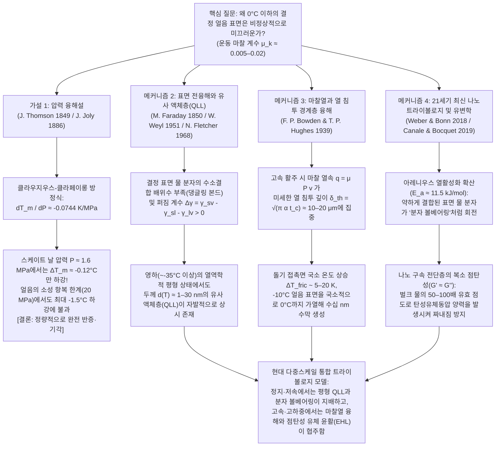

추운 겨울 아침 얼어붙은 길 위에 발을 내딛는 순간, 혹은 스피드 스케이팅 선수가 시속 $60\,\text{km}$에 달하는 속도로 빙판을 질주하거나 무게 $20\,\text{kg}$의 화강암 컬링 스톤이 얼음 위를 수십 미터 동안 거의 감속 없이 미끄러져 나가는 모습을 볼 때, 우리는 응집물질물리학(Condensed Matter Physics)과 트라이볼로지(Tribology, 마찰·마모·윤활 과학)에서 가장 기이한 이상 현상 중 하나를 목격하고 있는 것이다. 일상적인 직관으로는 "얼음이 미끄럽다"는 사실이 당연해 보이지만, 고체물리학과 표면역학의 엄밀한 시각에서 <strong>"왜 하필 결정 고체인 얼음 표면만 이토록 비정상적으로 미끄러운가?"</strong>라는 질문은 170년 넘게 물리학자들을 괴롭혀 온 깊은 과학적 난제다.

대부분의 건조한 결정 고체들—예를 들어 강철과 유리, 화강암과 석영, 혹은 구리와 산화알루미늄 세라믹—을 윤활유 없이 서로 문지르면 운동 마찰 계수는 보통 $\mu_k \approx 0.4\text{–}0.8$이라는 매우 큰 값을 보인다. 미시적 규모에서 접촉 표면의 미세 돌기(Asperities)들이 냉간 용접(Cold welding)처럼 응착되었다가 전단 파괴되는 과정을 반복하며 막대한 에너지를 소산시키기 때문이다. 그러나 강철 스케이트 날이나 폴리에틸렌 스키판이 영하 $-5^\circ\text{C} \sim -10^\circ\text{C}$의 육방정계 얼음(Ice $I_h$) 위를 활주할 때, 열역학적으로 명백히 고체상이 안정한 영역임에도 불구하고 운동 마찰 계수는 <strong>$\mu_k \approx 0.005\text{–}0.02$</strong>라는 경이로운 수준으로 급감한다. 이는 다른 어떤 결정 고체보다도 1~2 자릿수 낮은 값이며, 가장 미끄러운 합성 고분자인 폴리테트라플루오로에틸렌(PTFE / 테플론, $\mu_k \approx 0.04\text{–}0.10$)보다도 훨씬 낮다.

많은 과학 교과서나 교양서에서는 오랫동안 다음과 같은 설명을 제시해 왔다.
<strong>"물은 얼 때 부피가 팽창하는 예외적인 물질이므로, 얼음에 높은 압력을 가하면 어는점(녹는점)이 낮아진다. 스케이트 선수가 얇은 스케이트 날 위에 올라서면 체중이 좁은 면적에 집중되어 거대한 압력이 발생하고, 그 압력으로 날 아래의 얼음이 녹아 물막을 형성하기 때문에 미끄러진다."</strong>

이것이 바로 유명한 <strong>'압력 융해설(Pressure-Melting Theory)'</strong>이다(1849년 제임스 톰슨이 열역학적 이론을 제시하고, 1886년 존 졸리가 스케이트에 적용함). 그러나 현대 물리학의 엄밀한 정량적 검증에 따르면, <strong>클라우지우스-클라페이롱 방정식 자체는 참이지만 '압력 융해'로 스케이트나 스키, 혹은 빙판길 미끄러짐을 설명하는 것은 자릿수(Order of magnitude) 자체가 완전히 틀린 '교과서 신화(Textbook Myth)'다!</strong>

이 글에서는 먼저 화학 퍼텐셜 평형의 제1원리로부터 <strong>클라우지우스-클라페이롱 방정식(Clausius–Clapeyron Equation)</strong>을 유도하고, 물과 얼음의 정확한 물리 상수 및 스케이터의 실제 접촉 압력을 대입하여 압력 융해설이 왜 성립할 수 없는지 수학적으로 증명한다. 이어서 압력 융해설의 증거로 오용되어 온 <strong>'패러데이의 복빙(Regelation)과 철사의 얼음 통과 실험'</strong>에 숨겨진 푸리에 열전도 메커니즘을 분석하고, 왜 구리선은 얼음을 통과하지만 동일한 압력의 나일론 줄은 실패하는지 밝힌다. 마지막으로 현대 물리학이 규명한 3대 핵심 메커니즘을 심층 해설한다.
1. <strong>표면 전융해(Surface Premelting)와 나노미터 유사 액체층(Quasi-Liquid Layer, QLL)</strong> (패러데이 1850, Weyl 1951, Fletcher 1968, Dash & Somorjai);
2. <strong>마찰열(Frictional Heating)과 마이크로미터 열 침투 깊이(Thermal Skin Depth) 국소 융해</strong> (Bowden & Hughes 1939);
3. <strong>21세기 최신 나노트라이볼로지(Nanotribology)</strong>: 배위수가 부족한 표면 물 분자의 열활성화 '분자 볼베어링' 회전(Weber & Bonn et al., 2018) 및 벌크 물보다 50~100배 높은 유효 점도를 지닌 계면층의 <strong>복소 점탄성 유변학(Complex Viscoelasticity, $G' \approx G''$)</strong>(Canale & Bocquet et al., 2019).

---

## 1. 고체 마찰의 특이점으로서의 얼음과 4대 물리 메커니즘 구조

얼음 표면의 마찰 특성이 물질계에서 얼마나 예외적인지 확인하기 위해, 쿨롱-아몽통 마찰 법칙의 운동 마찰 계수 $\mu_k = F_f / F_N$을 다양한 고체 계면에서 비교해 보자.

| 접촉 계면 조합 (건조 마찰 또는 자기 윤활 상태) | 온도 조건 $T$ | 대표적인 운동 마찰 계수 $\mu_k$ | 지배적인 에너지 소산 및 마찰 물리 메커니즘 |
| :--- | :--- | :--- | :--- |
| <strong>강철 vs. 강철</strong> (건조 공기 중) | $20^\circ\text{C}$ | $0.50\text{–}0.80$ | 미세 돌기(Asperity) 응착 결합의 전단 파괴 및 소성 플라우잉(Ploughing) |
| <strong>석영 유리 vs. 석영 유리</strong> | $20^\circ\text{C}$ | $0.40\text{–}0.90$ | 실라놀 수소결합/공유결합 응착 및 취성 미세 균열 전파 |
| <strong>화강암 vs. 화강암</strong> (단층 암석 마찰) | $20^\circ\text{C}$ | $0.60\text{–}0.70$ | 암석 돌기의 취성 파쇄 및 마모 입자(단층 비지) 맞물림 |
| <strong>PTFE (테플론) vs. 강철</strong> | $20^\circ\text{C}$ | $0.04\text{–}0.10$ | 플루오린화 탄소 사슬의 낮은 표면에너지 및 전이막 슬립 |
| <strong>육방정계 얼음 $I_h$ vs. 강철</strong> (극저온 영역) | $-100^\circ\text{C}$ | $0.40\text{–}0.60$ | 일반 결정 고체와 동일한 응착 및 취성 전단 (전혀 미끄럽지 않은 얼음!) |
| <strong>육방정계 얼음 $I_h$ vs. 강철</strong> (스케이트 조건) | $-5^\circ\text{C}$ | <strong>$0.005\text{–}0.015$</strong> | 표면 전융해 QLL + 마찰열 경계층 융해 + 점탄성 유체동압 양력 |
| <strong>육방정계 얼음 $I_h$ vs. 폴리에틸렌</strong> (스키 베이스) | $-3^\circ\text{C}$ | <strong>$0.010\text{–}0.030$</strong> | 소수성 계면 벽면 슬립(Wall Slip) + 마찰열 혼합 윤활 |

위 표에서 보듯, 얼음이라도 $-100^\circ\text{C}$($173\,\text{K}$)의 극저온에서는 운동 마찰 계수가 $\mu_k \approx 0.5$에 달해 유리나 암석과 다름없는 '미끄럽지 않은 고체'가 된다. 얼음의 초저마찰은 녹는점 $T_m = 273.15\,\text{K}$($0^\circ\text{C}$) 부근(약 $-35^\circ\text{C} \sim 0^\circ\text{C}$)에서만 발현되는 창발적 현상이다.

---

## 2. '압력 융해설'의 붕괴: 클라우지우스-클라페이롱 방정식에 의한 엄밀한 검증

### 2.1 육방정계 얼음 $I_h$의 사면체 수소결합 구조와 부피 이상

물 분자($\text{H}_2\text{O}$)는 대기압 하에서 얼 때 버널-파울러 얼음 규칙(Bernal–Fowler ice rules)에 따라 주변의 물 분자 4개와 방향성이 강한 정사면체 수소결합($\text{O}-\text{H}\cdots\text{O}$ 거리 $\approx 2.76\,\text{\AA}$)을 형성한다. 이 육방정계 얼음(Ice $I_h$) 격자는 내부에 큰 빈 공간(Interstitial voids)을 가진 열린 케이지 구조를 이룬다. 얼음이 녹아 액체 물이 되면 사면체 네트워크가 부분적으로 붕괴하며 빈 공간으로 물 분자들이 스며들어 밀도가 증가한다(즉, 융해 시 단위 질량당 부피 변화 $\Delta v_{\text{fus}} = v_{\text{liquid}} - v_{\text{ice}} < 0$).

* <strong>육방정계 얼음 $I_h$ ($0^\circ\text{C}$)</strong>: 밀도 $\rho_{\text{ice}} = 916.7\,\text{kg/m}^3 \implies$ 비부피 $v_{\text{ice}} = 1.0909 \times 10^{-3}\,\text{m}^3/\text{kg}$
* <strong>액체 물 ($0^\circ\text{C}$)</strong>: 밀도 $\rho_{\text{liquid}} = 999.84\,\text{kg/m}^3 \implies$ 비부피 $v_{\text{liquid}} = 1.0002 \times 10^{-3}\,\text{m}^3/\text{kg}$
* <strong>융해 비부피 변화</strong>:
  $$\Delta v_{\text{fus}} = v_{\text{liquid}} - v_{\text{ice}} \approx -9.1 \times 10^{-5}\,\text{m}^3/\text{kg}$$

### 2.2 클라우지우스-클라페이롱 방정식 유도와 어는점 내림 계산

고체-액체 상공존 곡선 위에서는 두 상의 단위 질량당 깁스 자유 에너지(화학 퍼텐셜)가 같으므로 $dg_{\text{ice}} = dg_{\text{liquid}}$이다. 열역학 기본 관계식 $dg = -s\,dT + v\,dP$와 융해 엔트로피 변화 $\Delta s_{\text{fus}} = s_{\text{liquid}} - s_{\text{ice}} = \frac{L_f}{T_m}$를 대입하면 <strong>클라우지우스-클라페이롱 방정식(Clausius–Clapeyron Equation)</strong>을 얻는다.

$$\frac{dP}{dT_m} = \frac{L_f}{T_m \left(v_{\text{liquid}} - v_{\text{ice}}\right)}$$

여기에 융해 잠열 $L_f = 3.34 \times 10^5\,\text{J/kg}$, 녹는점 $T_m = 273.15\,\text{K}$, 비부피 차 $\Delta v_{\text{fus}} = -9.1 \times 10^{-5}\,\text{m}^3/\text{kg}$를 대입하면 다음과 같다.

$$\frac{dP}{dT_m} = \frac{3.34 \times 10^5\,\text{J/kg}}{273.15\,\text{K} \times \left(-9.1 \times 10^{-5}\,\text{m}^3/\text{kg}\right)} \approx -1.344 \times 10^7\,\text{Pa/K} = -13.44\,\text{MPa/K}$$

역수를 취하면 단위 압력당 녹는점 변화율은 다음과 같다.

$$\frac{dT_m}{dP} \approx -0.0744\,\text{K/MPa} \quad \left(\text{또는 } -0.00754^\circ\text{C/atm}\right)$$

즉, <strong>얼음의 녹는점을 단 $1^\circ\text{C}$ 낮추기 위해서도 약 $13.44\,\text{MPa}$(약 $133\,\text{기압}$)이라는 엄청난 압력이 필요하다!</strong>

### 2.3 스케이터의 실제 접촉 압력과 얼음의 소성 항복 한계

질량 $m = 75\,\text{kg}$인 성인 스케이터가 길이 $L = 30\,\text{cm} = 0.30\,\text{m}$, 폭 $w = 1.5\,\text{mm} = 1.5 \times 10^{-3}\,\text{m}$인 한쪽 스케이트 날(접촉 면적 $A = 4.5 \times 10^{-4}\,\text{m}^2$) 위에 온 체중을 실었을 때의 압력 $P$를 구해 보자.

$$P = \frac{m g}{A} = \frac{75 \times 9.81\,\text{N}}{4.5 \times 10^{-4}\,\text{m}^2} \approx 1.635\,\text{MPa} \quad (\approx 16.1\,\text{atm})$$

이 압력에 의한 녹는점 하강 폭 $\Delta T_m$은 다음과 같다.

$$\Delta T_m = \left(\frac{dT_m}{dP}\right) P = (-0.0744\,\text{K/MPa}) \times 1.635\,\text{MPa} \approx -0.122^\circ\text{C}$$

<strong>단 $0.12^\circ\text{C}$밖에 내려가지 않는다!</strong> 설령 미세 돌기(Asperities)에 응력이 집중되어 실제 접촉 면적이 줄어든다 하더라도, 국소 압력은 얼음의 압축 소성 항복 강도(압입 경도 한계)인 $\sigma_{y,\text{ice}} \approx 10\text{–}20\,\text{MPa}$를 절대 넘을 수 없다(그 이상에서는 얼음 돌기가 즉각 소성 붕괴하여 면적이 넓어지기 때문이다). 극한 항복 압력인 $P_{\max} = 20\,\text{MPa}$를 대입해도 녹는점 하강은 $\Delta T_{m,\max} \approx -1.49^\circ\text{C}$에 그친다. 따라서 압력 융해설로는 영하 $-5^\circ\text{C} \sim -20^\circ\text{C}$에서의 스케이팅이나 스키, 그리고 압력이 거의 $0$에 가까운 평평한 고무장화($P \approx 34\,\text{kPa}$, $\Delta T_m \approx -0.0026^\circ\text{C}$)나 아이스하키 퍽이 빙판에서 미끄러지는 현상을 전혀 설명할 수 없다.

---

## 3. 패러데이의 복빙(Regelation)과 철사 얼음 통과 실험의 열전도 진실

교과서에 자주 등장하는 "양 끝에 추를 매단 철사가 얼음 블록을 두 동강 내지 않고 통과하는 실험(Bottomley, 1872)"은 왜 스케이트에 적용될 수 없을까?
철사 아래의 얼음이 녹으려면 $1\,\text{g}$당 $334\,\text{J}$의 막대한 융해 잠열 $L_f$를 흡수해야 한다. 이 열은 철사 아래에서 녹은 물이 철사 위로 돌아 올라가 대기압 하에서 다시 얼면서(복빙) 방출하는 응고 잠열에서 온다. 즉, 철사가 속도 $v_{\text{wire}}$로 내려가려면 위쪽에서 방출된 잠열이 <strong>철사 단면을 가로질러 위에서 아래로 열전도(Thermal Conduction)되어야만 한다</strong>(Nye, 1967):

$$v_{\text{wire}} \approx \frac{\kappa_{\text{eff}} |\Delta T_m|}{\rho_{\text{ice}} L_f R}$$

* 열전도율이 높은 <strong>구리선</strong>($\kappa_{\text{Cu}} \approx 400\,\text{W/(m}\cdot\text{K)}$)은 잠열을 빠르게 아래로 전달하여 분당 수 밀리미터($v_{\text{wire}} \sim 10^{-5}\text{–}10^{-4}\,\text{m/s}$)로 얼음을 통과하지만, 이조차 스케이트 활주 속도($10\,\text{m/s}$)보다 <strong>5~6 자릿수나 느리다</strong>!
* 반면, 똑같은 굵기와 추를 매단 <strong>나일론 낚싯줄</strong>($\kappa_{\text{nylon}} \approx 0.25\,\text{W/(m}\cdot\text{K)}$)은 열전도율이 구리의 $1/1600$에 불과한 단열재이므로, 동일한 압력을 가해도 잠열을 전달하지 못해 얼음을 전혀 통과하지 못한다!

놀랍게도 1850년 복빙 현상을 처음 발견한 <strong>마이클 패러데이(Michael Faraday)</strong> 본인은 제임스 톰슨의 압력 융해설을 거부하고, <strong>"얼음 표면에는 영하에서도 본래 얇은 액체 같은 막이 존재하며, 두 얼음이 닿으면 표면이 내부로 바뀌면서 그 액체막이 어는 것"</strong>이라고 정확히 통찰했다.

---

## 4. 표면 전융해(Surface Premelting)와 나노미터 유사 액체층(QLL)

패러데이의 직관은 20세기 후반 표면물리학을 통해 완벽히 증명되었다.
1. <strong>수소결합 배위수 부족과 린데만 융해 기준(Lindemann Criterion)</strong>:
   얼음 결정 내부(벌크)의 물 분자는 4개의 수소결합으로 단단히 묶여 있지만, 결정-기체 자유 표면에 놓인 물 분자는 위쪽 이웃이 없어 2~3개의 수소결합만 맺은 채 끊어진 결합(Dangling $\text{O}-\text{H}$ bond)을 내밀고 있다. 복원력 상수가 절반으로 줄어들기 때문에 표면 분자의 열진동 진폭 $\sqrt{\langle u_{\text{surf}}^2 \rangle}$은 벌크보다 훨씬 크며, 녹는점($0^\circ\text{C}$)보다 훨씬 낮은 약 $-35^\circ\text{C}$ 부근에서부터 린데만 격자 불안정 한계를 넘어 두께 $d(T) \sim 1\text{–}30\,\text{nm}$의 <strong>유사 액체층(Quasi-Liquid Layer, QLL)</strong>을 자발적으로 형성한다.
2. <strong>계면 자유 에너지 최소화 열역학 모델</strong>:
   두께 $d$의 유사 액체층이 존재할 때 단위 면적당 과잉 깁스 자유 에너지 변화 $\Delta G_{\text{surf}}(d)$는 다음과 같다.
   $$\Delta G_{\text{surf}}(d) = -\left(\gamma_{sv} - \gamma_{sl} - \gamma_{lv}\right)\left(1 - e^{-d/\xi}\right) + \rho_l L_f \left(\frac{T_m - T}{T_m}\right) d$$
   얼음의 퍼짐 계수(젖음 파라미터) $\Delta \gamma = \gamma_{sv} - (\gamma_{sl} + \gamma_{lv}) \approx 109 - (30 + 75.6) = +3.4\,\text{mJ/m}^2 > 0$이므로, 표면을 얇은 물막으로 덮는 것이 열역학적으로 유리하다. $\frac{\partial \Delta G_{\text{surf}}}{\partial d} = 0$으로부터 평형 QLL 두께 $d(T)$는 온도에 따라 로그 법칙 또는 거듭제곱 법칙으로 성장한다.
   $$d(T) = \xi \ln\!\left(\frac{\Delta \gamma \, T_m}{\xi \rho_l L_f (T_m - T)}\right) \quad \text{또는} \quad d(T) \propto \left(T_m - T\right)^{-1/3}$$

---

## 5. 마찰열에 의한 열 경계층 국소 융해 (Bowden & Hughes, 1939)

고속 활주($v \sim 5\text{–}20\,\text{m/s}$) 시 스케이트 날이나 스키판의 표면 거칠기($R_q \sim 0.1\text{–}1\,\mu\text{m}$)는 수 나노미터의 평형 QLL보다 훨씬 크다. 1939년 <strong>보든(F. P. Bowden)</strong>과 <strong>휴즈(T. P. Hughes)</strong>는 융프라우요흐 빙하 동굴 실험을 통해, 열전도율이 높은 황동 스키는 마찰열을 빼앗아가 마찰이 크고, 단열재인 목재나 PTFE 스키는 마찰열을 얼음 표면에 가두어 마찰을 극적으로 낮춘다는 사실을 증명했다.

접촉 시간 $t_c = L/v$ 동안 마찰 열속 $q_{\text{fric}} = \mu_k P v$는 오직 얇은 <strong>열 침투 깊이(Thermal Skin Depth) $\delta_{\text{th}} = \sqrt{\pi \alpha_{\text{ice}} L / v} \approx 10\text{–}20\,\mu\text{m}$</strong> 내부에만 집중되며, 계면 온도 상승폭 $\Delta T_{\text{fric}}$은 다음과 같다.

$$\Delta T_{\text{fric}} = \frac{2 \mu_k P \sqrt{v L}}{\sqrt{\pi} \left(\sqrt{\kappa_{\text{ice}} \rho_{\text{ice}} c_{p,\text{ice}}} + \sqrt{\kappa_{\text{slider}} \rho_{\text{slider}} c_{p,\text{slider}}}\right)}$$

이 식은 영하 $-10^\circ\text{C}$의 얼음 돌기가 고속 활주 시 국소적으로 $0^\circ\text{C}$까지 가열되어 수십 나노미터의 수막을 형성하는 원리와, $-35^\circ\text{C}$ 이하의 극지방(1912년 스콧 탐험대의 비극)에서 눈이 메마른 모래처럼 변하는 이유($\mu_k \approx 0.4$), 그리고 $0^\circ\text{C}$ 습설에서 모세관 음압($\Delta P_{\text{cap}} = -2\gamma_{lv}\cos\theta/h$) 때문에 다시 마찰이 급증하는 'U자형 마찰 곡선'을 완벽히 설명한다.

---

## 6. 21세기 최신 나노트라이볼로지: 분자 볼베어링과 복소 점탄성 유변학 (2018–2024)

1. <strong>표면 물 분자의 '분자 볼베어링' 아레니우스 거동 (Weber & Bonn et al., 2018)</strong>:
   얼음의 마찰 계수는 $-100^\circ\text{C}$에서 $0^\circ\text{C}$까지 아레니우스 법칙 $\mu(T) \propto \exp(E_a / k_B T)$를 따르며, 활성화 에너지 $E_a \approx 11.5\,\text{kJ/mol}$은 단일 약한 수소결합으로 연결된 최외각 물 분자들이 결정 위에서 <strong>분자 볼베어링(Molecular Ball Bearings)</strong>처럼 굴러다니는 에너지 장벽과 정확히 일치한다.
2. <strong>계면 수막의 복소 점탄성과 고점도 그리스 거동 (Canale & Bocquet et al., 2019)</strong>:
   순수한 벌크 물은 점도가 너무 낮아($\eta_0 \approx 1.8\,\text{mPa}\cdot\text{s}$) 높은 압력 아래에서 즉시 밖으로 짜내어져(Squeeze-out) 윤활제로 쓸 수 없다. 보케(Bocquet) 연구팀은 석영 소리굽쇠 원자힘 현미경(Stroke-Probe AFM)으로 활주 중인 얼음 계면층의 나노유변학을 직접 측정한 결과, 계면 수막은 단순한 물이 아니라 <strong>유효 점도가 벌크 물의 50~100배($\eta_{\text{eff}} \sim 0.05\text{–}0.2\,\text{Pa}\cdot\text{s}$, 기계유 수준)</strong>에 달하고 <strong>저장 탄성률과 손실 탄성률이 비슷한($G' \approx G'' \sim 10^4\text{–}10^5\,\text{Pa}$) '복소 점탄성 유체(자가 치유 그리스)'</strong>임을 밝혀냈다. 이 높은 탄성률 $G'$이 탄성유체동압 양력(Elastohydrodynamic Lift)을 생성하여 고하중에서도 수막이 짜내어지지 않고 스케이터의 체중을 완벽히 지탱하는 것이다!
