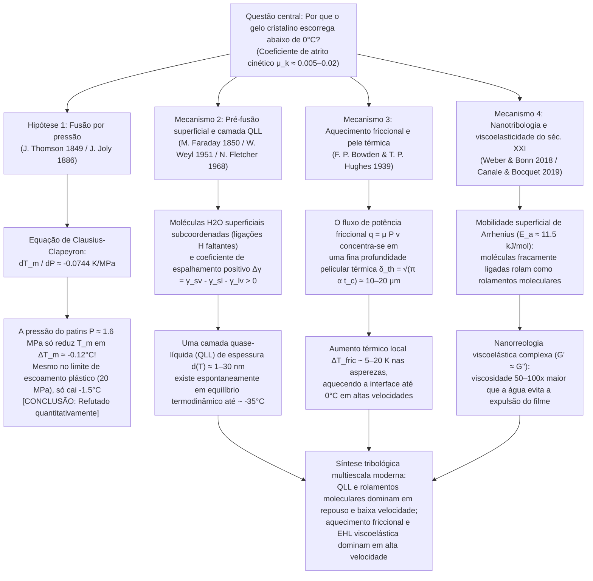

Pisar em uma poça congelada numa manhã de inverno, observar um patinador de velocidade fazer uma curva a $60\,\text{km/h}$ ou ver uma pedra de curling de granito de $20\,\text{kg}$ deslizar por quarenta metros sobre o gelo quase sem desacelerar é testemunhar uma das anomalias mais fascinantes da física da matéria condensada e da tribologia (a ciência do atrito, desgaste e lubrificação). Embora para a intuição cotidiana pareça óbvio que "o gelo é escorregadio", sob a ótica rigorosa da física do estado sólido a pergunta <strong>"Por que o gelo cristalino é tão excepcionalmente escorregadio?"</strong> revela-se um profundo enigma científico que desafia os físicos há mais de 170 anos.

Quando dois sólidos cristalinos secos comuns — como aço sobre vidro, granito sobre quartzo ou cobre sobre óxido de alumínio — deslizam um contra o outro sem lubrificante externo, seu coeficiente de atrito cinético é alto, tipicamente na faixa de $\mu_k \approx 0.4\text{–}0.8$. Em escala microscópica, as asperezas superficiais formam junções adesivas soldadas a frio que precisam ser continuamente cisalhadas com enorme dissipação de energia. Contudo, quando uma lâmina de patins de aço ou uma base de esqui de polietileno desliza sobre o gelo hexagonal comum (Gelo $I_h$) entre $-5^\circ\text{C}$ e $-10^\circ\text{C}$ — muito abaixo do ponto de fusão de $0^\circ\text{C}$ —, o coeficiente de atrito cinético despenca para <strong>$\mu_k \approx 0.005\text{–}0.02$</strong>, uma a duas ordens de grandeza menor do que qualquer outro sólido cristalino, superando até mesmo o politetrafluoretileno (PTFE / Teflon, $\mu_k \approx 0.04\text{–}0.10$).

Durante mais de um século, livros didáticos de física e enciclopédias repetiram uma explicação padrão:
<strong>"Como a água se expande ao congelar, aplicar pressão ao gelo diminui seu ponto de fusão. Quando um patinador se apoia sobre a lâmina fina do patins, todo o seu peso se concentra em uma área minúscula, gerando uma pressão imensa que derrete o gelo sob a lâmina e cria uma película lubrificante de água."</strong>

Esta é a famosa <strong>teoria da fusão por pressão (Pressure-Melting Theory)</strong>, formulada termodinamicamente por James Thomson em 1849 e aplicada à patinação no gelo por John Joly em 1886. No entanto, uma verificação quantitativa rigorosa mostra uma conclusão inequívoca: <strong>embora a equação de Clausius-Clapeyron seja perfeitamente correta, a hipótese da fusão por pressão como explicação para a patinação, o esqui ou escorregões no gelo é quantitativamente falsa por várias ordens de grandeza!</strong>

Neste artigo, deduziremos primeiro a <strong>equação de Clausius-Clapeyron</strong> a partir do equilíbrio do potencial químico e provaremos matematicamente por que a pressão de uma lâmina de patins reduz o ponto de fusão do gelo em apenas cerca de um décimo de grau Celsius. Em seguida, analisaremos o famoso <strong>experimento de regelação de Faraday/Bottomley do fio com pesos atravessando um bloco de gelo</strong> via condução térmica de Fourier, explicando por que um fio de cobre atravessa o gelo enquanto uma linha de náilon sob a mesma pressão falha. Por fim, apresentaremos a síntese moderna da tribologia do gelo através de três mecanismos físicos reais:
1. <strong>A pré-fusão superficial (Surface Premelting) e a camada quase-líquida nanométrica (Quasi-Liquid Layer, QLL)</strong> (Michael Faraday 1850, Woldemar Weyl 1951, Neville Fletcher 1968, J. G. Dash);
2. <strong>O aquecimento por atrito (Frictional Heating) e a fusão na profundidade pelicular térmica</strong> (Frank Philip Bowden & Thomas P. Hughes 1939);
3. <strong>A nanotribologia moderna do século XXI</strong>: o rolamento termicamente ativado de moléculas de água superficiais fracamente ligadas atuando como "rolamentos de esferas moleculares" (Weber & Bonn et al., 2018) e a <strong>nanorreologia viscoelástica complexa ($G' \approx G''$)</strong> do filme interfacial com viscosidade efetiva 50 a 100 vezes maior que a da água líquida comum (Canale & Bocquet et al., 2019).

---

## 1. O gelo como anomalia tribológica e as quatro escalas físicas

Comparemos o coeficiente de atrito cinético de Amontons-Coulomb $\mu_k = F_f / F_N$ entre diferentes pares de sólidos:

| Par de superfícies deslizantes | Temperatura $T$ | Coeficiente de atrito $\mu_k$ | Mecanismo físico dominante de dissipação |
| :--- | :--- | :--- | :--- |
| <strong>Aço sobre Aço</strong> (ar seco) | $20^\circ\text{C}$ | $0.50\text{–}0.80$ | Cisalhamento de junções soldadas a frio e sulcamento plástico (Ploughing) |
| <strong>Vidro de sílica sobre Vidro</strong> | $20^\circ\text{C}$ | $0.40\text{–}0.90$ | Adesão por ligações silanol/covalentes e microfratura frágil |
| <strong>Granito sobre Granito</strong> (falha geológica) | $20^\circ\text{C}$ | $0.60\text{–}0.70$ | Fratura frágil de asperezas e abrasão de terceiro corpo |
| <strong>PTFE (Teflon) sobre Aço</strong> | $20^\circ\text{C}$ | $0.04\text{–}0.10$ | Baixa energia superficial de van der Waals e filme de transferência |
| <strong>Gelo hexagonal $I_h$ sobre Aço</strong> (criogênico) | $-100^\circ\text{C}$ | $0.40\text{–}0.60$ | Adesão sólida normal e cisalhamento frágil (gelo nada escorregadio!) |
| <strong>Gelo hexagonal $I_h$ sobre Aço</strong> (patinação) | $-5^\circ\text{C}$ | <strong>$0.005\text{–}0.015$</strong> | QLL de equilíbrio + fusão térmica friccional + sustentação viscoelástica |
| <strong>Gelo hexagonal $I_h$ sobre UHMWPE</strong> (esqui) | $-3^\circ\text{C}$ | <strong>$0.010\text{–}0.030$</strong> | Deslizamento parietal hidrofóbico (Wall Slip) + lubrificação térmica mista |

A $-100^\circ\text{C}$ ($173\,\text{K}$), o gelo não escorrega ($\mu_k \approx 0.5$). Seu atrito ultrabaixo surge acima de $\approx -35^\circ\text{C}$ conforme o diagrama a seguir:

---

## 2. Refutação rigorosa da fusão por pressão via equação de Clausius-Clapeyron

### 2.1 Estrutura cristalina do gelo hexagonal ($I_h$) e anomalia volumétrica

Na rede cristalina do gelo hexagonal comum (<strong>Gelo $I_h$</strong>), cada molécula de $\text{H}_2\text{O}$ obedece às regras de Bernal-Fowler e forma quatro ligações de hidrogênio direcionais ($\text{O}-\text{H}\cdots\text{O}$ de comprimento $\approx 2.76\,\text{\AA}$) em coordenação tetraédrica ($109.5^\circ$). Essa estrutura aberta encerra grandes cavidades intersticiais vazias. Ao derreter a $T_m = 273.15\,\text{K}$ ($0^\circ\text{C}$), a rede tetraédrica colapsa parcialmente, aumentando a densidade $\rho$ e diminuindo o volume específico $v = 1/\rho$:

* <strong>Gelo sólido $I_h$ a $0^\circ\text{C}$</strong>: $\rho_{\text{ice}} = 916.7\,\text{kg/m}^3 \implies v_{\text{ice}} = 1.0909 \times 10^{-3}\,\text{m}^3/\text{kg}$
* <strong>Água líquida a $0^\circ\text{C}$</strong>: $\rho_{\text{liquid}} = 999.84\,\text{kg/m}^3 \implies v_{\text{liquid}} = 1.0002 \times 10^{-3}\,\text{m}^3/\text{kg}$
* <strong>Variação de volume específico de fusão</strong>:
  $$\Delta v_{\text{fus}} = v_{\text{liquid}} - v_{\text{ice}} = (1.0002 - 1.0909) \times 10^{-3}\,\text{m}^3/\text{kg} \approx -9.1 \times 10^{-5}\,\text{m}^3/\text{kg} < 0$$

### 2.2 Dedução da equação de Clausius-Clapeyron e avaliação numérica

Ao longo da curva de coexistência sólido-líquido $P(T_m)$, a igualdade das energias livres de Gibbs específicas $g_{\text{ice}}(T_m, P) = g_{\text{liquid}}(T_m, P)$ e a relação diferencial $dg = -s\,dT + v\,dP$ implicam:

$$-s_{\text{ice}}\,dT_m + v_{\text{ice}}\,dP = -s_{\text{liquid}}\,dT_m + v_{\text{liquid}}\,dP \implies \left(v_{\text{liquid}} - v_{\text{ice}}\right) dP = \left(s_{\text{liquid}} - s_{\text{ice}}\right) dT_m$$

Substituindo a variação de entropia específica de fusão $\Delta s_{\text{fus}} = s_{\text{liquid}} - s_{\text{ice}} = \frac{L_f}{T_m}$ com o calor latente de fusão $L_f = 3.34 \times 10^5\,\text{J/kg}$, obtemos a <strong>equação de Clausius-Clapeyron</strong>:

$$\frac{dP}{dT_m} = \frac{L_f}{T_m \left(v_{\text{liquid}} - v_{\text{ice}}\right)} = \frac{3.34 \times 10^5\,\text{J/kg}}{273.15\,\text{K} \times \left(-9.1 \times 10^{-5}\,\text{m}^3/\text{kg}\right)} \approx -1.344 \times 10^7\,\text{Pa/K} = -13.44\,\text{MPa/K}$$

Invertendo a relação, obtemos a queda do ponto de fusão por unidade de pressão:

$$\frac{dT_m}{dP} \approx -0.0744\,\text{K/MPa} \quad \left(\text{ou } -0.00754^\circ\text{C/atm}\right)$$

<strong>Para reduzir o ponto de fusão do gelo em apenas $1^\circ\text{C}$, é necessária uma pressão colossal de $13.44\,\text{MPa}$ (cerca de $133\,\text{atmosferas}$)!</strong>

### 2.3 Pressão real de um patinador e limite de escoamento plástico do gelo

Um patinador de massa $m = 75\,\text{kg}$ ($F_N = m g = 735.75\,\text{N}$) apoiado sobre uma única lâmina de comprimento $L = 30\,\text{cm} = 0.30\,\text{m}$ e largura $w = 1.5\,\text{mm} = 1.5 \times 10^{-3}\,\text{m}$ ($A = L w = 4.5 \times 10^{-4}\,\text{m}^2$) exerce uma pressão média:

$$P = \frac{m g}{A} = \frac{735.75\,\text{N}}{4.5 \times 10^{-4}\,\text{m}^2} \approx 1.635\,\text{MPa} \implies \Delta T_m = \left(\frac{dT_m}{dP}\right) P \approx -0.122^\circ\text{C}$$

<strong>O ponto de fusão cai apenas $0.12^\circ\text{C}$!</strong> Mesmo considerando as microasperezas de contato, a pressão local $P_{\text{local}}$ jamais pode ultrapassar a tensão de escoamento plástico por compressão (dureza de indentação) do gelo, $\sigma_{y,\text{ice}} \approx 10\text{–}20\,\text{MPa}$. Nesse limite máximo de $20\,\text{MPa}$, a queda térmica é de no máximo $\Delta T_{m,\max} \approx -1.49^\circ\text{C}$, o que jamais poderia explicar a patinação ou o esqui a $-15^\circ\text{C}$, nem por que uma pessoa de botas de borracha planas ($P \approx 34\,\text{kPa}$, $\Delta T_m \approx -0.0026^\circ\text{C}$) escorrega no gelo!

---

## 3. A regelação de Faraday e o experimento do fio atravessando o gelo

No clássico experimento de Bottomley (1872), onde um fio com pesos atravessa um bloco de gelo a $0^\circ\text{C}$ sem dividi-lo ao meio, para que o gelo sob o fio derreta ele precisa absorver continuamente o calor latente $L_f = 3.34 \times 10^5\,\text{J/kg}$. Esse calor vem do recongelamento (regelação) da água acima do fio e deve ser <strong>conduzido termicamente através do diâmetro do fio</strong> segundo a lei de Fourier (Nye 1967):

$$v_{\text{wire}} \approx \frac{\kappa_{\text{eff}} |\Delta T_m|}{\rho_{\text{ice}} L_f R}$$

Um <strong>fio de cobre</strong> ($\kappa_{\text{Cu}} \approx 400\,\text{W/(m}\cdot\text{K)}$) conduz rapidamente o calor latente e atravessa o gelo a $v_{\text{wire}} \sim 10^{-5}\text{–}10^{-4}\,\text{m/s}$ (ainda assim, <strong>5 a 6 ordens de grandeza lento demais</strong> para um patins movendo-se a $10\,\text{m/s}$!), enquanto uma <strong>linha de náilon</strong> do mesmo diâmetro ($\kappa_{\text{nylon}} \approx 0.25\,\text{W/(m}\cdot\text{K)}$, $1600$ vezes menos condutora) não consegue atravessar o gelo sob a mesma pressão. Além disso, quando <strong>Michael Faraday</strong> descobriu a regelação em 1850, ele rejeitou a hipótese de pressão de Thomson e propôs corretamente que o gelo possui naturalmente uma película superficial quase-líquida.

---

## 4. Pré-fusão superficial e a camada quase-líquida nanométrica (QLL)

1. <strong>Subcoordenação de ligações de hidrogênio e critério de Lindemann</strong>:
   Na interface cristal-vapor, as moléculas de água superficiais não têm vizinhos superiores e formam apenas 2 ou 3 ligações de hidrogênio em vez de 4. Com sua constante restauradora $k_{\text{surf}}$ reduzida pela metade, sua amplitude de vibração térmica $\sqrt{\langle u_{\text{surf}}^2 \rangle} \propto \sqrt{k_B T / k_{\text{surf}}}$ ultrapassa o limiar de instabilidade de Lindemann muito abaixo de $0^\circ\text{C}$ (a partir de $\approx -35^\circ\text{C}$), formando uma <strong>camada quase-líquida (QLL)</strong> de espessura $d(T) \sim 1\text{–}30\,\text{nm}$.
2. <strong>Modelo termodinâmico de energia livre interfacial (Weyl, Fletcher, Dash)</strong>:
   Como o coeficiente de espalhamento $\Delta \gamma = \gamma_{sv} - \gamma_{sl} - \gamma_{lv} \approx 109 - 30 - 75.6 = +3.4\,\text{mJ/m}^2 > 0$ é positivo, a energia livre superficial:
   $$\Delta G_{\text{surf}}(d) = -\left(\gamma_{sv} - \gamma_{sl} - \gamma_{lv}\right)\left(1 - e^{-d/\xi}\right) + \rho_l L_f \left(\frac{T_m - T}{T_m}\right) d$$
   é minimizada ($\frac{\partial \Delta G_{\text{surf}}}{\partial d} = 0$) resultando na espessura de equilíbrio:
   $$d(T) = \xi \ln\!\left(\frac{\Delta \gamma \, T_m}{\xi \rho_l L_f (T_m - T)}\right) \quad \text{ou} \quad d(T) \propto \left(T_m - T\right)^{-1/3}$$

---

## 5. Aquecimento por atrito e camada limite térmica (Bowden & Hughes, 1939)

Em velocidades macroscópicas ($v \sim 5\text{–}20\,\text{m/s}$), a rugosidade superficial ($R_q \sim 0.1\text{–}1\,\mu\text{m}$) supera a espessura nanométrica da QLL estática. Em 1939, na caverna glacial de Jungfraujoch, <strong>Frank Philip Bowden</strong> e <strong>Thomas P. Hughes</strong> demonstraram que esquis de latão ($\kappa \approx 110\,\text{W/(m}\cdot\text{K)}$) dissipam o calor de atrito e apresentam alto atrito, enquanto esquis isolantes de madeira ou PTFE ($\kappa \approx 0.2\,\text{W/(m}\cdot\text{K)}$) retêm o calor na interface do gelo e reduzem drasticamente o atrito.

Durante o tempo de contato $t_c = L/v$, o fluxo de calor friccional $q_{\text{fric}} = \mu_k P v$ penetra apenas até uma <strong>profundidade pelicular térmica $\delta_{\text{th}} = \sqrt{\pi \alpha_{\text{ice}} t_c} = \sqrt{\pi \alpha_{\text{ice}} L / v} \approx 10\text{–}20\,\mu\text{m}$</strong>, elevando a temperatura interfacial em:

$$\Delta T_{\text{fric}} = \frac{2 \mu_k P \sqrt{v L}}{\sqrt{\pi} \left(\sqrt{\kappa_{\text{ice}} \rho_{\text{ice}} c_{p,\text{ice}}} + \sqrt{\kappa_{\text{slider}} \rho_{\text{slider}} c_{p,\text{slider}}}\right)}$$

Isso explica a fusão local a $-10^\circ\text{C}$, por que abaixo de $-35^\circ\text{C}$ na Antártida ou Sibéria a neve se torna abrasiva como areia seca ($\mu_k \approx 0.4$), e por que a $0^\circ\text{C}$ o excesso de água forma pontes capilares ($\Delta P_{\text{cap}} = -2\gamma_{lv}\cos\theta / h$) que voltam a aumentar o atrito.

---

## 6. Nanotribologia do século XXI: Rolamentos moleculares e viscoelasticidade (2018–2024)

1. <strong>Rolamentos de esferas moleculares e lei de Arrhenius (Weber & Bonn et al., 2018)</strong>:
   O coeficiente de atrito do gelo entre $-100^\circ\text{C}$ e $0^\circ\text{C}$ obedece a uma lei exponencial de Arrhenius $\mu(T) \propto \exp(E_a / k_B T)$ com energia de ativação <strong>$E_a \approx 11.5\,\text{kJ/mol}$</strong>, correspondente a moléculas de água superficiais fracamente ligadas que rolam sobre a rede cristalina como <strong>rolamentos de esferas moleculares</strong>.
2. <strong>Nanorreologia viscoelástica complexa do filme interfacial (Canale & Bocquet et al., 2019)</strong>:
   A água líquida pura ($\eta_0 \approx 1.8\,\text{mPa}\cdot\text{s}$) seria expulsa instantaneamente sob pressões de megapascals. Utilizando microscopia de força atômica com diapasão de quartzo, Canale e Bocquet descobriram que o filme submicrônico cisalhado sobre o gelo possui uma <strong>viscosidade efetiva de 50 a 100 vezes maior que a água ($\eta_{\text{eff}} \sim 0.05\text{–}0.2\,\text{Pa}\cdot\text{s}$, semelhante ao óleo de motor)</strong> e um elevado módulo elástico de armazenamento <strong>$G' \approx G'' \sim 10^4\text{–}10^5\,\text{Pa}$</strong>. Essa "graxa viscoelástica autorreparável" gera sustentação elastohidrodinâmica que impede a expulsão do filme sob carga enquanto mantém uma resistência ao cisalhamento ultrabaixa.
