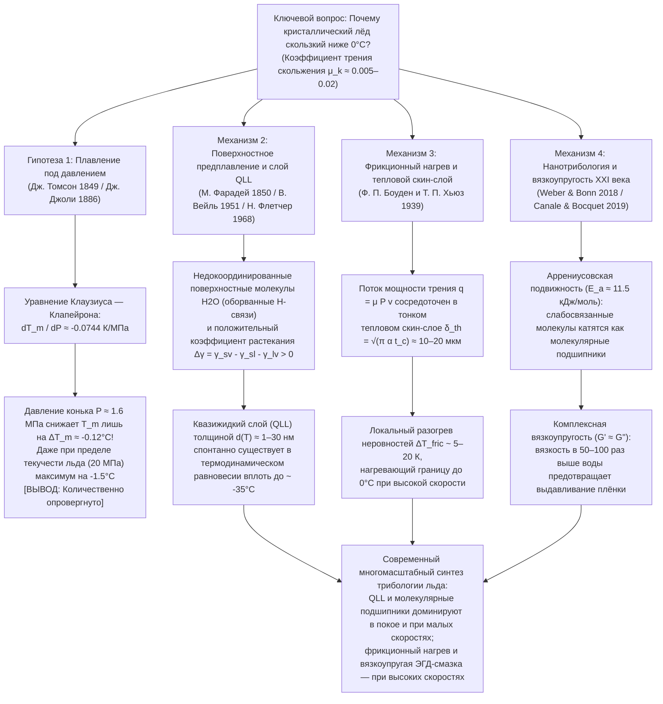

Ступая на замёрзшую лужу морозным зимним утром, наблюдая за конькобежцем, входящим в поворот на скорости $60\,\text{км/ч}$, или следя за двадцатикилограммовым гранитным камнем для кёрлинга, который почти без замедления скользит на сорок метров по льду, мы сталкиваемся с одной из самых удивительных аномалий физики конденсированного состояния и трибологии (науки о трении, износе и смазке). Нашему повседневному опыту кажется совершенно очевидным, что «лёд скользкий». Однако с точки зрения строгой физики твёрдого тела вопрос <strong>«Почему именно кристаллический лёд обладает столь аномально низким трением?»</strong> представляет собой глубокую научную загадку, над которой физики спорят уже более 170 лет.

Когда два обычных сухих кристаллических твёрдых тела — например, сталь по стеклу, гранит по кварцу или медь по оксиду алюминия — скользят друг по другу без внешней смазки, их коэффициент трения скольжения велик и обычно составляет $\mu_k \approx 0.4\text{–}0.8$. На микроскопическом уровне неровности поверхности (аспериты) образуют адгезионные спайки («холодная сварка»), срез которых требует огромных затрат механической энергии. Но когда стальное лезвие конька или полиэтиленовая лыжа скользит по обычному гексагональному льду (Лёд $I_h$) при температуре от $-5^\circ\text{C}$ до $-10^\circ\text{C}$ — глубоко в области термодинамической стабильности твёрдой фазы, — коэффициент трения скольжения падает до <strong>$\mu_k \approx 0.005\text{–}0.02$</strong>! Это на один-два порядка ниже, чем у любого другого кристаллического вещества, и даже ниже, чем у политетрафторэтилена (ПТФЭ / тефлона, $\mu_k \approx 0.04\text{–}0.10$).

В большинстве школьных учебников и научно-популярных книг более ста лет приводится стандартное объяснение:
<strong>«Поскольку вода при замерзании расширяется, повышение давления понижает температуру плавления льда. Когда конькобежец стоит на узком лезвии конька, весь его вес концентрируется на крошечной площади, создавая колоссальное давление, которое мгновенно плавит лёд под лезвием и образует смазывающую водяную плёнку».</strong>

Это знаменитая <strong>теория плавления под давлением (Pressure-Melting Theory)</strong>, термодинамически сформулированная Джеймсом Томсоном в 1849 году и применённая к катанию на коньках Джоном Джоли в 1886 году. Однако строгая количественная проверка приводит к однозначному выводу: <strong>хотя само уравнение Клаузиуса — Клапейрона абсолютно верно, гипотеза плавления под давлением как объяснение скольжения коньков, лыж или подошв обуви по льду ошибочна на несколько порядков величины!</strong>

В этой статье мы сначала выведем <strong>уравнение Клаузиуса — Клапейрона</strong> из равенства химических потенциалов и математически докажем, почему давление конька понижает точку плавления льда всего лишь на одну десятую градуса Цельсия. Затем мы разберём классический <strong>опыт Фарадея — Боттомли с режеляцией (прохождением нагруженной проволоки сквозь блок льда)</strong> на основе закона теплопроводности Фурье и объясним, почему медная проволока проходит сквозь лёд, а нейлоновая леска под точно таким же давлением застревает. Наконец, мы подробно изложим три истинных физических механизма скользкости льда:
1. <strong>Поверхностное предплавление (Surface Premelting) и нанометровый квазижидкий слой (Quasi-Liquid Layer, QLL)</strong> (Майкл Фарадей 1850, В. Вейль 1951, Н. Флетчер 1968, Дж. Дэш);
2. <strong>Фрикционный нагрев (Frictional Heating) и плавление в тепловом скин-слое</strong> (Фрэнк Филип Боуден и Томас Хьюз, 1939);
3. <strong>Современная нанотрибология XXI века</strong>: термически активированное качение слабосвязанных поверхностных молекул воды по принципу «молекулярных шарикоподшипников» (Weber & Bonn et al., 2018) и <strong>комплексная вязкоупругая нанореология ($G' \approx G''$)</strong> межфазной плёнки, эффективная вязкость которой в 50–100 раз превышает вязкость обычной воды (Canale & Bocquet et al., 2019).

---

## 1. Аномалия трения льда и четыре физических масштаба

Сравним коэффициент трения скольжения Амонтона — Кулона $\mu_k = F_f / F_N$ для различных пар твёрдых тел:

| Пара трения (без внешней смазки) | Температура $T$ | Коэффициент трения $\mu_k$ | Доминирующий физический механизм диссипации |
| :--- | :--- | :--- | :--- |
| <strong>Сталь по Стали</strong> (сухой воздух) | $20^\circ\text{C}$ | $0.50\text{–}0.80$ | Срез адгезионных микроконтактов и пластическое пропахивание |
| <strong>Кварцевое стекло по Стеклу</strong> | $20^\circ\text{C}$ | $0.40\text{–}0.90$ | Силанольная водородная/ковалентная адгезия и хрупкое разрушение |
| <strong>Гранит по Граниту</strong> (тектонический разлом) | $20^\circ\text{C}$ | $0.60\text{–}0.70$ | Хрупкое дробление неровностей и абразивный износ |
| <strong>ПТФЭ (Тефлон) по Стали</strong> | $20^\circ\text{C}$ | $0.04\text{–}0.10$ | Низкая поверхностная энергия ван-дер-Ваальса и плёнка переноса |
| <strong>Гексагональный лёд $I_h$ по Стали</strong> (криогенный) | $-100^\circ\text{C}$ | $0.40\text{–}0.60$ | Обычная твердотельная адгезия и хрупкий сдвиг (нескользкий лёд!) |
| <strong>Гексагональный лёд $I_h$ по Стали</strong> (коньки) | $-5^\circ\text{C}$ | <strong>$0.005\text{–}0.015$</strong> | Равновесный QLL + фрикционное плавление + вязкоупругая подъёмная сила |
| <strong>Гексагональный лёд $I_h$ по Полиэтилену</strong> (лыжи) | $-3^\circ\text{C}$ | <strong>$0.010\text{–}0.030$</strong> | Гидрофобное проскальзывание + фрикционная смешанная смазка |

При $-100^\circ\text{C}$ ($173\,\text{K}$) лёд совершенно не скользкий ($\mu_k \approx 0.5$). Сверхнизкое трение возникает лишь выше $\approx -35^\circ\text{C}$:

---

## 2. Строгое опровержение гипотезы плавления под давлением через уравнение Клаузиуса — Клапейрона

### 2.1 Кристаллическая структура гексагонального льда ($I_h$) и аномалия плотности

В кристаллической решётке обычного гексагонального льда (<strong>Лёд $I_h$</strong>) каждая молекула $\text{H}_2\text{O}$ согласно правилам Бернала — Фаулера образует четыре направленные водородные связи ($\text{O}-\text{H}\cdots\text{O}$ длиной $\approx 2.76\,\text{\AA}$) под тетраэдрическим углом $109.5^\circ$. Эта ажурная решётка содержит крупные пустые полости. При плавлении при $T_m = 273.15\,\text{K}$ ($0^\circ\text{C}$) жёсткий каркас частично разрушается, плотность $\rho$ возрастает, а удельный объём $v = 1/\rho$ уменьшается:

* <strong>Твёрдый лёд $I_h$ при $0^\circ\text{C}$</strong>: $\rho_{\text{ice}} = 916.7\,\text{кг/м}^3 \implies v_{\text{ice}} = 1.0909 \times 10^{-3}\,\text{м}^3/\text{кг}$
* <strong>Жидкая вода при $0^\circ\text{C}$</strong>: $\rho_{\text{liquid}} = 999.84\,\text{кг/м}^3 \implies v_{\text{liquid}} = 1.0002 \times 10^{-3}\,\text{м}^3/\text{кг}$
* <strong>Изменение удельного объёма при плавлении</strong>:
  $$\Delta v_{\text{fus}} = v_{\text{liquid}} - v_{\text{ice}} = (1.0002 - 1.0909) \times 10^{-3}\,\text{м}^3/\text{кг} \approx -9.1 \times 10^{-5}\,\text{м}^3/\text{кг} < 0$$

### 2.2 Вывод уравнения Клаузиуса — Клапейрона и численный расчёт

Вдоль кривой сосуществования твёрдой и жидкой фаз $P(T_m)$ удельные свободные энергии Гиббса равны: $g_{\text{ice}}(T_m, P) = g_{\text{liquid}}(T_m, P)$. Используя фундаментальное соотношение $dg = -s\,dT + v\,dP$ и удельную энтропию плавления $\Delta s_{\text{fus}} = s_{\text{liquid}} - s_{\text{ice}} = \frac{L_f}{T_m}$ (где $L_f = 3.34 \times 10^5\,\text{Дж/кг}$ — удельная теплота плавления льда), получаем <strong>уравнение Клаузиуса — Клапейрона</strong>:

$$\frac{dP}{dT_m} = \frac{L_f}{T_m \left(v_{\text{liquid}} - v_{\text{ice}}\right)} = \frac{3.34 \times 10^5\,\text{Дж/кг}}{273.15\,\text{K} \times \left(-9.1 \times 10^{-5}\,\text{м}^3/\text{кг}\right)} \approx -1.344 \times 10^7\,\text{Па/К} = -13.44\,\text{МПа/К}$$

Обратная величина даёт скорость понижения точки плавления с ростом давления:

$$\frac{dT_m}{dP} \approx -0.0744\,\text{К/МПа} \quad \left(\text{или } -0.00754^\circ\text{C/атм}\right)$$

<strong>Чтобы понизить температуру плавления льда всего на $1^\circ\text{C}$, необходимо приложить гигантское давление в $13.44\,\text{МПа}$ (около $133\,\text{атмосфер}$)!</strong>

### 2.3 Реальное давление конькобежца и предел пластической текучести льда

Рассмотрим конькобежца массой $m = 75\,\text{кг}$ ($F_N = m g = 735.75\,\text{Н}$), стоящего на одном лезвии длиной $L = 30\,\text{см} = 0.30\,\text{м}$ и шириной $w = 1.5\,\text{мм} = 1.5 \times 10^{-3}\,\text{м}$ ($A = L w = 4.5 \times 10^{-4}\,\text{м}^2$):

$$P = \frac{m g}{A} = \frac{735.75\,\text{Н}}{4.5 \times 10^{-4}\,\text{м}^2} \approx 1.635\,\text{МПа} \implies \Delta T_m = \left(\frac{dT_m}{dP}\right) P \approx -0.122^\circ\text{C}$$

<strong>Температура плавления снижается всего на $0.12^\circ\text{C}$!</strong> Даже с учётом микронеровностей локальное давление $P_{\text{local}}$ не может превысить предел пластической текучести (твёрдость на вдавливание) льда $\sigma_{y,\text{ice}} \approx 10\text{–}20\,\text{МПа}$, что даёт максимум $\Delta T_{m,\max} \approx -1.49^\circ\text{C}$. Это никак не объясняет ни катание на коньках при $-15^\circ\text{C}$, ни скольжение пешехода в плоской обуви ($P \approx 34\,\text{кПа}$, $\Delta T_m \approx -0.0026^\circ\text{C}$)!

---

## 3. Режеляция Фарадея и опыт с прохождением проволоки сквозь лёд

В классическом опыте Боттомли (1872), где проволока с грузами проходит сквозь глыбу льда при $0^\circ\text{C}$, не разрезая её, для таяния льда под проволокой необходим непрерывный подвод скрытой теплоты плавления $L_f = 3.34 \times 10^5\,\text{Дж/кг}$. Эта теплота выделяется при повторном замерзании (режеляции) воды над проволокой и должна <strong>передаваться теплопроводностью сквозь саму проволоку</strong> вниз (Nye 1967):

$$v_{\text{wire}} \approx \frac{\kappa_{\text{eff}} |\Delta T_m|}{\rho_{\text{ice}} L_f R}$$

<strong>Медная проволока</strong> ($\kappa_{\text{Cu}} \approx 400\,\text{Вт/(м}\cdot\text{К)}$) отлично проводит тепло и проходит сквозь лёд со скоростью $v_{\text{wire}} \sim 10^{-5}\text{–}10^{-4}\,\text{м/с}$ (что всё равно <strong>на 5–6 порядков медленнее</strong> скорости конька $10\,\text{м/с}$!), тогда как <strong>нейлоновая леска</strong> того же диаметра ($\kappa_{\text{nylon}} \approx 0.25\,\text{Вт/(м}\cdot\text{К)}$, в $1600$ раз менее теплопроводная) является теплоизолятором и под тем же давлением вообще не способна пройти сквозь лёд! Более того, сам <strong>Майкл Фарадей</strong>, открывший режеляцию в 1850 году, отверг гипотезу давления Томсона и гениально предположил, что поверхность льда изначально покрыта тонкой квазижидкой плёнкой.

---

## 4. Поверхностное предплавление и квазижидкий слой (QLL)

1. <strong>Дефицит водородных связей и критерий Линдемана</strong>:
   На границе кристалл — пар поверхностные молекулы воды имеют лишь 2 или 3 водородные связи вместо 4. Из-за уменьшения возвращающей силовой постоянной $k_{\text{surf}}$ вдвое их среднеквадратичная амплитуда тепловых колебаний $\sqrt{\langle u_{\text{surf}}^2 \rangle} \propto \sqrt{k_B T / k_{\text{surf}}}$ превышает критерий плавления Линдемана задолго до $0^\circ\text{C}$ (начиная с $\approx -35^\circ\text{C}$), образуя <strong>квазижидкий слой (QLL)</strong> толщиной $d(T) \sim 1\text{–}30\,\text{нм}$.
2. <strong>Термодинамическая модель межфазной свободной энергии (Weyl, Fletcher, Dash)</strong>:
   Поскольку параметр растекания положителен ($\Delta \gamma = \gamma_{sv} - \gamma_{sl} - \gamma_{lv} \approx 109 - 30 - 75.6 = +3.4\,\text{мДж/м}^2 > 0$), минимизация поверхностной свободной энергии:
   $$\Delta G_{\text{surf}}(d) = -\left(\gamma_{sv} - \gamma_{sl} - \gamma_{lv}\right)\left(1 - e^{-d/\xi}\right) + \rho_l L_f \left(\frac{T_m - T}{T_m}\right) d$$
   по толщине $d$ ($\frac{\partial \Delta G_{\text{surf}}}{\partial d} = 0$) даёт логарифмический или степенной закон роста равновесной толщины QLL:
   $$d(T) = \xi \ln\!\left(\frac{\Delta \gamma \, T_m}{\xi \rho_l L_f (T_m - T)}\right) \quad \text{или} \quad d(T) \propto \left(T_m - T\right)^{-1/3}$$

---

## 5. Фрикционный нагрев и тепловой пограничный слой (Bowden & Hughes, 1939)

При высоких скоростях скольжения ($v \sim 5\text{–}20\,\text{м/с}$) шероховатость лезвий и лыж ($R_q \sim 0.1\text{–}1\,\text{мкм}$) превышает толщину статического QLL. В 1939 году в ледниковой пещере Юнгфрауйох <strong>Фрэнк Филип Боуден</strong> и <strong>Томас Хьюз</strong> доказали, что латунные лыжи ($\kappa \approx 110\,\text{Вт/(м}\cdot\text{К)}$) отводят тепло трения и скользят плохо, а теплоизолирующие деревянные или тефлоновые лыжи ($\kappa \approx 0.2\,\text{Вт/(м}\cdot\text{К)}$) удерживают тепло на границе льда и резко снижают трение.

За время контакта $t_c = L/v$ мощность трения $q_{\text{fric}} = \mu_k P v$ проникает лишь на малую <strong>глубину теплового скин-слоя $\delta_{\text{th}} = \sqrt{\pi \alpha_{\text{ice}} t_c} = \sqrt{\pi \alpha_{\text{ice}} L / v} \approx 10\text{–}20\,\text{мкм}$</strong>, вызывая скачок температуры:

$$\Delta T_{\text{fric}} = \frac{2 \mu_k P \sqrt{v L}}{\sqrt{\pi} \left(\sqrt{\kappa_{\text{ice}} \rho_{\text{ice}} c_{p,\text{ice}}} + \sqrt{\kappa_{\text{slider}} \rho_{\text{slider}} c_{p,\text{slider}}}\right)}$$

Это объясняет как локальное плавление при $-10^\circ\text{C}$, так и то, почему ниже $-35^\circ\text{C}$ в Сибири и Антарктиде снег становится шершавым, как сухой кварцевый песок ($\mu_k \approx 0.4$), а при $0^\circ\text{C}$ избыток воды образует капиллярные мостики ($\Delta P_{\text{cap}} = -2\gamma_{lv}\cos\theta / h$), вновь увеличивающие трение.

---

## 6. Нанотрибология XXI века: Молекулярные шарикоподшипники и вязкоупругость (2018–2024)

1. <strong>Молекулярные шарикоподшипники и закон Аррениуса (Weber & Bonn et al., 2018)</strong>:
   Коэффициент трения льда от $-100^\circ\text{C}$ до $0^\circ\text{C}$ подчиняется экспоненциальному закону Аррениуса $\mu(T) \propto \exp(E_a / k_B T)$ с энергией активации <strong>$E_a \approx 11.5\,\text{кДж/моль}$</strong>, что соответствует качению слабосвязанных поверхностных молекул воды по кристаллической решётке подобно <strong>молекулярным шарикоподшипникам</strong>.
2. <strong>Комплексная вязкоупругая нанореология межфазной плёнки (Canale & Bocquet et al., 2019)</strong>:
   Чистая вода ($\eta_0 \approx 1.8\,\text{мПа}\cdot\text{с}$) мгновенно выдавливалась бы из-под лезвия конька. С помощью атомно-силового микроскопа с кварцевым камертоном группа Лидерика Боке (ENS Paris) обнаружила, что сдвигаемая субмикронная плёнка на льду обладает <strong>эффективной вязкостью в 50–100 раз выше вязкости воды ($\eta_{\text{eff}} \sim 0.05\text{–}0.2\,\text{Па}\cdot\text{с}$, как у моторного масла)</strong> и высоким модулем упругости <strong>$G' \approx G'' \sim 10^4\text{–}10^5\,\text{Па}$</strong>. Эта «самовосстанавливающаяся вязкоупругая смазка» создаёт упругогидродинамическую подъёмную силу, предотвращающую выдавливание плёнки под нагрузкой при минимальном сопротивлении сдвигу!
